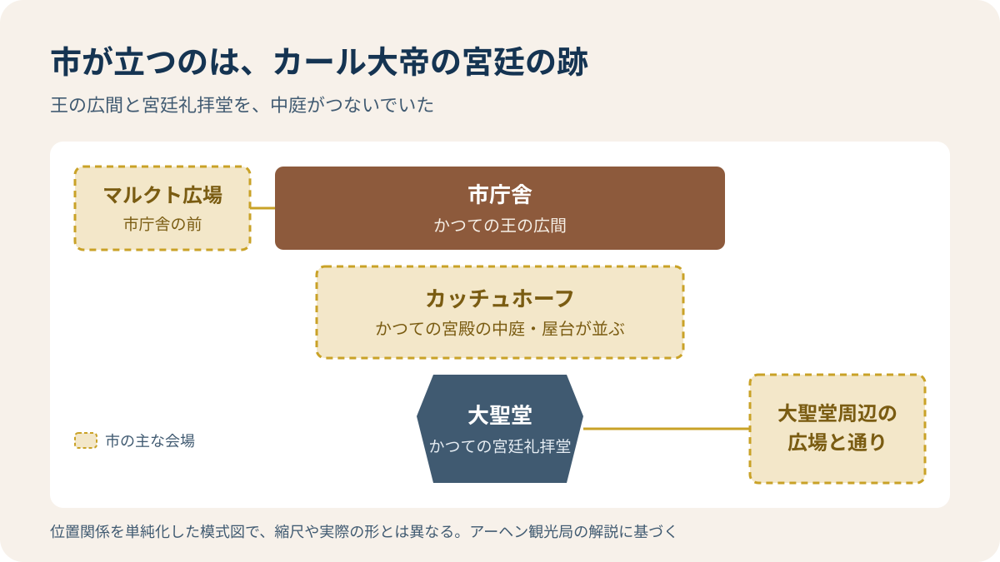
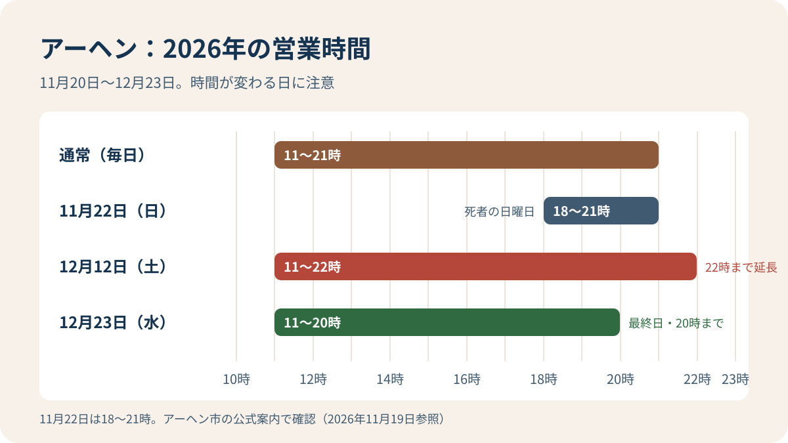

# アーヘン・クリスマスマーケット2026｜カール大帝の都で、プリンテンの香りに包まれる

ドイツ最西端の街アーヘンでは、2026年11月20日から12月23日まで、大聖堂と市庁舎のまわりにクリスマスマーケットが開かれます。NRW州に住む人の日帰りの行き先として、またオランダやベルギーとの国境に近い街の冬を知りたい人に向けて、この市が立つ場所の歴史と、名物の焼き菓子プリンテンの楽しみ方を紹介します。2026年の営業時間、特別日、車で行く場合のP+Rも確認しました。

## 1200年前の宮廷の中庭に、屋台が並ぶ

アーヘンの市の中心は、市庁舎前のマルクト広場と、その裏手にあるカッチュホーフという広場です。カッチュホーフは、かつてカール大帝の宮殿の中庭だった場所で、王の広間（現在の市庁舎）と宮廷礼拝堂（現在の大聖堂）を結んでいました。[アーヘン観光局の解説](https://www.aachen-tourismus.de/aachen-entdecken/sehenswuerdigkeiten/details/katschhof/)

8世紀から9世紀にかけてヨーロッパの広い範囲を治めたカール大帝は、晩年をこの街で過ごし、大聖堂に眠っています。大聖堂は1978年、ドイツで最初にユネスコの世界遺産に登録された建物の一つです。つまり、屋台の間を歩いて市庁舎から大聖堂へ抜ける道は、中世の皇帝が行き来した宮廷の空間をそのままなぞることになります。

昼間に大聖堂の八角形の礼拝堂を見学してから、夕方に灯りのともった市へ出ると、同じ広場の表情が大きく変わるのが分かります。歴史の重い建物と、温かい飲み物を手にした人のにぎわいが同じ場所にあることが、アーヘンの市の個性です。

## プリンテンの市から始まった

アーヘン観光局によると、このクリスマスマーケットの始まりは1970年代、温泉の噴水エリーゼンブルンネンの周りに立った「プリンテン市」でした。その後、マルクト広場やカッチュホーフ、大聖堂前の広場へと広がり、2026年は53回目の開催になります。現在は120を超える店や職人、飲食店が参加し、毎年100万人ほどが訪れるとされています。[アーヘン観光局](https://www.aachen-tourismus.de/aachen-entdecken/details/event/aachener-weihnachtsmarkt/)

プリンテンは、アーヘンを代表する硬めの焼き菓子です。スパイスの香りと素朴な甘みがあり、チョコレートでコーティングしたものや、ナッツを散らしたものなど種類も豊富です。「アーヘンのプリンテン」はEUの地理的表示保護を受けており、その名前で売られるのはアーヘンとその周辺で作られたものに限られます。

日本のお菓子でいえば、柔らかなクッキーより、少し噛みごたえのある固焼きの菓子に近い食感です。市の屋台で少量を試し、気に入った種類を街の老舗菓子店で買い足すと、食べ比べも楽しめます。日持ちするので、日本への手土産や、クリスマスまでの数週間に少しずつ食べるおやつにも向いています。

## 国境の街らしいにぎわい

アーヘンはオランダ、ベルギーとの国境まで車で数分の場所にあります。市にはドイツ国内だけでなく、オランダ、ベルギー、フランス、イギリスなどからも人が訪れます。屋台の前でドイツ語、オランダ語、フランス語が混ざって聞こえるのも、この街ならではの光景です。

週末は特に混み合うため、ゆっくり屋台を見たい人は平日の昼過ぎ、灯りを楽しみたい人は暗くなり始める夕方が向いています。12月は16時半ごろには暗くなるので、平日でも早い時間から灯りの中を歩けます。

## 2026年の開催情報

| 項目 | 内容 |
| --- | --- |
| 期間 | 2026年11月20日（金）〜12月23日（水） |
| 通常の時間 | 毎日11〜21時 |
| 11月22日（日） | 死者の日曜日のため18〜21時 |
| 12月12日（土） | 11〜22時に延長 |
| 12月23日（水） | 最終日。11〜20時 |
| 場所 | 市庁舎前のマルクト広場、カッチュホーフ、大聖堂周辺の広場と通り |
| 入場料 | 無料 |
| 会場の案内 | アーヘン観光局はバリアフリー・ベビーカー対応と案内 |

営業時間は[アーヘン市の公式案内](https://www.aachen.de/kalender/2026/q4/weihnachten/2026-11-20-aachener-weihnachtsmarkt/)で再確認しました。11月22日は18〜21時、12月12日は11〜22時、最終日は11〜20時です。アーヘン観光局は入場無料で、会場をバリアフリー・ベビーカー対応と案内しています。週末は混み合うため、ベビーカー利用時は移動時間に余裕を持ち、現地の誘導表示に従ってください。

車で行く場合は、旧市街の駐車場を探すより市のP+R（郊外駐車場とバスの組み合わせ）を使う方法があります。アーヘン市は合計1,700台超の駐車スペースを案内し、対象駐車場から中心部まで、最大5人が往復できるP+Rチケットを5ユーロで販売しています。チケットはバスの運転手から購入でき、ティヴォリ駐車場では入口で取った駐車券がバス乗車券になります。ただし、ティヴォリはアレマニア・アーヘンのホーム試合日には閉鎖されるため、利用前に[市のP+R案内](https://www.aachen.de/kalender/2026/q4/weihnachten/2026-11-20-aachener-weihnachtsmarkt/)を確認してください。

中央駅から市の中心までは徒歩15分ほどです。ケルンやデュッセルドルフからは地域列車で直通でき、日帰りで訪れやすい距離です。街歩きと合わせて計画したい人は[アーヘン日帰り旅行ガイド](/germany/ja/living/aachen-day-trip/)も参考にしてください。

## 誰に向いている？

- 歴史のある建物と一緒にクリスマスマーケットを楽しみたい人
- 名物の菓子を食べ比べたり、日持ちする手土産を探したりしたい人
- ケルンやデュッセルドルフとは違う、国境の街の冬を体験したい人

同じ季節のケルンの市は、大聖堂の下で広場ごとに違うテーマを持つのが特徴です。[ケルンのクリスマスマーケット2026](/germany/ja/events/cologne-christmas-markets-2026-guide/)と比べると、それぞれの街の個性がよく見えてきます。

## 皇帝の広場で、甘い香りの冬を

アーヘンの市の魅力は、規模の大きさよりも、場所そのものが持つ時間の厚みにあります。カール大帝の時代から続く広場で、50年ほど前にプリンテンの市から始まった冬の習慣を味わう。歴史と日常が自然に重なるその感覚が、この街のクリスマスを特別なものにしています。

**確認日：2026年11月21日。** 営業時間とP+Rの条件はアーヘン市の公式案内、入場・アクセシビリティ情報はアーヘン観光局の案内で確認しました。
