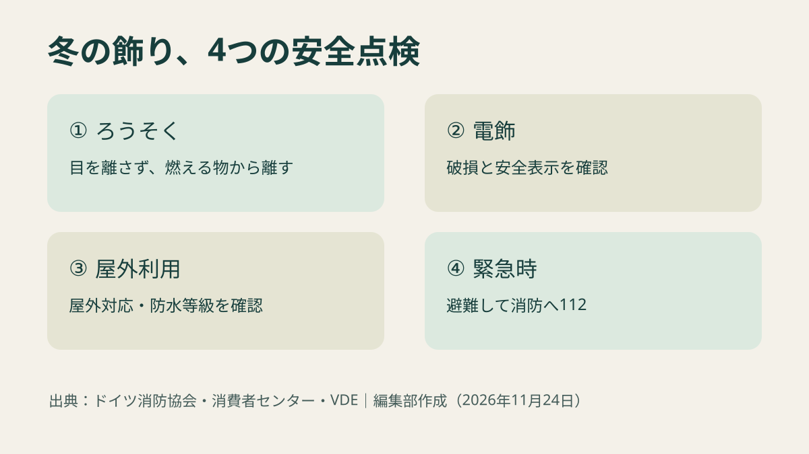
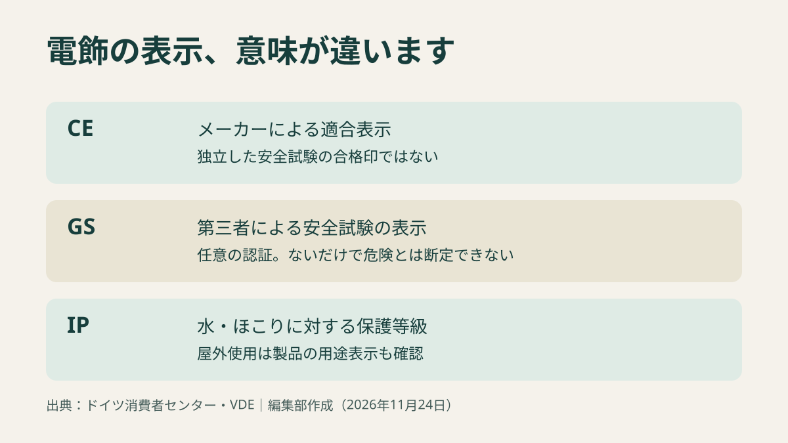

# ドイツのクリスマス電飾・ろうそく安全ガイド｜GS・CE・IP表示と火災予防

ドイツのクリスマスシーズンには、室内のアドベントリースからベランダのイルミネーションまで、さまざまな飾りを使います。ところが、電飾の安全表示や屋外使用の条件を誤解すると、火災や感電の危険があります。ドイツ消防協会、消費者センター、電気技術協会の一次情報をもとに、購入前と設置後に確認すべき点を整理しました。

## まず結論：安全のための4項目

**本物の火を使うなら、絶対に目を離さないこと。** 特に乾いたモミの枝やカーテン、包装紙の近くでろうそくを使わないでください。電飾はLEDを優先し、屋外では屋外対応の製品を選びます。ドイツで火災が起きた場合、避難して消防に通報する番号は**112**です。

| 使うもの | 最初に確認すること | 避けたい使い方 |
| --- | --- | --- |
| 本物のろうそく | 不燃性の安定した台、燃えやすい物との距離 | 無人の部屋や子ども・ペットだけの部屋で点火 |
| 室内のLED電飾 | 破損の有無、製品の安全表示、電源容量 | 傷んだコードや過負荷のコンセント |
| ベランダ・庭の電飾 | 屋外対応の用途表示、防水・防じん等級 | 室内専用品の屋外使用 |
| クリスマスツリー | 乾燥状態、安定した台、周囲の可燃物 | 乾いた枝の近くで裸火を使うこと |

## GS・CE・IP表示の違いを知る

ドイツの店頭や通販で見かけるマークは、すべて同じ意味ではありません。

- **CE表示：** 製造者が適用されるEUの要求事項への適合を示すものです。独立機関による安全試験の合格証とは限りません。
- **GS表示：** ドイツ語で「安全性試験済み」を意味する任意の第三者認証です。信頼性を判断する一つの材料になりますが、表示がない製品を自動的に危険と断定することもできません。
- **IP表示：** 水やほこりに対する保護の程度を表す等級です。屋外で使う際は、数値だけでなくメーカーが認める使用環境も確認します。

VDEは屋外用の電飾に少なくともIP44（防まつ形）の保護等級が必要だと説明しています。ただし、**「IP44ならどんな屋外環境でも安全」という意味ではありません。** 雨へのさらされ方、接続部、電源アダプターを含め、製品説明書の条件に従ってください。

## 買う前・飾る前のチェックリスト

1. **用途を決める。** 室内用か、屋外の雨に当たる場所かを先に決め、適合する製品を選びます。
2. **販売情報を読む。** 製造者、使用説明、警告、定格電圧・消費電力を確認します。CEだけで安全性を判断せず、GSやVDEなど独立試験の表示も参考にします。
3. **ケーブルを点検する。** 被覆が破れている、接続部が緩い、変色している電飾は使用しません。
4. **電源の容量を確認する。** 延長コードや電源タップに負荷を集中させないようにします。複数製品をつなぐ場合は説明書の上限を守ります。
5. **設置場所を確認する。** 乾いた枝、紙、カーテン、暖房器具の近くを避けます。
6. **外出・就寝前に消灯する。** VDEは電飾を無人の状態で電源につないだままにしないよう注意を促しています。

## ろうそくと子ども・ペットのいる家庭

アドベントリースの枝は日がたつほど乾燥し、燃えやすくなります。ろうそくを使う場合は、不燃性の台に固定し、周囲の飾りや家具から十分離してください。子どもやペットの手が届く位置には置かず、点火中は大人がその場を離れないことが重要です。

ドイツ消防協会は、本物の火を使う家庭に適切な消火手段を準備するよう勧めています。一方、ミュンスター市消防局は、クリスマスツリーでは**本物のろうそくを避け、電気式の電飾を使う**よう推奨しています。安全性を優先するならLED式のキャンドルが実用的です。

## もし火が出たら：消火より避難を優先

火が出た場合、**自分の安全を確保できる範囲でしか消火を試みない**でください。危険を感じたら部屋を離れ、可能であれば火元の部屋の扉を閉め、同居人と避難し、**112**に通報します。ドイツ消防協会の案内は、無理な初期消火より避難と通報を優先しています。

通報時は「どこで火災が起きたか」「何が燃えているか」「けが人や避難できない人がいるか」を落ち着いて伝え、指令員の質問に答えてください。

## よくある勘違い

**CEマークがあれば第三者が安全を認証した？** いいえ。CEは独立した安全試験の証明ではありません。第三者の試験表示であるGSなどとは意味が異なります。

**LEDなら火災は絶対に起きない？** いいえ。LEDは従来の電球より発熱と消費電力を抑えやすいものの、破損したコードや過負荷の電源は別の危険を生みます。

**室内用の電飾を短時間だけベランダに出してよい？** 屋外使用が認められていない製品は、短時間でも雨や湿気への耐性が保証されません。用途表示を優先してください。

## クリスマスの文化的背景も知りたい人へ

飾りの文化的背景については、[クリスマスツリーの起源](/germany/ja/events/columns/christmas-tree-origin-germany/)と[アドベントリースとカレンダーの歴史](/germany/ja/events/columns/advent-wreath-calendar-origin/)で解説しています。年末に屋外で花火を見る予定なら、[ドイツの大晦日の花火ルール](/germany/ja/events/columns/germany-silvester-fireworks-rules/)もあわせて確認してください。

## 公式情報・参考ソース

- [ドイツ消防協会：安全なクリスマスのための10項目](https://www.feuerwehrverband.de/zehn-tipps-des-deutschen-feuerwehrverbandes-fuer-ein-sicheres-weihnachtsfest/)（2025年12月17日発表、**2026年11月25日確認**）
- [ドイツ消費者センター：LED電飾と安全表示](https://www.verbraucherzentrale.de/wissen/energie/strom-sparen/energiesparende-lichterketten-leds-sind-die-beste-wahl-10902)（2026年10月29日更新、**2026年11月25日確認**）
- [VDE：クリスマス照明の安全性](https://www.vde.com/topics-de/verbraucherschutz/weihnachtsbeleuchtung)（**2026年11月25日確認**）
- [ミュンスター市消防局：クリスマスの防火対策](https://www.stadt-muenster.de/feuerwehr/berufsfeuerwehr/vorbeugender-brandschutz/tipps-fuer-ein-sicheres-weihnachtsfest)（**2026年11月25日確認**）

*この記事は一般的な防火・製品選択情報です。個々の製品の使用条件はメーカーの説明書に従ってください。*
