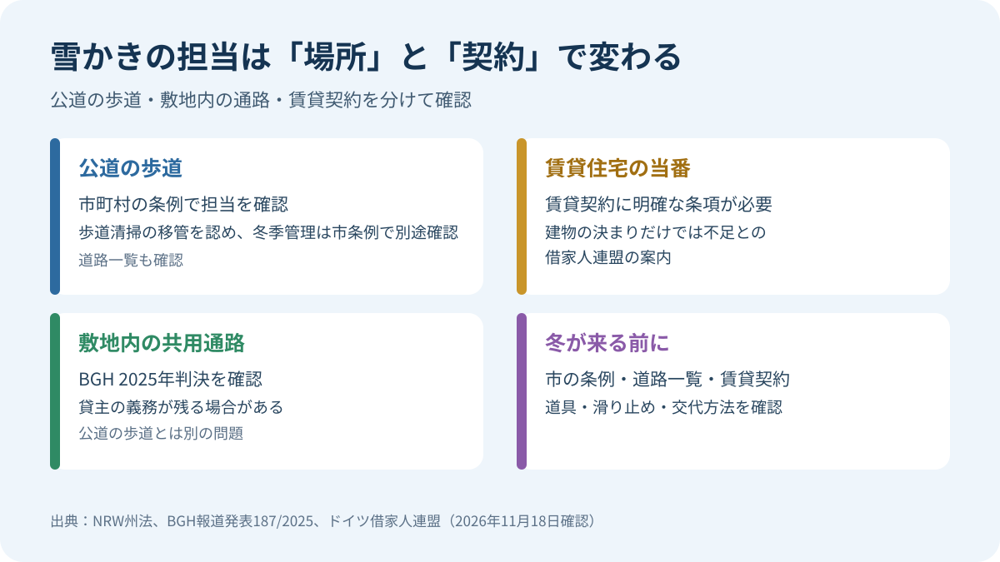
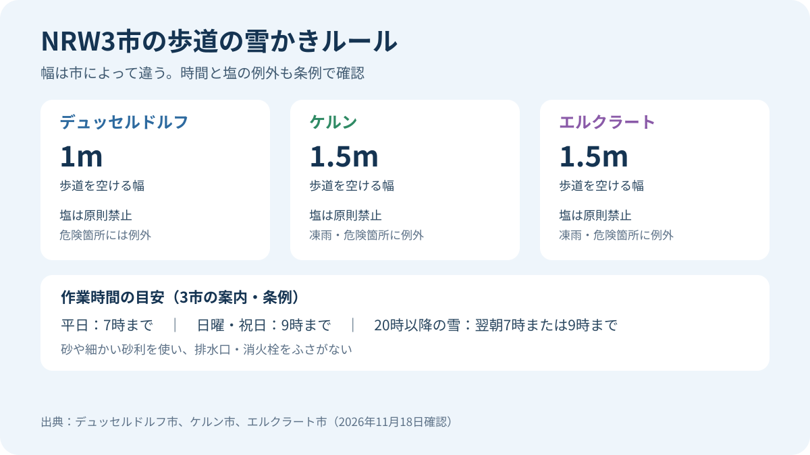

# 雪の朝、家の前の歩道は誰が掃除する？｜ドイツの「雪かき・凍結対策の義務」と時間のルール

雪が降った朝、ドイツの住宅街では、家の前の歩道を誰が片付けるのかが問題になります。ただし、雪かきの担当・幅・時間は全国共通ではありません。この記事では、NRW州のデュッセルドルフ、ケルン、エルクラートの現行ルールを比べ、賃貸契約と2025年の連邦通常裁判所判決を踏まえて、借りている人が確認する順番を説明します。

## まず結論：歩道・敷地内の通路・車道を分けて考える

「家の前」といっても、公道の歩道、建物の敷地内にある共用通路、車道では責任の根拠が違います。まず、どの場所の雪かきを指しているのかを分けてください。

| 場所 | まず確認するもの | 基本的な考え方 |
| --- | --- | --- |
| 公道の歩道 | 市町村の道路清掃条例 | NRW州法は市町村が条例で歩道清掃を隣接土地所有者に移すことを認め、冬季管理は別途規定できる仕組みです。雪かきの具体的な義務は各市の条例で確認します。 |
| 建物敷地内の共用通路・玄関までの通路 | 賃貸契約、管理会社の案内、清掃業者との契約 | 貸主の契約上の安全管理義務が問題になることがあります。公道の歩道と同じルールだと決めつけないでください。 |
| 車道（公道） | 市の冬季サービス計画、道路一覧 | 市が除雪する道路と、隣接土地所有者（Anlieger）が担当する道路があります。歩道の義務とは別に確認します。 |
| 借りている人の当番 | 賃貸契約の明確な条項 | 借主が実際に雪かきをするのは、契約で担当が明確に割り当てられている場合です。 |

## NRWでは市町村の条例が具体的なルールを決める

NRW州の道路清掃法第1条第2項は冬季管理を道路清掃の一部として定義し、第4条は市町村が歩道清掃を隣接土地所有者に移すことを認めています。一方、冬季管理は別途規定できる仕組みです。そのため、第4条だけを読んで雪かきの担当を決めず、実際に住む市の条例で、歩道・車道・時間・滑り止めを確認してください。これはNRW州の制度であり、ドイツ全土に同じ数値が適用されるわけではありません。

エルクラート市の2026年1月版条例では、歩道の清掃義務は原則として隣接土地の所有者に割り当てられています。車道の冬季サービスはすべての道路で市が行うわけではありません。条例の別表にある「Winterdienst durch」の欄で「Stadt（市）」か「Anlieger（隣接土地所有者）」かを確認してください。なお、この道路一覧は車道の担当を確認する資料で、歩道の義務は条例本文の規定もあわせて読む必要があります。

## デュッセルドルフ・ケルン・エルクラートの歩道ルール

次の表は、2026年11月18日に各市の公式案内・条例で確認した例です。別の市に住んでいる場合は、必ずその市の条例を確認してください。

| 市 | 歩道を空ける幅 | 作業時間の目安 | 塩・滑り止め |
| --- | --- | --- | --- |
| デュッセルドルフ | 少なくとも1メートル | 平日は7時〜20時、日曜・祝日は9時〜20時。20時以降の雪は翌朝7時または9時までに対応 | 塩は原則禁止。住民は砂や砂利を使い、市の委託業者に認められた危険箇所の例外を一般の住民向け許可と誤解しないでください。 |
| ケルン | 少なくとも1.5メートル | 平日は7時まで、日曜・祝日は9時までに対応。20時以降の雪は翌朝に対応 | 塩は原則禁止。凍雨や特に危険な場所などに例外があります。 |
| エルクラート | 少なくとも1.5メートル | 平日は7時〜20時、日曜・祝日は9時〜20時。20時以降の雪は翌朝7時または9時までに対応 | 塩は原則禁止。凍雨や危険な場所などの例外を除き、砂や細かい砂利を使います。 |

デュッセルドルフ市の車道除雪も、すべての住宅街で同じように行われるわけではありません。市は交通量の多い道路や危険な箇所を優先し、時速30キロ制限の住宅街は、積雪が25センチを超える場合などを除き、通常は市の除雪対象にならないと案内しています。

エルクラートでは、歩道の幅だけでなく、排水口や消火栓を雪でふさがないことも重要です。雪を車道に押し出したり、緑地に塩をまいたりしないでください。市の道路一覧で車道の担当が「Stadt」となっていても、歩道の担当まで自動的に市へ移るとは限りません。

## 借りている人は雪かきをする？賃貸契約で確認する

ドイツ借家人連盟の2026年1月7日の案内では、借りている人が雪かき当番を負うのは、賃貸契約でその義務が明確に割り当てられている場合とされています。建物の決まり（Hausordnung）に書いてあるだけでは足りないという見解で、「1階に住んでいる人が担当する」という全国共通の決まりもありません。

契約に当番が明記されている場合は、次の点も確認しましょう。

- **道具と滑り止めの材料**：スコップ、砂、細かい砂利を誰が用意するか。
- **当番表**：平日と日曜・祝日で時間が異なるため、担当日と交代方法を確認する。
- **不在・病気のとき**：当番を負う契約になっているなら、旅行や病気のときの代わりを管理会社と事前に調整する。
- **業者の費用**：清掃業者の費用を共益費に含められるかは、賃貸契約と費用項目を確認する。

契約の記載が曖昧なら、雪が降る前に家主や管理会社へ書面で確認してください。公道の歩道について市の条例が所有者に義務を課していても、それだけで借主に当番が移るわけではありません。

## 2025年の連邦通常裁判所判決：敷地内の共用通路は別に考える

連邦通常裁判所は2025年8月6日、事件番号VIII ZR 250/23で、集合住宅の敷地内にある共用通路の冬季管理をめぐる判断を示しました。報道発表は2025年10月15日付の第187/2025号です。

この事件では、借主に冬季管理の義務を明確に移す合意がない状況で、建物の共用通路の除雪を請け負った業者が作業を怠った場合に、貸主の責任が問題となりました。裁判所は、貸主が業者を使ったことだけで契約上の責任を免れるとは限らず、業者の過失が貸主に帰属する場合があると判断し、事件を下級審に差し戻しました。

この判決は、**建物敷地内の共用通路**に関する個別事件です。公道の歩道を誰が除雪するかという市町村条例の問題と混同しないでください。また、法律の改正ではなく、賃貸契約上の義務についての裁判所の判断です。損害賠償額まで最終確定した判決として読むこともできません。

## 雪が降り続く日は、いつ片付ける？

エルクラート市の条例は、雪がやんだ後、遅れずに歩道を片付けるよう定めています。ドイツ借家人連盟も、雪が降り続いていて除雪してもすぐに積もる状況では、何度も無意味な作業を繰り返す必要はないと説明しています。ただし、凍結が生じた場合や危険な箇所がある場合は、自治体の規則に従って対応してください。

多くの自治体では、夜20時を過ぎて降った雪は翌朝に対応する扱いです。平日は7時、日曜・祝日は9時が目安ですが、時間は市によって異なります。雪を車道や排水口の上に押し出さず、歩行できる幅を確保してください。

## 塩ではなく砂や細かい砂利を使う

ケルンとエルクラートでは、歩道への塩の使用は原則禁止で、凍雨や特に危険な場所に例外があります。デュッセルドルフ市も住民による塩の使用を原則禁止としており、市の委託業者に認められた指定危険箇所の例外を、住民が自由に使える許可と解釈しないでください。日常的な滑り止めには砂や細かい砂利（Streugut、Splitt）を使います。

エルクラートの条例では、排水口や消火栓を雪でふさがないこと、緑地に塩をまかないことも確認できます。塩の例外や使える材料は自治体ごとに異なるため、近所の人のやり方だけで判断しないでください。

## 冬の前に確認するチェックリスト

1. **自治体の条例を確認する**：エルクラートでは2026年1月版の条例と道路一覧を確認します。別の市では、その市の道路清掃・冬季管理の案内を探してください。
2. **賃貸契約書を確認する**：「Winterdienst」「Schneeräumen」などの条項があり、借主に義務が明確に割り当てられているかを確認します。
3. **道具と当番表を確認する**：スコップ、砂・砂利、担当時間、交代方法、管理会社の連絡先を確認します。
4. **不在時の代わりを決める**：契約上の当番がある場合は、旅行や病気のときに誰へ連絡するかを事前に決めます。
5. **自分の移動手段も冬仕様にする**：車の冬タイヤについては「[ドイツの冬タイヤ義務とオールシーズンタイヤ](/germany/ja/living/winter-tires-germany-2026/)」、室内の結露・カビ対策は「[ドイツの暖房・換気・カビ対策](/germany/ja/living/germany-heating-ventilation-mold-guide/)」も確認してください。

## 確認日と注意

NRW州法、デュッセルドルフ市・ケルン市の案内、エルクラート市の2026年1月版条例、連邦通常裁判所の2025年判決、ドイツ借家人連盟の案内を2026年11月18日に確認しました。雪かきの担当や時間は自治体・道路・賃貸契約によって異なります。この記事は一般情報であり、個別の賃貸紛争や損害賠償の法律相談ではありません。
