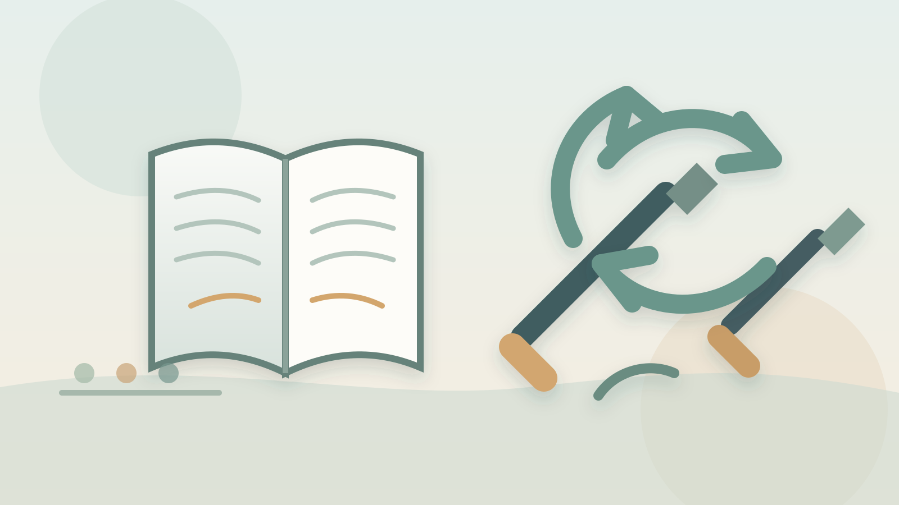
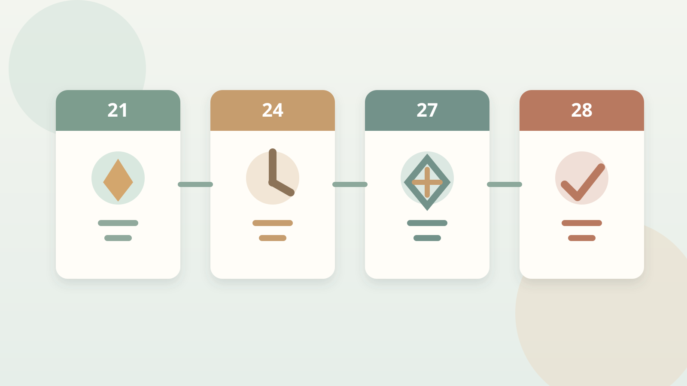

# デュッセルドルフの欧州ごみ削減週間2026｜無料イベント・Repair Café・図書館展示

デュッセルドルフでは2026年11月19日から30日まで、市内独自のプログラムとして欧州ごみ削減週間に合わせた催しが続きます。国際キャンペーンの期間である11月21〜29日より3日長く、Südparkの体験ブース、プラスチック削減の講演、リサイクルクイズ、Repair Café、図書館展示が予定されています。この記事では、これから参加できる日程と会場、無料・予約不要などの条件を整理します。

## 2026年の開催期間：市内プログラムは11月19〜30日

欧州ごみ削減週間の2026年のテーマは「資源を大切にし、意識して選ぶ」です。AWISTAの案内ではキャンペーン期間は11月21日（土）から29日（日）までですが、デュッセルドルフ市のプログラムは11月19日（木）から30日（月）までで、国内の通常期間より3日長く設定されています。

市の発表には、すでに終了した11月19日の料理イベントとPFAS講演も含まれています。以下では、11月21日以降に参加できる催しと、期間中に見られる展示に絞りました。

## これから参加できる催し

| 日付・時間 | 内容 | 会場 | 参加条件 |
| --- | --- | --- | --- |
| 11月21日（土）12〜16時 | 持続可能な買い物を考える体験ブース、クイズ、短いアンケート | Südpark内のVHS-Biogarten | 費用・予約条件は市の案内に記載なし |
| 11月24日（火）14時30分〜16時 | 日常生活でプラスチックを減らす方法の講演 | zentrum plus、Flurstraße 57c | 費用・予約条件は市の案内に記載なし |
| 11月27日（金）14〜17時 | スマートフォンなどの資源量を考えるリサイクルクイズ | AWO Adventsmarkt、Siegstraße 2 | 費用・予約条件は市の案内に記載なし |
| 11月28日（土）13〜17時 | Repair Café GarageLab | KAP1中央図書館 | 無料、予約不要 |
| 11月28日（土）15〜16時30分 | 資源保護・修理についての短い講演 | KAP1中央図書館内のRepair Café | 無料、予約不要 |

## 11月21日：Südparkで持続可能な買い物を考える

11月21日は、SüdparkのVHS-Biogartenで、持続可能な消費を分かりやすく示す「持続可能性のピラミッド」が紹介されます。クイズや短いアンケートも予定されており、買い物のときに何を選ぶと資源を守れるのかを考える機会です。

開催時間は12〜16時です。市の案内には個別の参加費や予約条件、会場の詳しい入口までは記載されていないため、出発前に公式案内を確認してください。

## 11月24日：日常生活でプラスチックを減らす講演

11月24日14時30分から16時までは、zentrum plus（地域交流施設）で「日常生活でプラスチックを減らすには」をテーマにした講演が行われます。プラスチックを完全になくせるかという問いから、普段の買い物や生活で使う量を見直す方法を考える内容です。

会場はFlurstraße 57cです。市の発表では、参加費や事前予約の要否が明記されていません。参加を予定している場合は、開催直前に市の案内で変更がないか確認してください。

## 11月27日：AWOのアドベントマーケットでリサイクルクイズ

11月27日14〜17時には、AWOのアドベントマーケットでリサイクルクイズが行われます。スマートフォンにどれだけの資源が使われているか、製品の環境負荷をどう考えるかといったテーマが取り上げられます。

会場はSiegstraße 2です。市の案内には参加費・予約条件の記載がないため、買い物やマーケットへの訪問と合わせて参加する場合は、当日の開催状況を確認してください。

## 11月28日：KAP1のRepair Café GarageLab

壊れた日用品をすぐに捨てず、修理して使い続けることに関心がある人には、11月28日のRepair Caféが向いています。開催時間は13〜17時、会場はKAP1中央図書館内のGarageLabです。AWISTAと欧州キャンペーンの案内では、入場無料・予約不要とされています。

15〜16時30分には、AWISTAのごみ相談員と消費者相談センターの担当者による、資源保護と共同修理についての短い講演もあります。

ただし、公式案内には持ち込める物の種類、修理受付の締切、部品代、当日の受付人数が記載されていません。大きな家具や特殊な機器を持参する場合は、事前にGarageLabへ確認してください。無料・予約不要という案内だけで、すべての物をその場で修理してもらえるとは限りません。

## 図書館展示：Bilkは30日まで、KAP1は29日まで

イベント当日に参加できなくても、図書館の展示は期間中に立ち寄りやすい催しです。

- **Bilk地区図書館：** 市の2026年11月12日付発表は11月20〜30日、AWISTAの2026年11月16日付案内は11月23〜30日としています。AWISTAが資源保護をテーマにした窓展示を行い、図書館が関連書籍のコーナーを設けます。住所はFriedrichstraße 127, 40217 Düsseldorfです。開始日の案内に差があるため、11月20〜22日に訪れる場合は図書館または主催者へ確認してください。
- **KAP1中央図書館：** 11月20〜29日。Reduce（減らす）、Reuse（繰り返し使う）、Recycle（再資源化）をテーマにした書籍展示があります。住所はKonrad-Adenauer-Platz 1, 40210 Düsseldorfです。

展示の個別開催時刻は公表されていません。訪問前に[デュッセルドルフ市立図書館の案内](https://www.duesseldorf.de/stadtbuechereien)で開館時間を確認してください。

## ごみ削減週間がデュッセルドルフの地域の暮らしに結び付く理由

今回の催しは、単にごみを分別する方法を学ぶだけではありません。買い物の前に必要な物を考えること、使える物を修理すること、資源を再利用することなど、日々の選択を通じて廃棄物を減らす取り組みです。

デュッセルドルフ市は、資源を循環させ、ごみそのものをできるだけ発生させない「ゼロ・ウェイスト」の方針を進めています。市の発表では、市内に14のRepair Caféがあると案内されており、今回のKAP1の催しも、地域で物を長く使う活動の一つです。ほかの修理会場を探すときは、[市のRepair Café・資源保護の案内](https://www.duesseldorf.de/umweltamt/umwelt-und-verbraucherthemen-von-a-z/abfall/initiativen)や[Düsseldorf Maps](https://maps.duesseldorf.de/)で「Repair-Café」と検索できます。

## 参加前に確認したいこと

1. **当日の変更：** 市や主催者の最新案内で、開催時間・会場・中止情報を確認する。
2. **予約と費用：** 無料・予約不要と明記されているのは11月28日のRepair Café。ほかの催しは個別案内で確認する。
3. **修理したい物：** Repair Caféに持参する前に、対象品目・大きさ・部品の扱いを主催者へ確認する。
4. **図書館の開館時間：** 展示の開始・終了日は分かっていても、個別の開催時刻は公表されていない。
5. **過去の催し：** 11月19日の料理イベントとPFAS講演は終了済み。これから参加できる日程と混同しない。

## 関連する生活ガイド

- [ドイツのごみ分別｜デュッセルドルフの容器・品目別の捨て方](/germany/ja/living/germany-waste-sorting-guide/)
- [ドイツのPfand返却方法｜容器の返金とスーパーでの手順](/germany/ja/living/germany-pfand-return-guide/)

## 公式情報・参考ソース

- [デュッセルドルフ市：欧州ごみ削減週間の市内プログラム（2026年11月12日）](https://www2.duesseldorf.de/medienportal/pressedienst-einzelansicht/pld/europaeische-woche-der-abfallvermeidung-vom-19-bis-zum-30-november)（2026年11月21日確認）
- [AWISTA Kommunal：欧州ごみ削減週間のイベント案内（2026年11月16日）](https://www.awista-kommunal.de/aktuelles/europaeische-woche-der-abfallvermeidung-aktionen-der-abfallberatung)（2026年11月21日確認）
- [AWISTA Kommunal：2026年キャンペーン案内](https://www.awista-kommunal.de/ewav2026)（2026年11月21日確認）
- [欧州ごみ削減週間：KAP1のRepair Caféと講演](https://wochederabfallvermeidung.de/aktion/impulsvortrag-im-repair-cafe-garagelab-im-kap-1/)（2026年11月21日確認）
- [デュッセルドルフ市：Repair Caféと資源保護の地域活動](https://www.duesseldorf.de/umweltamt/umwelt-und-verbraucherthemen-von-a-z/abfall/initiativen)（2026年11月21日確認）
- [デュッセルドルフ市：市立図書館](https://www.duesseldorf.de/stadtbuechereien)（2026年11月21日確認）

確認日：2026年11月21日。市の発表とAWISTAの案内で、開催期間・日時・会場・参加条件を照合しました。費用や予約条件が明記されていない催しは、確定情報として扱っていません。
