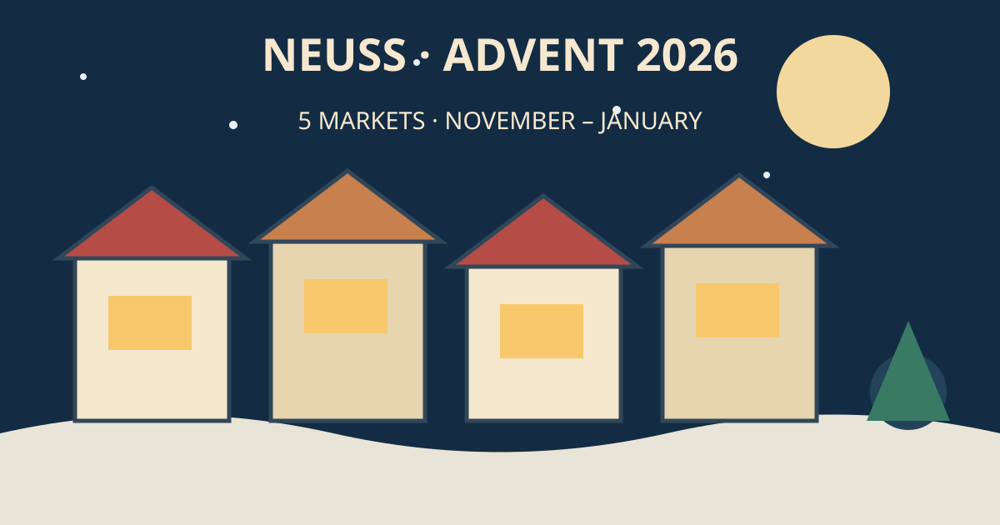
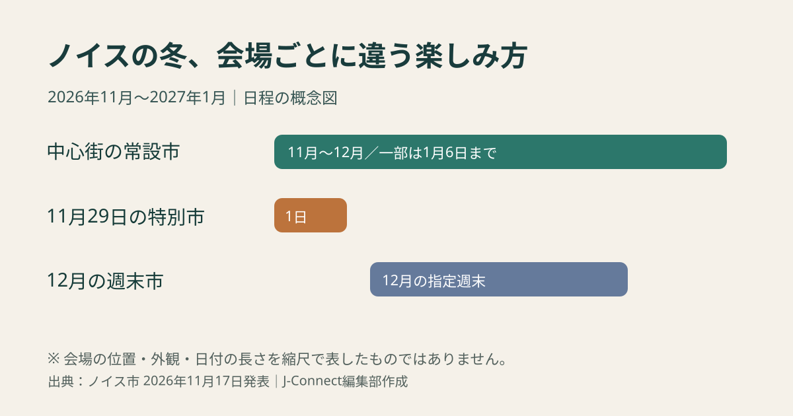

# ノイスのクリスマスマーケット2026｜5会場の日程・営業時間と11月29日の催し

デュッセルドルフの隣町ノイスでは、2026年11月から年明けまで、開催日も雰囲気も異なる複数のクリスマスマーケットが開かれます。毎日開く中心街の市、11月29日だけの催し、週末限定の会場を混同しないよう、ノイス市が11月17日に発表した5会場の日時を比較しました。日本語で訪問日を決めたい人向けに、終了日、日曜の営業時間、子ども連れでの確認事項を整理します。

## まず結論：11月29日だけの催しと年明けまでの会場を区別

**11月29日（日）に行くなら**、中心街のフライトホーフで11〜18時30分に開く「クィリヌス・アドベント市」が候補です。同日は一部店舗の特別日曜営業が13〜18時に予定されています。これに対して、長い期間楽しめるのはミュンスター広場の通常の市（12月23日まで）とアム・コンヴェントのアドベント市（2027年1月6日まで）です。

| 会場・催し | 2026年の開催日 | 営業時間・注意点 |
| --- | --- | --- |
| ミュンスター広場のクリスマスマーケット | 11月18日〜12月23日 | 月〜木11〜20時、金・土11〜21時、日12〜20時30分。11月22日は休業 |
| アム・コンヴェントのアドベント市 | 11月14日〜2027年1月6日 | 月〜土11〜19時、日14〜19時 |
| クィリヌス・アドベント市（フライトホーフ） | **11月29日のみ** | 11〜18時30分。周辺の一部店舗は13〜18時に特別営業 |
| 北部のニコラウス市（ノイサー・ヴァイエ） | 12月3〜6日 | 木16〜21時、金13〜21時、土11〜21時、日11〜20時15分 |
| 競馬場公園の「レンバーン・ヴァイナハト」 | 12月5・6日、12・13日、19・20日 | 土11〜23時、日11〜20時 |

*出典：ノイス市の2026年11月17日付[公式一覧](https://www.neuss.de/news/2026/11/17/neusser-weihnachtsmaerkte-2026)。2026年11月23日確認。*

## どの会場を選ぶ？

### 11月23日〜28日に行く場合

この期間に確実に候補となるのは、通常のミュンスター広場の市とアム・コンヴェントです。11月22日の「死者の日曜日」はミュンスター広場が休業でしたが、**23日以降の通常営業と混同しない**でください。アム・コンヴェントは日曜だけ開始時刻が14時なので、昼前に行く計画には向きません。郡の公式観光案内では、こちらの会場に子ども向けの回転木馬があり、焼きアーモンドやライベクーヘンなどの飲食も紹介されています。

### 11月29日（日）に行く場合

フライトホーフの一日限定アドベント市を中心に、ミュンスター広場とアム・コンヴェントを組み合わせると、開催日の違いを楽しめます。ライン・ノイス郡の案内によると、フライトホーフでは子ども向けのフェイスペイント、フードトラック、舞台プログラムがあり、**16時にはクリスマスソングを一緒に歌う催し**が予定されています。ただし舞台の開始時刻や参加条件は変更される可能性があるため、[ノイス・マーケティングの催し一覧](https://www.neuss-marketing.de/veranstaltungskalender/)を出発直前に確認してください。

**日曜営業は全店舗の営業を意味しません。** 買い物を目的にする場合は、対象店舗の案内を別途確認しましょう。

### 12月の週末に行く場合

12月3〜6日は北部のニコラウス市、12月の3週末には競馬場公園の市も選択肢に入ります。北部のニコラウス市は聖ヨゼフ教会周辺で開催され、郡の案内では初日に馬車に乗った聖ニコラウスの登場、日曜日16時の子どもたちによる降誕劇が紹介されています。**ただし北部の市の金・土曜の開始時刻について、市と郡の案内に差があるため、出発前に主催者の最新案内を確認してください。** 特に競馬場公園は土曜23時までと、今回の市公式一覧では最も遅い終了時刻です。夜の帰路や子どもの就寝時間を考えて会場を選ぶとよいでしょう。

### クリスマス後に行く場合

ミュンスター広場は12月23日で終了します。一方、アム・コンヴェントは2027年1月6日までの案内です。**12月24日以降の祝日や年末年始も通常時刻どおりかどうかは、今回確認した市の一覧だけでは断定できません。** 年末の訪問は主催者の当日案内を確認してください。

## 地域の文化と冬のマーケットの意味

ノイスの冬の催しは、ひとつの大きな会場に集まるのではなく、歴史ある中心街の広場、北部の地域行事、競馬場公園の週末イベントなど、場所ごとに特色があります。クィリヌス教会のある中心街では、11月29日に一日限定のアドベント市と特別日曜営業が重なります。買い物だけでなく、地域の人々が冬に集まる場として、会場ごとの雰囲気の違いを楽しめます。

## ノイスならではの楽しみ方

デュッセルドルフ中心街の大規模なマーケットと違い、ノイスは複数の会場に開催期間が分散しているのが特徴です。特に11月29日は一日限定のフライトホーフと、普段から開く市を比較できる日です。近郊から短時間で訪ねたい人は、まず開催日を確かめ、現地の公共交通機関の経路検索で帰りの便を確認すると計画しやすくなります。

## 行く前のチェックリスト

1. **日付を確認する：** 11月29日だけの会場と12月限定の会場を取り違えない。
2. **曜日で営業時間を確認する：** ミュンスター広場は日曜の開始が12時、アム・コンヴェントは14時。
3. **特別営業を確認する：** 11月29日の店舗営業は一部店舗のみ。営業時間もマーケットとは別。
4. **年末年始は再確認する：** 祝日・天候・運営上の事情による変更がないか、公式案内を確認する。
5. **家族連れは設備を確認する：** トイレ、ベビーカーの動線、混雑状況は各会場で異なる。公式一覧には全会場の設備詳細がない。

## デュッセルドルフと比較するなら

デュッセルドルフ中心街のマーケットは11月19日〜12月30日の開催です。ノイスの会場は12月23日終了のものから翌年1月6日まで続くものまであり、年末に訪れる場合は日付によって選択肢が変わります。[デュッセルドルフのクリスマスマーケット案内](/germany/ja/events/christmas-markets-duesseldorf/)も参考にしてください。

## 入場料と子ども連れのポイント

ライン・ノイス郡の観光案内では、**ミュンスター広場、アム・コンヴェント、フライトホーフ、競馬場公園の各マーケットは入場無料**と案内されています。飲食や商品購入には別途費用がかかります。小さな子ども連れなら、アム・コンヴェントの回転木馬、11月29日のフライトホーフでのフェイスペイントなど、開催日が明記された催しを軸に選ぶとよいでしょう。会場設備や個別プログラムは変更される可能性があります。

## 公式情報・更新日

- [ノイス市：2026年のクリスマスマーケット5会場一覧](https://www.neuss.de/news/2026/11/17/neusser-weihnachtsmaerkte-2026)（2026年11月23日確認）
- [ノイス・マーケティング：イベントカレンダー](https://www.neuss-marketing.de/veranstaltungskalender/)（2026年11月23日確認）
- [ライン・ノイス郡：クリスマスマーケットと展示](https://www.rhein-kreis-neuss.de/de/freizeit-kultur/weihnachten-im-rhein-kreis-neuss/)（2026年11月23日確認。入場料、子ども向け催し、プログラムの情報を照合）

**情報確認日：2026年11月23日。次回確認予定：11月27日。** 期間中の変更や特別営業時間は、出発前に主催者の公式案内で確認してください。
