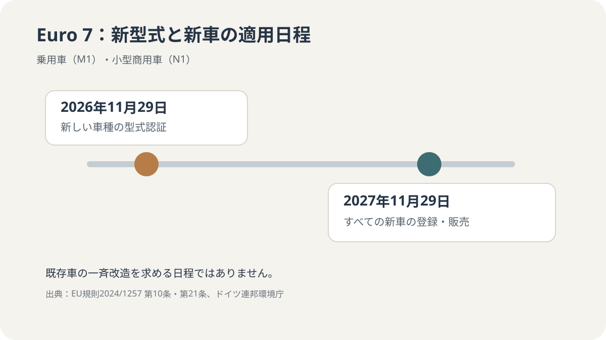
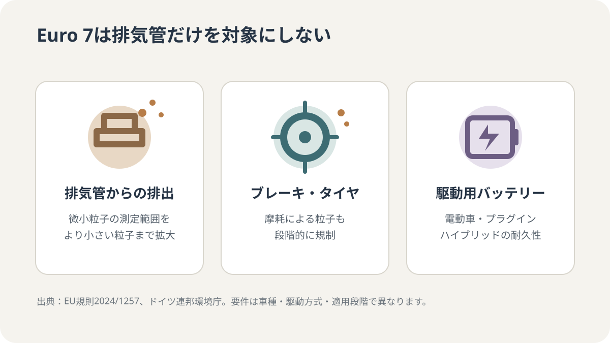

# Euro 7は2026年11月29日から新しい車種の型式認証に適用｜ドイツで車を買う人向け

EUの新しい車両排出基準Euro 7は、2026年11月29日から新しい乗用車・小型商用車の型式認証に適用されます。Euro 7に適合しないM1・N1新車の登録・販売・使用開始が原則として認められなくなるのは2027年11月29日からで、2026年11月29日に既存車が一斉に対象になるわけではありません。ドイツで新車や中古車を買う人に向けて、日程と実際の影響を整理します。

## まず押さえたい日程

| 日付 | 対象 | 何が変わるか |
| --- | --- | --- |
| 2026年11月29日 | 乗用車（M1）・小型商用車（N1）の新しい車種 | Euro 7に適合しない新しい車種は、排出・燃費・電力消費・バッテリー耐久性に関する型式認証を受けられなくなる |
| 2027年11月29日 | M1・N1の新車 | Euro 7に適合しない新車は、原則として新規登録・販売・使用開始ができなくなる |
| 2028年5月29日 | バス（M2/M3）・大型トラック（N2/N3）・トレーラー（O3/O4）の新しい車種 | 新しい車種の型式認証に適用 |
| 2029年5月29日 | 同区分の新車 | 新車の登録・販売・使用開始に適用 |

M1は一般的な乗用車、N1は最大質量3.5トン以下の小型商用車を指します。ドイツ連邦環境庁は2026年11月29日をM1・N1の新しい車両型式への適用日として案内しています。2027年の対象範囲は、同庁の概要ページがM1を明記する一方、拘束力のあるEU規則第10条第5項はM1・N1の両方を対象としています。本記事は法令本文の対象範囲を優先して記載しています。

## 「新しい車種」と「新車」は同じではない

2026年11月29日の最初の段階は、個々の車の登録日ではなく、新しい車種の型式認証に関するものです。型式認証とは、メーカーがその車種をEU域内で販売・登録できるよう、車両の技術要件への適合を確認する手続きです。

そのため、2026年11月29日以降にすべての販売店在庫が直ちにEuro 7になるわけではありません。すでに認証されている車種と、これから新たに認証を受ける車種では扱いが異なります。2027年11月29日からは、M1・N1の新車について、Euro 7に適合しない車両の新規登録・販売・使用開始が原則として認められなくなります。

## Euro 7で何が変わるのか

Euro 7は、排気管から出るガスだけを対象にする規則ではありません。EU規則とドイツ連邦環境庁の説明では、主に次の分野が対象になります。

- **排気管からの排出：** 微小粒子の測定範囲が、粒径23ナノメートルから10ナノメートルまで拡大されます。ドイツ連邦環境庁は、この粒子数の測定範囲拡大に対して、該当する限界値と適合係数はEuro 6eの水準に維持されると説明しています。したがって「排気ガスのすべての限界値が一律に大幅低下する」と理解するのは正確ではありません。
- **ブレーキとタイヤの摩耗：** ブレーキ摩耗粉とタイヤ摩耗による粒子について、非排気由来の排出基準が新たに設けられます。基準値は対象や時期に応じて段階的に適用されます。
- **電動車のバッテリー耐久性：** 電気自動車とプラグインハイブリッドの駆動用バッテリーについて、型式認証上の最低性能要件が定められます。

### 電気自動車のバッテリー要件

乗用車（M1）の電気自動車とプラグインハイブリッドについて、EU規則の附属書は、バッテリーのエネルギー性能に最低基準を設けています。M1（乗用車）の該当する電気自動車・プラグインハイブリッドでは、使用開始から5年または走行10万kmのいずれか早い時点まで80％、さらに8年または16万kmのいずれか早い時点まで72％が基準です。N1（小型商用車）の電気自動車・プラグインハイブリッドでは、同じ期間区分で75％、67％が基準です。

これは型式認証のための最低性能要件であり、個々の車両の残存容量を保証するものでも、メーカー保証期間を定めるものでもありません。対象車両や駆動方式によって適用される数値は異なります。

## ドイツで車を買う人への影響

| 購入・保有の状況 | 実務上の確認点 |
| --- | --- |
| すでに登録済みの車を保有 | Euro 7の開始だけを理由に改造・再登録する必要はありません |
| 中古車を購入 | その車の既存の排出基準・登録書類を確認します。Euro 7が過去の車両区分を自動的に変更するわけではありません |
| 2026年11月29日以降に新型車を購入 | 新しい車種か、すでに型式認証済みの車種かを販売店に確認します |
| 2027年11月29日以降に新車を登録 | M1・N1の新車は、原則としてEuro 7への適合が必要です |

購入時は、販売店の説明だけで判断せず、車両の適合証明書（CoC）や仕様書で排出基準、型式認証、初回登録に関する情報を確認してください。特に2026年末から2027年にかけては、「新型式への適用」と「すべての新車への適用」を混同しないことが重要です。

## 小規模メーカーには別の適用日があります

EU規則第10条第9項では、小規模生産メーカーが製造するM1・N1の新車について、Euro 7に適合しない車両の登録・販売・使用開始を禁止する日を **2030年7月1日** としています。小規模生産メーカーは、EU域内で登録される年間台数など第3条第48号の条件で定義されるため、一般的な大手メーカーの量販車と同じ日程で説明しないことが重要です。この例外はメーカーの法的区分に関するもので、購入者が任意に選べる猶予ではありません。

## Euro 7はガソリン車・ディーゼル車の一律禁止ではない

Euro 7は、車両の排出性能やバッテリー耐久性を定める技術基準です。この規則の適用開始日そのものが、既存のガソリン車・ディーゼル車の走行禁止や一斉改造を意味するわけではありません。既存車の保有者は、通常の登録・車検・保険の義務を引き続き確認してください。

## よくある質問

### 2026年11月29日以降、販売店の新車はすべてEuro 7ですか？

いいえ。最初の日程は新しい車種の型式認証に適用されます。M1・N1のすべての新車への適用は2027年11月29日です。

### 今乗っている車をEuro 7に改造する必要がありますか？

この規則の上記日程は新しい車種の型式認証と新車の登録を対象にしています。すでに登録されている車を、Euro 7の開始だけを理由に改造・再登録する義務が新たに生じるものではありません。

### 電気自動車も対象ですか？

はい。Euro 7は電動車も対象に含み、排気管からの排出がない車でも、ブレーキ・タイヤの摩耗や駆動用バッテリーの耐久性に関する要件が関係します。

## 公式情報

- [ドイツ連邦環境庁：乗用車・軽商用車の排出基準（2026年8月13日更新）](https://www.umweltbundesamt.de/themen/verkehr/emissionsstandards/pkw-leichte-nutzfahrzeuge)
- [EU規則2024/1257（Euro 7）：公式法令全文](https://eur-lex.europa.eu/eli/reg/2024/1257/oj)
- [EU規則2024/1257：2026年9月23日時点の統合版（EUR-Lex）](https://eur-lex.europa.eu/legal-content/EN/TXT/?uri=CELEX:02024R1257-20260923)

確認日：2026年11月7日。対象車種、適用日、例外は車両区分やメーカー規模によって異なる場合があります。購入・登録の個別判断では、販売店と登録当局が示す車両固有の適合情報を確認してください。
