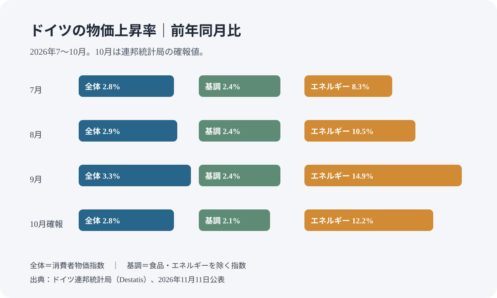
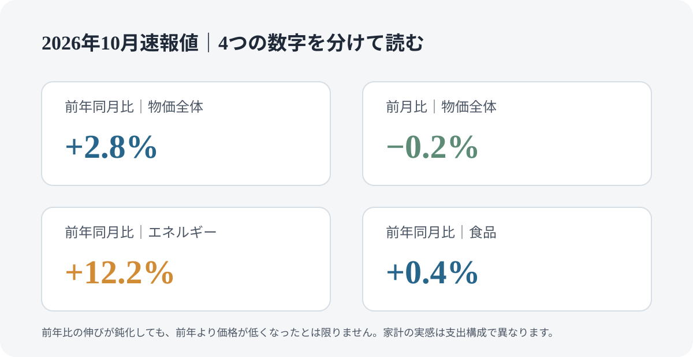

# ドイツの物価は2026年10月に2.8％上昇｜確報で確認、9月から鈍化

ドイツ連邦統計局は2026年11月11日、10月の消費者物価の確報を公表し、10月30日の速報値を確認しました。前年同月比は+2.8％、前月比は-0.2％で、9月の前年比+3.3％から上昇率が鈍化しています。エネルギー価格は前年比+12.2％、食品とエネルギーを除く指数は+2.1％でした。数字の意味を分けて読み、家計で確認するポイントを整理します。

## 先に結論

- 10月の消費者物価指数は前年同月比 **+2.8％**、前月比 **-0.2％**（11月11日公表の確報値）。
- 食品とエネルギーを除く基調的な物価上昇率は **+2.1％**。
- エネルギーは前年同月比 **+12.2％**。9月の+14.9％より伸びは鈍化しましたが、なお高い上昇率です。
- 10月の確報値は **2026年11月11日** に公表され、速報値と同じ結果が確認されました。

## 9月から何が変わったか

以下は連邦統計局が公表した前年同月比の変化率です。10月の確報値と、7〜9月の比較値を並べています。

| 指標 | 7月 | 8月 | 9月 | 10月確報 |
| --- | ---: | ---: | ---: | ---: |
| 消費者物価全体 | +2.8％ | +2.9％ | +3.3％ | +2.8％ |
| 食品・エネルギーを除く指数 | +2.4％ | +2.4％ | +2.4％ | +2.1％ |
| エネルギー | +8.3％ | +10.5％ | +14.9％ | +12.2％ |
| 食品 | +0.4％ | +0.1％ | +0.4％ | +0.4％ |
| サービス | +2.9％ | +2.8％ | +2.7％ | +2.5％ |
| 財 | +2.5％ | +3.0％ | +3.8％ | +3.0％ |

9月に大きく伸びたエネルギーの上昇率が10月には低下し、サービスや財の伸びも鈍化しました。ただし、これは各分類の平均的な変化です。個別の電気・ガス契約、暖房方式、燃料の購入時期、食品の買い方によって、家計で感じる変化は異なります。

## 「インフレ率が下がった」は、値段が元に戻ったという意味ではない

2.8％という数字は、2026年10月の平均的な消費者物価が2025年10月より2.8％高いという意味です。9月の3.3％から上昇率が下がっても、前年より安くなったわけではありません。

また、前月比の-0.2％は、指数全体の平均が9月より低かったという意味です。すべての商品・サービスが値下がりしたわけではなく、個々の店舗や契約の価格改定を直接示すものでもありません。

## 家計では何を確認するか

### エネルギー費は全体の数字と分けて見る

10月のエネルギー価格は前年同月比12.2％上昇です。伸びは9月より鈍化しましたが、家計の負担が前年と同じ水準に戻ったことを意味しません。電気・ガスの契約単価、基本料金、使用量、暖房費の精算を分けて確認してください。

### 食品の上昇率だけで買い物全体を判断しない

食品の平均上昇率は0.4％でしたが、食品の種類によって価格の動きは異なります。食費を見直す場合は、月ごとの購入額と購入量を比べるほうが、全国平均だけを見るより実態をつかみやすくなります。

### 自分の支出構成で考える

連邦統計局の消費者物価指数は、世帯全体の平均的な支出構成を使った指標です。家賃、通勤、車、電気・ガス、外食などの比重が違えば、個人の実感も変わります。統計局の物価情報から個人向け計算ツールを確認できますが、現時点ではドイツ語での提供です。

## 消費者物価指数と欧州共通の指数は同じではない

ドイツ国内の物価を示す消費者物価指数に加え、欧州各国の比較に使う調和消費者物価指数も公表されます。10月の調和指数は前年同月比+2.8％、前月比-0.1％の速報値でした。

両者は対象範囲、計算方法、重み付けが異なります。欧州各国との比較には調和指数、ドイツ国内の家計の物価変化を見るときは国内の消費者物価指数、というように目的を分けてください。

## 確報の公表日と次の確認

10月の確報値は **2026年11月11日** に公表され、速報値と同じ結果が確認されました。次の月次統計を扱う際は、Destatisの公表予定と確報の有無を確認してから更新します。燃料税の一時的な変更など同時期の政策があっても、物価変化の原因を一つの施策だけに帰属させることはできません。

9月の詳しい内訳は[ドイツの9月物価の記事](/germany/ja/events/news/germany-inflation-september-2026/)で確認できます。制度変更の予定は[2027年にドイツで変わる制度・料金](/germany/ja/events/news/germany-january-2027-changes/)も参照してください。

## 公式情報・参考ソース

- [連邦統計局：2026年10月の消費者物価・確報値（2026年11月11日）](https://www.destatis.de/DE/Presse/Pressemitteilungen/2026/11/PD26_392_611.html)
- [連邦統計局：2026年10月の消費者物価・速報値（2026年10月30日）](https://www.destatis.de/DE/Presse/Pressemitteilungen/2026/10/PD26_382_611.html)
- [連邦統計局：消費者物価指数](https://www.destatis.de/DE/Themen/Wirtschaft/Preise/Verbraucherpreisindex/_inhalt.html)
- [連邦統計局：2026年9月の消費者物価・確定値（2026年10月13日）](https://www.destatis.de/DE/Presse/Pressemitteilungen/2026/10/PD26_364_611.html)

<small>確認日：2026年11月12日。10月分の確報は2026年11月11日公表です。</small>
