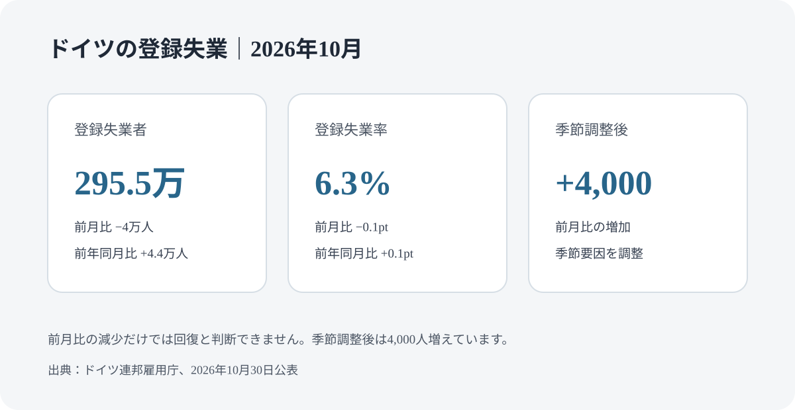
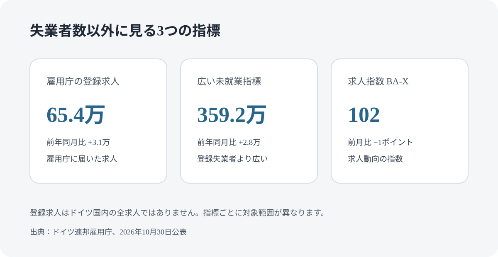

# ドイツの失業者は2026年10月に295.5万人｜秋の改善は弱く、季節調整後は増加

ドイツ連邦雇用庁が2026年10月30日に公表した統計では、登録失業者は295万5,000人で、前月から4万人減りました。ただし、季節要因をならした数字では4,000人増え、前年同月より4万4,000人多い状態です。ドイツで仕事を探している人や転職を考える人が、全国平均を自分の職種・地域に置き換えて読むためのポイントを整理します。

## 10月の主な数字

| 指標 | 2026年10月 | 前月・前年との比較 |
| --- | ---: | --- |
| 登録失業者 | 295万5,000人 | 前月比-4万人、前年同月比+4万4,000人 |
| 登録失業率 | 6.3％ | 前月比-0.1ポイント、前年同月比+0.1ポイント |
| 季節調整後の登録失業者 | — | 前月比+4,000人 |
| 広い意味の未就業者数 | 359万2,000人 | 前年同月比+2万8,000人。季節調整後は前月比-9,000人 |
| 雇用庁に登録された求人 | 65万4,000件 | 前年同月比+3万1,000件 |
| 雇用庁の求人指数 | 102ポイント | 前月比-1ポイント、前年同月比+4ポイント |

登録失業者数は季節調整前の数字です。10月は秋の採用で前月より減りましたが、季節調整後は増えています。したがって「失業者が減った」という一つの数字だけで、労働市場が回復したとは判断できません。

## 失業者数と広い意味の未就業者数は違う

連邦雇用庁の「登録失業者」は、同庁に失業者として登録された人を数えます。一方、広い意味の未就業者数は、登録失業に加え、労働市場政策の措置に参加している人や短期的に就労できない人なども考慮する指標です。対象範囲が異なるため、同じ数字として扱わないでください。

また、連邦雇用庁の登録失業率と、国際労働機関の基準で算出される失業率は、調査方法と対象が異なります。報道で異なる失業率を見た場合は、どの機関のどの定義かを先に確認します。

## 求人65万4,000件を、そのまま仕事の数と考えない

10月に雇用庁へ登録されていた求人は65万4,000件でした。これは雇用庁に届け出られた求人の数であり、ドイツ国内に存在するすべての求人を示すものではありません。

求人指数は、登録求人の残高だけでなく新たに登録された求人も考慮する指標です。10月は前月から1ポイント低下しました。求人件数と指数の動きが異なる場合もあるため、片方だけで採用環境を決めつけないことが大切です。

## 求職中の人が確認したいこと

### 全国平均ではなく、自分の地域と職種を見る

仕事探しでは、次の条件を固定して求人の変化を追います。

- 職種名と近い職種、必要な資格・経験
- 通勤できる地域、出社・在宅の条件
- 必須のドイツ語・英語レベル
- 雇用期間、労働時間、給与範囲
- 応募から面接までの反応

連邦雇用庁の求人検索では、勤務地、職種、勤務形態などを絞り込めます。全国の失業率が高くても、個別の職種や地域で募集が続くことはあります。逆に、全国の求人が増えていても、自分の条件に合うとは限りません。

### 応募のどこで止まるかを記録する

書類選考を通らない場合は、職務要約と求人の必須条件が対応しているかを確認します。面接後に進まない場合は、経験の説明、給与、開始可能日、言語条件にずれがないかを振り返ります。応募数だけでなく、書類通過率や面接後の反応を2〜4週間単位で記録すると、修正すべき点を見つけやすくなります。

## 雇用契約が終わる可能性がある人へ

月次統計より先に、求職登録・失業登録、失業給付、健康保険、滞在資格を確認してください。雇用契約の終了が分かった時点で、連邦雇用庁へ登録期限を確認し、必要書類を準備します。

日本人など第三国籍の人は、在留許可の種類によって就労先・職種・転職時の手続きが異なることがあります。雇用終了だけで在留資格が自動的にどう変わるかを推測せず、許可証の条件と外国人局の案内を確認してください。失業給付の申請手順は[ドイツの失業給付ガイド](/germany/ja/living/unemployment-benefit-germany/)で整理しています。

## まとめ

10月の登録失業者は295万5,000人で前月より減りましたが、季節調整後は4,000人増え、前年同月比でも増加しています。求人も雇用庁に登録された範囲の数字です。全国平均だけで応募を諦めず、自分の地域・職種の求人と応募結果を確認し、契約終了が見えた場合は登録・保険・滞在資格を早めに確認してください。

## 公式情報・参考ソース

- [連邦雇用庁：2026年10月の労働市場（2026年10月30日）](https://www.arbeitsagentur.de/presse/2026-41-arbeitsmarkt-im-oktober-2026)
- [連邦雇用庁：2026年の失業者数・失業率](https://www.arbeitsagentur.de/news/arbeitsmarkt)
- [連邦雇用庁：求人検索](https://www.arbeitsagentur.de/jobsuche/)

<small>確認日：2026年11月4日。統計は連邦雇用庁の2026年10月公表資料に基づきます。</small>
