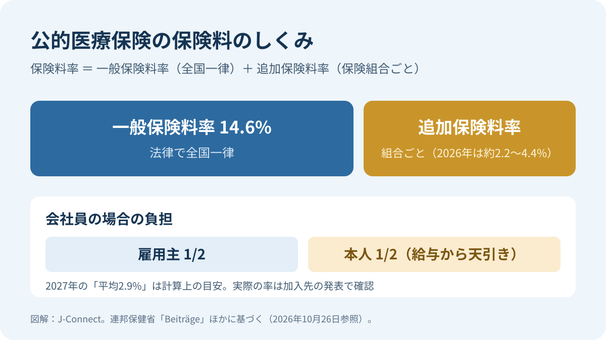
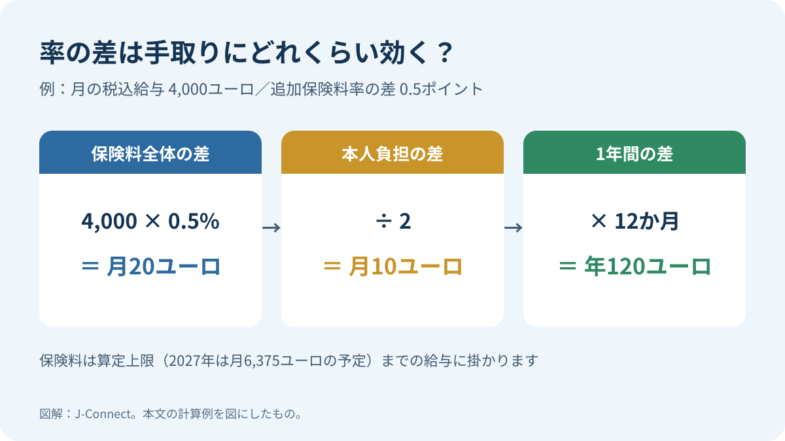
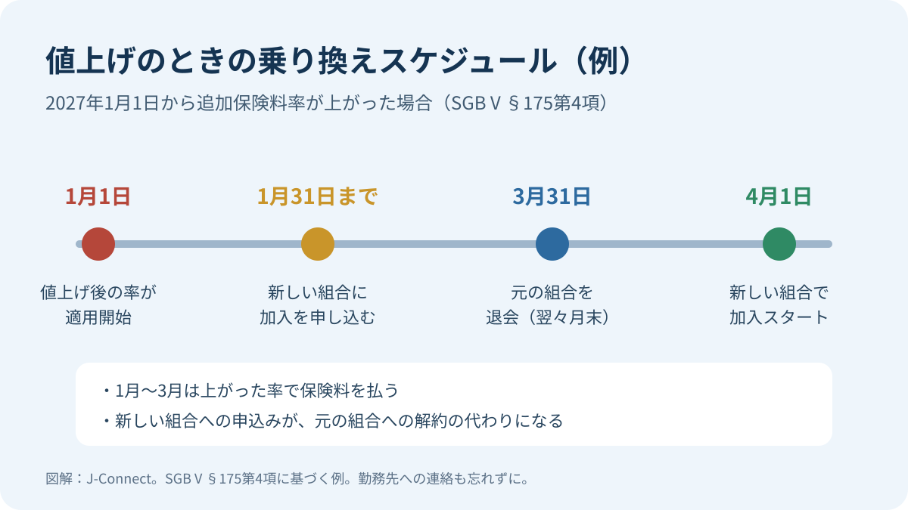

# 【2027年】ドイツの健康保険料は上がる？平均追加保険料率2.9％決定と乗り換え方

ドイツの公的医療保険（GKV）について、連邦保健省は2026年10月30日、2027年の平均追加保険料率を2.9％に正式決定しました。これは2026年と同じ水準ですが、全ての保険組合が2.9％を請求するわけではありません。実際の追加保険料率は加入先ごとに決まるため、自分の給与から引かれる金額は変わる可能性があります。

この記事は、ドイツで公的医療保険に加入して働く方、その家族、これから加入する方に向けたものです。決定済みの平均値と保険組合別の料率の違い、手取りへの影響、値上げ時の特別解約権と乗り換え手順を整理します（2026年11月8日確認）。

## 何が発表されたのか

公的医療保険の財政を見通す推計委員会は、2026年10月14日に2027年の収支見通しを示しました。この段階で示された2.9％は、収支見通しに基づく平均追加保険料率の見込みでした。

その後、連邦保健省は2026年10月30日、2027年の平均追加保険料率を**2.9％に決定**しました。2026年と同じ水準です。したがって、従来の「11月1日までの告示を待つ」「正式な決定は未確認」という説明は、現在は古くなっています（[連邦保健省：2026年10月30日付決定発表](https://www.bundesgesundheitsministerium.de/presse/pressemitteilungen/zusatzbeitragssatz-gkv-2027-festgelegt)）。

ただし、決定された2.9％は全保険組合に一律適用される個別料率ではありません。各保険組合は、自らの財政状況に応じて実際の追加保険料率を決めます。2027年に加入先の料率が上がるか下がるかは、各組合の公式発表で確認してください。

## 「平均2.9%」と「自分の保険料」は別もの

ここが一番誤解されやすい点です。公的医療保険の保険料は、次の2つを足したものです。

- **一般保険料率 14.6%**：法律で全国一律。
- **追加保険料率**：保険組合ごとに、それぞれの財政状況に応じて決める。

会社員の場合、14.6%も追加保険料も、雇用主と本人が半分ずつ負担します（[連邦保健省](https://www.bundesgesundheitsministerium.de/beitraege)）。年金受給者は年金保険機関が半分を負担します。

「平均2.9%」は、全保険組合の支出をまかなうのに計算上必要な率で、いわば目安です。各組合はこれと関係なく自分の率を決められ、年の途中で引き上げることもあります。2026年も計算上の平均は2.9％でしたが、実際の料率は保険組合ごとに異なります。特定時点の平均や最低・最高の数字だけで判断せず、加入先の最新料率を[全国組織の公式一覧](https://www.gkv-spitzenverband.de/service/krankenkassenliste/krankenkassen.jsp)で確認してください。

つまり**2027年に引き上げる組合も、据え置く組合も、引き下げる組合もありえます**。平均値だけで自分の保険料を予測せず、加入先の公式発表を確認してください。

## 手取りへの影響：計算例

追加保険料率の差が、毎月の手取りにどれくらい効くかを計算してみます。会社員本人の負担は差の半分です。

| 月の税込給与 | 率の差 | 本人負担の差（月） | 本人負担の差（年） |
| --- | --- | --- | --- |
| 3,000ユーロ | 0.5ポイント | 7.50ユーロ | 90ユーロ |
| 4,000ユーロ | 0.5ポイント | 10ユーロ | 120ユーロ |
| 6,375ユーロ以上 | 1.0ポイント | 31.88ユーロ | 382.50ユーロ |

保険料は給与のうち「保険料算定上限」までにしか掛かりません。2027年の上限は月6,375ユーロに引き上げられる予定です（連邦参議院の同意待ち。詳しくは「[【2027年1月から】ドイツで何が変わる？](/germany/ja/events/news/germany-january-2027-changes/)」）。上限を超える給与の方は、6,375ユーロを基準に計算します。

月10ユーロでも、夫婦それぞれが加入していれば2倍になり、数年続けば積み重なります。一方で、保険組合は保険料だけでなく、サービスや追加給付でも違いがあります。率だけで決める必要はありません。

## 要注意：値上げのお知らせの手紙は、もう届かないかもしれない

これまで保険組合は、追加保険料率を引き上げる場合、遅くとも1か月前までに加入者へ手紙で知らせ、特別解約権があることも伝える義務がありました。消費者センターによると、この通知義務はGKV保険料率安定化法によってなくなりました。2026年7月30日の施行以降は、手紙で個別に知らせる義務も、デジタルで知らせる一般的な義務もありません（[消費者センター](https://www.verbraucherzentrale.de/wissen/gesundheit-pflege/krankenversicherung/zusatzbeitrag-der-krankenkasse-sonderkuendigung-und-wechsel-moeglich-10581)）。

アプリやデジタル会員誌で引き続き知らせるとしている組合もありますが、2027年1月の値上げは、**自分から確認しないと気づかない**可能性があります。ただし、値上げのときに乗り換えられる特別解約権そのものは残っています（[消費者センター](https://www.verbraucherzentrale.de/wissen/gesundheit-pflege/krankenversicherung/zusatzbeitrag-der-krankenkasse-sonderkuendigung-und-wechsel-moeglich-10581)）。

## 値上げされたら使える「特別解約権」

公的医療保険では、一度選んだ保険組合に**原則12か月**は加入し続ける決まりです（[SGB V §175 第4項](https://www.gesetze-im-internet.de/sgb_5/__175.html)）。ただし、保険組合が追加保険料率を引き上げた場合は例外で、12か月が経っていなくても解約できます。

条文のポイントは次のとおりです。

1. **期限**：値上げ後の率が最初に適用される**月の末日まで**に解約を申し出られる（第4項6文）。たとえば2027年1月1日から上がる場合、2027年1月31日が期限です。
2. **退会の時期**：退会は、申し出た月の**翌々月の末日**です（第4項3文）。1月に申し出た場合は3月末で退会し、4月1日から新しい保険組合に移ります。それまでの間は、上がった率で保険料を払います（[消費者センター](https://www.verbraucherzentrale.de/wissen/gesundheit-pflege/krankenversicherung/zusatzbeitrag-der-krankenkasse-sonderkuendigung-und-wechsel-moeglich-10581)）。
3. **手続き**：別の保険組合に移る場合、新しい組合への加入申込みが元の組合への解約の代わりになります（第4項4文）。自分で元の組合に解約届を出す必要は、通常ありません。元の組合は、新しい組合に対して2週間以内に退会日を電子的に確認します（第2項）。

また、すでに12か月以上加入している方は、値上げがなくても、同じ「翌々月の末日」のルールでいつでも乗り換えられます（第4項3文）。

## 乗り換えの手順：やることは3つ

1. **新しい保険組合を選んで加入を申し込む**：多くの組合はウェブサイトやアプリで申し込めます。社会保険番号（Sozialversicherungsnummer）、今の保険組合の名前、勤務先の情報を手元に用意しておくとスムーズです。
2. **勤務先（人事・給与担当）に伝える**：保険料は給与から天引きされるため、新しい保険組合名と加入開始日を勤務先に知らせます。新しい組合から届く加入の確認書類を求められることがあります。
3. **新しい保険証（eGK）を待つ**：開始日までに新しいカードが届きます。届いたら病院や薬局ではこちらを使い、古いカードは元の組合の案内に従って処分します。

家族保険（Familienversicherung）で家族が加入している場合は、家族も一緒に新しい組合へ移ります。家族の分も申込み時に忘れず届け出ましょう。

### 乗り換え前に確認したいこと

- **選択タリフ（Wahltarif）**：保険料の一部払い戻しなどの特別プランに入っている場合、別の拘束期間が設けられていることがあります。加入中の組合に確認してください。
- **ボーナスプログラムや追加給付**：健康診断・予防接種・オステオパシーなどの補助は組合ごとに違います。年の途中で移ると、ボーナスの条件を満たせなくなることもあります。
- **言葉と窓口**：英語の案内やチャット、アプリの使いやすさは組合によって差があります。病気のときに問い合わせやすいかも大事な基準です。
- **滞在許可の手続き中の方**：加入する保険組合が変わっても公的医療保険であることに変わりはありませんが、外国人局から加入証明を求められた場合は新しい組合の証明書を出します。

公的医療保険と民間医療保険（PKV）の違いそのものは、「[ドイツの健康保険ガイド](/germany/ja/living/health-insurance-guide/)」で解説しています。

## いつ、どこで確認すればいい？

各保険組合の2027年の率は、例年12月ごろから年末にかけて発表されます。中には、すでに据え置きを表明した組合や、引き下げを検討していると報じられた組合もありますが、大半はまだ決まっていません（10月26日時点）。

- **公式の一覧**：GKV-Spitzenverband の[保険組合一覧](https://www.gkv-spitzenverband.de/service/krankenkassenliste/krankenkassen.jsp)で、全組合の現在の追加保険料率を比べられます。表示されるのはその日時点で有効な率です。
- **加入先のウェブサイトやアプリ**：手紙での通知義務はなくなったため、年末に自分で一度チェックします。
- **給与明細**：1月の給与明細で、医療保険の本人負担額（KV-Beitrag）が変わっていないかを見ると確実です。

## まとめ：年末までにやっておくこと

- 自分の保険組合の名前と、今の追加保険料率を確認する。
- 12月〜1月に、加入先の2027年の率を自分で確認する（手紙が届くとは限らない）。
- 上がった場合、乗り換えるなら**値上げ月の末日まで**に新しい組合へ申し込む。
- 乗り換えたら勤務先に伝え、新しい保険証を受け取る。

## よくある疑問

### 「平均2.9%据え置き」なら、保険料は上がらない？

いいえ。2.9%は計算上の目安で、各保険組合は自分で率を決めます。上がるか下がるかは、加入先の発表を待つ必要があります。

### 値上げされたら、保険組合から連絡は来る？

来るとは限りません。2026年7月30日から、値上げを手紙で事前に知らせる義務はなくなりました。加入先のウェブサイトやアプリ、1月の給与明細で確認してください。

### 特別解約権を使わずに放っておくとどうなる？

そのまま上がった率で保険料を払い続けることになります。何もしなくても保険が切れることはありません。

### 乗り換えると、治療中の病院や処方に影響はある？

公的医療保険の基本的な給付は法律で決まっているため、どの組合でも大きくは変わりません。ただし、組合独自の追加給付や、すでに承認を受けている治療の扱いは、移る前に新旧の組合に確認しておきましょう。

### 民間医療保険（PKV）に入っている場合は？

今回の追加保険料率は公的医療保険の話で、民間医療保険の保険料には直接関係しません。民間保険の保険料改定は、契約先からの通知で確認してください。

## 参考情報（2026年11月8日確認）

- [連邦保健省：2027年の平均追加保険料率を2.9％に決定（2026年10月30日）](https://www.bundesgesundheitsministerium.de/presse/pressemitteilungen/zusatzbeitragssatz-gkv-2027-festgelegt)
- [連邦保健省：GKV推計委員会の結果（2026年10月14日）](https://www.bundesgesundheitsministerium.de/presse/pressemitteilungen/ergebnisse-gkv-schaetzerkreis-zusatzbeitragssatz)
- [連邦保健省：公的医療保険の保険料](https://www.bundesgesundheitsministerium.de/beitraege)
- [連邦労働・社会省：2027年の社会保険基準額](https://www.bmas.de/DE/Service/Gesetze-und-Gesetzesvorhaben/sozialversicherungs-rechengroessenverordnung-2027.html)
- [社会法典第5編 §175（保険組合の選択・解約）](https://www.gesetze-im-internet.de/sgb_5/__175.html)・[§242a（平均追加保険料率）](https://www.gesetze-im-internet.de/sgb_5/__242a.html)
- [GKV-Spitzenverband：保険組合一覧と個別追加保険料率](https://www.gkv-spitzenverband.de/service/krankenkassenliste/krankenkassen.jsp)
- [消費者センター：追加保険料の値上げと特別解約権（2026年8月19日更新）](https://www.verbraucherzentrale.de/wissen/gesundheit-pflege/krankenversicherung/zusatzbeitrag-der-krankenkasse-sonderkuendigung-und-wechsel-moeglich-10581)

本記事は公開情報をもとにした一般的な情報提供で、個別の保険・法律相談に代わるものではありません。乗り換えの判断は、加入先と乗り換え先の保険組合の最新情報を確認したうえで行ってください。
