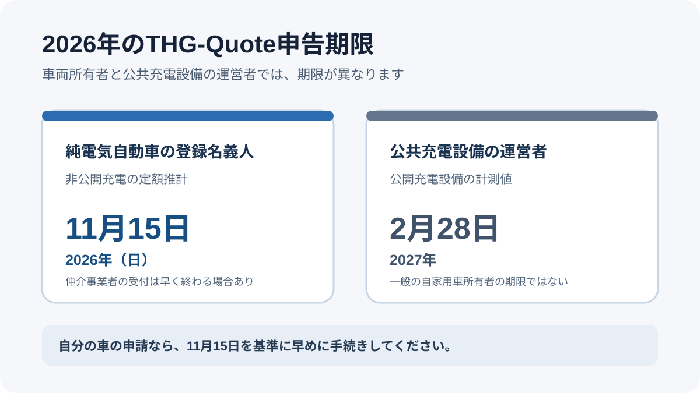
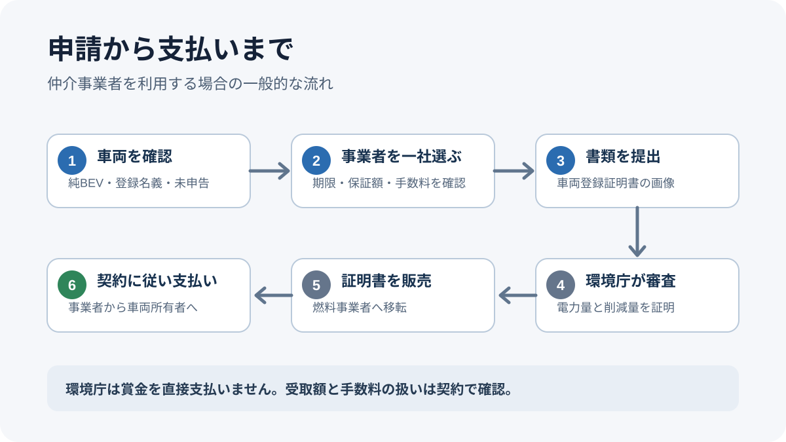

# ドイツのTHG-Quote 2026｜電気自動車の申告期限は11月15日（日）、休日扱いと手数料

ドイツで登録した純電気自動車の所有者は、2026年分のTHG-Quote（燃料の温室効果ガス削減義務に電気自動車の充電電力を算入する制度）を通じて、民間事業者から対価を受け取れる場合があります。自家用車の非公開充電に関する法令上の基準日は2026年11月15日です。2026年は日曜日に当たるため、行政手続の一般規定による翌営業日扱いが適用されるかを確認する必要があります。この記事では、対象車両、公共充電設備との期限の違い、2026年からの環境庁手数料、申請前に確認すべき契約条件を整理します。

## 先に結論

- ドイツで登録された純電気自動車の所有者が、車両ごとの定額推計を申告する場合、法令上の基準日は **2026年11月15日（日）** です。行政手続の一般規定による翌営業日扱いが適用されるかは、環境庁の案内で明確に確認できていません。
- 公共充電設備の運営者が、設備で計測した電力量を申告する期限は **2027年2月28日** です。これは一般の自家用車所有者に適用される期限ではありません。
- 環境庁は賞金を直接支払いません。電力量を証明し、その証明を燃料事業者へ販売する民間事業者などを通じて、車両所有者に対価が支払われます。
- 2026年4月17日以降の申請には、環境庁の審査手数料が発生します。金額は審査負担に応じて94.60〜6,500ユーロの範囲です。申請を仲介事業者に任せる場合、手数料を誰が負担するか契約で確認してください。
- 仲介事業者の受付期限は、法律上の期限より早い場合があります。11月15日まで待たず、利用する事業者の締切を先に確認してください。

## THG-Quoteとは

ドイツでは、ガソリンや軽油を販売する事業者に、燃料の利用で発生する温室効果ガスを一定割合削減する義務があります。その削減方法の一つとして、道路を走る電気自動車で使われた電力を制度上の削減量に算入できます。

環境庁は、条件を満たす電力量と温室効果ガス削減量を証明します。その証明を燃料事業者へ販売することで対価が生まれ、車両所有者が民間の仲介事業者を利用した場合は、契約に従って支払いを受けます。

重要なのは、**環境庁が個人に定額の補助金を振り込む制度ではない**という点です。受取額、支払時期、保証の有無は、仲介事業者の契約と市場の状況によって異なります。「最大○ユーロ」という広告表示を、必ず受け取れる金額と考えないでください。

## 2026年の期限は二つある

38番目の連邦排出規制令第8条は、申告する電力量の種類によって期限を分けています。

| 申告する人・電力量 | 法律上の期限 | 何を申告するか |
| --- | --- | --- |
| 純電気自動車の登録名義人などが、非公開充電の定額推計を申告 | **2026年11月15日** | 車両ごとに定められた推計電力量 |
| 公共充電設備の運営者が、公開充電設備で計測した電力量を申告 | **2027年2月28日** | 公共充電設備で計測した電力量 |

自家用車の所有者が自分の車について申請する場合は、通常、上段の11月15日が基準です。2月28日の期限は、公開充電設備の運営者が計測値を申告するためのものです。自宅の充電設備を持っている人が、後者の期限まで待てるという意味ではありません。

環境庁の概要ページには、公開充電設備の計測電力量について翌年2月28日と記載されています。一方、同庁の申請FAQと第8条は、純電気自動車の定額推計（第7条）を11月15日、公共充電設備の計測値（第6条）を翌年2月28日と区別しています。自家用車の申請では、この区分を混同しないでください。

2026年11月15日は日曜日です。行政手続法第31条第3項は、期限の末日が日曜日・祝日・土曜日に当たる場合、原則として次の平日まで期限が延びると定めています。ただし、38番目の連邦排出規制令第8条のこの申告期限に同規定が適用されるかについて、環境庁の公開ページは明示していません。したがって、11月16日（月）まで提出できると断定せず、環境庁へ確認するか、可能なら11月15日までに提出してください。仲介事業者の利用者向け締切は、確認・集約のためさらに早い場合があります。

## 申請できる車両と、先に確認すること

自家用車の定額推計を申告する制度で対象となるのは、ドイツで登録された純電気自動車です。プラグインハイブリッド車や通常のハイブリッド車は、純電気自動車の定額推計の対象ではありません。

申請前に、次の点を確認してください。

1. **車両登録証明書の名義**：車両登録証明書（パートI）に記載された登録名義人が誰かを確認します。仲介事業者へ提出する情報と名義が一致している必要があります。
2. **2026年分がすでに申告されていないか**：一台の車両について、同じ年の証明は一度だけです。中古車を購入した場合や年の途中で名義変更した場合は、前の所有者がすでに申告していないか確認してください。
3. **純電気自動車かどうか**：プラグインハイブリッドやレンジエクステンダー付き車両を、純電気自動車として申告しないでください。
4. **登録期間**：環境庁のFAQでは、対象車両が年の途中で登録された場合でも、その年の推計値を申告できると説明されています。ただし、車両ごとの申告がすでに行われていないことが前提です。

中古車の売買では、売主に「2026年分のTHG-Quoteをすでに申告したか」を書面で確認しておくと、二重申告を避けやすくなります。環境庁は、過去の所有者による申告の有無を購入前の個別照会で確認するサービスを提供していません。

## 2026年から環境庁の審査手数料が発生する

2026年4月17日以降に提出された対象申請は、環境庁の審査手数料の対象です。環境庁が公表する手数料の範囲は **94.60〜6,500ユーロ** で、具体的な額は個々の申請の審査に必要な事務負担などに応じて決まります。決定通知とともに金額が知らされ、原則として通知から10日以内に支払うと案内されています。

これは、すべての車両所有者に一律94.60ユーロが請求されるという意味ではありません。また、車両一台あたりの固定料金と断定することもできません。仲介事業者が複数車両の申告をまとめて提出する場合と、個人が直接申請する場合では、申請者や費用の扱いが異なる可能性があります。

仲介事業者を利用する場合は、次を契約前に確認してください。

- 環境庁の手数料を事業者が負担するのか、利用者に転嫁するのか
- 表示された金額から、手数料や事務費が差し引かれるのか
- 環境庁が申請を認めなかった場合、費用や支払いはどうなるのか
- 固定額が保証されるのか、市場価格に応じて変動するのか

個人が環境庁へ直接申請することも制度上は可能ですが、環境庁は対価を支払わず、証明書の発行を担当します。直接申請する場合は、証明書を買い取る義務対象事業者との契約や手数料負担も自分で確認する必要があります。少額の一台分だけを直接申請する前に、費用と売却先を必ず確認してください。

## 環境庁へ直接申請する場合

環境庁の2026年11月6日更新ページによると、申請は現在、書式自由で電子メール（38bimschv@uba.de）により提出できます。デジタル申請システムはまだ利用できません。2026年の義務年度については、2026年9月9日以降に提出された申請を処理中と案内されています。

直接申請する場合は、最新の環境庁FAQと提出様式を確認し、送信した申請書類と受付番号を保存してください。環境庁が発行するのは電力量と削減量の証明であり、対価の支払いではありません。証明書を買い取る義務対象事業者との契約は別に必要です。

## 仲介事業者を利用する場合の手順

一般的な流れは次のとおりです。事業者によって受付方法や必要情報は異なるため、申込み画面と契約条件を確認してください。

1. **一台の車両について、まだ2026年分を申告していないことを確認する。** 中古車の場合は前の所有者にも確認します。
2. **事業者の受付期限を確認する。** 法律上の11月15日より早く締め切る事業者があります。利用者が写真をアップロードする日と、環境庁に申告が届く日は同じとは限りません。
3. **金額の表示方法を確認する。** 「保証額」と「最大額」「市場価格連動」を区別し、支払時期、契約期間、自動更新、キャンセル条件を読みます。
4. **一つの事業者を選ぶ。** 環境庁への申告後は、指定した第三者を別の事業者へ変更できません。複数社へ同じ車両を重複申込みしないでください。
5. **車両登録証明書のコピーを提出する。** 環境庁のFAQでは、非公開充電の定額推計を申告する際、車両登録証明書パートIの表面が必要書類として示されています。文字や車台番号が読める画像を用意します。
6. **申込みの確認を保存する。** 受付番号、申告対象年、契約金額、支払条件を保存し、事業者から追加確認が来た場合は期限内に対応します。
7. **支払いを確認する。** 環境庁の証明発行と、仲介事業者からの支払いは別の段階です。申込み時に示された支払条件を確認してください。

## よくある質問

### 11月15日（日）を過ぎたら、2026年分を翌年に申告できますか？

非公開充電の定額推計について、38番目の連邦排出規制令第8条は当該年の11月15日を基準日としています。2026年は日曜日のため、行政手続法第31条第3項の翌営業日規定が適用されるかを環境庁に確認してください。適用の有無が確認できないまま、11月16日まで待つことは勧められません。適用される期限を過ぎた過年度分は、新たに申告できません。

### 2月28日まで待てるのではありませんか？

2月28日は、公共充電設備の運営者が計測した電力量を申告する場合の期限です。自家用車の登録名義人が車両ごとの定額推計を申告する期限とは異なります。

### 環境庁から直接お金が振り込まれますか？

いいえ。環境庁は電力量と削減量を証明します。証明書を買い取る事業者や仲介事業者との契約に基づいて支払いが行われます。

### 中古車を買ったばかりでも申請できますか？

同じ車両について2026年分の証明がまだ発行されていなければ、条件を満たす可能性があります。ただし、一台につき同じ年の証明は一度だけです。前の所有者がすでに申告していないかを先に確認してください。

### プラグインハイブリッド車も対象ですか？

純電気自動車の定額推計の対象ではありません。車検証上の車両区分と、環境庁・申請事業者の条件を確認してください。

## 公式情報・参考ソース

- [環境庁：38番目の連邦排出規制令に基づく電気自動車の電力申告（2026年10月30日更新）](https://www.umweltbundesamt.de/themen/verkehr/kraftstoffe-antriebe/vollzug-38-bimschv-anrechnung-von-strom-fuer)
- [環境庁：38番目の連邦排出規制令の申請・運用FAQ（2025年7月17日版）](https://www.umweltbundesamt.de/system/files/medien/366/dokumente/2025-07-18_uba_faq_vollzug_38._bimschv_0.pdf)
- [法令：38番目の連邦排出規制令 第8条](https://www.gesetze-im-internet.de/bimschv_38_2017/__8.html)
- [法令：38番目の連邦排出規制令 第7条](https://www.gesetze-im-internet.de/bimschv_38_2017/__7.html)
- [法令：行政手続法 第31条（期限と期日）](https://www.gesetze-im-internet.de/vwvfg/__31.html)
- [ADAC：2026年のTHG-Quoteと申請の仕組み（2026年6月24日）](https://www.adac.de/rund-ums-fahrzeug/elektromobilitaet/elektroauto/thg-quote/)

<small>確認日：2026年11月11日。申請期限、審査手数料、事業者の受付状況は変更される可能性があります。申込み前に環境庁と利用する事業者の最新案内を確認してください。税務上の扱いは個別の状況により異なる場合があります。</small>
