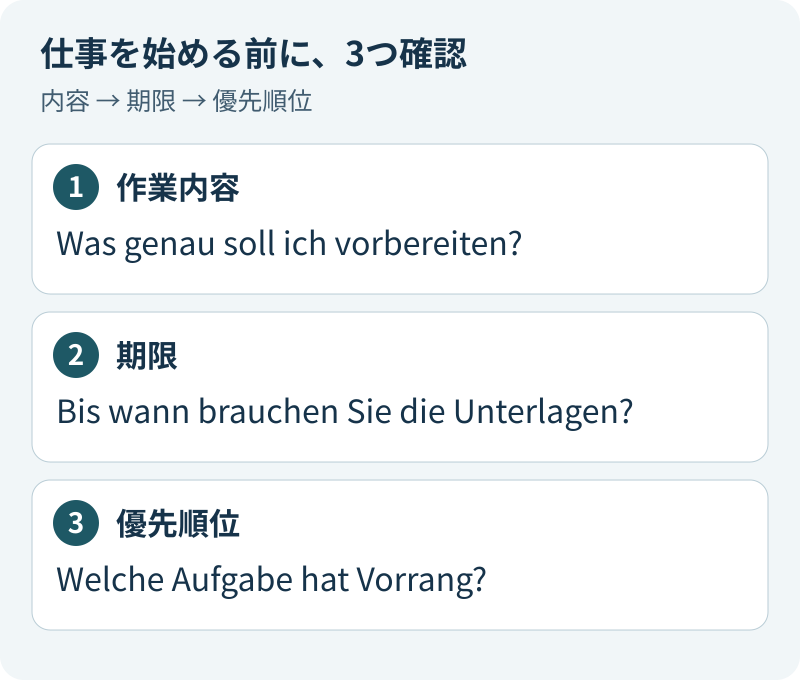

# 職場会話で使うドイツ語

この記事は、ドイツ語の職場で質問、聞き返し、予定確認、短い雑談を行うための会話表現集です。分かったふりをせず、作業内容と期限を確認し直す言い方を中心に、A2〜B1の学習者が使える形でまとめます。会議と日常会話の両方で、自分の仕事に合わせて語句を入れ替えられます。

## 使い方

職場では、短い雑談、分からないことの確認、会議での質問、予定調整を落ち着いて言えると働きやすくなります。完璧な表現より、誤解を避ける確認表現を優先しましょう。

## Sieとduを使い分ける

この記事の例文は、丁寧な呼びかけの`Sie`でそろえています。職場での呼び方は相手との関係やチームの慣習で異なるため、迷う場合は`Sie`で始め、どちらを使うか確認すると安心です。`du`で話すと決まっている相手には、代名詞だけでなく動詞の形も変えます。

| 場面 | Sieで話す場合 | duで話す場合 | 日本語 |
| --- | --- | --- | --- |
| 手助けを頼む | Könnten Sie mir kurz helfen? | Könntest du mir kurz helfen? | 少し手伝っていただけますか。／少し手伝ってもらえる？ |
| 時間を確認する | Passt es Ihnen morgen um 10 Uhr? | Passt es dir morgen um 10 Uhr? | 明日の10時はご都合がよいですか。／明日の10時は都合がいい？ |

呼びかけの違いは[Goethe-Institutの練習問題](https://www.goethe.de/de/spr/ueb/daa/all/ds0/ds1.html)でも確認できます（2026年11月27日確認）。

## 基本フレーズ

| 場面 | ドイツ語 | 日本語 |
| --- | --- | --- |
| 朝の挨拶 | Guten Morgen. Wie geht es Ihnen? | おはようございます。お元気ですか。 |
| 確認 | Habe ich das richtig verstanden? | 正しく理解できていますか。 |
| 聞き返し | Könnten Sie das bitte noch einmal erklären? | もう一度説明していただけますか。 |
| 質問 | Ich habe eine Frage zu diesem Punkt. | この点について質問があります。 |
| 助けを求める | Könnten Sie mir kurz helfen? | 少し手伝っていただけますか。 |
| 予定確認 | Passt es Ihnen morgen um 10 Uhr? | 明日の10時で都合はよいですか。 |
| 遅れそう | Ich komme etwa zehn Minuten später. | 10分ほど遅れます。 |
| 共有 | Ich schicke Ihnen die Informationen per E-Mail. | 情報をメールでお送りします。 |

## 作業内容・期限・優先順位を確認する

「分かりました」で終わらせず、何をいつまでに仕上げるか確認します。間に合わない場合は、分かった時点で相談しましょう。

| 目的 | ドイツ語 | 日本語 |
| --- | --- | --- |
| 作業内容 | Was genau soll ich vorbereiten? | 具体的に何を準備すればよいですか。 |
| 期限 | Bis wann brauchen Sie die Unterlagen? | いつまでに書類が必要ですか。 |
| 優先順位 | Welche Aufgabe hat Vorrang? | どの作業を優先すればよいですか。 |
| 復唱 | Ich soll also die Liste bis Freitag aktualisieren. Stimmt das? | つまり金曜日までにリストを更新するのですね。合っていますか。 |
| 遅れる見込み | Ich schaffe es voraussichtlich erst bis Montag. Wäre das in Ordnung? | 完了は月曜日になる見込みです。それでも大丈夫でしょうか。 |

## 会議での会話例

学習用の架空の会話です。変更先の週と曜日、時刻を順に確認します。

**同僚:** Wir sollten den Termin auf nächste Woche verschieben.
予定を来週に変更したほうがよさそうです。

**私:** Habe ich das richtig verstanden? Der Termin soll nächste Woche stattfinden?
正しく理解できているでしょうか。予定は来週になるのですね。

**同僚:** Ja, genau.
はい、そのとおりです。

**私:** Passt es Ihnen nächste Woche Dienstag um 10 Uhr?
来週火曜日の10時はご都合がよいですか。

**同僚:** Dienstag passt gut.
火曜日で大丈夫です。

**私:** Super. Ich schicke Ihnen die Bestätigung per E-Mail.
よかったです。確認のメールをお送りします。

## 雑談で使いやすい一言

| ドイツ語 | 日本語 |
| --- | --- |
| Wie war Ihr Wochenende? | 週末はいかがでしたか。 |
| Das klingt gut. | それはよさそうですね。 |
| Ich kenne mich hier noch nicht so gut aus. | ここにはまだあまり詳しくありません。 |
| Ich lerne noch Deutsch. | まだドイツ語を勉強中です。 |
| Danke für Ihre Geduld. | 辛抱強くお付き合いいただき、ありがとうございます。 |

## 確認メールの短い例

以下は学習用の文例です。`[Datum]`と`[Uhrzeit]`に合意した日付と時刻を入れます。

Betreff: Bestätigung unseres Termins

Hallo [Name],

vielen Dank für das Gespräch. Ich bestätige unseren Termin am [Datum] um [Uhrzeit]. Bitte geben Sie mir kurz Bescheid, falls sich etwas ändert.

Viele Grüße

[Name]

日本語：

> 件名：お約束の日時の確認
>
> [名前]さん
>
> お話しいただきありがとうございました。[日付]の[時刻]のお約束を確認いたします。変更がありましたら、ひと言お知らせください。
>
> よろしくお願いいたします。
>
> [名前]

## メモ

* “Habe ich das richtig verstanden?” は誤解を防ぐ便利な確認表現です。
* 会議で長く話せないときは、質問を1つに絞ると伝わりやすくなります。
* 口頭で決まった内容は、短いメールで確認すると安心です。

## 関連記事

- [ビジネスメールで使う丁寧なドイツ語](/germany/ja/learn-german/work-email-phrases/)
- [電話でよく使うドイツ語](/germany/ja/learn-german/telephone-phrases/)
- [予約を取りたいときのドイツ語](/germany/ja/learn-german/appointment-phrase/)
