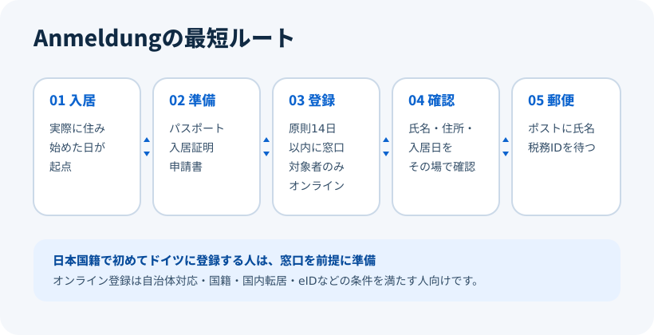

# ドイツの住民登録（Anmeldung）｜入居後2週間の期限・必要書類・予約が取れないとき

ドイツで住居へ実際に入居したら、原則として2週間以内に自治体へ住所を登録します。この記事は、初めてドイツで暮らす人や国内で引っ越した人が、期限の起点、必要な入居証明、窓口の予約、登録後に届く書類までを一つの流れで理解するための案内です。読み終えると、部屋探しの段階で確認すべきことと、入居後の手続きを切り分けられるようになります。

到着直後の全体の順番は[最初の30日チェックリスト](/germany/ja/living/germany-first-30-days/)、ほかの手続きへの入口は[渡独直後の案内](/germany/ja/living/routes/new-arrival/)で確認できます。

## まず結論

- 何を：入居したら、住む自治体の住民登録の窓口（Bürgerbüro・Bürgeramt）で住所を登録する。
- いつまでに：実際の入居日から**2週間以内**（連邦住民登録法第17条第1項）。遅れると過料の対象になる（同第54条）。
- どこで：住む市・自治体の窓口。多くはオンライン予約制。
- 持ち物：**パスポート**、家主などが出す**入居証明**（Wohnungsgeberbestätigung、同第19条）、**申請書**。結婚・出生の証明を求められることがある。費用はデュッセルドルフ市では無料。

## あなたはどのケース？

| あなたの状況 | 違うところ | 確認すること |
| --- | --- | --- |
| 日本から初めてドイツに住む | 登録の後、税務識別番号が郵送で届く。滞在許可や銀行の手続きで登録確認書を使う | 郵便受けとドアベルに名前を出す |
| ドイツ国内で引っ越した | 新しい住所で登録すれば、旧住所の転出は通常不要 | 新しい自治体の予約 |
| 家族と一緒に住む | 家族分の旅券、婚姻・出生の証明を求められることがある | 日本の書類の翻訳・認証の要否 |
| 間借り・短期の家具付き物件 | 入居証明を出してもらえないことがある | 契約前に「入居証明を出してもらえるか」を確認 |
| ドイツを出る（本帰国など） | 国内に新しい住居がなければ転出届が必要。転出日の1週間前から可能 | [本帰国の手続き](/germany/ja/living/returning-to-japan-checklist/) |

## 住民登録は生活手続きの土台

住民登録の正式名称は **Anmeldung** です。これは滞在許可そのものではなく、「誰が、いつから、どの住所に住んでいるか」を自治体の住民記録へ登録する手続きです。

登録した住所は、税務識別番号の郵送、行政からの通知、放送負担金、銀行や保険での住所確認など、多くの手続きの基礎になります。形式的な届け出に見えても、郵便受けの名前や入居日の正確さが、その後の生活に影響します。

## 2週間は「実際の入居日」から数える

連邦住民登録法第17条は、住居へ入った人に、入居後2週間以内の登録を求めています。賃貸契約へ署名した日や、鍵を受け取った日と、実際に住み始めた日が違う場合があります。基準になるのは実際の入居日です。

窓口の予約が2週間以内に取れないこともあります。その場合は、期限内に予約を試みた記録、最初に取れた予約、自治体へ問い合わせた履歴を残し、できるだけ早く手続きします。期限を過ぎたからと諦めて放置する方が問題を大きくします。

ホテルや民泊など一時的な滞在には別の扱いがあります。国外から来て最初から3か月を超えて住む予定がある場合など、滞在期間と施設の形で登録義務が変わるため、自治体の公式案内を確認してください。

## 最も重要なのは入居証明

住民登録では、大家や住居を提供した人が、実際の入居を証明する書類を出します。正式名称は **Wohnungsgeberbestätigung** ですが、本文では入居証明と呼びます。

通常、入居証明には次の情報が入ります。

- 住居提供者の氏名と住所
- 所有者が別にいる場合はその氏名
- 住居の住所
- 実際の入居日
- 入居した全員の氏名

賃貸契約書は契約関係を示すもので、入居証明の代わりにならないのが原則です。部屋探しの時点で「住民登録できるか」「入居証明をいつ誰が出すか」を確認してください。

サブレットでは、所有者ではなく主契約者が住居提供者となる場合があります。ただし、又貸しの許可や契約関係が不明確だと、入居証明を受け取れないことがあります。「登録不可」と書かれた住居を、長期生活の基盤として安易に選ばないでください。

## 入居証明を出してもらえないとき

住居提供者には、期限内の登録へ協力する義務があります。証明を拒まれた、誤った入居日を書かれた、家族の一部しか載っていない場合は、まず書面で訂正を依頼します。

それでも受け取れない場合は、連邦行政ポータルが案内する通り、住民登録窓口へ速やかに事情を伝えます。契約書、家賃の支払い、鍵の引き渡し、依頼履歴など、実際の入居を示す資料を残しておきます。

## どこで、どのように登録するか

担当は、住居のある市や自治体の住民登録窓口です。公式サイトでは市民窓口、住民窓口など複数の名称が使われます。検索時だけ、正式名称の一例 **Bürgeramt** を住所の都市名と組み合わせると見つけやすくなります。

自治体によって、対面、オンライン、郵送などの対応が異なります。オンライン登録には電子身分証など条件があるため、「ドイツ全国で誰でもオンライン」とは考えないでください。公式サイトで自分の国籍、本人確認手段、住所が対象かを確認します。

予約画面では、住民登録、国内転居、主住所の登録など近い名称が並ぶことがあります。初めてドイツの住所へ入るのか、同じ市内で移るのか、別の市から移るのかを区別して選びます。

## 一般的に必要なもの

自治体の案内を優先しますが、基本は次の通りです。

| 用意するもの | どこで取得・準備するか | どこへ出すか |
| --- | --- | --- |
| 有効な旅券などの本人確認書類 | 自分の原本を準備。家族分が必要かも確認 | 新住所の住民登録窓口で提示 |
| 入居証明 | 家主・管理会社・主契約者など実際の住居提供者へ発行を依頼 | 自治体指定の方法で提出。賃貸契約書だけで代用しない |
| 申請書 | 自治体の公式サービスページから取得。本人が出向く場合の要否も確認 | 窓口または対象となるオンライン手続き |
| 婚姻・出生などの家族関係書類 | 発行国の役所・公館など。原本、翻訳、認証の必要性を予約前に確認 | 必要と指定された場合に登録窓口へ |
| 委任状・代理人の本人確認書類 | 自治体の指定書式と指示を確認し、本人が署名 | 代理申請を受け付ける窓口へ |

結婚証明や出生証明は、原本、翻訳、認証の要否が自治体や目的で変わります。日本の書類を出す場合は、予約前に確認してください。

家族全員を登録する場合、入居証明と申請内容の氏名がパスポート表記と一致しているかを確認します。ミドルネーム、長音、姓の順序などを自己判断で省略しないことが重要です。

## デュッセルドルフで予約・書式を探す場合

市の[住民登録サービスページ](https://service.duesseldorf.de/suche/-/vr-bis-detail/dienstleistung/227/show)に、予約、入居証明、申請書、委任状へのリンクがあります。海外からの転入と、市内での住所変更では入口が異なるため、自分に合う手続きを選びます。

市の案内では、一緒に転居した家族の登録は成人の家族一人が出向ける場合がありますが、対象者全員の旅券などを持参します。代理人の手続きには、署名済みの申請書、委任状、代理人の身分証が必要です。他都市にも同じ条件をそのまま当てはめず、転入先の公式案内を確認してください。

## 窓口で確認されること

窓口では、本人、住所、入居日、主住所か副住所か、家族構成などを確認します。宗教に関する項目がある自治体では、教会税に関わるため、分からないまま推測で記入しないでください。

複数の住居をドイツ国内に持つ場合は、主に生活する住所とそれ以外を区別します。副住所に独自の税がある自治体もあるため、実際の生活関係を正確に申告します。

手続きの言葉が不安な場合は、このあとの「そのまま使えるドイツ語」と、[住民登録で使うドイツ語](/germany/ja/learn-german/behoerde-anmeldung-phrases/)から必要な表現だけ準備してください。

## 登録証明を受け取ったら

登録後には、住所が登録されたことを示す確認書が発行されます。正式名称 **Meldebestätigung** は、銀行、滞在許可、保険などで求められることがあります。

受け取ったら、その場で次を見ます。

- 氏名と生年月日
- 住所の綴り、番地、住戸情報
- 入居日
- 主住所・副住所の区分
- 家族全員が正しく登録されているか

誤りを見つけたら、窓口を離れる前に申し出ます。原本は保管し、提出先には必要に応じてコピーを使います。

入居前に家主から受け取る入居証明と、登録後に自治体が発行する登録確認書は別の書類です。後日発行してもらう住所の証明を求められる場合もあるため、銀行や外国人局には、必要な書類名・発行日・原本の要否を確認します。

## 税務識別番号との関係

住民登録の情報は、連邦中央税務局へ送られ、個人の税務識別番号の通知につながります。すでに番号を持つ人には新しい番号が発行されるのではなく、同じ番号が生涯使われます。

通知は登録住所へ郵送されるため、郵便受けとドアベルに氏名を表示します。届かない場合は、登録住所の誤り、郵便受けの名前、以前の番号の有無を確認し、再通知の手続きを調べます。

住民登録をした日に、必ず窓口で税務識別番号を受け取れるわけではありません。勤務開始で急ぐ場合は、雇用主へ状況を伝え、[税務識別番号の記事](/germany/ja/living/tax-id-steuernummer-steuerklasse/)で確認方法を見てください。

## 国内の引っ越しと国外への転出

ドイツ国内で別の住所へ移る場合は、新しい住所で登録すれば、通常は旧住所の転出だけを別に行う必要はありません。一方、ドイツ国内に新しい住居を持たず国外へ移る場合は、転出届が必要です。

短期の出張や旅行で家を空けることと、住居を放棄して国外へ移ることは同じではありません。賃貸契約、実際の居住、今後の住所をもとに判断します。

## 落とし穴

### 予約が取れない

公式予約ページを定期的に確認し、別の窓口を利用できるかを見ます。時間を変えて何度か確認します。期限内に動いた記録（予約画面の画面写真、窓口へのメール）を残し、最初に取れる日程で予約します。メールで状況を伝える文例は下の「そのまま使えるドイツ語」にあります。

### 入居日や氏名が違う

大家や管理会社へ訂正を依頼します。誤った日付で手続きを合わせるのではなく、実際の入居を示す資料と整合させます。

### 短期物件で登録できない

長期滞在の予定があるなら、住民登録できる次の住居を早めに探します。登録できない理由が法律上の例外なのか、貸主の都合なのかを分けて確認してください。

### 郵便が届かない

住所の綴り、住戸番号、郵便受けの名前を確認します。行政郵便は転送されない場合もあるため、住所変更後は各機関へ個別に知らせます。

## 手順

1. 部屋を決める前：住民登録できる住居か、入居証明を出してもらえるかを家主・管理会社に確認する。
2. 入居が決まったら：住む自治体の公式サイトで、住民登録の予約ページを開き、2週間以内の枠を探す。取れなければ、取れた最初の日で予約し、取れなかった記録を残す。
3. 入居日：家主などから入居証明（Wohnungsgeberbestätigung）を受け取る。入居日と氏名の綴りがパスポートと合っているかを確認する。
4. 前日まで：申請書を記入し、パスポート、入居証明、必要なら家族の証明書をそろえる。
5. 窓口：書類を出し、住所・入居日・主住所かを確認する。宗教欄は教会税に関わるので、推測で書かない。
6. その場で：登録確認書（Meldebestätigung）の氏名・住所・入居日を確認し、誤りはその場で直してもらう。
7. 登録後：後日、税務識別番号が郵送で届く。郵便受けとドアベルに名前を出しておく。

## そのまま使えるドイツ語

| 場面 | ドイツ語 | 日本語 |
| --- | --- | --- |
| 家主に入居証明を頼む | Könnten Sie mir bitte die Wohnungsgeberbestätigung für die Anmeldung ausstellen? | 住民登録のために、入居証明を書いていただけますか。 |
| 窓口で最初に | Guten Tag, ich möchte mich anmelden. Ich bin am [Datum] eingezogen. | こんにちは、住民登録をしたいです。〇日に入居しました。 |
| 宗教欄を聞かれたら | Ich gehöre keiner Religionsgemeinschaft an. | どの宗教団体にも属していません。 |

予約が2週間以内に取れないときのメール：

> 件名：Anmeldung – kein Termin innerhalb der Zweiwochenfrist
> Sehr geehrte Damen und Herren,
> ich bin am [Datum] in die Wohnung [Adresse] eingezogen. Über das Online-Terminsystem konnte ich bisher keinen Termin innerhalb von zwei Wochen finden. Der früheste freie Termin ist am [Datum], diesen habe ich gebucht.
> Bitte teilen Sie mir mit, ob ich noch etwas tun muss, um die Frist zu wahren.
> Mit freundlichen Grüßen
> [Name], geb. [Datum]

和訳：件名「住民登録：2週間の期限内に予約が取れません」。〇日に〔住所〕に入居しました。オンライン予約システムで、2週間以内の予約がこれまで見つかりませんでした。最も早い空きは〇日で、その日を予約しました。期限を守るために、ほかにすべきことがあれば教えてください。

## 在住者の実例

この記事には、まだJ-Connect編集部や読者の住民登録の実例を載せていません。予約が取れるまでの日数や、窓口で聞かれたことの体験を集めて追記します。

## 公式情報・参考ソース

- [連邦住民登録法第17条：入居から2週間以内の登録、転出](https://www.gesetze-im-internet.de/bmg/__17.html)（2026年11月14日確認）
- [連邦住民登録法第19条：家主などの入居証明](https://www.gesetze-im-internet.de/bmg/__19.html)（2026年11月14日確認）
- [連邦住民登録法第54条：過料](https://www.gesetze-im-internet.de/bmg/__54.html)（2026年11月14日確認）
- [デュッセルドルフ市：住民登録の義務と無料の登録確認書](https://www.duesseldorf.de/einwohnerangelegenheiten/meldeangelegenheiten/informationen-zur-meldepflicht)（2026年10月31日確認）
- [連邦行政ポータル：住民登録](https://verwaltung.bund.de/leistungsverzeichnis/de/leistung/99115005104001)：住まいに入居したら登録が必要。前の住所での転出届は不要。詳しい案内は地域を選ぶと表示される（2026年11月15日確認）
- [連邦行政ポータル：入居証明](https://verwaltung.bund.de/leistungsverzeichnis/DE/leistung/99115008000000)：詳しい案内は地域を選ぶと表示される形式で、この環境からは本文を読めず未確認

受付方法と必要書類は自治体で異なります。実際の登録では、居住地の市・自治体が出す最新案内を優先してください。
