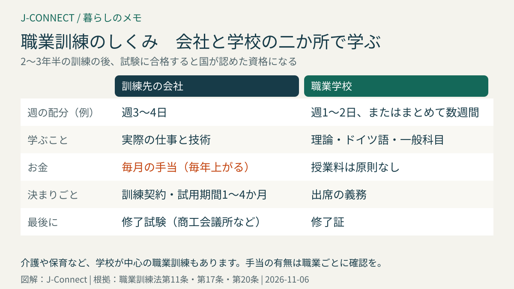
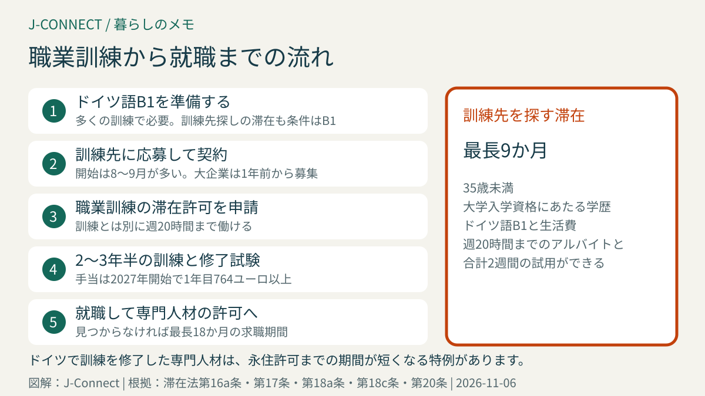

# ドイツの職業訓練（Ausbildung）｜給料をもらいながら資格を取るしくみ、2027年の最低手当764ユーロ、日本人の滞在許可とドイツ語

ドイツでは、料理人、パン職人、美容師、介護、事務、IT、整備士など、多くの職業に「職業訓練（Ausbildung）」という国の資格制度があります。会社で働きながら職業学校で学び、2年から3年半で資格を取るしくみで、訓練中も毎月の手当が支払われます。この記事は、ドイツで手に職をつけたい日本人や、子どもの進路を考える家庭に向けて、職業訓練のしくみ、手当の最低額、訓練先の探し方、滞在許可とドイツ語の条件、修了後の進路を整理します。読み終えると、自分が挑戦できそうか、何から準備すればよいかが分かります。

## まず結論：職業訓練の要点

- **しくみ**：週の大部分を訓練先の会社で働き、残りを職業学校で学ぶ「二つの場所で学ぶ」形が中心です
- **期間**：職業によって2〜3年半
- **手当**：毎年上がり、最低額が法律で決まっています。2027年に始める訓練は1年目**月764ユーロ**以上
- **滞在許可**：日本人は職業訓練の滞在許可（滞在法第16a条）を使います。多くの場合、**ドイツ語B1**が必要です
- **修了後**：資格を生かした仕事に就けば、専門人材の滞在許可に切り替えられます。永住許可への近道にもなります

## 職業訓練のしくみ

ドイツの職業訓練の多くは、訓練先の会社と職業学校の二か所で学ぶ形です。

- **会社で**：実際の仕事を担当しながら、決められた訓練計画に沿って技術を身につけます。
- **職業学校で**：週1〜2日、または数週間まとめて、その職業の理論とドイツ語、社会などの一般科目を学びます。
- **試験**：途中と最後に、商工会議所や手工業会議所などが行う試験を受け、合格すると国が認めた資格になります。

介護や保育、医療の一部の職業のように、学校が中心で実習を組み合わせる「学校での職業訓練」もあります。こちらは職業によって手当が出ない場合もあるので、事前に確認してください。

訓練を始めるときは、会社と**訓練契約**を結びます。契約には、訓練の内容、期間、1日の訓練時間、手当の額、休暇、試用期間などを書くことが法律で決まっています（職業訓練法第11条）。試用期間は**1か月以上4か月以内**です（同第20条）。

## 訓練中の手当

訓練先は、訓練生に適切な手当を払う義務があり、手当は**毎年上がる**ことが法律で決まっています（職業訓練法第17条）。最低額は、訓練を始めた年で決まり、2026年・2027年に始める訓練は次のとおりです。

| 訓練の年数 | 2026年に開始 | 2027年に開始 |
| --- | --- | --- |
| 1年目 | 月724ユーロ | 月764ユーロ |
| 2年目 | 月854ユーロ | 月902ユーロ |
| 3年目 | 月977ユーロ | 月1,031ユーロ |
| 4年目 | 月1,014ユーロ | 月1,070ユーロ |

2年目以降は、1年目の額にそれぞれ18%・35%・40%を足した額です。業界の労働協約がある会社では、これより高い手当が払われることも多く、職業によって大きく違います。手当から、税金と社会保険料が差し引かれます。

手当だけでは都市での生活費が足りない場合があります。滞在許可の審査でも、生活費をまかなえるかが確認されるため、不足する場合は貯金などの証明を求められることがあります。

## 日本人が職業訓練を受けるための滞在許可

### 職業訓練の滞在許可（滞在法第16a条）

訓練先が決まったら、職業訓練の滞在許可を申請します。主な条件は次のとおりです。

- 訓練契約があること
- 連邦雇用エージェンシーの同意（訓練の条件がドイツ人と同等かなどの確認）
- **ドイツ語B1**の証明（訓練先や学校が語学力を確認済みの場合や、訓練前の語学コースで身につける場合を除く）
- 生活費と健康保険

日本国籍の人は、ビザなしで入国してドイツ国内で申請することもできます（滞在令第41条）。ただし、許可が出るまで訓練を始められないので、訓練の開始日（多くは8月か9月）に間に合うよう、余裕を持って申請してください。

### 訓練先を探すための滞在（滞在法第17条第1項）

まだ訓練先が決まっていない人は、訓練先を探すための滞在許可を受けられる場合があります。条件は、**35歳未満**、日本の高校卒業など大学入学の資格にあたる学歴、**ドイツ語B1**、生活費の証明で、期間は**最長9か月**です。この間は週20時間までのアルバイトと、合計2週間までの試用の仕事ができます。

## 訓練中に働ける範囲

職業訓練の滞在許可では、訓練とは別に**週20時間まで**アルバイトができます（滞在法第16a条第3項）。ただし、訓練と職業学校の負担は大きいので、無理のない範囲にしましょう。訓練先の会社の許可が必要な場合もあります。

## 訓練先の探し方

- **連邦雇用エージェンシーの求人検索**：訓練の求人（Ausbildungsplatz）を職業や地域で探せます。
- **商工会議所・手工業会議所の訓練先リスト**：地域の会社の募集が見られます。
- **会社に直接応募**：大企業は1年前から募集を始めることが多く、締め切りが早めです。
- **日系企業や日本食の店**：日本語や日本の文化を生かせる訓練先もあります。料理人や販売の訓練は、日本食レストランや食品店で受けられる場合があります。

応募には、ドイツ式の履歴書と、志望の動機を書いた手紙、学校の成績証明書（翻訳）が一般的です。応募や面接で使う表現は[職場の会話で使うドイツ語](/germany/ja/learn-german/workplace-conversation-phrases/)や[仕事のメールで使うドイツ語](/germany/ja/learn-german/work-email-phrases/)を参考にしてください。

## 修了後の進路

- **そのまま就職する**：多くの訓練生は、修了後に訓練先で正社員として働き始めます。資格を生かす仕事なら、専門人材の滞在許可（滞在法第18a条）に切り替えられます。
- **仕事を探す**：修了後、仕事を探すための滞在許可を**最長18か月**受けられます（滞在法第20条）。
- **永住許可**：ドイツで職業訓練を修了した専門人材は、永住許可までの期間が短くなる特例があります。条件は[ドイツの永住許可](/germany/ja/living/permanent-residence-germany/)で説明しています。
- **さらに上の資格**：経験を積んで「マイスター」などの上位の資格を目指す道もあります。

## 訓練を途中でやめたいとき

訓練契約は、試用期間中はいつでも、理由を示さずに解約できます。試用期間の後は、訓練生の側からは**4週間前**に、理由を書いた書面（メールは不可）で伝えれば、訓練をやめる、または別の職業の訓練に移ることができます（職業訓練法第22条）。

滞在許可は訓練のためのものなので、訓練をやめたときは外国人局に伝える必要があります。訓練生の責任でない理由で訓練が終わった場合は、別の訓練先を探すために最長6か月の猶予が与えられます（滞在法第16a条第4項）。

## よくある質問

### 年齢の上限はありますか？

職業訓練そのものに年齢の上限はなく、30代で始める人もいます。ただし、訓練先を探すための滞在許可は35歳未満が条件です。

### 日本の専門学校の資格は認められますか？

日本で取った職業資格が、ドイツの職業訓練と同等と認められれば、訓練を受けずに専門人材として働ける場合があります。認定の手続きは職業ごとに担当機関が異なります。認定されなかった部分を補う研修（滞在法第16d条）の制度もあります。

### 子どもがドイツの学校を卒業した後に職業訓練を受けられますか？

ドイツの学校を卒業した子どもは、ドイツの同級生と同じように職業訓練の道を選べます。家族の滞在許可を持っている場合は、多くの場合そのまま訓練を受けられます。ドイツの学校制度は[ドイツで子どもの学校をどう選ぶ？](/germany/ja/living/schools-germany-japanese-families/)で説明しています。

## 関連記事

- [ドイツのビザ・滞在許可の種類](/germany/ja/living/germany-visa-types-japanese/)
- [ドイツの労働契約](/germany/ja/living/employment-contract-germany/)
- [ドイツのチャンスカード](/germany/ja/living/chancenkarte-germany-japanese/)
- [ドイツの永住許可](/germany/ja/living/permanent-residence-germany/)
- [ドイツの健康保険](/germany/ja/living/health-insurance-guide/)

## 公式情報・参考ソース

- [職業訓練法第17条：訓練手当と最低額](https://www.gesetze-im-internet.de/bbig_2005/__17.html)
- [職業訓練法第11条：訓練契約に書く内容](https://www.gesetze-im-internet.de/bbig_2005/__11.html)
- [職業訓練法第20条：試用期間](https://www.gesetze-im-internet.de/bbig_2005/__20.html)
- [職業訓練法第22条：訓練契約の解約](https://www.gesetze-im-internet.de/bbig_2005/__22.html)
- [滞在法第16a条：職業訓練の滞在許可](https://www.gesetze-im-internet.de/aufenthg_2004/__16a.html)
- [滞在法第17条：訓練先を探すための滞在](https://www.gesetze-im-internet.de/aufenthg_2004/__17.html)
- [滞在法第20条：修了後の求職](https://www.gesetze-im-internet.de/aufenthg_2004/__20.html)
- [滞在法第18a条：職業資格を持つ専門人材](https://www.gesetze-im-internet.de/aufenthg_2004/__18a.html)

**参照日：2026年11月6日。** 手当の最低額は毎年見直されます。2027年の金額は2026年秋に公表された額です。この記事は一般的な情報で、個別の法的助言ではありません。滞在許可の条件は、必ず外国人局やドイツ大使館の最新の案内で確認してください。
