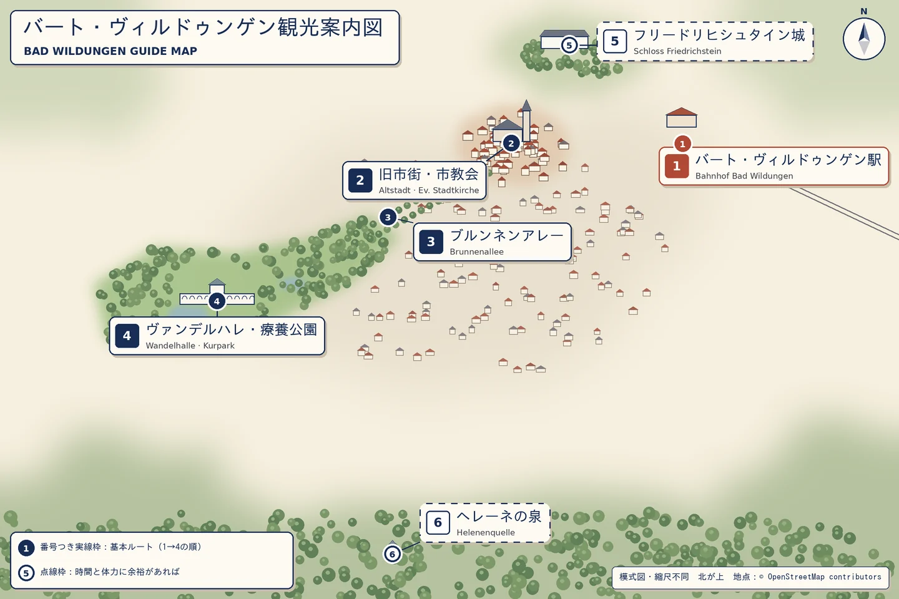
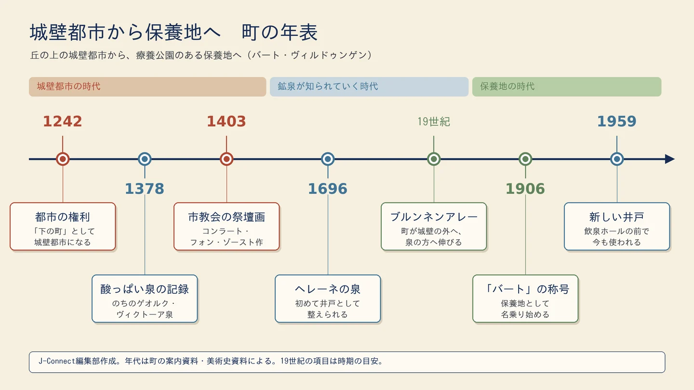

# バート・ヴィルドゥンゲン1泊2日｜ヨーロッパ最大級の療養公園と鉱泉の町を歩く

バート・ヴィルドゥンゲンは、ヘッセン州北部の森に囲まれた保養地で、丘の上の木組みの旧市街と、町が「ヨーロッパ最大」とうたう療養公園が並木道一本でつながっています。この記事では、駅から旧市街、並木の大通り、飲泉ホールのある公園へ歩く1泊2日のルートを紹介します。中世の小さな城壁都市が、鉱泉をきっかけに保養地へ姿を変えた歴史も合わせて読み解きます。

## 位置関係と基本ルート

駅は町の東の端にあり、西へ1キロほど進むと、丘の上に楕円形の旧市街があります。旧市街から南西へ延びる大通りがブルンネンアレー（Brunnenallee）で、その先に療養公園と飲泉ホール「ヴァンデルハレ」が広がります。北の丘にはフリードリヒシュタイン城、南の森の入口にはヘレーネの泉があります。

初日は「旧市街から公園へ歩く」一本道、二日目は城か森のどちらかを選ぶ、と分けると無理がありません。丘の上にある旧市街と城へは上り坂があるため、荷物は宿か駅で身軽にしてから歩き始めます。

## 丘の上の城壁都市として始まった町

町の案内によると、800年ごろに記録に現れた集落が、1242年に「ニーダー・ヴィルドゥンゲン（下の町）」として都市の権利を得ました。「下」と呼ばれたのは、城の周りにあった、より古い上の町アルトヴィルドゥンゲンと区別するためです。今日の旧市街の楕円形の輪郭は、かつての城壁と堀の線をそのまま写しています。

城壁の内側に暮らしたのは1500人ほどとされ、町の大きさは今もほとんど変わりません。大きな通りが交わる場所に市場広場と市庁舎、少し高い位置に教会が置かれた、中世都市の典型的な配置です。最も古い防御塔「赤い雄鶏（ローター・ハーン）」は重罪人の牢獄としても使われ、三つの門には見張りの部屋と牢がありました。

木組みの家の正面をよく見ると、建てられた時代によって木材の組み方や装飾が違います。観光地として整えられた広場だけで引き返さず、城壁沿いの細い道も一本歩くと、小さな町が外敵から身を守りながら暮らしていた密度が伝わってきます。

## 市教会の祭壇画と「眼鏡の使徒」

旧市街で最も重要な見どころは、町を見下ろすように建つ福音派の市教会と、その内陣にある「ヴィルドゥンゲンの祭壇画」です。ヴェストファーレンの画家コンラート・フォン・ゾーストが1403年ごろに描いたとされ、中央パネルだけで高さ約1.9メートル、幅約3メートルあります。ドイツの初期板絵を代表する作品として、美術史の文献に繰り返し登場します。

金地を背景にキリストの生涯を描く画面の中で、特に知られているのが、本をのぞき込みながら眼鏡を押さえる使徒の姿です。アルプス以北で眼鏡が描かれた最も古い例の一つとされています。600年以上前の教会の中で、読書に苦労する人の仕草がこれほど身近に描かれていることに驚かされます。

教会は礼拝や行事の時間には見学が制限され、季節によって開いている時間が変わります。作品の前では、使徒たちの表情や衣のひだを一人ずつ追うように見ると、600年前の画家の観察眼がよく分かります。

## ブルンネンアレーは町が保養地へ伸びた道

旧市街は長いあいだ城壁の中にとどまり、町が外へ広がり始めたのは19世紀になってからでした。成長の方向を決めたのは、南西の郊外にあった「酸っぱい泉（ザウアーブルンネン）」です。炭酸を含む鉱泉へ向かって家並みが延び、その軸となったのが現在のブルンネンアレーです。

並木道の両側には、保養客を迎えた19世紀末から20世紀初めのホテルや邸宅が残ります。旧市街の木組みの家と比べると、窓が大きく、装飾が華やかで、町の主役が農業を営む市民から各地の保養客へ移ったことが建物の顔つきで分かります。町が「バート（温泉・保養地）」の称号を名乗るようになったのは1906年です。

旧市街の城壁跡にある円形の稜堡からは、この大通りがまっすぐ延びていく様子を見渡せます。地図で見るより、ここで一度振り返って町の構造を確かめると、後半の公園歩きがぐっと分かりやすくなります。

## 飲泉ホールで鉱泉を味わう

ブルンネンアレーの先に広がる療養公園の中心に、長い回廊を持つ飲泉ホール「ヴァンデルハレ」があります。かつての酸っぱい泉は、町の案内では1378年の記録にさかのぼるとされ、19世紀のヴァルデック侯ゲオルク・ヴィクトーアにちなんでゲオルク・ヴィクトーア泉と呼ばれるようになりました。元の泉はホールの中にあり、現在は1959年に掘り直した井戸の水が使われています。

町には15の療養泉があり、ヴァンデルハレと、公園の西端にある隣地区ラインハルツハウゼンの飲泉ホールで、いくつかの泉の水を飲み比べできます。泉ごとに炭酸の強さ、鉄分、ミネラルの味がはっきり違い、町の人が散歩に自分のカップを持ち歩く習慣にも納得できます。ホールの上階には泉の歴史を紹介する「鉱泉博物館」があります。

療養泉の水は医療目的のミネラル水で、ふつうの飲料水とは扱いが違います。味見程度なら気軽に楽しめますが、持病や服薬がある人が続けて飲む場合は、ホールの案内や医師に相談してください。保養地らしい午後を過ごすなら、ホールで開かれる療養楽団の演奏会の日程も見ておくと楽しめます。

## 50ヘクタールの療養公園を歩く

療養公園は面積約50ヘクタール、長さ約6キロにわたって、中心部からラインハルツハウゼン地区まで続きます。町はこれを「ヨーロッパ最大の療養公園」と紹介しています。池、花壇、古木の並木、演奏用のパビリオンが点在し、坂の傾斜を利用した11本の「地形療法コース」が、療養の一環として歩く距離と勾配を段階的に示しています。

ここでの散歩は、19世紀以来の保養文化そのものです。医師の指示で決まった量の泉水を飲み、決まった道を歩き、音楽を聴いて休む。現在も町はドイツ有数のリハビリ・療養の拠点で、公園では療養中の人たちとすれ違います。観光客は静かな雰囲気を壊さないよう、自転車や大声の会話は控えめにします。

全長を歩き通す必要はありません。初日はヴァンデルハレの周りを一周し、二日目に余力があれば西のラインハルツハウゼン方面へ延ばす、くらいがちょうどよい距離です。

## 二日目は城か森か、一つを選ぶ

**城を選ぶ場合**：旧市街の北の丘に建つフリードリヒシュタイン城は、ヴァルデック伯家が建てたバロック様式の城館です。現在はヘッセン・カッセル文化財管理機構の分館として、同機構で最も充実した、狩猟と軍事の歴史のコレクションを展示しています。城の前からは、旧市街の屋根と市教会の塔を一望できます。冬季は閉館期間や開館日の制限があるため、行く前に必ず確認してください。

**森を選ぶ場合**：公園の南からヘレーネの泉へ向かうと、町並みがすぐに森へ変わります。この泉は1696年に初めて井戸として整えられ、町は成分の組み合わせがドイツで唯一のものだと紹介しています。さらに足を延ばせば、ユネスコ世界自然遺産「カルパティア山脈とヨーロッパ各地の古代及び原生ブナ林」の一部であるケラーヴァルト＝エーダーゼー国立公園や、エーダー湖もこの町から近い距離にあります。森へ入る日は、日没時刻と帰りのバスの時刻を先に決めておきます。

## 白雪姫の村という物語

町の南の森にある小さな鉱山村ベルクフライハイトは、「白雪姫の村」を名乗っています。地元の郷土研究家が1994年の著書で、ヴァルデック伯家の娘マルガレータの生涯と、銅を掘った鉱山村の暮らしが、グリム童話「白雪姫」のもとになったと唱えたことがきっかけです。村の名前は、1561年にヴァルデック伯が出した鉱山の自由に関する布告に由来します。

この説は民俗学の研究者の間では根拠が弱いと見られており、史実として確かめられたものではありません。それでも、坑道で働いた小柄な鉱夫たちと「七人の小人」を重ねる想像は、深い森と鉱山の歴史を持つこの土地だからこそ生まれたものです。村には童話の世界を再現した「白雪姫の家」があり、開館は季節ごとに週数日の午後に限られます。物語として楽しみ、史実と伝説を分けて受け止めるのがよいでしょう。

## 交通・予約で必要なこと

バート・ヴィルドゥンゲン駅は地域列車の終点で、カッセルからヴァーベルンを経由する路線が結んでいます。NRWからは長距離列車でカッセルまたはヴァーベルンへ行き、地域列車に乗り換えるのが基本で、乗り継ぎ次第で片道4〜5時間ほどかかります。地域列車の区間は[ドイツ全国共通の地域交通定期券](/germany/ja/living/germany-train-travel-guide/#全国共通の地域交通定期券)の対象です。乗り換えが一回でも崩れると次の列車まで間隔が空くため、[鉄道旅行ガイドの遅延時の判断](/germany/ja/living/germany-train-travel-guide/#遅延-運休が起きたら)を参考に、遅れたら旧市街を後回しにして公園から始めます。

駅から旧市街までは徒歩15分ほど、公園の飲泉ホールまでは40分ほどかかり、途中に坂もあります。荷物が多い日は市内バスを使います。町の案内パンフレットによると、町内の宿に泊まると滞在税を含むゲストカードが渡され、市内バス、市営の博物館、療養楽団の演奏会が無料になり、城の入場料などが割引になります。特典の内容は年によって変わるため、チェックイン時に確認してください。

**確認手順**：出発の二日前に、乗り換え駅を含む列車の時刻と工事情報、フリードリヒシュタイン城と市教会の公開日を、それぞれ公式サイトで確認します。冬は城が閉まっている期間があり、教会も行事で見学できないことがあります。

**確認手順**：到着したら、ブルンネンアレーにある観光案内所で、その週の演奏会、ガイドツアー、飲泉ホールの開いている時間を聞きます。聞き方は[旅行で使うドイツ語の観光案内所の表現](/germany/ja/learn-german/travel-german-phrases/#観光案内所で当日券-ツアーを聞く)が使えます。

同じ温泉文化を日帰りで比べたい人は、ローマ時代からの温泉の町を歩く[アーヘン日帰り旅行](/germany/ja/living/aachen-day-trip/)も参考になります。

## まとめ

バート・ヴィルドゥンゲンの魅力は、丘の上の中世の城壁都市と、19世紀に泉へ向かって伸びた保養地が、一本の並木道でつながっていることです。市教会で600年前の「眼鏡の使徒」に出会い、ブルンネンアレーを歩いて鉱泉を飲み比べ、療養公園をゆっくり歩くと、町が泉によって生まれ変わった道筋がそのまま体験できます。二日目は城か森を一つだけ選び、静かな保養地の時間の流れに合わせて過ごしてください。
