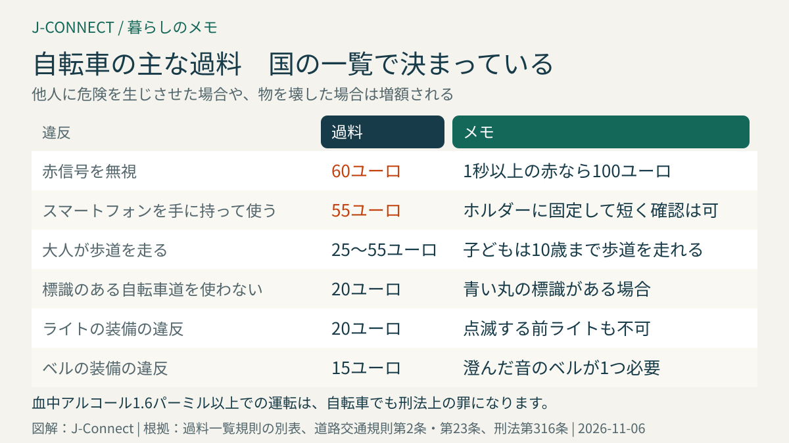
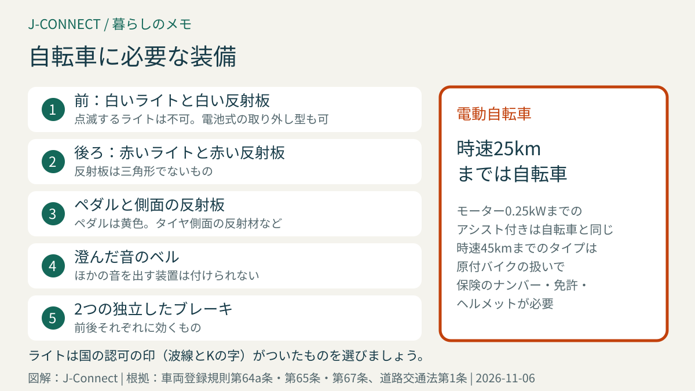

# ドイツで自転車に乗るときのルール｜自転車道と歩道、ライトとベルの装備、信号無視60ユーロなどの過料、飲酒、子どもの自転車、電動自転車

ドイツでは、自転車は通勤や買い物、子どもの送り迎えに欠かせない交通手段で、多くの街に専用の自転車道があります。一方で、日本とはルールや考え方が違い、歩道を走る、ライトをつけずに走る、信号を無視するといった行為には、国が決めた過料（反則金）がかかります。この記事は、ドイツで自転車に乗る日本人やその家族に向けて、走る場所、自転車の装備、過料の金額、飲酒、子どもの自転車、電動自転車の違いを法律に沿って整理します。読み終えると、安心して自転車に乗るために何を確認すればよいかが分かります。

## まず結論：日本と違う5つのポイント

1. **大人は歩道を走れない**：歩道を走れるのは原則として子どもだけです
2. **自転車道は右側通行**：標識のある自転車道は使う義務があり、逆方向に走るのは原則禁止です
3. **装備が法律で決まっている**：前後のライト、反射板、ベル、**2つのブレーキ**が必要です
4. **過料がある**：信号無視は**60ユーロ**から、運転中のスマートフォンは**55ユーロ**など
5. **電動自転車は2種類**：時速25kmまでのアシスト付きは自転車、時速45kmまでのものはバイクの扱い

## どこを走るか

### 自転車道

青い丸の標識（自転車のマーク）がある自転車道は、**使う義務**があります（道路交通規則第2条第4項）。標識がない自転車道は、使っても車道を走っても構いません。

- **進行方向の右側**の自転車道を走ります。左側の自転車道は、「自転車通行可」の補助標識がある場合だけ走れます。
- 道路に白い線で描かれた自転車レーンや、路面に自転車のマークがある「保護レーン」を走ることもできます。
- 周りの交通の妨げにならなければ、2台並んで走れます。

### 歩道は子どもだけ

大人が歩道を自転車で走ることは、原則として禁止です。子どもについては、次のように決まっています（道路交通規則第2条第5項）。

| 子どもの年齢 | 走る場所 |
| --- | --- |
| 8歳になるまで | **歩道を走らなければならない**（車道から分離された自転車道も可） |
| 10歳になるまで | 歩道を走ってもよい |
| 10歳から | 大人と同じ（車道や自転車道） |

8歳になるまでの子どもに付き添う16歳以上の大人は、付き添っている間、一緒に歩道を自転車で走れます。歩道では、歩行者に十分注意し、歩く速さに合わせます。

### 自転車専用の道路

「自転車道路（Fahrradstraße）」の標識がある道路は、自転車が優先で、自動車は補助標識で許可された場合だけ通れます。自転車が並んで走ることも認められています。

## 自転車に必要な装備

自転車を公道で使うには、次の装備が必要です（車両登録規則第64a条・第65条・第67条）。

- **前のライト**（白）と**前の白い反射板**
- **後ろのライト**（赤）と**後ろの赤い反射板**
- ペダルの**黄色い反射板**と、タイヤ側面の反射材などの**横の反射板**
- **ベル**（澄んだ音のもの）
- **2つの独立したブレーキ**

ライトは、取り外せる電池式でも構いませんが、暗いときやトンネルでは取り付けて使います。点滅する前のライトは使えません。国の認可を示す印（波線とKの字と番号）がついたライトを選びましょう。

日本から持ってきた自転車や、競技用の自転車は、装備が足りないことがあります。自転車店で、ドイツの基準を満たしているか確認してもらうと安心です。

## 主な過料の金額

自転車の違反の金額は、国の過料一覧に決められています（過料一覧規則の別表）。主なものは次のとおりです。

| 違反 | 過料 |
| --- | --- |
| 赤信号を無視 | 60ユーロ |
| 1秒以上赤だった信号を無視 | 100ユーロ |
| 運転中にスマートフォンを手に持って使う | 55ユーロ |
| 歩道を走る | 25〜55ユーロ（状況による） |
| 標識のある自転車道を使わない | 20ユーロ |
| 一方通行を逆に走る（許可がない場合） | 20ユーロ |
| ライトの装備の違反 | 20ユーロ |
| ベルの装備の違反 | 15ユーロ |

他人に危険を生じさせたり、物を壊したりした場合は、金額が高くなります。赤信号の無視などは、自動車の運転免許の点数制度にも記録されることがあります。

スマートフォンは、ホルダーに固定して、手に持たずに短く確認する程度なら認められますが、手に持って操作するのは禁止です（道路交通規則第23条第1a項）。イヤホンで音楽を聞くことは禁止されていませんが、周りの音が聞こえる音量にとどめる必要があります。

## お酒を飲んだら乗らない

自転車でも、お酒を飲んで運転すると処罰の対象になります。

- 血中アルコール濃度が**1.6パーミル**以上だと、事故を起こしていなくても、運転できない状態とみなされ、刑法上の罪になります（刑法第316条、裁判所の判断による基準）。
- **0.3パーミル**以上でも、ふらつきや事故など、運転できない状態だったと判断されれば処罰されます。
- 自動車の運転免許に影響したり、医学・心理検査を求められたりすることもあります。

## 電動自転車の2つの種類

| 種類 | 最高速度のアシスト | 扱い | 必要なもの |
| --- | --- | --- | --- |
| 電動アシスト自転車（ペデレック） | 時速25kmまで、モーターは0.25kWまで | **自転車** | 自転車と同じ |
| 高速の電動自転車（S-ペデレック） | 時速45kmまで | **原付バイク** | 保険のナンバー、運転免許（AM以上）、ヘルメット |

一般的な電動アシスト自転車は、道路交通法上は自転車として扱われます（同法第1条第3項）。時速45kmまでアシストする高速のタイプは、原付バイクと同じ扱いで、保険のナンバープレート、運転免許、ヘルメットが必要で、原則として自転車道を走れません。購入するときは、どちらの種類かを必ず確認してください。

電動キックボードは、別の規則があり、歩道は走れず、運転できるのは14歳からです。

## ヘルメットとけが・事故への備え

- **ヘルメット**：普通の自転車と電動アシスト自転車では、ヘルメットは法律上の義務ではありません。ただし、子どもを中心に着用が強くすすめられています。
- **自動車との間隔**：自動車が自転車を追い越すときは、市街地で1.5m、市街地の外で2m以上の間隔を空けることが義務です（道路交通規則第5条第4項）。
- **賠償責任保険**：自転車で人にけがをさせたり、車を傷つけたりしたときに備えて、個人の賠償責任保険に入っておくと安心です。[ドイツの個人賠償責任保険と家財保険](/germany/ja/living/liability-household-insurance-germany/)で説明しています。

## 盗難を防ぐ

ドイツでは自転車の盗難が多く、特に駅前や集合住宅の駐輪場で被害が目立ちます。

- **丈夫なU字ロックやチェーンロック**で、柱などの動かない物と一緒にロックします
- 車体番号を控え、自転車の写真と購入時のレシートを保管します
- 警察などが行う**自転車への刻印**の制度を使える地域もあります
- 高価な自転車は、家財保険の自転車の特約や、自転車保険で盗難に備えます

盗まれたら、警察に被害届を出します。保険の請求には被害届の受付番号が必要です。

## 電車に自転車を乗せる

ドイツの多くの電車には自転車を乗せる場所があります。地域の電車では、自転車の切符が別に必要な場合があり、長距離列車では自転車の予約が必要です。混雑する時間帯は乗せられないこともあります。[ドイツの鉄道の乗り方](/germany/ja/living/germany-train-travel-guide/)も参考にしてください。

## よくある質問

### 日本の自転車をドイツに持ってきて乗れますか？

乗れますが、ドイツの装備の基準を満たしている必要があります。前後のライト、反射板、ベル、2つのブレーキがあるかを確認してください。

### 冬も自転車に乗れますか？

雪や凍結の日は滑りやすく危険です。冬用のタイヤに替える人もいます。暗い時間が長いので、ライトの電池や充電も確認しましょう。

### 子どもを自転車に乗せるときの決まりはありますか？

自転車に子どもを乗せられるのは、16歳以上の人が、7歳未満の子どもを専用の座席に乗せる場合などです。子ども用の座席は、足が車輪に巻き込まれない構造のものを使います。子ども用のトレーラーを使う家庭も多くあります。

## 関連記事

- [ドイツの鉄道の乗り方](/germany/ja/living/germany-train-travel-guide/)
- [日本の運転免許とドイツ](/germany/ja/living/drivers-license-japan-germany/)
- [ドイツの個人賠償責任保険と家財保険](/germany/ja/living/liability-household-insurance-germany/)
- [ドイツ生活の最初の30日](/germany/ja/living/germany-first-30-days/)
- [ドイツの冬タイヤ義務](/germany/ja/living/winter-tires-germany-2026/)

## 公式情報・参考ソース

- [道路交通規則第2条：自転車道と歩道、子どもの自転車](https://www.gesetze-im-internet.de/stvo_2013/__2.html)
- [道路交通規則第5条：自転車を追い越すときの間隔](https://www.gesetze-im-internet.de/stvo_2013/__5.html)
- [道路交通規則第23条：運転中の電子機器の使用](https://www.gesetze-im-internet.de/stvo_2013/__23.html)
- [車両登録規則第67条：自転車のライトと反射板](https://www.gesetze-im-internet.de/stvzo_2012/__67.html)
- [車両登録規則第64a条：自転車のベル](https://www.gesetze-im-internet.de/stvzo_2012/__64a.html)
- [車両登録規則第65条：2つのブレーキ](https://www.gesetze-im-internet.de/stvzo_2012/__65.html)
- [過料一覧規則の別表：違反ごとの金額](https://www.gesetze-im-internet.de/bkatv_2013/anlage.html)
- [道路交通法第1条：電動アシスト自転車の定義](https://www.gesetze-im-internet.de/stvg/__1.html)
- [刑法第316条：酒気を帯びた運転](https://www.gesetze-im-internet.de/stgb/__316.html)

**参照日：2026年11月6日。** 過料の金額は改正されることがあります。この記事は一般的な情報で、個別の法的助言ではありません。具体的な事故や違反の扱いは、警察や専門家に確認してください。
