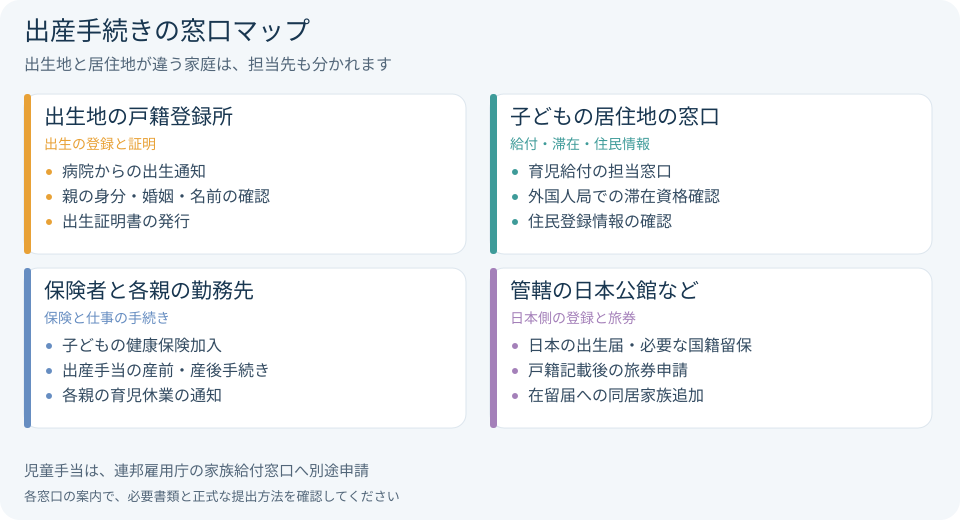
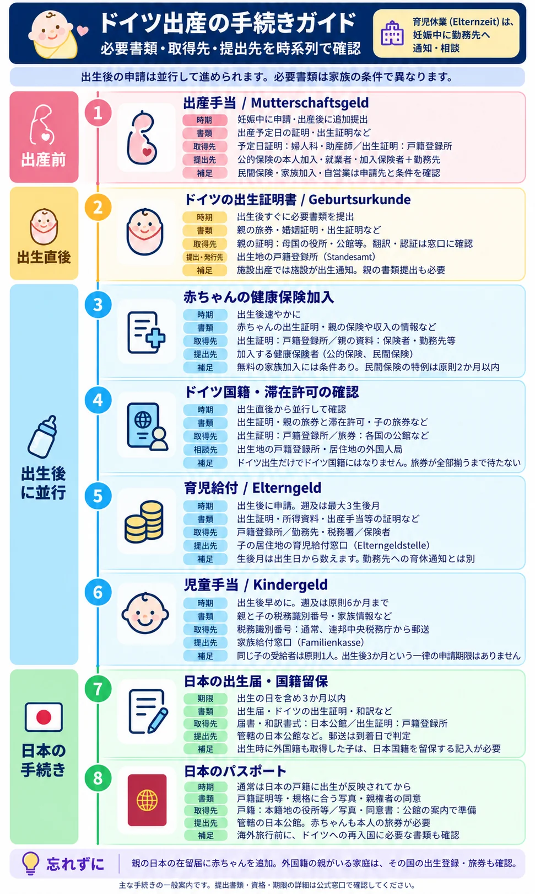

# 外国籍の配偶者がいる場合の出生届（ドイツ）｜必要書類・認定翻訳・アポスティーユの要否【2026年版】

配偶者が外国籍の家庭がドイツで出産する場合、出生届に必要な書類は、両親の国籍、婚姻状況、出生地の戸籍登録所によって異なります。特に、外国の出生証明書の原本、翻訳者の要件、アポスティーユなどの認証は一律ではありません。この記事では、出産前に窓口へ確認する項目と、日本側の出生届・国籍留保を含む準備の順番を整理します。

## まず結論

- 何を：両親の出生証明書と婚姻証明書を、出生地の戸籍登録所が受け付ける形（原本・認定翻訳・必要なら認証）でそろえる。
- いつまでに：ドイツの出生届は出生から**1週間以内**（病院で生まれた場合は病院が届け出る）。外国の証明書の取り寄せや翻訳に時間がかかることがあるため、妊娠中に早めに準備を始める。日本の出生届は出生の日から**3か月以内**で、子が出生で外国籍も得る場合は同時に国籍を留保する。
- どこで：子どもが生まれる場所の戸籍登録所（Standesamt）。日本側は管轄の日本の在外公館。
- 費用と期間：翻訳費用と納期は、言語、ページ数、翻訳者によって異なる。複数の翻訳者から見積もりを取り、書類の提出期限から逆算して依頼する。

## あなたはどのケース？

| あなたの家庭 | 違うところ | 確認すること |
| --- | --- | --- |
| 結婚していて、配偶者が外国籍 | 配偶者の出生証明書は配偶者の国で発行されたもの。原本・翻訳・認証の要否を戸籍登録所に確認 | この記事の手順どおり |
| 結婚していない | 父の認知と共同親権の手続きが別に必要。日本人父と外国人母の場合は、日本国籍のために胎児認知が関わる | 出産前に戸籍登録所と日本の在外公館へ相談 |
| 配偶者の国の証明が電子発行 | 紙の証明と扱いが異なる場合がある | 電子の証明を受け付けるか、認証が要るかを先に聞く |
| 外国籍の親がドイツに5年以上住み、無期限の滞在資格がある | 子が出生でドイツ国籍を得る場合がある（国籍法第4条第3項） | 出生登録時に戸籍登録所で確認。日本国籍の留保も必要 |
| 住所と出産する病院の市が違う | 出生届は出生地の戸籍登録所。住所地の窓口ではない | 病院のある市の戸籍登録所の案内を見る |

## 手順

1. 出産前：出生地の戸籍登録所の公式ページで、出生届の必要書類と問い合わせ先を確認する。メールアドレスは必ず自治体の公式ページから取得し、部署名も確認する。
2. 同じ時期：戸籍登録所に、家庭の状況（結婚している、配偶者の国籍、書類の発行国）を書いてメールで問い合わせ、書類ごとに「原本か」「翻訳は誰の訳か」「アポスティーユなどの認証が要るか」を聞く。ドイツの規則では、婚姻している両親は婚姻証明書と、必要に応じて両親の出生証明書、旅券などを出す（戸籍法施行令第33条）。
3. 日本人の親の出生証明書：日本の在外公館の公式案内を確認し、必要に応じて発行を依頼する。手順は「[ドイツ出産の手続き完全ガイド](/germany/ja/living/birth-procedures-germany/#両親の出生証明書を準備する)」を参照。
4. 配偶者の国の出生証明書：原本を取り寄せる。電子発行しかない国では、電子の証明を受け付けるかを戸籍登録所に確認する。
5. 翻訳を依頼する：外国語の書類にはドイツ語訳が求められる（戸籍法施行令第2条）。提出先が求める翻訳者の資格、署名・押印の形式、原本かスキャンかを先に確認する。複数の認定翻訳者に見積もりを頼む。翻訳者の探し方は「[ドイツで認定翻訳を頼む](/germany/ja/living/certified-translation-germany/)」。
6. 出産前に一式をそろえ、戸籍登録所に事前に送れるか、出生後に持参するかを確認する。
7. 出生後：病院が出生を戸籍登録所に届け出る（戸籍法第20条）。親は指示された書類を出し、出生証明書を受け取る。名前と生年月日などの記載を受け取り時に確認する。
8. 出生の日から3か月以内：日本の在外公館に出生届を出す。子が出生で外国籍も得た場合は、出生届の「日本国籍を留保する」欄に記入しないと、出生時にさかのぼって日本国籍を失う。

## 落とし穴

- 宛先アドレスが違う：ネット上で見つけた古いアドレスや別部署のアドレスでは届かないことがある。必ず市の公式ページから取り直し、届いたか分からないときは電話で確認する。
- 翻訳者の資格：自分や知人の翻訳、ドイツ国外の翻訳が受け付けられるとは限りません。提出先が求める認定資格、署名・押印の形式を事前に確認してください。
- アポスティーユの思い込み：要否は書類の発行国、紙か電子か、提出先の判断で変わります。ほかの人のケースを一般化せず、自分の書類ごとに確認してください。
- 原本を送ってしまう：原本が必要か、コピーや電子証明で足りるかは書類と提出先によって異なります。返却の可否も含め、送付前に確認してください。
- 日本国籍の留保を忘れる：外国のパスポートを作らなくても、子が出生で外国籍を得ていれば留保が必要。3か月を過ぎると後から戻せない。

## そのまま使えるドイツ語

| 場面 | ドイツ語 | 日本語 |
| --- | --- | --- |
| 電話の最初の一言 | Guten Tag, ich habe eine Frage zur Geburtsanzeige. Unser Kind kommt im [Monat] zur Welt. | こんにちは、出生届について質問があります。子どもが〇月に生まれる予定です。 |
| メールが届いたか確認する | Ich habe Ihnen am [Datum] eine E-Mail geschickt. Ist sie bei Ihnen angekommen? | 〇日にメールを送りました。届いていますか。 |
| 翻訳者の条件を聞く | Muss die Übersetzung von einem in Deutschland ermächtigten Übersetzer sein? | 翻訳はドイツで認定された翻訳者のものである必要がありますか。 |

戸籍登録所への問い合わせメール：

> 件名：Geburtsanzeige – benötigte Unterlagen (Entbindung voraussichtlich im [Monat Jahr])
> Sehr geehrte Damen und Herren,
> unser Kind wird voraussichtlich im [Monat Jahr] in [Klinik/Stadt] geboren. Wir sind verheiratet. Ich bin japanische Staatsangehörige / japanischer Staatsangehöriger, mein Ehepartner hat die [Staatsangehörigkeit] Staatsangehörigkeit.
> Könnten Sie mir bitte mitteilen, welche Unterlagen wir für die Geburtsanzeige vorlegen müssen? Insbesondere:
> 1. Werden die ausländischen Urkunden im Original benötigt?
> 2. Ist für die Geburtsurkunde meines Ehepartners eine Apostille erforderlich, oder genügt eine Übersetzung?
> 3. Muss die Übersetzung von einem in Deutschland ermächtigten Übersetzer angefertigt werden?
> 4. Können wir die Unterlagen bereits vor der Geburt einreichen?
> Mit freundlichen Grüßen
> [Name]

和訳：件名「出生届の必要書類（出産予定〇年〇月）」。子どもが〇年〇月に〇〇で生まれる予定です。両親は婚姻しています。片方の親は日本国籍、もう片方の親は〇〇国籍です。出生届に必要な書類を教えてください。特に、1. 外国の証明書は原本が必要ですか。2. 出生証明書にアポスティーユは必要ですか。3. 翻訳はドイツで認定された翻訳者によるものでなければなりませんか。4. 出生前に書類を提出できますか。

## 出産前に戸籍登録所へ確認する項目

- 両親それぞれの出生証明書・婚姻証明書について、原本、コピー、電子証明のどれが必要か。
- 翻訳者の資格、言語、署名・押印の形式に指定があるか。
- アポスティーユや領事認証が必要か。発行国・書類の形式ごとに確認する。
- 出産前に書類を事前提出できるか。出生後に追加で必要な書類は何か。
- 原本の返却方法、提出期限、翻訳の納期を確認し、回答を保存する。

## 日本側の手続き

- 出生届：出生の日を含めて3か月以内に、管轄の日本の在外公館（または日本の本籍地）に出す。郵送では期限内に公館に届く必要がある。
- 国籍留保：子が出生でほかの国籍も得た場合は、出生届の「日本国籍を留保する」欄に記入する。しないと、出生時にさかのぼって日本国籍を失う（国籍法第12条、戸籍法第104条）。
- パスポート：通常は出生届が戸籍に反映された後に申請する。
- 在留届：子どもを同居家族に追加する。

国籍留保の期限と方法は、[国籍法第12条](https://laws.e-gov.go.jp/law/325AC0000000147)と[戸籍法第104条](https://laws.e-gov.go.jp/law/322AC0000000224)（出生の日から3か月以内、出生届と同時に届け出る）で確認しました（2026年11月14日確認）。在外公館の案内ページはこの環境から開けず未確認です。必要書類は管轄の在外公館の案内を確認してください。

## 関連記事

- [ドイツ出産の手続き完全ガイド](/germany/ja/living/birth-procedures-germany/)
- [ドイツで認定翻訳を頼む](/germany/ja/living/certified-translation-germany/)
- [ドイツで妊娠・出産する日本人へ](/germany/ja/living/pregnancy-birth-germany/)

## 公式情報・参考ソース

- [戸籍法第18条：出生から1週間以内の届出](https://www.gesetze-im-internet.de/pstg/__18.html)（2026年11月14日確認）
- [戸籍法第20条：病院などの施設による届出](https://www.gesetze-im-internet.de/pstg/__20.html)（2026年11月14日確認）
- [戸籍法施行令第33条：出生届の添付書類](https://www.gesetze-im-internet.de/pstv/__33.html)（2026年11月14日確認）
- [戸籍法施行令第2条：外国語の書類のドイツ語訳](https://www.gesetze-im-internet.de/pstv/__2.html)（2026年11月14日確認）
- [国籍法第4条：出生によるドイツ国籍の取得](https://www.gesetze-im-internet.de/stag/__4.html)（2026年11月14日確認）
- [NRW州司法：通訳・翻訳者](https://www.justiz.nrw/Gerichte_Behoerden/anschriften/dolmetscher__u_uebersetzer)：NRW州では、翻訳者の認定（Ermächtigung）の申請と問い合わせは州内の上級地方裁判所が受け付ける。根拠はNRW州司法法第33〜39条と裁判所通訳者法（2026年11月15日確認）
- [国籍法第12条・戸籍法第104条（e-Gov法令検索）](https://laws.e-gov.go.jp/law/322AC0000000224)：国籍留保は出生の日から3か月以内に出生届とともに（2026年11月14日確認）
- [在デュッセルドルフ日本国総領事館：出生届](https://www.dus.emb-japan.go.jp/itpr_ja/konsular_koseki_04.html)：必要書類（この環境から接続を拒否され未確認）
