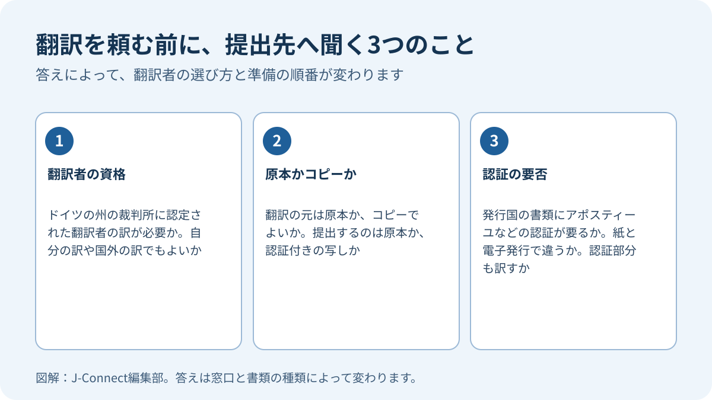
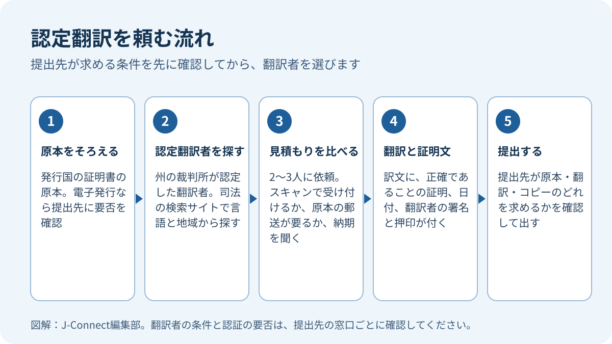

# ドイツで認定翻訳（beglaubigte Übersetzung）を頼む｜翻訳者の探し方・見積もり依頼のメール文例【2026年版】

ドイツの役所に外国語の書類を出すと、提出先から認定翻訳を求められることがあります。自分で訳したものや、ドイツ国外で作った訳が受け付けられるとは限らず、誰に頼めばよいか分からずに止まりがちです。この記事では、州の公的検索サイトで翻訳者を探す方法、見積もりで確認する項目、依頼メールの文例をまとめます。

## まず結論

- 何を：提出先が求める条件（翻訳者の資格、原本かコピーか、認証の要否）を確かめてから、州の裁判所に認定された翻訳者に頼む。
- いつまでに：翻訳は原本がそろってから始まる。出生届のように期限が短い手続き（出生から**1週間以内**）は、出産前に翻訳まで済ませる。
- どこで：州の司法当局の検索サイトで、言語と地域から翻訳者を探す。NRW州では、翻訳者の認定の申請は州内の上級地方裁判所（OLG）が受け付ける。
- 費用と期間：料金は翻訳者ごとに違う。2〜3人に見積もりを頼み、納期とスキャン受付の可否もあわせて比べる。

## あなたはどのケース？

| あなたの状況 | 違うところ | 確認すること |
| --- | --- | --- |
| 戸籍登録所（出生届・婚姻）に出す | 外国語の書類にはドイツ語訳を求めるのが原則（戸籍法施行令第2条）。認定翻訳者の訳を指定されることが多い | 翻訳者の条件、アポスティーユの要否、原本の要否 |
| 外国人局・住民登録に出す | 窓口や書類によって、認定翻訳が要らない場合もある | 翻訳が要るか、誰の訳でよいか |
| 日本の書類（戸籍など）を出す | 日本の在外公館が独自に訳文や証明を出す書類もある | 公館の証明で足りるか、認定翻訳が要るか |
| 電子で発行された書類 | 紙の証明と扱いが違うことがある | 電子の証明を受け付けるか、認証が要るか |

## 手順

1. 提出先に条件を聞く：翻訳者の資格（ドイツの州で認定された翻訳者か）、翻訳の元は原本かコピーか、アポスティーユなどの認証が要るかを、メールで確認して記録を残す。
2. 原本をそろえる：発行国の証明書の原本を手元に置く。翻訳者が原本を見る必要があるか、スキャンでよいかは翻訳者によって違う。
3. 翻訳者を探す：州の司法当局の通訳・翻訳者データベースで、言語と地域を選んで探す。NRW州は司法のページから検索できる。翻訳者は州の裁判所に認定されており、自分の認定を証明文に書く。
4. 見積もりを頼む：2〜3人に、書類の種類、ページ数、スキャン画像、希望の納期を送る。料金の数え方（行数・文字数・ページ）、スキャンで受け付けるか、原本の郵送が必要か、仕上がりを郵送するかを聞く。
5. 依頼する：条件の合う翻訳者に、提出先と用途（例：出生届）を伝えて依頼する。人名や地名の綴りは、パスポートの表記に合わせるよう頼む。
6. 受け取って確認する：訳文に、正確で完全であることの証明、場所と日付、翻訳者の資格の記載、署名が付いているかを確認する（民事訴訟法第142条第3項の形式。押印する翻訳者が多い）。名前と日付の綴りを原本と照らし合わせる。
7. 提出する：原本、翻訳、コピーのどれを出すかを提出先の指示どおりに分ける。

## 落とし穴

- 自分で訳してしまう：内容が正しくても、認定翻訳者の訳を求める窓口では受け付けられない。先に条件を聞く。
- 綴りの不一致：翻訳での名前の綴りがパスポートと違うと、出生証明書などに違う綴りが載ることがある。依頼時にパスポートの写しを渡す。
- 原本の郵送で時間を失う：原本を見ないと訳せない翻訳者もいる。スキャンで受け付ける翻訳者もいたので、急ぐときは最初に確認する。
- 認証の順番：アポスティーユが要る場合、認証を受けた後の書類（認証部分も含めて）を訳すよう求められることがある。順番を提出先に確認する。
- 用途の違い：ある窓口で使えた翻訳が、別の窓口や別の国でも使えるとは限らない。

## そのまま使えるドイツ語

| 場面 | ドイツ語 | 日本語 |
| --- | --- | --- |
| 提出先に条件を聞く | Muss die Übersetzung von einem in Deutschland ermächtigten Übersetzer angefertigt werden? | 翻訳は、ドイツで認定された翻訳者が作ったものでなければなりませんか。 |
| 翻訳者にスキャン可否を聞く | Können Sie die Übersetzung anhand eines Scans anfertigen, oder benötigen Sie das Original? | スキャンから翻訳できますか、それとも原本が必要ですか。 |
| 綴りを指定する | Bitte übernehmen Sie die Schreibweise der Namen aus dem beigefügten Reisepass. | 名前の綴りは、添付したパスポートの表記に合わせてください。 |

見積もり依頼のメール：

> 件名：Anfrage beglaubigte Übersetzung – Geburtsurkunde ([Sprache] → Deutsch)
> Sehr geehrte Damen und Herren,
> ich benötige eine beglaubigte Übersetzung einer Geburtsurkunde aus dem [Sprache] ins Deutsche für die Vorlage beim Standesamt.
> Die Urkunde umfasst [Anzahl] Seite(n). Einen Scan habe ich beigefügt.
> Könnten Sie mir bitte ein Angebot mit Preis und Lieferzeit schicken und mitteilen, ob Sie die Übersetzung anhand des Scans anfertigen können oder das Original benötigen?
> Mit freundlichen Grüßen
> [Name]

和訳：件名「認定翻訳の見積もり依頼（出生証明書、〇〇語→ドイツ語）」。戸籍登録所に出すため、出生証明書を〇〇語からドイツ語へ認定翻訳していただきたいです。証明書は〇ページで、スキャンを添付しました。料金と納期の見積もりを送っていただけますか。また、スキャンから翻訳できるか、原本が必要かを教えてください。

## 翻訳を依頼する前に確認する項目

- 提出先が求める翻訳者の資格・認定と、翻訳言語の組み合わせ。
- 翻訳する書類の全ページ、裏面、印影、欄外の記載を含める必要があるか。
- 原本、コピー、スキャンのどれを翻訳者へ渡し、完成品をどの形式で受け取るか。
- 翻訳者の署名・押印、製本、電子署名、追加認証の要否。
- 見積もりの総額、納期、郵送費、追加ページ料金、急ぎ料金。

## 関連記事

- [外国籍の配偶者がいる場合の出生届](/germany/ja/living/birth-registration-foreign-spouse-germany/)
- [ドイツ出産の手続き完全ガイド](/germany/ja/living/birth-procedures-germany/)
- [ドイツの住民登録](/germany/ja/living/anmeldung-guide/)

## 公式情報・参考ソース

- [民事訴訟法第142条第3項：認定翻訳者の翻訳と証明文](https://www.gesetze-im-internet.de/zpo/__142.html)（2026年11月14日確認）
- [戸籍法施行令第2条：外国語の書類の翻訳](https://www.gesetze-im-internet.de/pstv/__2.html)（2026年11月14日確認）
- [NRW州司法：通訳・翻訳者](https://www.justiz.nrw/Gerichte_Behoerden/anschriften/dolmetscher__u_uebersetzer)：NRW州では、翻訳者の認定（Ermächtigung）の申請と問い合わせは州内の上級地方裁判所が受け付ける。根拠はNRW州司法法第33〜39条と裁判所通訳者法（2026年11月15日確認）
- [州司法当局の通訳・翻訳者データベース](https://www.justiz-dolmetscher.de/)：全国の認定翻訳者を、名前・地域・言語で検索できる（2026年11月15日確認）
