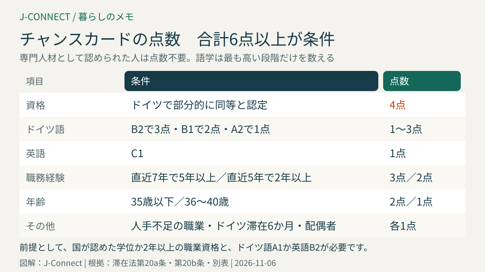
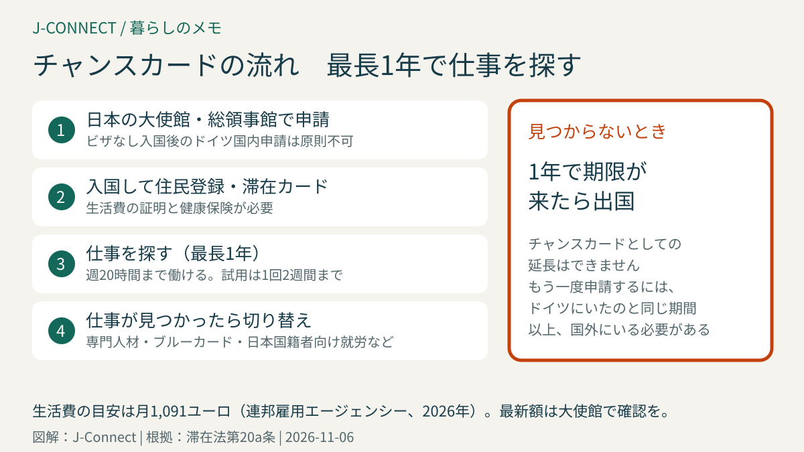

# ドイツのチャンスカード（求職ビザ）｜6点の点数制、生活費の証明、週20時間の就労、日本で申請する流れ

ドイツで働きたいけれど、まだ仕事が決まっていない人のために、2024年に「チャンスカード（Chancenkarte）」という滞在許可ができました。大学の学位や職業資格を持つ人が、最長1年ドイツに住みながら仕事を探し、その間はアルバイトもできます。この記事は、ドイツでの就職や転職を考えている日本人に向けて、点数制の条件、生活費の証明、働ける範囲、申請の流れを滞在法の条文に沿って整理します。読み終えると、自分が条件を満たしそうか、何を準備すればよいかが分かります。

## まず結論：チャンスカードの要点

- **期間**：最長1年（滞在法第20a条第5項）
- **働ける範囲**：平均で週20時間までのアルバイトと、1回2週間までの試用の仕事（同条第2項）
- **条件**：ドイツで認められた資格を持つ「専門人材」か、点数制で**6点以上**（同条第3項、別表）
- **生活費**：自分で暮らせる資金の証明が必要。連邦雇用エージェンシーは2026年の目安を**月1,091ユーロ**としています
- **申請先**：ビザなしで入国した人はドイツ国内で申請できないため、**日本のドイツ大使館・総領事館**で申請するのが基本です（同条第4項）

## 条件1：専門人材なら点数は不要

滞在法第18条第3項でいう「専門人材（Fachkraft）」に当たる人は、点数を計算しなくてもチャンスカードを申請できます。専門人材とは、次のどちらかの人です。

- ドイツの職業訓練と同等と**認定された**外国の職業資格を持つ人
- ドイツの大学の学位、または**ドイツの学位と同等と認められる**外国の大学の学位を持つ人

日本の大学の学位がドイツの学位と同等かは、各州の文部大臣会議が運営する外国学位のデータベース（anabin）で、大学と学位の評価を確認できます。大学が「H+」と評価され、学位がドイツの学位と同等とされていれば、専門人材として扱われる可能性が高くなります。データベースで確認できない場合は、同会議の外国教育評価センターに学位の評価書（比較可能性の証明）を申請します。

## 条件2：専門人材でない人は点数制

専門人材でない人は、まず次の**基本条件をすべて**満たす必要があります（滞在法第20a条第4項）。

1. 次のどれかを持っていること
   - 取得した国で国が認めた、**2年以上の課程**の職業資格
   - 取得した国で国が認めた**大学の学位**
   - 在外ドイツ商工会議所が出した、ドイツの職業訓練の基準を満たす職業資格
2. **ドイツ語A1以上**、または**英語B2以上**の証明があること

職業資格や学位は、ドイツ国内の専門機関の確認を受ける必要があります。日本の大学の学位なら、上のデータベースの評価や評価書が確認の手段になります。日本の専門学校の資格が「国が認めた2年以上の課程」に当たるかは、ケースによって判断が分かれるので、早めに大使館に相談してください。

### 点数の計算

基本条件を満たしたうえで、次の表の点数を合計して**6点以上**が必要です（滞在法第20b条、別表）。

| 項目 | 点数 |
| --- | --- |
| 外国の資格が、ドイツで**部分的に**同等と認められた（追加の研修などで完全に認められる見込み） | 4点 |
| ドイツ語B2 | 3点 |
| ドイツ語B1 | 2点 |
| ドイツ語A2 | 1点 |
| 英語C1 | 1点 |
| 資格取得後、直近7年で5年以上の関連する職務経験 | 3点 |
| 資格取得後、直近5年で2年以上の関連する職務経験 | 2点 |
| 資格が人手不足の職業（ブルーカードの優遇対象の職業）に当たる | 1点 |
| 申請時に35歳以下 | 2点 |
| 申請時に36〜40歳 | 1点 |
| 直近5年でドイツに6か月以上、合法的に続けて住んでいた | 1点 |
| 配偶者も条件を満たし、一緒にチャンスカードを申請する | 1点 |

ドイツ語は最も高い段階だけが数えられ、B2の人がB1やA2の点数を重ねて受けることはできません。

### 計算の例

- **30歳・大学卒・職務経験3年・ドイツ語A2の人**：職務経験2点＋35歳以下2点＋ドイツ語A2で1点＝5点。あと1点足りないので、ドイツ語をB1まで上げる（2点に）、英語C1を証明する、などで6点に届きます。
- **38歳・大学卒・職務経験8年・ドイツ語B1の人**：職務経験3点＋36〜40歳1点＋ドイツ語B1で2点＝6点。条件を満たします。

年齢の点数は申請した時点で判断されるので、35歳や40歳の誕生日が近い人は、申請の時期に注意してください。

## 条件3：生活費を証明する

チャンスカードは、仕事を探す間、自分のお金で暮らせることが条件です（滞在法第20a条第4項）。連邦雇用エージェンシーは、2026年の目安として**月1,091ユーロ**、1年分で1万3,092ユーロを示しています。証明の方法は、一般的に次のどれかです。

- ドイツの銀行の**閉鎖口座（Sperrkonto）**に1年分を入金し、毎月決まった額だけ引き出せるようにする
- ドイツに住む人などが生活費を保証する書類（保証の申告書）
- 週20時間までの仕事の雇用契約で、生活費を補う

金額は毎年見直されることがあります。申請前に大使館の最新の案内を確認してください。健康保険の加入も必要で、仕事を探している間は、民間の保険に入るのが一般的です。保険のしくみは[ドイツの健康保険](/germany/ja/living/health-insurance-guide/)で説明しています。

## 日本で申請する理由

日本国籍の人は、ほとんどの滞在許可をビザなしで入国してからドイツ国内で申請できます（滞在令第41条）。ところが、チャンスカードについては、すでにドイツにいる人に申請が認められるのは、**学生や就労など、教育・就労の目的の滞在許可を持っている人だけ**と定められています（滞在法第20a条第4項）。

このため、観光でビザなしで入国し、ドイツ国内でチャンスカードに切り替えることは、原則としてできません。日本に住んでいる人は、東京のドイツ大使館か大阪・神戸のドイツ総領事館でビザを申請してから入国します。ドイツの大学に留学している人や、ドイツで働いている人は、外国人局でチャンスカードに切り替えられる場合があります。

## チャンスカードで働ける範囲

- **アルバイト**：平均で週20時間まで。仕事の種類に制限はありません。
- **試用の仕事**：資格を生かす仕事などの試用として、**1回あたり2週間まで**働けます。採用前のお試し勤務に使えます。

週20時間を超えて働きたい場合や、本採用で働き始める場合は、就労の滞在許可に切り替える必要があります。

## 仕事が見つかったら

仕事が見つかったら、その仕事に合った滞在許可に切り替えます。大学の学位を生かす仕事なら専門人材の許可（滞在法第18b条）、年収の条件を満たせば[EUブルーカード](/germany/ja/living/eu-blue-card-germany/)が候補です。日本国籍の人は、資格を問わない就労の許可（滞在法第19c条）も選べます。

専門的な仕事が見つかったのに、ほかの就労の滞在許可の条件を満たさない場合は、チャンスカードを**最長2年延長**できる「次のチャンスカード」の制度があります（滞在法第20a条第5項）。連邦雇用エージェンシーの同意が必要です。

1年たっても仕事が見つからない場合、チャンスカードは延長できません。もう一度申請するには、ドイツにいたのと同じ期間以上、国外にいる必要があります。

## 申請の流れ

1. **点数と資格を確認する**：学位の評価、語学の証明書、職務経験の証明（在職証明書や推薦状）をそろえます。
2. **生活費と保険を準備する**：閉鎖口座の開設と入金、健康保険の加入証明を用意します。
3. **大使館・総領事館に申請する**：オンラインで予約し、パスポート、申請書、写真、履歴書、資格・語学・経験の証明、生活費の証明などを提出します。
4. **入国後**：住民登録をし、ビザの期限内に外国人局で電子滞在カードの滞在許可に切り替えます。

必要書類の最新のリストや、英語・ドイツ語への翻訳が必要な書類は、大使館の案内で確認してください。

## よくある質問

### ドイツ語ができなくても申請できますか？

英語B2以上の証明があれば、ドイツ語ができなくても基本条件は満たせます。ただし、ドイツ語の点数がない分、ほかの項目で6点を集める必要があります。また、実際の仕事探しでは、ドイツ語が求められる職場が多いのが現実です。

### チャンスカードで日本食レストランなどでアルバイトできますか？

週20時間までなら、仕事の種類に制限はありません。ただし、本業として長時間働く場合は、就労の滞在許可が必要です。

### ワーキングホリデーとどちらがよいですか？

18〜30歳の人は、ワーキングホリデーのほうが働ける時間の制限が少なく、資格の条件もありません。一方、チャンスカードは年齢の上限がなく、仕事が見つかった後の切り替えを前提にした制度です。[ドイツのワーキングホリデー](/germany/ja/living/working-holiday-germany/)と比べて選んでください。

## 関連記事

- [ドイツのビザ・滞在許可の種類](/germany/ja/living/germany-visa-types-japanese/)
- [ドイツのEUブルーカードとは](/germany/ja/living/eu-blue-card-germany/)
- [ドイツのワーキングホリデー](/germany/ja/living/working-holiday-germany/)
- [ドイツの滞在許可を申請・更新する方法](/germany/ja/living/residence-permit-renewal-germany/)
- [ドイツで仕事を探す方法](/germany/ja/jobs/guide/)

## 公式情報・参考ソース

- [滞在法第20a条：チャンスカード](https://www.gesetze-im-internet.de/aufenthg_2004/__20a.html)
- [滞在法第20b条：チャンスカードの点数](https://www.gesetze-im-internet.de/aufenthg_2004/__20b.html)
- [滞在法の別表：点数表と最低6点](https://www.gesetze-im-internet.de/aufenthg_2004/anlage.html)
- [滞在法第18条：専門人材の定義](https://www.gesetze-im-internet.de/aufenthg_2004/__18.html)
- [滞在法第2条：ドイツ語能力の段階](https://www.gesetze-im-internet.de/aufenthg_2004/__2.html)
- [滞在令第41条：日本国籍者などのビザなし入国](https://www.gesetze-im-internet.de/aufenthv/__41.html)
- [連邦雇用エージェンシー：チャンスカード](https://www.arbeitsagentur.de/vor-ort/zav/working-and-living-in-germany/newsletter-iss/02-2026/chancenkarte)

**参照日：2026年11月6日。** 点数表や生活費の金額は、政令などで変わることがあります。この記事は一般的な情報で、個別の法的助言ではありません。申請前に必ずドイツ大使館・総領事館の最新の案内を確認してください。
