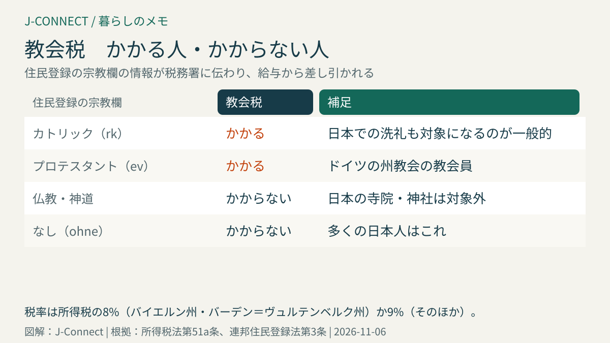
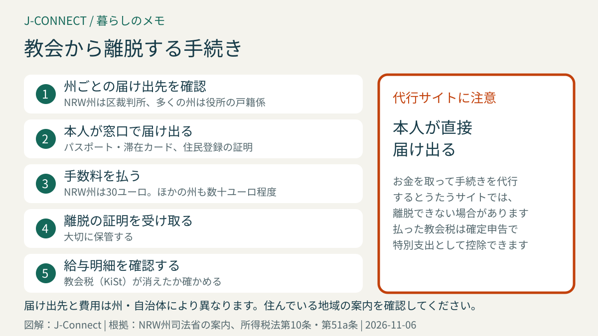

# ドイツの教会税｜住民登録の宗教欄、税率8%・9%、日本で洗礼を受けた人の注意、離脱の手続きと費用

ドイツでは、カトリックやプロテスタントなど、国が認めた宗教団体に属している人に「教会税（Kirchensteuer）」がかかります。給与から自動的に差し引かれるため、気づかないまま払い続けている人もいます。この記事は、ドイツで働く日本人や、これから住民登録をする人に向けて、教会税がかかる人とかからない人、住民登録の宗教欄の書き方、給与明細での確認方法、教会から離脱する手続きを整理します。読み終えると、自分に教会税がかかるのか、間違ってかかっていないかを確認できます。

## まず結論：教会税の要点

- **かかる人**：ドイツでカトリック、プロテスタント（ドイツ福音主義教会に属する州教会）、一部のユダヤ教の団体などに属している人
- **かからない人**：仏教、神道、無宗教など、教会税を集める団体に属していない人。**多くの日本人は対象外**です
- **税率**：所得税の**8%**（バイエルン州、バーデン＝ヴュルテンベルク州）または**9%**（そのほかの州）
- **決まり方**：住民登録の宗教欄の情報が税務署に伝わり、給与から差し引かれます
- **やめるには**：役所や区裁判所で教会からの離脱を届け出ます。費用は州により異なり、NRW州は**30ユーロ**です

## 教会税のしくみ

教会税は、宗教団体が州の法律に基づいて集める税金で、実際の徴収は税務署が代わりに行います。会社員の場合は、給与から所得税と一緒に差し引かれます（所得税法第51a条）。

- **計算の基礎**：所得税（給与から差し引かれる給与所得税）の額。子どもがいる人は、子どもの控除を考えた額で計算されます。
- **税率**：バイエルン州とバーデン＝ヴュルテンベルク州は**8%**、そのほかの州は**9%**です。
- **例**：月の給与所得税が500ユーロの人は、NRW州なら月45ユーロ、年540ユーロの教会税になります。
- **銀行の利子や配当**：資本所得にかかる税金にも、教会税が上乗せされます。

## 住民登録の宗教欄が決め手

教会税がかかるかどうかは、**住民登録の宗教欄**で決まります。住民登録の情報には、宗教団体の所属が含まれ（連邦住民登録法第3条）、この情報が税務署を通じて会社の給与計算に使われます。

住民登録の用紙には、カトリック（rk）やプロテスタント（ev）などを書く欄があります。教会税を集める団体に属していない人は、「なし（ohne）」などを記入します。仏教徒の人も、日本の寺院は教会税を集める団体ではないため、教会税の対象になりません。

分からないまま「キリスト教」などと推測で書くと、教会税がかかってしまう可能性があります。住民登録の手順は[ドイツの住民登録](/germany/ja/living/anmeldung-guide/)で説明しています。

## 日本で洗礼を受けたことがある人の注意

日本でキリスト教の洗礼を受けたことがある人は、注意が必要です。

- **カトリックの洗礼を受けた人**：カトリック教会は世界で一つの組織と考えられているため、ドイツでもカトリック教会の信者として扱われ、教会税の対象になるのが一般的です。
- **プロテスタントの教会で洗礼を受けた人**：日本の教会の多くは、ドイツの州教会とは別の団体です。ドイツの州教会に入る手続きをしなければ、原則として教会税の対象になりません。ただし、教会の種類や本人の申告によって判断が分かれることがあります。
- **子どもの頃に洗礼を受けただけで、自覚がない人**：住民登録で「なし」と書いても、後で教会が洗礼の記録を確認し、教会税を求められることがあります。

教会員であることを続けるか迷う場合は、教会や税務署に相談してください。

## 給与明細で確認する

給与明細の税金の欄に、カトリックなら「RK」、プロテスタントなら「EV」などの略号と、教会税の金額（Kirchensteuer、略して「KiSt」）が書かれています。教会員でないのに教会税が差し引かれている場合は、次の順番で確認します。

1. **住民登録の証明を確認する**：住民登録の窓口で、宗教欄が正しいか確認します。
2. **間違いなら訂正を求める**：住民登録の窓口で訂正を申し出ます。
3. **税務署に連絡する**：訂正の証明を税務署に出し、会社の給与計算に使われる情報を直してもらいます。
4. **払いすぎた分**：確定申告や税務署への申し出で、払いすぎた教会税の返金を求められる場合があります。

給与計算に使われる税の情報は[税番号と税区分](/germany/ja/living/tax-id-steuernummer-steuerklasse/)で説明しています。

## 夫婦の一方だけが教会員の場合

夫婦で税区分を組み合わせて合算で申告している場合、教会員の人の分だけに教会税がかかります。一部の州では、教会員の配偶者に収入がなく、教会員でない配偶者だけが収入を得ている場合に、教会員の人に「特別教会費」と呼ばれる負担がかかることがあります。日本人とドイツ人の夫婦などで、どちらか一方だけが教会員の場合は、確定申告の前に確認してください。

## 教会から離脱する手続き

教会に属したくない、教会税を払いたくない場合は、教会からの離脱を届け出ます。

- **届け出先**：州によって異なります。NRW州やベルリン州などは**区裁判所**、そのほかの多くの州は**住民登録の役所の戸籍係**などです。
- **費用**：NRW州は**30ユーロ**です（州の司法省の案内）。ほかの州でも数十ユーロ程度ですが、自治体によって違います。
- **必要なもの**：パスポートか滞在カード、住民登録の証明、洗礼の証明（あれば）など
- **いつから止まるか**：離脱が成立した月の終わりなどで、教会税の義務が終わります。会社の給与計算に反映されるまで、少し時間がかかることがあります。

インターネット上には、離脱の手続きを代行すると言ってお金を取るサイトがありますが、本人が役所などに直接届け出る必要があり、こうしたサイトでは離脱できない場合があります。消費者センターも注意を呼びかけています。

離脱すると、教会での結婚式や、教会が運営する施設での仕事などに影響することがあります。宗教的な意味を考えたうえで決めましょう。

## 確定申告での控除

払った教会税は、確定申告で「特別支出」として控除できます（所得税法第10条第1項第4号）。ただし、銀行の利子や配当にかかった分は対象外です。確定申告の流れは[ドイツの確定申告](/germany/ja/living/income-tax-return-germany/)で説明しています。

## よくある質問

### 住民登録のときに宗教欄を書き忘れました。

空欄のままだと、窓口で確認されることがあります。教会員でない場合は「なし」と伝えてください。後で間違いに気づいた場合も、住民登録の窓口で訂正できます。

### 教会税を払っていないと、教会に行けませんか？

教会のミサや礼拝、コンサートには、教会員でなくても参加できます。教会での結婚式や洗礼などは、教会員であることが求められる場合があります。

### 日本に帰国するとき、教会税の手続きは必要ですか？

住民登録を抹消してドイツを離れると、ドイツでの教会税の義務も終わります。帰国の年の確定申告で、教会税も精算されます。[ドイツから本帰国するときの手続き](/germany/ja/living/returning-to-japan-checklist/)も参考にしてください。

## 関連記事

- [ドイツの住民登録](/germany/ja/living/anmeldung-guide/)
- [税番号と税区分](/germany/ja/living/tax-id-steuernummer-steuerklasse/)
- [ドイツの確定申告](/germany/ja/living/income-tax-return-germany/)
- [ドイツの労働契約で確認したいこと](/germany/ja/living/employment-contract-germany/)
- [ドイツから本帰国するときの手続き](/germany/ja/living/returning-to-japan-checklist/)

## 公式情報・参考ソース

- [所得税法第51a条：教会税などの付加税の計算](https://www.gesetze-im-internet.de/estg/__51a.html)
- [所得税法第10条：教会税の控除](https://www.gesetze-im-internet.de/estg/__10.html)
- [連邦住民登録法第3条：登録される情報](https://www.gesetze-im-internet.de/bmg/__3.html)
- [ノルトライン＝ヴェストファーレン州司法省：教会からの離脱](https://www.justiz.nrw/node/1133)

**参照日：2026年11月6日。** 教会税の税率や離脱の手続きは州の法律で決まり、地域によって異なります。この記事は一般的な情報で、個別の税務・法的助言ではありません。具体的な扱いは、税務署、住民登録の窓口、教会に確認してください。
