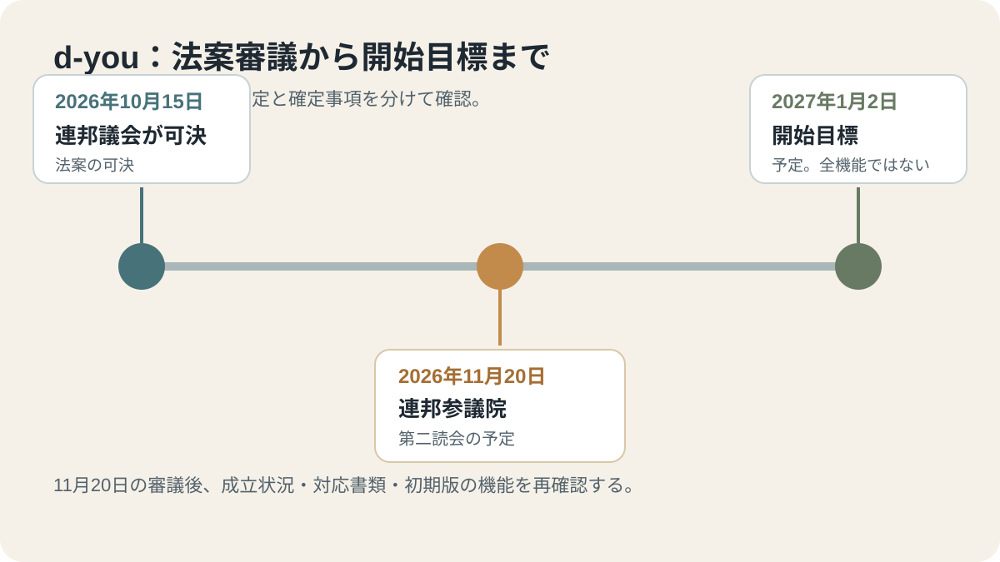
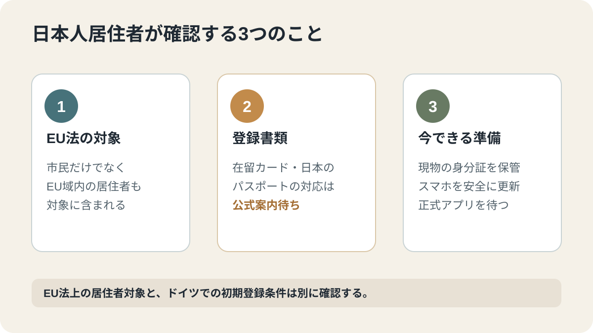

# ドイツのデジタル身分証「d-you」とは？2027年1月開始予定と日本人居住者の注意点

連邦政府の現行案内は、EU共通のデジタル身分証ウォレット「d-you」を2027年1月初旬に開始する計画と説明しています。連邦議会は2026年10月15日に関連法案を可決しましたが、連邦参議院での第2次審議は11月20日に予定されており、現時点では法的手続きが完了していません。日本人を含む外国籍の居住者に向けて、EU法上の対象、開始時に期待できる機能、まだ確認できない点を分けて説明します。

## この記事でわかること

- d-youとEUデジタルIDウォレットの役割
- 2027年1月の開始予定と、2026年11月20日の連邦参議院審議
- 日本人など第三国籍の居住者が確認すべき本人確認書類
- 初期版の機能、任意利用、プライバシー上の注意点

## 2026年11月4日時点の結論

- ドイツのウォレット名は「d-you」。政府は2027年1月初旬の開始を予定しています。
- 連邦議会は2026年10月15日にデジタルID関連法案を可決しました。
- 連邦参議院では2026年11月20日に第2次審議が予定されています。したがって、11月3日時点で最終的な法的手続きが完了したとは扱えません。
- 利用は無料・任意で、紙の書類や対面手続きなどの代替手段は引き続き残ると政府は説明しています。
- EUの枠組みは居住者も対象に含みますが、日本人の在留カードや日本のパスポートを使ったドイツ版ウォレットへの登録方法は、現時点の公開情報では確認できません。

## d-youは何をするアプリ？

EUDI Wallet（European Digital Identity Wallet）は、スマートフォン上で本人確認情報や属性証明を保管し、必要な相手に必要な情報を提示するためのEU共通のデジタル身分証ウォレットです。ドイツ版の名称がd-youです。

政府の説明では、本人確認、行政サービス、銀行手続き、オンライン契約などでの利用が想定されています。将来的には、身分証明に加えて出生証明書、運転免許証、乗車券など、さまざまな証明を扱う構想も示されています。ただし、将来の構想と2027年の初期版で実際に使える機能は分けて考える必要があります。

## 開始までの予定

| 日付 | 状況 |
| --- | --- |
| 2024年5月 | EUのデジタルID規則が発効 |
| 2026年10月15日 | ドイツ連邦議会がデジタルID法案を可決 |
| 2026年11月20日 | 連邦参議院で第2次審議が予定 |
| 2027年1月初旬 | 政府が公表した開始予定 |

開始日や利用可能な機能は、法的手続きと実装状況によって更新される可能性があります。11月20日の審議後に、正式な成立状況と政府の案内を再確認する必要があります。

## 初期版で何ができる予定？

連邦政府は、開始時点で約40の民間・研究・行政機関のパートナーが参加し、年齢確認、法的効力のある契約、銀行口座開設などの用途を想定していると説明しています。

一方、連邦議会の専門家公聴会では、初期版はEU規則が求める全機能を最初から備えるわけではないとの説明がありました。特に、サービスごとに異なる仮名を使って本人の追跡を抑える機能について、個人情報保護上の課題が指摘されています。連邦議会の決議も、この機能が開始時点で利用できない場合には、できるだけ早く追加するよう政府に求めています。

したがって、「2027年1月からすべての行政・民間手続きがスマートフォンだけで完了する」と考えるのは早すぎます。どのサービスが開始日に対応するか、どの証明書を追加できるかを個別に確認してください。

## 日本人など外国籍の居住者は使える？

EU規則の説明では、デジタルIDウォレットはEU市民だけでなく、EU域内の居住者や事業者も対象に含みます。したがって、EUの枠組みそのものは、ドイツに合法的に居住する日本人を一律に対象外としているわけではありません。

ただし、ドイツ政府の説明で具体例として示されているのは、ドイツの身分証明書をスマートフォンに登録する仕組みです。日本人の在留カード、電子滞在許可証、日本のパスポートのどれを、どの方法で本人確認に使えるのかは、2026年11月4日時点の公開案内では確認できません。

そのため、次の点は正式な登録手順が公表されてから判断してください。

- 日本人など第三国籍の居住者が初期版の利用対象になるか
- 電子滞在許可証を本人確認に使えるか
- 日本のパスポートや住所登録情報が必要になるか
- 対応するスマートフォン、OS、本人確認方法は何か

EU規則が「居住者」を対象にしていることと、すべての種類の在留書類が初日から登録できることは同じではありません。

## 無料・任意利用で、従来の身分証は残る

政府は、ウォレットの発行・利用を無料かつ任意とし、紙の書類や従来の本人確認手段を置き換えないと説明しています。使いたくない人やスマートフォンを使えない人が、行政サービスや民間サービスから不利益を受けることがないよう、代替手段を残すこともEU規則の重要な原則です。

したがって、開始後もパスポートや在留カードなどの現物は保管し、必要な場面では従来どおり提示できるようにしてください。d-youの開始だけを理由に、既存の身分証やオンライン本人確認手段を解約・廃止する必要はありません。

## プライバシーと安全性で確認したいこと

EUの枠組みは、利用者が共有する情報を選び、必要以上の個人情報を相手に渡さないことを目指しています。ただし、実際の保護水準は、初期版の機能、利用先のデータ要求、スマートフォン自体の安全性にも左右されます。

連邦議会の公聴会では、仮名利用機能が初期版にない可能性や、スマートフォンのセキュリティ更新が不十分な場合のリスクが議論されました。利用を始める際は、次の点を確認してください。

1. OSとアプリを公式の更新状態に保つ。
2. 画面ロックと端末紛失時の保護を有効にする。
3. 本人確認を求める相手が、なぜその情報を必要とするのか確認する。
4. 年齢確認など一つの属性だけで足りる場面で、身分証全体の情報を共有しない。
5. 政府・監督機関が公表する正式なアプリ配布先とプライバシー説明を確認する。

## 今から準備すること

2026年11月4日時点では、急いで登録したり、非公式アプリを探したりする必要はありません。次の準備にとどめてください。

- パスポート、在留カード、電子滞在許可証など現物の有効期限を確認する。
- スマートフォンがOSのセキュリティ更新を受けられる状態か確認する。
- 2026年11月20日の連邦参議院審議後に、法案の成立状況を確認する。
- 2027年1月の正式案内で、第三国籍住民の登録条件と対応書類を確認する。
- アプリは連邦政府などの公式案内からのみ入手する。

## よくある質問

### d-youの利用は義務ですか？

いいえ。政府は無料・任意の利用と説明しており、従来の手段や対面・紙の手続きも残るとしています。

### 日本人でも利用できますか？

EUの枠組みは居住者を対象に含みます。ただし、ドイツ版の初期登録で日本人の在留カードやパスポートがどう扱われるかは、正式な案内を待つ必要があります。

### d-youがあればパスポートや在留カードを持たなくてよくなりますか？

そのような変更は、現時点の政府案内では確認できません。国際移動や在留資格の確認では、引き続き現物の書類を保管・携帯する前提で行動してください。

### 2027年1月初旬に必ず全機能が使えますか？

いいえ。政府は開始時期を2027年1月初旬と説明しており、現時点で特定の日付は示していません。初期版は全機能を備えない可能性があります。対応サービスと登録条件は正式発表で確認してください。

## 関連記事

- [ドイツの2027年1月からの主な変更点](/germany/ja/events/news/germany-january-2027-changes/)

## 公式情報・参考ソース

- [連邦政府：デジタルブリーフケース「d-you」の開始計画（2026年10月15日）](https://www.bundesregierung.de/breg-de/aktuelles/digitale-brieftasche-2431500)
- [連邦政府：d-youの2027年1月初旬開始、参加パートナー、無料・任意利用に関する現行案内](https://www.bundesregierung.de/breg-de/aktuelles/digital-wallet-2452384)
- [ドイツ連邦議会：EUDI Wallet関連法案・公聴会・決議（2026年10月15日までの審議）](https://www.bundestag.de/dokumente/textarchiv/2026/kw42-de-digitale-identitaeten-gesetz-1223586)
- [ベルリン州政府：2026年11月20日の連邦参議院会議予定（2026年10月30日現在）](https://www.berlin.de/rbmskzl/politik/senatskanzlei/bundesangelegenheiten/der-bundesrat/vorschau-auf-die-bundesratssitzung-1616077.php)
- [欧州委員会：European Digital Identity Wallet](https://digital-strategy.ec.europa.eu/en/factpages/european-digital-identity-wallet)
- [EU規則2024/1183：欧州デジタルIDの法的枠組み](https://eur-lex.europa.eu/legal-content/EN/TXT/?uri=CELEX:32024R1183)
