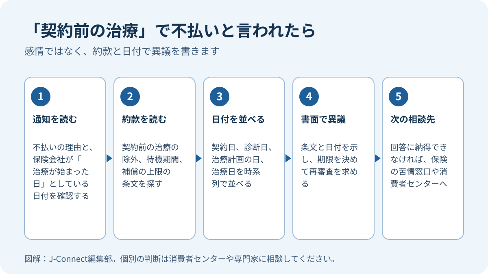
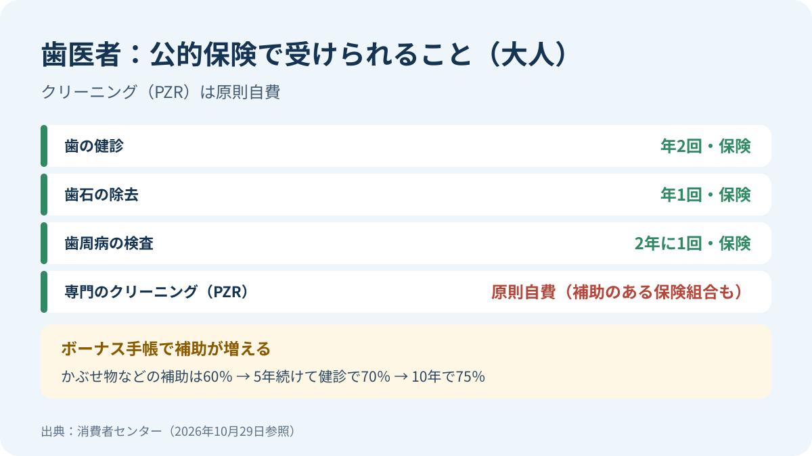

# ドイツの歯科補助保険で「契約前の治療」と言われたら｜不払いの理由の読み方と異議申立ての書き方【2026年 編集部の記録】

ドイツの公的健康保険では、かぶせ物や入れ歯、専門のクリーニングの費用の多くが自己負担になるため、歯科補助保険（Zahnzusatzversicherung）に入る人がいます。ただし、補助保険は契約より前に始まった治療や、すでに勧められていた治療を補償しないのが一般的で、請求してから「契約前の治療」を理由に断られることがあります。この記事は、2026年にJ-Connect編集部のメンバーが実際に不払いとされ、異議を申し立てた記録をもとに、加入前に確かめること、通知の読み方、異議の書き方をまとめます。

## まず結論

- 何を：加入前に、契約前の治療の扱い、待機期間、最初の数年の補償上限を約款で確かめる。不払いの通知が来たら、理由と日付を確認し、根拠を示して書面で異議を出す。
- いつまでに：異議の期限は通知や約款を確認する。民間医療保険では、歯の治療の待機期間は法律上**8か月**まで（保険契約法第197条）。
- どこで：保険会社に書面で。納得できない回答なら、民間医療・介護保険のオンブズマン（無料の苦情窓口）に相談できる。
- 費用と期間：異議の申し立てに費用はかからない。

## あなたはどのケース？

| あなたの状況 | 違うところ | 確認すること |
| --- | --- | --- |
| これから加入する | 歯医者で治療を勧められた後に入っても、その治療は補償されないことが多い | 加入前に歯の健診を受けるか、勧められた治療がないかを確認 |
| 加入後すぐに治療が必要になった | 待機期間や、最初の数年の補償上限にかかることがある | 約款の待機期間と上限 |
| 「契約前の治療」と言われた | 保険会社が「治療が始まった日」をいつと見ているかで決まる | 診断日、治療計画の日、治療開始日、契約日 |
| 加入時の質問に答えた内容が問われた | 契約前の告知義務（保険契約法第19条）の問題になることがある | 加入時の質問と自分の回答の控え |

## 手順

1. 通知を読む：不払いの理由と、保険会社が「治療が始まった日」としている日付、根拠にしている約款の条文番号を確認する。
2. 約款を読む：契約前に始まった治療の除外、待機期間、補償の上限、「治療の開始」の定義を探す。
3. 日付をそろえる：契約日、歯医者で症状を初めて相談した日、診断日、治療計画（Heil- und Kostenplan）の日付、治療日を時系列に並べる。歯医者に、診療記録の該当日を確認してもらう。
4. 異議を書面で出す：保険会社の判断のどこが約款のどの条文と合わないかを、日付を添えて書く。返答の期限（例：4週間）を書き、送った日と方法を記録する。
5. 回答を待つ：再審査の結果が書面で届く。
6. 納得できないとき：民間医療・介護保険のオンブズマンに相談する。費用はかからない（未確認：2026年11月14日にオンブズマンのページをこの環境から開けなかった）。

## 落とし穴

- 勧められた後に入る：歯医者で「この歯は治療が必要」と言われた後に加入すると、その治療は契約前の治療として扱われやすい。
- 「待機期間なし」を「何でも補償」と思う：待機期間がない商品でも、契約前の治療は別の条文で除外されていることが多い。
- 日付があいまい：「いつ治療が始まったか」は、診断、計画、治療のどの日を指すかで結論が変わる。歯医者の記録で日付を確かめる。
- 電話だけで済ませる：電話の説明は記録に残らない。異議は書面（メールでも可かを確認）で出し、控えを残す。
- 告知の回答を控えていない：加入時に答えた質問と回答の控えがないと、後から反論しにくい。

## そのまま使えるドイツ語

| 場面 | ドイツ語 | 日本語 |
| --- | --- | --- |
| 歯医者に日付を聞く | Könnten Sie mir bitte bestätigen, wann diese Behandlung zum ersten Mal festgestellt bzw. empfohlen wurde? | この治療が最初に診断された日、または勧められた日を確認していただけますか。 |
| 保険会社に根拠を聞く | Auf welche Bestimmung Ihrer Versicherungsbedingungen stützen Sie die Ablehnung? | 不払いは、約款のどの条文に基づいていますか。 |
| 電話の最初の一言 | Guten Tag, ich rufe wegen der Ablehnung meiner Erstattung an. Meine Versicherungsnummer ist [Nummer]. | こんにちは、保険金の不払いの件でお電話しました。保険番号は〇〇です。 |

異議のメール・手紙：

> 件名：Widerspruch gegen die Leistungsablehnung vom [Datum], Versicherungsnummer [Nummer]
> Sehr geehrte Damen und Herren,
> hiermit widerspreche ich Ihrer Entscheidung vom [Datum], die Erstattung für die Behandlung vom [Datum] abzulehnen.
> Sie begründen die Ablehnung damit, dass die Behandlung bereits vor Vertragsbeginn begonnen habe. Dies trifft nicht zu: Der Vertrag begann am [Datum]. Die Behandlungsbedürftigkeit wurde erst am [Datum] festgestellt (siehe Bestätigung der Zahnarztpraxis in der Anlage). Nach § [Nummer] Ihrer Versicherungsbedingungen besteht daher Leistungspflicht.
> Ich bitte Sie, Ihre Entscheidung zu überprüfen und mir bis zum [Datum] schriftlich zu antworten.
> Mit freundlichen Grüßen
> [Name]

和訳：件名「〇月〇日付の不払いの決定への異議（保険番号〇〇）」。〇月〇日の治療について保険金を支払わないとした〇月〇日の決定に、異議を申し立てます。貴社は、治療が契約開始前に始まっていたことを理由にしています。しかし、契約の開始は〇月〇日で、治療が必要と診断されたのは〇月〇日です（歯科医院の確認書を添付）。約款第〇条により、支払いの義務があります。決定を見直し、〇月〇日までに書面で回答してください。

## 在住者の実例

J-Connect編集部メンバーの実例（2026年、デュッセルドルフ近郊）。

| したこと | 結果 |
| --- | --- |
| 歯科補助保険に治療費を請求 | 「契約前の治療」を理由に不払いとされた |
| 異議の申し立て | 約款の条文を根拠に、書面で異議を申し立てた |

異議の結果が出たら、この記事に追記します。保険会社の名前は載せていません。

## 関連記事

- [ドイツの歯医者のかかり方](/germany/ja/living/dentist-germany-guide/)
- [ドイツの健康保険の選び方](/germany/ja/living/health-insurance-guide/)

## 公式情報・参考ソース

- [保険契約法第197条：待機期間は一般3か月、歯の治療は8か月まで](https://www.gesetze-im-internet.de/vvg_2008/__197.html)（2026年11月14日確認）
- [保険契約法第19条：契約前の告知義務](https://www.gesetze-im-internet.de/vvg_2008/__19.html)（2026年11月14日確認）
- [民間医療・介護保険オンブズマン](https://www.pkv-ombudsmann.de/)：2026年11月14日にこの環境から開けず未確認
