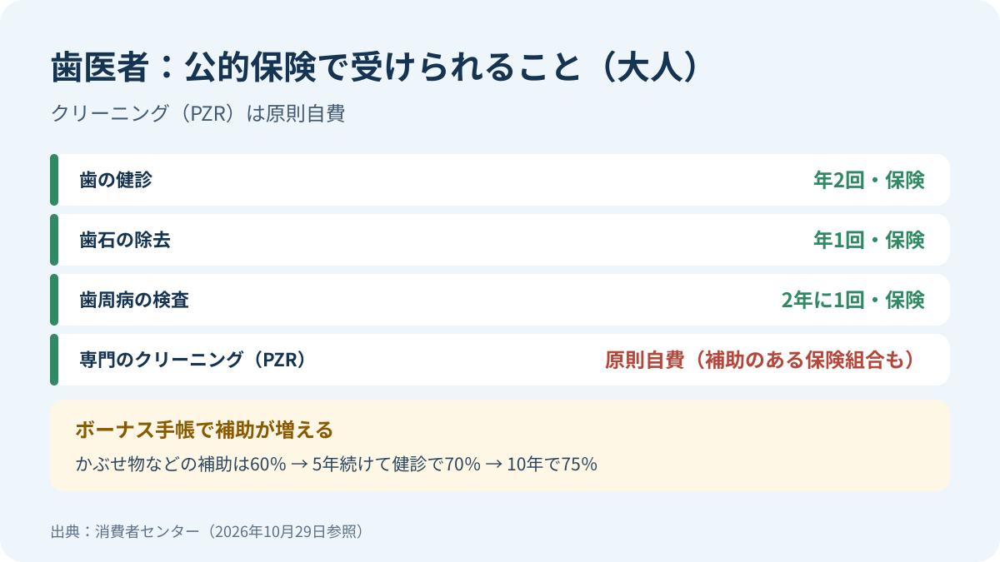
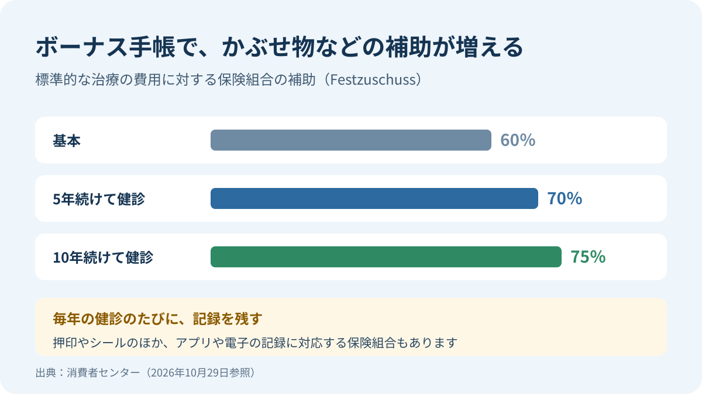

# ドイツの歯医者のかかり方｜保険で受けられる健診、クリーニングの費用、ボーナス手帳

ドイツで歯医者（Zahnarzt）にかかるときは、まず予約を取ります。急な痛みがあるときも、電話で「痛みがある（Schmerzen）」と伝えると、その日のうちに診てくれる歯科も多くあります。

日本との一番の違いは、**歯のクリーニングが原則として自費**であることです。公的保険で受けられるのは、健診と歯石の除去が中心です。そこで歯科補助保険に入る人もいますが、2026年にはJ-Connect編集部のメンバーが「契約前の治療」を理由に不払いとされ、異議を申し立てました。その経験から分かった注意点も載せています。

## まず結論

- 何を：公的保険の大人は、歯の健診が**年2回**、歯石の除去が**年1回**保険で受けられる。専門のクリーニング（PZR）は原則自費。
- いつまでに：毎年健診を受けてボーナス手帳に記録すると、かぶせ物や入れ歯の補助が標準の**60％**から、5年続けて**70％**、10年続けて**75％**に上がる（社会法典第5編第55条）。
- どこで：近くの歯科（Zahnarzt）を予約。夜間・休日は歯科の当番医。
- 費用：保険の範囲を超える治療は、治療前に見積もり（Heil- und Kostenplan）が出る。補助保険に入るなら、勧められた治療がない時期に加入する。

## あなたはどのケース？

| あなたの状況 | 違うところ | 確認すること |
| --- | --- | --- |
| 公的保険（GKV） | 健診・歯石除去は保険、PZRは自費（保険組合の補助あり） | 保険組合のPZR補助、ボーナス手帳 |
| 民間保険（PKV） | 契約で補償範囲が大きく違う | 契約書の歯科の項目 |
| 歯科補助保険を検討中 | 契約前に始まった治療・勧められた治療は補償されないのが一般的 | 待機期間、最初の数年の上限、契約前の治療の扱い |
| 補助保険で不払いと言われた | 約款の条文と日付で異議を書く | 通知の理由と、診断日・契約日 |
| 急な痛み・夜間 | 当番医が対応。命に関わる腫れは112 | 州の歯科医師会の当番医検索 |

## 公的保険で受けられること（大人）

消費者センターによると、公的保険（GKV）に入っている大人は、次の歯の予防を保険で受けられます（[消費者センター](https://www.verbraucherzentrale.de/wissen/gesundheit-pflege/krankenversicherung/welche-zahnvorsorge-zahlt-die-krankenkasse-12913)）。

| 内容 | 回数 | 費用 |
| --- | --- | --- |
| 歯の健診（Kontrolluntersuchung） | 年2回 | 保険 |
| 歯石の除去（Zahnsteinentfernung） | 年1回 | 保険 |
| 歯周病の検査 | 2年に1回 | 保険 |
| 専門のクリーニング（PZR） | — | 原則自費。保険組合によって一部の補助あり |

専門のクリーニング（Professionelle Zahnreinigung、PZR）は、公的保険の基本の内容には含まれていません。保険組合によっては、1回あたり20〜100ユーロ程度の補助を出しているところがあります（[消費者センター：PZRの補助](https://www.verbraucherzentrale.de/wissen/gesundheit-pflege/krankenversicherung/welche-zuschuesse-zahlen-die-kassen-zur-professionellen-zahnreinigung-12917)）。加入している保険組合のウェブサイトやアプリで確認してみましょう。

## ボーナス手帳（Bonusheft）で補助が増える

かぶせ物（クラウン）、ブリッジ、入れ歯などの治療では、保険組合が決まった額の補助（Festzuschuss）を出します。補助の基本は、標準的な治療の費用の60％です。

毎年の健診を受けた記録を「ボーナス手帳」に残しておくと、補助が増えます。5年続けて健診を受けていれば70％、10年続けていれば75％になります（[消費者センター：入れ歯・かぶせ物の補助](https://www.verbraucherzentrale.de/wissen/gesundheit-pflege/krankenversicherung/zahnersatz-wie-viel-uebernimmt-die-gesetzliche-krankenkasse-12884)）。

**ボーナス手帳は、健診のたびに歯科で押印やシールをもらいます。** 最近は、アプリや電子の記録に対応している保険組合もあります。ドイツに来て最初の健診のときに、手帳をもらえるか聞いてみましょう。

## 手順：予約から治療までの流れ

1. **歯科を探す**：家の近くの歯科を地図アプリや保険組合の検索で探します。日本語で受診したい場合は「[ドイツで日本語で受診できる医療機関の探し方](/germany/ja/living/japanese-speaking-doctors-germany/)」も参考にしてください。
2. **予約する**：電話かオンラインで予約します。初めての患者を受け付けていない歯科もあります。
3. **受診する**：健康保険証（eGK）を持っていきます。
4. **費用の見積もり**：保険の範囲を超える治療は、治療の前に費用の見積もり（Heil- und Kostenplan）が出ます。内容を確かめてから治療を決めましょう。

## 夜間・休日に歯が痛くなったら

夜間や休日は、歯科の当番医（zahnärztlicher Notdienst）が対応します。地域の当番の歯科は、州の歯科医師会のウェブサイトなどで探せます。在デュッセルドルフ日本国総領事館の医療機関の案内でも、休日・時間外の歯科を探す方法が紹介されています。

顔が大きく腫れて呼吸が苦しいなど、命に関わる場合は、112に電話してください。

## 民間保険の人

民間保険に入っている人は、契約によって補償の範囲が大きく違います。クリーニングや詰め物の費用がどこまで出るか、契約書を確認してから治療を受けましょう。健康保険のしくみは「[ドイツの健康保険](/germany/ja/living/health-insurance-guide/)」で紹介しています。

## 落とし穴

- PZRも保険だと思う：専門のクリーニングは原則自費。予約時に料金を聞き、保険組合の補助を確認する。
- ボーナス手帳を作らない：健診の記録がないと、将来のかぶせ物・入れ歯の補助が上がらない。最初の健診で手帳をもらう。
- 見積もりを読まずに治療する：保険外の治療は見積もりで自己負担額を確認してから決める。
- 勧められた後に補助保険に入る：その治療は「契約前の治療」として補償されないことが多い。
- 不払いを電話だけで済ませる：異議は書面で出し、条文と日付を示す。保険の苦情窓口（オンブズマン）にも相談できる。

## そのまま使えるドイツ語

| 場面 | ドイツ語 | 日本語 |
| --- | --- | --- |
| 予約の電話 | Guten Tag, ich möchte einen Termin zur Kontrolluntersuchung vereinbaren. Ich bin gesetzlich versichert. | こんにちは、健診の予約をしたいです。公的保険に入っています。 |
| 痛みがあるとき | Ich habe starke Zahnschmerzen. Könnte ich heute noch kommen? | 歯がひどく痛みます。今日診てもらえますか。 |
| PZRの料金を聞く | Was kostet eine professionelle Zahnreinigung bei Ihnen? | 専門のクリーニングはいくらですか。 |
| ボーナス手帳 | Könnten Sie die Untersuchung bitte in mein Bonusheft eintragen? | 健診をボーナス手帳に記入していただけますか。 |

保険会社に不払いの根拠を聞くメール：

> 件名：Leistungsablehnung vom [Datum], Versicherungsnummer [Nummer]
> Sehr geehrte Damen und Herren,
> Sie haben die Erstattung für meine Behandlung vom [Datum] abgelehnt. Bitte teilen Sie mir mit, auf welche Bestimmung Ihrer Versicherungsbedingungen Sie die Ablehnung stützen und welches Datum Sie als Behandlungsbeginn zugrunde legen.
> Mit freundlichen Grüßen
> [Name]

和訳：件名「〇日付の不払い（保険番号〇〇）」。〇日の治療の保険金を支払わないとされました。約款のどの条文に基づくのか、治療の開始日をいつと見ているのかを教えてください。

## 在住者の実例

J-Connect編集部メンバーの実例（2026年、デュッセルドルフ近郊）。

| したこと | 結果 |
| --- | --- |
| 歯科補助保険に請求 | 「契約前の治療」を理由に不払いとされた |
| 異議の申し立て | 約款の条文を根拠に、書面で異議を申し立てた |

保険会社の名前は載せていません。異議の書き方は、編集部の記録をもとに別の記事で詳しく準備しています。

## 公式情報・参考ソース

- [連邦保健省：歯科の治療](https://www.bundesgesundheitsministerium.de/zahnaerztliche-behandlung)（2026年10月29日確認）
- [消費者センター：保険で受けられる歯の予防](https://www.verbraucherzentrale.de/wissen/gesundheit-pflege/krankenversicherung/welche-zahnvorsorge-zahlt-die-krankenkasse-12913)（2026年10月29日確認）
- [消費者センター：歯のクリーニング（PZR）の補助](https://www.verbraucherzentrale.de/wissen/gesundheit-pflege/krankenversicherung/welche-zuschuesse-zahlen-die-kassen-zur-professionellen-zahnreinigung-12917)（2026年10月29日確認）
- [消費者センター：入れ歯・かぶせ物の補助はいくら？](https://www.verbraucherzentrale.de/wissen/gesundheit-pflege/krankenversicherung/zahnersatz-wie-viel-uebernimmt-die-gesetzliche-krankenkasse-12884)（2026年10月29日確認）
- [消費者センター：保険で受けられる歯科の治療の一覧](https://www.verbraucherzentrale.de/wissen/gesundheit-pflege/krankenversicherung/alle-kassenleistungen-der-zahnmedizin-im-ueberblick-12921)（2026年10月29日確認）
- [連邦健康ポータル：歯科の受診](https://gesund.bund.de/wege-im-gesundheitswesen/erwachsenenleben/alter/aerztliche-betreuung/zahnaerztliche-versorgung)（2026年10月29日確認）
- [社会法典第5編第55条：かぶせ物・入れ歯の補助（60％・70％・75％）](https://www.gesetze-im-internet.de/sgb_5/__55.html)（2026年11月14日確認）
