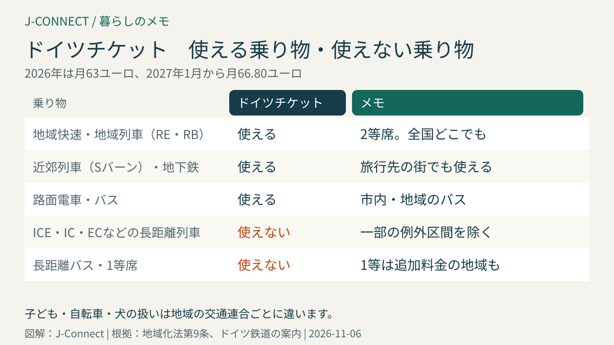
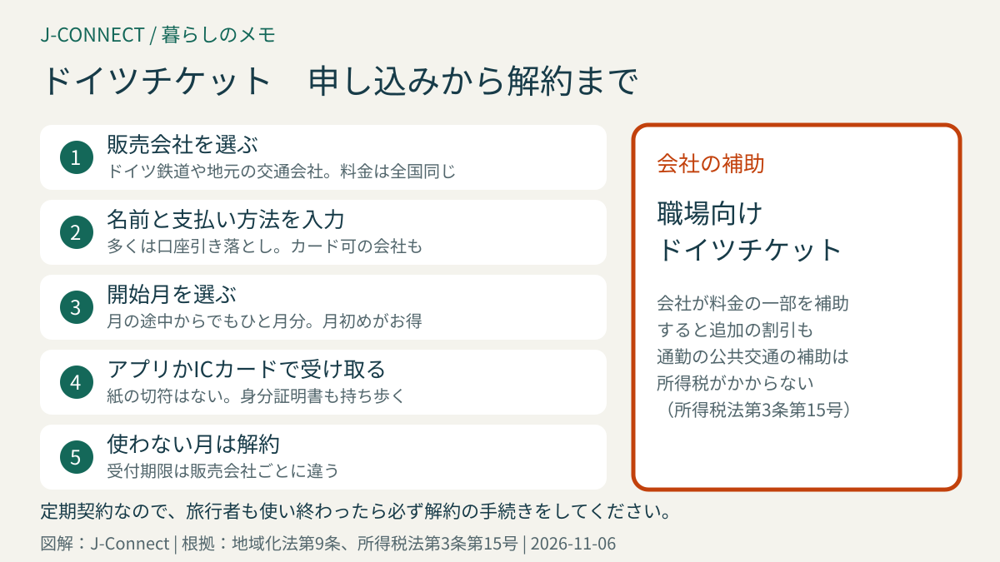

# ドイツチケット（Deutschlandticket）の使い方｜2027年は月66.80ユーロ、使える電車と使えない電車、申し込みと解約、会社の補助

ドイツチケット（Deutschlandticket）は、月額の料金でドイツ全国の地域の電車やバスに乗り放題になる定期券です。通勤や通学はもちろん、週末に近くの街へ出かけるときにも使え、ドイツに住む多くの人が利用しています。この記事は、ドイツに住む日本人やこれから住む人に向けて、料金、使える乗り物と使えない乗り物、申し込みと解約の方法、会社の補助や学生の扱い、元が取れるかの目安を整理します。読み終えると、自分がドイツチケットを買うべきか、買うならどこでどう申し込めばよいかが分かります。

## まず結論：ドイツチケットの要点

- **料金**：2026年は月63ユーロ、**2027年1月から月66.80ユーロ**
- **使える乗り物**：全国の地域列車（RE・RB）、近郊列車（Sバーン）、地下鉄、路面電車、バスの2等席
- **使えない乗り物**：ICE、IC、ECなどの**長距離列車**、長距離バス（一部の例外区間を除く）
- **形**：月ごとに解約できる**定期契約**。スマートフォンのアプリかICカードで持ちます
- **本人だけ**：記名式で、ほかの人に貸せません。乗るときは身分証明書も持ち歩きます

## 料金と2027年の値上げ

ドイツチケットの料金は、2026年が**月63ユーロ**、2027年1月からは**月66.80ユーロ**です。2027年の料金は、交通大臣の会議で、人件費やエネルギー費などを使った計算式に基づいて決められました。2028年以降も、同じように毎年見直される見込みです。

すでに契約している人は、販売会社から値上げの案内が届きます。ドイツ鉄道で契約している人は、新しい料金への同意が必要な場合があります。手順は「[ドイツチケットは2027年66.80ユーロへ](/germany/ja/events/news/deutschlandticket-2027-price-consent/)」を確認してください。

## 使える乗り物と使えない乗り物

### 使える

- 地域快速（RE）、地域列車（RB）、近郊列車（Sバーン）の**2等席**
- 地下鉄（Uバーン）、路面電車、市内バス、地域のバス
- 一部の地域のフェリー

ドイツ全国どこでも使えるので、例えばデュッセルドルフに住む人が、ケルンやボンへ地域列車で出かける、旅行先のベルリンで地下鉄やバスに乗る、といった使い方ができます。

### 使えない

- **ICE、IC、EC**などの長距離列車
- 長距離バス、民間の長距離列車
- 1等席（追加料金で乗れる地域もあります）

経路検索アプリでは、長距離列車を含む経路が表示されることがあります。「地域交通のみ」の条件で検索するか、列車の種類を確認してから乗りましょう。一部の区間では、例外として長距離列車に乗れる場合もあります。長距離の移動のしかたは[ドイツの鉄道の乗り方](/germany/ja/living/germany-train-travel-guide/)で説明しています。

### 子ども・自転車・犬

- 子どもの扱い、自転車や犬を乗せる料金は、**地域の交通連合ごとに**決まっています。多くの地域では、6歳未満の子どもは無料です。
- 地域によっては、夜間や週末に大人や子どもを一緒に乗せられる特典がありますが、全国共通ではありません。

自転車で電車に乗るときの注意は[ドイツで自転車に乗るときのルール](/germany/ja/living/bicycle-rules-germany/)も参考にしてください。

## 申し込み方法

ドイツチケットは、**月ごとに解約できる定期契約**として売られています（地域化法第9条）。1回だけの切符や、1か月分だけ買う切符ではない点に注意してください。

1. **販売会社を選ぶ**：ドイツ鉄道のアプリ、地元の交通会社のアプリやウェブサイトなどで申し込めます。料金は全国同じです。
2. **必要な情報を入力する**：名前、生年月日、住所、支払い方法（多くはドイツの銀行口座の引き落とし。クレジットカードを使える販売会社もあります）
3. **開始月を選ぶ**：多くの販売会社では、月の途中から申し込んでも、料金はひと月分かかります。月の初めから使うのがお得です。
4. **アプリかICカードで受け取る**：スマートフォンのアプリに定期券が表示されるか、ICカードが郵送されます。紙の切符はありません。

ドイツの銀行口座がまだない人は、クレジットカードで払える販売会社を選ぶか、口座を開いてから申し込みます。口座の開き方は[ドイツの銀行口座開設](/germany/ja/living/bank-account-germany/)で説明しています。

## 解約のしかた

ドイツチケットは、**月ごとに解約**できます。ただし、解約の受付期限は販売会社ごとに決まっていて、月の途中の決められた日までに手続きすると、その月の末で終わるのが一般的です。期限を過ぎると、翌月分の料金がかかります。

- 一時帰国や長期の旅行で使わない月がある場合は、解約して、戻ってから申し込み直す方法もあります。
- 本帰国するときは、早めに解約の手続きをしましょう。[ドイツから本帰国するときの手続き](/germany/ja/living/returning-to-japan-checklist/)のチェックリストにも入れておくと安心です。

## 会社の補助で安くなる「職場向けドイツチケット」

勤め先が料金の一部を補助する「職場向けドイツチケット（Deutschlandticket Job）」があります。会社が一定以上を補助すると、交通会社からも追加の割引が受けられる制度で、本人の負担が大きく下がります。

会社が通勤のための公共交通の費用を補助する場合、その補助は**所得税がかかりません**（所得税法第3条第15号）。勤め先に制度があるか、人事担当に聞いてみましょう。

## 学生・若者・低所得の人の割引

- **大学生**：多くの大学では、学期ごとの交通券がドイツチケットに含まれているか、差額を払って切り替えられます。[ドイツの大学に留学する](/germany/ja/living/study-in-germany-student-visa/)も参考にしてください。
- **学生・職業訓練生・若者**：州によっては、割引のドイツチケットがあります。
- **社会給付を受けている人**：地域によっては、割引の「社会チケット」があります。

割引の内容は州や地域で違うので、住んでいる地域の交通会社の案内を確認してください。

## 元が取れるかの目安

地域の1か月の定期券（市内だけ）とドイツチケットの料金を比べてみましょう。多くの大都市では、市内だけの月の定期券でも、ドイツチケットと同じか、より高い料金がかかります。

- **毎日の通勤・通学に使う人**：ほとんどの場合、ドイツチケットのほうがお得です。
- **週に数回だけ乗る人**：1回券や回数券の合計と比べて判断します。片道3ユーロ前後の街なら、月に20回以上乗れば元が取れる計算です。
- **週末に近くの街へ出かける人**：遠くまで乗るほどお得になります。

## よくある質問

### 旅行者も買えますか？

ドイツに住んでいない旅行者も申し込めます。ただし、定期契約なので、使い終わったら必ず解約の手続きをしてください。

### 1等席に乗れますか？

基本は2等席です。地域によっては、追加料金で1等席に乗れる切符があります。

### 定期券の画面を見せるだけでよいですか？

検札では、アプリやICカードの定期券と一緒に、パスポートや滞在カードなどの身分証明書を求められることがあります。

## 関連記事

- [ドイツの鉄道の乗り方](/germany/ja/living/germany-train-travel-guide/)
- [ドイツで自転車に乗るときのルール](/germany/ja/living/bicycle-rules-germany/)
- [ドイツ生活の最初の30日](/germany/ja/living/germany-first-30-days/)
- [ケルン観光ガイド](/germany/ja/living/cologne-city-guide/)
- [デュッセルドルフ観光](/germany/ja/living/duesseldorf-city-guide/)

## 公式情報・参考ソース

- [地域化法第9条：ドイツチケット](https://www.gesetze-im-internet.de/regg/__9.html)
- [所得税法第3条第15号：会社の公共交通の補助は非課税](https://www.gesetze-im-internet.de/estg/__3.html)
- [ドイツ鉄道（地域交通）：ドイツチケットの案内](https://regional.bahn.de/tickets/Deutschlandticket)
- [ドイツ連邦議会：ドイツチケットの財源を2030年まで定める法律](https://www.bundestag.de/dokumente/textarchiv/2025/kw45-de-regionalisierungsgesetz-1118560)

**参照日：2026年11月6日。** 料金や割引、解約の受付期限は、販売会社や地域によって異なり、変わることがあります。申し込みの前に、販売会社の最新の案内を確認してください。
