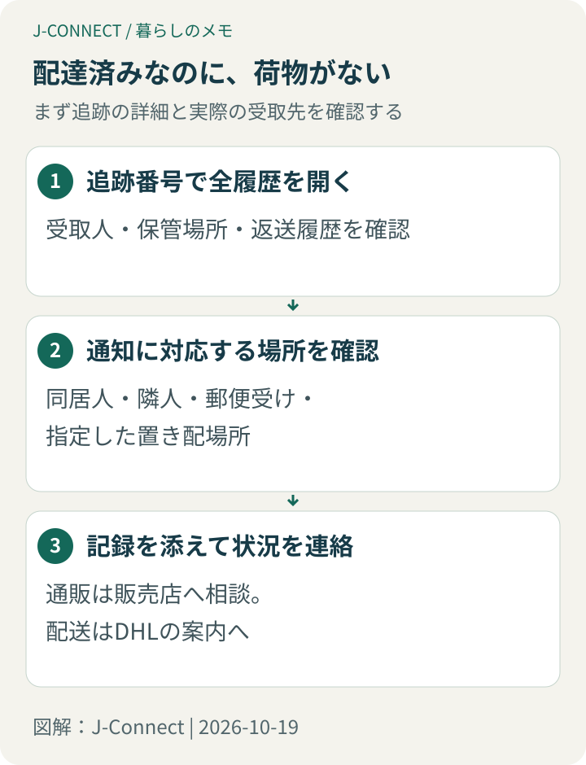
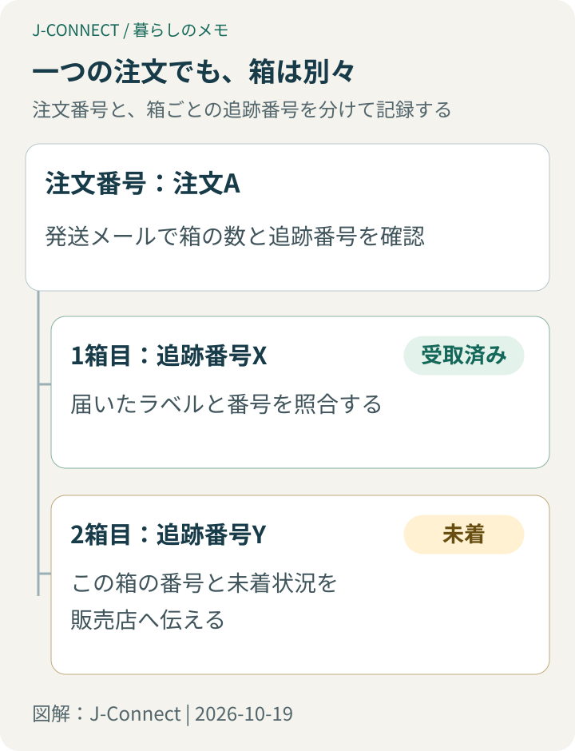

# ドイツでDHLの荷物が届かない｜配達済み・追跡が止まった時の問い合わせ先

DHLの追跡に「配達済み」と出ても、自分の手元に荷物がないことがあります。ドイツで通販を利用する人に向けて、受取人や返送履歴の確認から、販売店・DHLへの連絡までを整理します。この記事はドイツのDHL Paketを中心とした案内で、DHL Expressや他の配送会社の荷物は、それぞれの追跡・窓口を使ってください。

## まず結論

- 何を：追跡の詳細で「誰に届いたか（Zugestellt an）」と返送の履歴を見て、隣人・郵便受け・置き配場所を探す。見つからなければ、通販の販売店に未着を連絡する。
- いつまでに：中身の不足や破損は、配達から**7日以内**にDHLへ申告する。「輸送中」のまま**5営業日**を超えて変わらなければ、調査（Nachforschung）を頼める（どちらもDHLの案内、2026年11月14日確認）。
- どこで：通販の荷物は、まず販売店（差出人）へ。DHLも、受取人にはまず差出人への相談を勧めている。
- 費用：確認と問い合わせに費用はかからない。返金や再送の条件は販売店ごとに違う。

## あなたはどのケース？

| あなたの状況 | 違うところ | 先にすること |
| --- | --- | --- |
| 通販で買った | 調査を頼めるのは主に差出人（販売店）。受取人は販売店に連絡する | 注文番号と追跡番号をそろえて販売店へ |
| 個人から送られた | 差出人の発送控えと内容品の資料が調査に必要 | 差出人に連絡して調査を頼んでもらう |
| 知らない隣人の名前が出る | 隣人が持って来るまで少し待つよう、DHLは案内している | 同じ建物の表札を確認し、メモを残す |
| 返送開始（Rücksendung eingeleitet）の履歴がある | 「配達済み」は差出人への返送完了かもしれない | 販売店に返送を受け取ったか確認 |
| 複数の箱のうち一部だけ届いた | 注文全体の「配達済み」は全部の箱の到着を意味しない | 箱ごとの追跡番号を照合 |
| 「輸送中」のまま止まっている | 配達済みとは別の手順。5営業日を超えたら調査を頼める | 下の「輸送中のまま更新されない」へ |

## 手順：最初の5分で確認すること

1. **注文番号ではなく追跡番号**で、DHL公式の追跡を開く。
2. 最後の1行だけでなく、配達先・受取人・返送を含む履歴を見る。
3. 同居人、通知で指定された隣人、郵便受け、自分が許可した置き配場所を確認する。
4. 店舗やロッカーへの入庫なら、最新の保管場所と受取可能時刻を見る。
5. 見つからなければ画面と確認結果を保存し、通販の販売店へ未着を連絡する。DHLの案内に従って配送状況も照会する。

## 追跡の詳細で「誰に届いたか」を見る

DHLの[配達済みの荷物のヘルプ](https://www.dhl.de/de/privatkunden/hilfe-kundenservice/empfangen/zustellung/paket-geliefert.html)では、詳細情報を開いて受取先の郵便番号を入力し、受取人の欄を確認するよう案内しています。画面上では「Weitere Informationen zur Sendung anzeigen」が詳細表示、「Zugestellt an」が受取人の手がかりです。

| 追跡・通知の内容 | 次にすること |
| --- | --- |
| 本人・同居人への配達 | 家族などが受け取っていないか確認。自分は受け取っていない事実を記録 |
| 隣人への配達 | 表示された氏名・場所を確認し、その相手へ尋ねる |
| 郵便受けへの配達 | 郵便受け内を確認。ほかの受取方法の履歴も見る |
| 置き配 | 自分が指定した場所と通知内容を確認 |
| 店舗・ロッカーで受取 | 保管場所と受取可能時刻を確認してから向かう |
| 返送の履歴あり | 自宅への配達ではなく、差出人へ戻った荷物の配達完了でないか確認 |

返送開始の表示（Rücksendung eingeleitet）がある場合は、最後の「配達済み」が差出人への返送完了を指す可能性もあります。どの住所に向かった履歴なのかを確かめてから販売店へ相談します。

## 隣人・置き配・ロッカーで分岐する

### 知らない隣人の名前が出る

表示された氏名を玄関の表札等で確認し、見当たらない場合はそのことを記録します。DHL公式は、知らない・見つからない隣人が受け取った場合、相手からの連絡を少し待ち、**2日経っても連絡がなければカスタマーサービスへ連絡**するよう案内しています。

これは特定の隣人受取ケースの案内です。すべての未着について「2日は連絡してはいけない」という意味ではありません。通販の販売店には、確認済みの状況を早めに伝えて構いません。

### 置き配と表示されているが見つからない

アカウントの恒常的な置き配設定と、その荷物に対する一回限りの指定を確認します。DHLの[置き配の案内](https://www.dhl.de/de/privatkunden/hilfe-kundenservice/empfangen/zustellung/ablageort.html)では、通知がメールになる場合や、設定により呼び鈴を鳴らさず置く場合が説明されています。呼び鈴が鳴らなかったことだけで判断せず、通知と設定を照合してください。

許可した場所にない、置き配を頼んでいない、といった違いを連絡時に明確にします。紛失の原因・責任を自分で断定するより、表示された事実と現地確認の結果を伝える方が調査につながります。

### 店舗やロッカーにあるはずだが受け取れない

通知票の住所と最新の追跡を照合してください。別の店舗へ変更されていることや、まだ店舗で受取準備ができていない場合があります。ロッカーのコード・操作で困っている場合は、[Packstationの受取方法](/germany/ja/living/dhl-packstation-guide/)で、直接指定と不在後の移送を分けて確認します。

## 通販なら販売店へ連絡し、調査と希望する対応を確認する

DHLは、オンラインショップの注文が届かない場合、まず差出人へ相談するよう[未配達の案内](https://www.dhl.de/de/privatkunden/hilfe-kundenservice/empfangen/zustellung/paket-nicht-geliefert.html)で勧めています。受取人側で確認できる情報を販売店へ渡し、配送会社への調査依頼と注文への対応を確認します。

**連絡にまとめるもの：**

- 注文番号、問題の追跡番号、注文した商品
- 配達済みになった日時と受取人・保管場所の表示
- 同居人・隣人・置き配場所をどこまで確認したか
- 未着が全部か、一部の箱だけか
- 希望する対応と、いつまでに回答が必要か

電話で話した場合も、受付番号や日時、案内された次の対応をメモします。ドイツ語で状況を伝える文章は、[買い物・配送のフレーズ集](/germany/ja/learn-german/shopping-phrases/#配送状況-未配達を問い合わせる)にあります。個人からの荷物なら、その差出人へ連絡し、発送控え・内容品・価格が分かる資料を確認してもらいます。

調査依頼（Nachforschung）は荷物の所在を調べる手続きで、返金や再送の確約とは異なります。[消費者センターの発送時の案内](https://www.verbraucherzentrale.de/wissen/vertraege-reklamation/kundenrechte/worauf-sie-achten-sollten-wenn-sie-ein-paket-verschicken-12323)も、紛失時には差出人が発送控えや内容品の資料を用意して調査を進める流れを説明しています。注文の返金・再送条件は販売店に確認し、責任や支払いを巡る争いが解決しなければ消費者センター等へ個別に相談してください。

## 複数の箱のうち一つだけ届いた場合

家具などでは、一つの注文が複数の箱に分かれて発送されることがあります。**注文全体の「配達済み」表示だけで、すべての箱が届いたと判断しない**ことが大切です。

1. 注文画面や発送メールで、箱の数と追跡番号の一覧を探す。
2. 届いた箱のラベルと追跡番号を照合する。
3. 残りの箱について別の追跡番号がないか販売店に確認する。
4. 「全2箱のうち1箱受領、もう1箱は未着」のように、数を明示して連絡する。

箱が丸ごと未着なのか、開けた箱の中で部品が不足していたのかも区別します。内容品の不足・破損の場合は、外箱、ラベル、梱包材、届いた内容品を写真に残し、販売店へ速やかに伝えます。DHLが案内する内容品の不足・破損の申告期限は**配達から7日以内**なので、[公式の申告手順](https://www.dhl.de/de/privatkunden/hilfe-kundenservice/empfangen/zustellung/paket-geliefert.html)も確認し、包装等を処分しないでください。

## 「輸送中のまま更新されない」は別の確認手順

まだ配達済みではなく、追跡が止まっている場合は遅延の案内を使います。DHLは、**追跡状況が5営業日を超えて変わらない場合**に調査を依頼できると説明し、受取人にはまず差出人への相談を勧めています。[DHLの追跡トラブルの案内](https://www.dhl.de/de/privatkunden/hilfe-kundenservice/sendungsverfolgung/probleme-loesungen.html)を確認してください。

この5営業日の目安を、配達済みなのに見つからない荷物へ一律に当てはめる必要はありません。また、DHLは通常のカスタマーサービスから輸送を早めたり、配達担当者や配送拠点に直接電話で取り次いだりすることはできないと案内しています。急ぎの場合は販売店に必要な日付を伝え、再送を含めて可能な対応を確認します。

## 落とし穴

- 最後の1行だけ見る：返送の履歴や受取人の欄を見ずに「配達済み」と判断すると、差出人に戻った荷物を探し続けることになる。
- 注文番号で追跡する：DHLの追跡には追跡番号（Sendungsnummer）を使う。注文番号では出てこない。
- 破損・不足の申告が遅れる：中身の不足や破損は配達から7日以内。箱や梱包材を捨てずに写真を撮る。
- 調査依頼を返金の約束と思う：調査は荷物の所在を調べる手続き。返金・再送は販売店の条件による。
- 追跡番号や住所を公開の場に貼る：掲示板やSNSに追跡番号・住所を載せない。

## そのまま使えるドイツ語

| 場面 | ドイツ語 | 日本語 |
| --- | --- | --- |
| 隣人に聞く | Entschuldigung, hat DHL bei Ihnen ein Paket für mich abgegeben? Mein Name ist [Name]. | すみません、DHLが私宛ての荷物をお宅に預けていませんか。〇〇といいます。 |
| 隣人へのメモ | Liebe Nachbarn, laut DHL wurde ein Paket für [Name] bei Ihnen abgegeben. Bitte klingeln Sie bei mir (Wohnung [Nr.]). Danke! | ご近所の皆さまへ。DHLによると、〇〇宛ての荷物がお宅に届いたそうです。〇号室のベルを鳴らしてください。ありがとうございます。 |
| 電話で最初に | Guten Tag, meine Sendung ist als zugestellt markiert, aber ich habe sie nicht erhalten. Die Sendungsnummer ist [Nummer]. | こんにちは、荷物が配達済みになっていますが、受け取っていません。追跡番号は〇〇です。 |

販売店への未着の連絡：

> 件名：Bestellung [Bestellnummer] – Paket als zugestellt markiert, aber nicht erhalten
> Sehr geehrte Damen und Herren,
> laut DHL-Sendungsverfolgung wurde meine Bestellung [Bestellnummer] (Sendungsnummer [Nummer]) am [Datum] zugestellt. Ich habe das Paket jedoch nicht erhalten. Ich habe bei meinen Nachbarn, im Briefkasten und am Ablageort nachgesehen.
> Bitte leiten Sie eine Nachforschung bei DHL ein und teilen Sie mir mit, ob Sie die Ware erneut senden oder den Kaufpreis erstatten können.
> Mit freundlichen Grüßen
> [Name]

和訳：件名「注文〇〇：配達済みになっているが受け取っていない」。DHLの追跡では、注文〇〇（追跡番号〇〇）は〇日に配達済みです。しかし、荷物を受け取っていません。隣人、郵便受け、置き配場所を確認しました。DHLへの調査を依頼し、再送か返金ができるか教えてください。

## 在住者の実例

この記事には、まだJ-Connect編集部や読者の実例を載せていません。荷物が見つかるまでの日数や、販売店の対応の体験を集めて追記します。

## 問い合わせ前の確認メモ

連絡を一度で進めやすくするため、追跡画面、注文情報、確認した場所、連絡履歴を一つにまとめます。「受け取っていない箱の番号はどれか」「誰に何を依頼したか」「次の回答はいつか」が分かる状態を目指してください。追跡番号や住所を公開掲示板へそのまま貼る必要はありません。

## 公式情報・参考ソース

- [DHL：配達済みだが受け取っていない場合・内容品の不足（7日以内の申告）](https://www.dhl.de/de/privatkunden/hilfe-kundenservice/empfangen/zustellung/paket-geliefert.html)（2026年11月14日確認）
- [DHL：追跡の問題と調査依頼（5営業日）](https://www.dhl.de/de/privatkunden/hilfe-kundenservice/sendungsverfolgung/probleme-loesungen.html)（2026年11月14日確認）
- [DHL：未配達の場合](https://www.dhl.de/de/privatkunden/hilfe-kundenservice/empfangen/zustellung/paket-nicht-geliefert.html)（2026年10月19日確認）
- [消費者センター：発送した荷物の紛失・調査依頼](https://www.verbraucherzentrale.de/wissen/vertraege-reklamation/kundenrechte/worauf-sie-achten-sollten-wenn-sie-ein-paket-verschicken-12323)（2026年10月19日確認）
