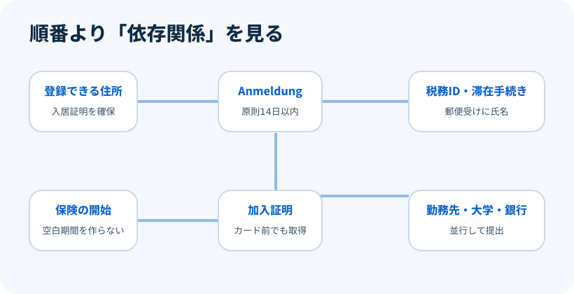

# デュッセルドルフ赴任ガイド｜渡独前から到着後・本帰国まで、やることと読む記事の順番

デュッセルドルフへの赴任が決まったら、「何から手をつければいいか」が一番の悩みです。このページは、J-Connect編集部が、渡独前から到着後、本帰国までの流れを一枚にまとめた入口です。個別の手続きの詳細は、各記事で確認してください。このページ自体には、新しい制度の説明は書いていません。

ドイツ語ができなくても進められるように、日本語で読める記事と、ドイツ語の手紙を日本語で解説する[無料のAIツール](/germany/ja/tools/)をあわせて紹介します。

## まず結論

- **最初の山は住民登録です。** 実際に入居した日から2週間以内が原則です。入居証明を家主から受け取り、予約を取るところから始まります。詳しくは[住民登録ガイド](/germany/ja/living/anmeldung-guide/)。
- **保険・銀行・税務IDは並行して進めます。** 勤務開始日、保険の開始日、入居日は別々に確認してください。順番は[最初の30日チェックリスト](/germany/ja/living/germany-first-30-days/)にあります。
- **日本側の手続きは出国前に終わらせます。** 海外転出届、年金、健康保険、運転免許などは[日本でする手続き](/germany/ja/living/leaving-japan-before-moving-germany/)で確認します。
- **日本語で診てもらえる医師を、病気になる前に探しておきます。** デュッセルドルフなど日本人の多い都市では、日本語で診療する医師や通訳の案内があります。→[日本語で受診できる医療機関の探し方](/germany/ja/living/japanese-speaking-doctors-germany/)

## あなたはどのケース？

| あなたの状況 | 特に先に読む記事 |
| --- | --- |
| 日本の会社から派遣される駐在 | [日独社会保障協定と年金](/germany/ja/living/japan-germany-social-security-pension/)、[健康保険の選び方](/germany/ja/living/health-insurance-guide/) |
| 現地採用・転職で渡独 | [滞在許可の申請・更新](/germany/ja/living/residence-permit-renewal-germany/)、[健康保険の選び方](/germany/ja/living/health-insurance-guide/) |
| 配偶者・子どもと一緒に赴任 | [学校の選び方](/germany/ja/living/schools-germany-japanese-families/)、[Kita・保育ママ探し](/germany/ja/living/kita-u3-tagesmutter-guide/) |
| 運転する予定がある | [日本の免許とドイツの免許切り替え](/germany/ja/living/drivers-license-japan-germany/) |
| 引っ越し先がまだ決まっていない | [引っ越しチェックリスト](/germany/ja/living/moving-checklist-germany/) |

## 時期別：やることと読む記事

### 渡独前（出発の数か月前〜直前）

- 日本での手続きを確認する：[ドイツへ引っ越す前に日本でする手続き](/germany/ja/living/leaving-japan-before-moving-germany/)
- 在留資格（ビザ）の種類と、自分の場合に何が必要かを勤務先に確認する：[ドイツのビザの種類](/germany/ja/living/germany-visa-types-japanese/)
- 到着直後の郵便や連絡手段をどうするかを決める：[最初の30日チェックリスト](/germany/ja/living/germany-first-30-days/)

### 到着直後〜1週間

- 郵便が届く状態にする（呼び鈴・郵便受けの名前）。
- 住民登録の予約を取り、必要書類を揃える：[住民登録ガイド](/germany/ja/living/anmeldung-guide/)
- 保険の加入証明を確認する：[健康保険の選び方](/germany/ja/living/health-insurance-guide/)

### 2〜4週間

- 銀行口座を開く：[銀行口座開設ガイド](/germany/ja/living/bank-account-germany/)
- 税務IDが届かないときの対処を知る：[税務IDと給与税区分の違い](/germany/ja/living/tax-id-steuernummer-steuerklasse/)
- 放送負担金の通知が届いたら：[放送負担金ガイド](/germany/ja/living/rundfunkbeitrag-guide/)
- 万一の賠償に備える：[個人賠償責任保険](/germany/ja/living/liability-household-insurance-germany/)

### 生活が落ち着いてから

- ごみの分別と収集日（デュッセルドルフの例あり）：[ごみ分別ガイド](/germany/ja/living/germany-waste-sorting-guide/)
- 返却できる飲料容器：[Pfand返却ガイド](/germany/ja/living/germany-pfand-return-guide/)
- 日本のパスポートの更新：[パスポート更新ガイド](/germany/ja/living/japanese-passport-consulate-germany/)
- 暮らしのマナー：[日本人がやりがちな「知らずに失礼」](/germany/ja/living/germany-manners-mistakes-japanese/)
- 週末の過ごし方：[デュッセルドルフの街ガイド（日本人街・旧市街）](/germany/ja/living/duesseldorf-city-guide/)、[子連れで楽しむデュッセルドルフ](/germany/ja/living/duesseldorf-family-trip/)

### 本帰国が決まったら

- 住まいの解約は、契約で定められた期限に注意します。時期別の流れは[本帰国の手続き](/germany/ja/living/returning-to-japan-checklist/)にまとめています。

## 落とし穴

- **「30日で全部終わる」と思い込む。** 期限があるものと、待つしかないものは別物です。優先順位は[最初の30日チェックリスト](/germany/ja/living/germany-first-30-days/)で確認します。
- **住民登録の予約が取れず、他の手続きも止まる。** 予約が取れないときの動き方は[住民登録ガイド](/germany/ja/living/anmeldung-guide/)にあります。
- **保険の開始日を、入居日や勤務開始日と同じだと決めつける。** 3つは別々に確認します。
- **ドイツ語の手紙を後回しにする。** 期限が書かれていることがあります。届いたら早めに内容を確認してください（下記）。

## ドイツ語の手紙が届いたとき

役所、保険、家主、放送負担金などから、紙の手紙が届くことがよくあります。J-Connectの[ドイツの手紙AI解説](/germany/ja/tools/letter-explainer/)では、手紙の写真から日本語の解説を作れます。手紙・メールのドイツ語の返信案は[手紙・メール作成](/germany/ja/tools/write/)で作れます。

AIの回答は参考情報です。税金・滞在許可・期限のある手紙など、大切なものは、勤務先の担当者や公式窓口にも確認してください。手紙の写真は、住所や保険番号などを隠してから使うと安心です。

## そのまま使えるドイツ語

| 場面 | ドイツ語 | 日本語 |
| --- | --- | --- |
| 窓口で | Ich spreche nur wenig Deutsch. Können Sie bitte langsam sprechen? | ドイツ語は少ししか話せません。ゆっくり話していただけますか。 |
| 予約を取るとき | Ich möchte einen Termin vereinbaren. | 予約を取りたいのですが。 |
| 手紙の内容を確認するとき | Können Sie mir bitte schriftlich bestätigen, bis wann ich das einreichen muss? | いつまでに提出が必要か、書面で確認いただけますか。 |

## 在住者の実例

このページは入口のため、編集部の実例は掲載していません。実際に編集部が窓口へ照会した記録は、[NRWでKitaと保育ママを探す](/germany/ja/living/kita-u3-tagesmutter-guide/)などの個別記事に掲載しています。

## 公式情報・参考ソース

このページは、J-Connectの既存記事への案内です。制度や期限の根拠となる公式情報は、各記事の末尾に掲載しています。
