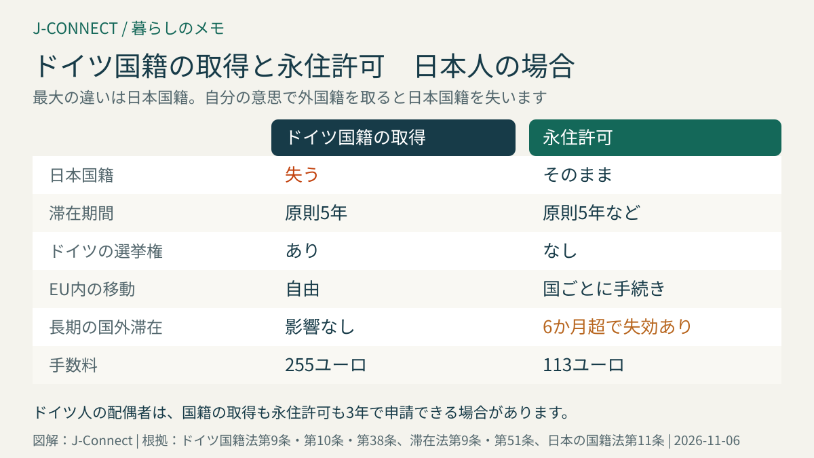
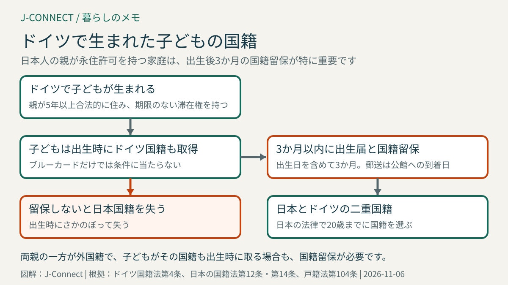

# ドイツ国籍の取得（Einbürgerung）と日本国籍｜5年の条件、B1・帰化テスト、日本国籍を失う仕組み、子どもの二重国籍

ドイツは2024年の法改正で、ほかの国籍を持ったままドイツ国籍を取得できるようになりました。ただし、日本の国籍法では、自分の意思で外国の国籍を取得すると日本国籍を失います。この記事は、ドイツに長く住む日本人とその家族に向けて、ドイツ国籍を取るための条件、永住許可との違い、日本国籍への影響、ドイツで生まれた子どもの国籍を整理します。読み終えると、自分や家族にとって国籍の取得と永住許可のどちらが合うかを判断し、子どもの出生時に必要な手続きを確認できます。

## まず結論：日本人は「日本国籍を手放すか」が最大の判断材料

| 比べる点 | ドイツ国籍の取得 | 永住許可 |
| --- | --- | --- |
| 日本国籍 | **失う**（日本の国籍法第11条第1項） | そのまま |
| 必要な滞在期間 | 原則5年。ドイツ人の配偶者は3年 | 原則5年。専門人材は3年など |
| ドイツ語 | B1 | 多くはB1 |
| 試験 | 帰化テスト | 「ドイツでの生活」テストなど |
| 選挙権 | ドイツの連邦・州・市町村の選挙 | なし |
| EU内での移動 | EU市民として自由に住み、働ける | 国ごとに手続きが必要 |
| 長期の国外滞在 | 国籍は失われない | 6か月を超えると失効することがある |
| 手数料 | 255ユーロ | 113ユーロ |

ドイツに長く住み続けるだけなら、多くの日本人は日本国籍を保てる永住許可を選びます。ドイツの選挙で投票したい、EUのほかの国でも自由に暮らしたい、長期の国外滞在で滞在資格を失う心配をなくしたいといった理由があるときに、国籍の取得を検討することになります。永住許可の条件は「[ドイツの永住許可](/germany/ja/living/permanent-residence-germany/)」で詳しく説明しています。

## ドイツ国籍を取るための条件

ドイツ国籍法第10条第1項は、次の条件を満たす人は、申請によって帰化が認められると定めています。

1. **5年以上、合法的にドイツに住んでいる**
2. **期限のない滞在権、EUブルーカード、または対象となる滞在許可を持っている**
3. **生活保護や求職者向けの基礎給付を受けずに、自分と扶養家族の生活費をまかなえる**
4. **有罪判決を受けていない**（軽い処罰の例外は下記）
5. **ドイツ語B1の力がある**
6. **ドイツの法律・社会・暮らしの知識がある**（帰化テストで証明）
7. **ドイツの基本法の民主的な秩序と、ナチス時代の不正に対するドイツの歴史的な責任を受け入れることを表明する**

本人の身元と国籍がはっきりしていることも前提です。

### 3年への短縮は廃止された

2024年の改正では、特別な社会への貢献がある場合に3年で帰化できる特例が設けられましたが、その後廃止されました。現在の第10条第3項は削除されており、ドイツ人の配偶者などを除いて、原則として**5年**が必要です。

### 持っている滞在許可の種類

期限のない滞在権（永住許可、EU長期滞在許可）やEUブルーカードを持っていれば、この条件を満たします。それ以外の滞在許可では、目的によっては対象外です。たとえば、留学（滞在法第16b条）、**企業内転勤（ICTカード、同第19条）**、求職などのための滞在許可は、帰化の条件を満たす許可から除かれています。日本の会社からICTカードで派遣されている人は、そのままでは申請できない点に注意してください。

日本国籍者向けの就労許可（滞在法第19c条）や、家族の呼び寄せの滞在許可は、除外の対象ではありません。

### 軽い処罰は考慮されない

第12a条により、罰金90日分以下の判決や、3か月以下の執行猶予付きの判決で猶予期間を終えたものなどは、帰化の審査では考慮されません。ただし、人種差別などの動機が判決で認められた場合は別です。交通違反の過料（行政上の罰金）は、刑事罰ではありません。

### 国外にいた期間

1回あたり6か月までの国外滞在であれば、ドイツでの滞在期間は途切れません（第12b条）。それより長い場合は、外国人局が定めた期限内に戻ったかどうかで扱いが変わります。日本への長期の一時帰国があった人は、出入国の記録を整理しておきましょう。

## ドイツ人の配偶者と家族

### ドイツ人と結婚している場合

ドイツ人の配偶者・登録パートナーは、**3年**ドイツに合法的に住み、婚姻が**2年**以上続いていれば、原則として帰化が認められます（第9条）。ドイツ語や帰化テストなど、ほかの条件は同じです。

### 家族も一緒に帰化できる

申請する人の配偶者と未成年の子どもは、5年の滞在期間を満たしていなくても、一緒に帰化できます（第10条第2項）。ただし、日本国籍の子どもがドイツ国籍を取ると、子どもも日本国籍を失います（下記）。家族の国籍は一人ずつ慎重に考えてください。

## ドイツ語と帰化テスト

ドイツ語はB1の試験の合格で証明します（第10条第4項）。16歳未満の子どもは、年齢に応じたドイツ語の力があれば足ります。

ドイツの法律・社会・暮らしの知識は、原則として**帰化テスト（Einbürgerungstest）**の合格で証明します（第10条第5項）。準備のための講座もありますが、参加は義務ではありません。病気・障害・高齢のために条件を満たせない人には、例外があります。

ドイツ語の学習の進め方は「[B1を目指す生活ドイツ語ルート](/germany/ja/learn-german/b1-daily-life-german-route/)」が参考になります。

## 日本国籍への影響

### 自分の意思でドイツ国籍を取ると、日本国籍を失う

日本の国籍法第11条第1項は、「日本国民は、自己の志望によって外国の国籍を取得したときは、日本の国籍を失う」と定めています。ドイツ側がほかの国籍を持ったままの帰化を認めていても、日本側では**ドイツ国籍を取得した時点で日本国籍を失います**。日本の旅券を使い続けることはできません。

### 国籍喪失届を出す

日本国籍を失ったときは、戸籍に反映させるために**国籍喪失届**を出します。戸籍法第103条では、国籍を失った事実を知った日から1か月以内、国外にいる場合は**3か月以内**に届け出ることになっています。ドイツに住んでいる人は、管轄の日本大使館・総領事館で手続きします。必要な書類は、ドイツの帰化証明書とその日本語訳などです。事前に公館へ確認してください。

### 日本との行き来

ドイツ国籍になった後は、ドイツ人として日本に入国します。観光などの短期滞在であれば、ビザなしで入国できます。日本で長く暮らしたり働いたりする場合は、日本の在留資格が必要です。

## ドイツで生まれた子どもの国籍

### 親の条件を満たすと、生まれた時点でドイツ国籍になる

ドイツ国籍法第4条第3項により、ドイツで生まれた外国人の子どもは、親のどちらかが**5年以上合法的にドイツに住み、期限のない滞在権を持っている**場合、生まれた時点でドイツ国籍を取得します。たとえば、親が永住許可を持っていれば、日本人の両親の子どもでも、ドイツで生まれるとドイツ国籍を持つことがあります。

### 3か月以内の国籍留保が必要

この場合、子どもは外国の国籍を出生によって取得した日本国民になります。日本の国籍法第12条により、出生の日を含めて**3か月以内**に、出生届とともに日本国籍を留保する意思を届け出ないと、**生まれた時にさかのぼって日本国籍を失います**（戸籍法第104条）。

親が永住許可を持っているかどうかで、子どもがドイツ国籍を持つかどうかが変わります。国籍留保の欄に記入し忘れないよう、出生届の書き方は「[ドイツ出産の手続き完全ガイド](/germany/ja/living/birth-procedures-germany/)」と、管轄の日本公館の案内で確認してください。

### 二重国籍になった子どもは、日本の法律で国籍を選ぶ

国籍留保をして日本とドイツの両方の国籍を持つ子どもは、日本の国籍法第14条により、**18歳になる前に二重国籍になった場合は20歳になるまでに**、どちらかの国籍を選ぶ必要があります。ドイツ側には、以前あった「どちらかを選ぶ義務」は現在ありません。日本国籍を選ぶ手続きなどは、管轄の日本公館や法務局で確認してください。

## 申請の流れ

1. **担当窓口を確認する**：住んでいる市や郡の国籍担当窓口（帰化担当）に申請します。多くの自治体ではオンライン申請や事前の相談予約を案内しています
2. **書類をそろえる**：一般的には、パスポート、滞在許可、住民登録の証明、収入の証明（雇用契約、給与明細、税額決定通知など）、年金の加入記録、ドイツ語の証明書、帰化テストの合格証、出生証明書・婚姻証明書とその翻訳などです
3. **審査を待つ**：自治体によっては申請が多く、決定まで長くかかることがあります
4. **帰化証明書を受け取る**：受け取った時点でドイツ国籍になります。その後、ドイツの身分証明書と旅券を申請します
5. **日本の国籍喪失届を出す**：上記のとおり、3か月以内に日本公館へ届け出ます

手数料は**大人1人255ユーロ**、一緒に帰化する収入のない未成年の子どもは**51ユーロ**です（第38条）。翻訳や証明書の取り寄せにも費用がかかります。

## よくある質問

### ドイツ国籍を取ってから、日本国籍を取り戻せますか？

日本の国籍法には、外国籍を取得して日本国籍を失った人が、日本に住所を移して帰化の許可を受ける制度があります。しかし、日本の帰化は審査があり、ドイツ国籍を手放すことも求められるのが一般的です。「後で戻せばよい」とは考えず、取得前に慎重に判断してください。

### 日本の家族の相続や不動産に影響はありますか？

国籍が変わっても、日本の家族の相続人であることは変わりません。ただし、手続きで必要な書類や税金の扱いが変わることがあります。日本に財産がある人は、日本の専門家に事前に相談すると安心です。

### 永住許可を持っていなくても申請できますか？

EUブルーカードや、除外の対象ではない滞在許可を持っていれば、永住許可がなくても申請できます。ただし、子どもがドイツで生まれたときにドイツ国籍を取得する条件は、親が「期限のない滞在権」を持っていることなので、ブルーカードだけでは当たらない点に注意してください。

## 関連記事

- [ドイツの永住許可（Niederlassungserlaubnis）](/germany/ja/living/permanent-residence-germany/)
- [ドイツの滞在許可を申請・更新する方法](/germany/ja/living/residence-permit-renewal-germany/)
- [ドイツ出産の手続き完全ガイド](/germany/ja/living/birth-procedures-germany/)
- [ドイツから本帰国するときの手続き](/germany/ja/living/returning-to-japan-checklist/)
- [ドイツから日本の選挙に投票する（在外選挙）](/germany/ja/living/overseas-voting-japan/)

## 公式情報・参考ソース

- [ドイツ国籍法第10条：帰化の条件](https://www.gesetze-im-internet.de/stag/__10.html)
- [ドイツ国籍法第9条：ドイツ人の配偶者の帰化](https://www.gesetze-im-internet.de/stag/__9.html)
- [ドイツ国籍法第12a条：考慮されない軽い処罰](https://www.gesetze-im-internet.de/stag/__12a.html)
- [ドイツ国籍法第12b条：国外滞在と滞在期間](https://www.gesetze-im-internet.de/stag/__12b.html)
- [ドイツ国籍法第4条：ドイツで生まれた子どもの国籍](https://www.gesetze-im-internet.de/stag/__4.html)
- [ドイツ国籍法第38条：手数料](https://www.gesetze-im-internet.de/stag/__38.html)
- [日本の国籍法（e-Gov法令検索）](https://laws.e-gov.go.jp/law/325AC0000000147)
- [日本の戸籍法（e-Gov法令検索）](https://laws.e-gov.go.jp/law/322AC0000000224)
- [在デュッセルドルフ日本国総領事館：出生届・国籍留保](https://www.dus.emb-japan.go.jp/itpr_ja/konsular_koseki_04.html)
- [連邦政府の専門人材向けポータル：ビザと滞在](https://www.make-it-in-germany.com/en/visa-residence)

**参照日：2026年11月6日。** 国籍に関する判断は取り消しが難しい重大な決定です。この記事は一般的な情報で、個別の法的助言ではありません。申請前に、ドイツの帰化担当窓口と管轄の日本大使館・総領事館に必ず確認してください。
