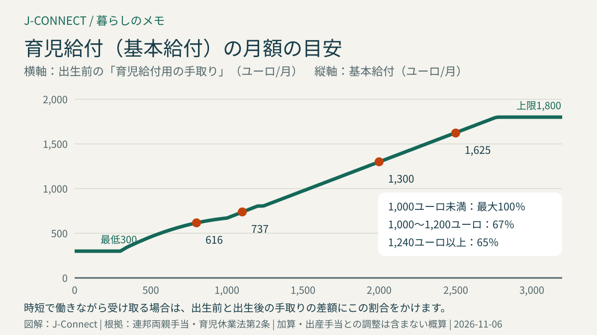
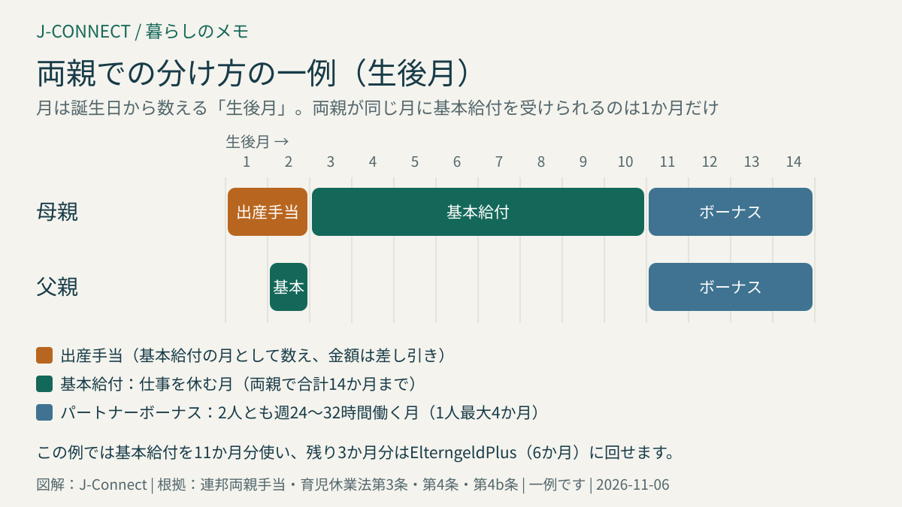

# ドイツの育児給付（Elterngeld）の計算と受け取り方｜手取りの65〜67％、ElterngeldPlus、パートナーボーナス、外国籍の条件

ドイツでは、子どもが生まれた後に仕事を休んだり減らしたりした親に、収入の減少を補う「育児給付（Elterngeld）」が支給されます。この記事は、ドイツで出産を控えた日本人の家族や、パートナーと育休の分け方を考えている人に向けて、金額の計算方法、ElterngeldPlusとパートナーボーナスの使い分け、日本国籍の親の受給条件、税金との関係を具体例で説明します。読み終えると、自分たちの家庭ではいくらぐらい、何か月受け取れそうか、どの組み合わせが合いそうかを判断できます。

出生届から各種申請までの全体の流れは「[ドイツ出産の手続き完全ガイド](/germany/ja/living/birth-procedures-germany/)」にまとめています。この記事では、育児給付の中身に絞って説明します。

## まず結論：3つの受け取り方と金額の目安

| 種類 | 金額 | 期間 | 向いている人 |
| --- | --- | --- | --- |
| **基本給付（Basiselterngeld）** | 出生前の手取りの65〜67％、月300〜1,800ユーロ | 両親で合計12か月、条件を満たせば14か月。1人最大12か月 | 仕事を完全に休む人 |
| **ElterngeldPlus** | 基本給付の半額まで | 基本給付1か月分を2か月に延ばせる | 時短勤務で早めに復職する人 |
| **パートナーボーナス** | ElterngeldPlusを1人あたり2〜4か月分追加 | 両親が同時に週24〜32時間働く月 | 共働きで、2人とも時短勤務にする家庭 |

基本給付は子どもの生後14か月まで、ElterngeldPlusは条件を満たせば生後32か月まで受け取れます。2025年4月1日以降に生まれた子どもでは、両親の前年の課税所得の合計が**17万5,000ユーロ**を超えると受給できません（連邦両親手当・育児休業法第1条第8項）。

## 金額はどう計算する？

### 基本は「出生前の手取り」の65〜67％

育児給付の金額は、出生前の「育児給付用の手取り」をもとに計算します（同法第2条）。

- 手取りが**1,000〜1,200ユーロ**の人は**67％**
- 手取りが**1,200ユーロを超える**人は、2ユーロ増えるごとに0.1ポイントずつ下がり、**1,240ユーロ以上では65％**
- 手取りが**1,000ユーロ未満**の人は、2ユーロ減るごとに0.1ポイントずつ上がり、最大**100％**
- 金額は**最低300ユーロ、最高1,800ユーロ**。出生前に収入がなかった人も300ユーロを受け取れます

ここでいう手取りは、給与明細に書かれた振込額そのものではありません。法律で決められた方法で、額面から税金と社会保険料を一律の計算で差し引いた金額です。クリスマス賞与などの一時金は計算に入りません（同法第2c条）。

### 計算の対象になる期間

会社員は、原則として**子どもが生まれた月の前の12か月**の給与で計算します。ただし、母親が産前の保護期間（Mutterschutz）や出産手当を受けていた月、妊娠が原因の病気で収入が減った月は除かれ、その分さらに前の月で数えます（同法第2b条）。自営業の人は、出生前の最後の確定申告の年が基準です。

### 金額の例

| 出生前の手取り（月） | 割合 | 基本給付（月） |
| --- | --- | --- |
| 800ユーロ | 77％ | 616ユーロ |
| 1,100ユーロ | 67％ | 737ユーロ |
| 2,000ユーロ | 65％ | 1,300ユーロ |
| 2,500ユーロ | 65％ | 1,625ユーロ |
| 3,000ユーロ | 65％ | 1,800ユーロ（上限） |

手取りがおよそ2,770ユーロを超えると、上限の1,800ユーロになります。3歳未満のきょうだいがいる（6歳未満の子どもが3人以上いる場合も含む）などの条件では10％（最低75ユーロ）の「きょうだい加算」、双子以上では2人目から1人につき300ユーロの「多胎加算」があります（同法第2a条）。

正確な見込み額は、連邦家族省の育児給付計算ツールで試算できます。[連邦家族ポータル](https://familienportal.de/familienportal/familienleistungen/elterngeld)から利用できます。

## 14か月をどう分ける？

### 基本のルール

- 両親で合計**12か月分**。もう一方の親も2か月以上収入が減れば、さらに**2か月分（パートナー月）**が加わり、合計14か月分になります
- 1人が受け取れる基本給付は**最大12か月分**、受け取る場合は**最低2か月分**
- 月は暦の月ではなく、**生まれた日から数える「生後月」**です。11月10日生まれなら、第1生後月は11月10日〜12月9日です
- 早産の場合は、予定日より何週早かったかに応じて1〜4か月分が追加されます

### 両親が同じ月に基本給付を受けられるのは1か月だけ

2024年4月1日以降に生まれた子どもでは、両親が**同じ生後月に基本給付を受け取れるのは、生後12か月までのうち1か月だけ**です（同法第4条第6項）。双子以上、早産、障害のある子どもなどは例外です。一方がElterngeldPlusを選ぶ場合は、同時に受け取れます。

産後に出産手当（Mutterschaftsgeld）や勤務先の補助を受けている期間は、母親が基本給付を受け取っている月として数えられ、その金額は育児給付から差し引かれます（同法第3条・第4条第4項）。通常、産後8週間は出産手当の期間なので、母親の最初の2か月は出産手当でほぼ相殺されます。

### よくある分け方の例

- **母親12か月＋父親2か月**：もっとも多い形です。父親の2か月を生後2か月目に重ねられるのは1か月だけなので、1か月は重ね、1か月はずらすなどの調整が必要です
- **両親7か月ずつ**：父親も長く育児に関わりたい家庭向けです
- **基本給付の一部をElterngeldPlusに替える**：母親が7か月目から時短で復職する場合などに使います

## ElterngeldPlus：時短勤務と組み合わせる

ElterngeldPlusの月額は、収入がない場合の基本給付の**半分**が上限です。その代わり、基本給付1か月分を2か月に延ばして受け取れます（同法第4条第3項・第4a条）。

育児給付を受け取りながら働く場合、受け取れる額は「出生前の手取り（最大2,770ユーロとして計算）と出生後の手取りの差額」に割合をかけて計算します。

**例：出生前の手取り2,500ユーロ、出生後は時短勤務で手取り1,200ユーロ**

- 基本給付：差額1,300ユーロ×65％＝**845ユーロ**
- ElterngeldPlus：上限は1,625ユーロの半分＝812.50ユーロ。差額から計算した845ユーロより低いため、**812.50ユーロ**

この例では、基本給付1か月で845ユーロを受け取る代わりに、ElterngeldPlusなら812.50ユーロを2か月受け取れます。時短で働きながら受け取る場合は、ElterngeldPlusのほうが総額は多くなります。

育児給付を受ける月に働けるのは、**生後月の平均で週32時間まで**です（同法第1条第6項）。

## パートナーボーナス：2人とも時短で働く

両親が**同じ時期に、連続して2〜4か月**、どちらも**週24〜32時間**働く場合、それぞれがElterngeldPlusを1か月分ずつ追加で受け取れます（同法第4b条）。2人とも時短勤務で育児を分担したい家庭に向いています。

働く時間が週24時間未満、または32時間を超えた月があると、その月はボーナスの条件を満たしません。勤務先と時短の時間を決めるときは、残業や在宅勤務の時間も含めて平均で範囲に収まるかを確認してください。ひとり親の場合も、条件を満たせばひとりで受け取れます。

## 日本国籍の親が確認したいこと

### 滞在許可の種類

ドイツに住む外国籍の親が育児給付を受け取るには、滞在許可の種類にも条件があります（同法第1条第7項）。

- **受け取れる**：永住許可、EU長期滞在許可、EUブルーカード、企業内転勤用の許可（ICTカード）、就労が認められた滞在許可（6か月以上）
- **原則として受け取れない**：留学、職業訓練、求職のための滞在許可など。ただし、実際に働いているなどの条件を満たすと受け取れる場合があります

日本国籍者が仕事のために持つ滞在許可や、家族の呼び寄せで就労が認められた配偶者の滞在許可は、多くの場合、受給できる種類に当たります。滞在許可の条文番号は、電子滞在カード（eAT）の裏面や補足の紙で確認できます。永住許可について詳しくは「[ドイツの永住許可](/germany/ja/living/permanent-residence-germany/)」も参考にしてください。

### 日本の会社からの派遣で働いている場合

育児給付の金額は、**ドイツで課税される給与**をもとに計算します（同法第2条第1項）。日本の会社から派遣され、ドイツに住んで給与にドイツの所得税がかかっている人は、その給与が計算の対象になります。

日本の雇用保険に加入したまま派遣されていて、日本の育児休業給付を受け取る場合、ドイツの育児給付から差し引かれる「比べられる外国の給付」に当たる可能性があります（同法第3条第1項第3号）。申請書では日本の給付も申告し、扱いを窓口で確認してください。日独の社会保険の関係は「[日独社会保障協定と年金](/germany/ja/living/japan-germany-social-security-pension/)」で説明しています。

## 給与税区分と確定申告との関係

### 給与税区分の変更は早めに

育児給付の計算に使う税金の差し引き方は、計算期間の最後の月の給与明細に書かれた給与税区分が基準です。ただし、期間の途中で区分を変えた場合は、**12か月のうち半分を超える月で適用されていた区分**が使われます（同法第2c条第3項）。

夫婦の一方が育児給付を受ける予定のとき、その人の区分を3にすると計算上の手取りが増え、給付額が上がることがあります。この効果を得るには、計算期間の7か月以上でその区分が適用されている必要があります。一方で、もう一方の毎月の手取りは減り、夫婦の区分が3と5の組み合わせになると確定申告が義務になります。区分の違いは「[ドイツの税務識別番号・税務署番号・給与税区分の違い](/germany/ja/living/tax-id-steuernummer-steuerklasse/)」で確認してください。

### 育児給付は非課税でも、確定申告は必要

育児給付そのものに所得税はかかりません。しかし、ほかの収入にかかる税率を決める計算には加えられます。そのため、年に410ユーロを超える育児給付を受け取った年は、**確定申告が義務**になります（所得税法第46条第2項第1号）。追加で税金を払うことになる場合もあるので、給付額の一部を残しておくと安心です。申告の方法は「[ドイツの確定申告入門](/germany/ja/living/income-tax-return-germany/)」にまとめています。

## 申請の流れと期限

1. **出生前に計画を立てる**：両親それぞれ、どの生後月にどの給付を受けるか、勤務先にいつから育児休業を取るかを決めます。育児休業（Elternzeit）は、子どもが3歳になる前の期間なら、原則として開始の7週間前までに勤務先へ通知します
2. **出生後に申請する**：子どもの住所地を担当する育児給付の窓口へ申請します。NRW州では[NRW家族ポータル](https://www.familienportal.nrw/de/elterngeld)から窓口とオンライン申請に進めます
3. **必要書類を出す**：出生証明書、給与明細（計算期間の分）、出産手当や勤務先の補助の証明、滞在許可のコピー、振込先などです
4. **決定通知を確認する**：金額と生後月ごとの内訳を確認します

申請は書面（オンラインを含む）で行い、**さかのぼって受け取れるのは申請した月の前の3生後月分まで**です（同法第7条第1項）。出生後はやることが多いので、出生前にオンラインで下書きを作っておき、生まれたらすぐに出せるようにしておきましょう。申請書には、両親ともに署名します。受給する月の計画は、受給期間が終わるまで変更を申し出ることができます。

## 制度の見直しについて

2026年11月時点で、連邦政府が育児給付の見直しを検討していると報じられています。ただし、まだ閣議決定や法律の成立の前で、報道によって内容も異なります。一部の報道では、見直しの対象は2027年11月以降に生まれる子どもとされています。それより前に生まれる子どもには、この記事で説明した現在のルールが適用されます。決まり次第、連邦家族ポータルで確認してください。

## よくある質問

### 育児休業を取らないと育児給付は受け取れませんか？

育児休業と育児給付は別の制度です。育児休業は仕事を休む権利、育児給付は収入の減少を補うお金です。週32時間以下に勤務時間を減らせば、育児休業を取らずに育児給付を受け取ることもできます。

### 子どもと一緒に日本へ長期帰省しても受け取れますか？

受給には、ドイツに住所があることなどが条件です。一時的な帰省で住所や生活の拠点がドイツに残っている場合と、ドイツを離れる場合とでは扱いが違います。長期間ドイツを離れる予定があるときは、事前に窓口へ確認してください。

### 振り込みはいつ始まりますか？

申請から決定までは、書類がそろっていても数週間かかることがあります。最初の数か月分がまとめて振り込まれることもあるため、出生直後の生活費は育児給付に頼りすぎない計画にしておくと安心です。

## 関連記事

- [ドイツ出産の手続き完全ガイド](/germany/ja/living/birth-procedures-germany/)
- [ドイツで妊娠・出産｜医療、仕事、出生届の全体ガイド](/germany/ja/living/pregnancy-birth-germany/)
- [Kindergeld（ドイツの児童手当）2027年の支給日一覧](/germany/ja/living/kindergeld-auszahlungstermine-2027/)
- [ドイツの確定申告入門](/germany/ja/living/income-tax-return-germany/)
- [ドイツのKita・U3申込み](/germany/ja/living/kita-u3-tagesmutter-guide/)

## 公式情報・参考ソース

- [連邦両親手当・育児休業法第1条：受給できる人、外国籍の条件、所得の上限](https://www.gesetze-im-internet.de/beeg/__1.html)
- [連邦両親手当・育児休業法第2条：金額](https://www.gesetze-im-internet.de/beeg/__2.html)
- [連邦両親手当・育児休業法第2a条：きょうだい加算・多胎加算](https://www.gesetze-im-internet.de/beeg/__2a.html)
- [連邦両親手当・育児休業法第2c条：所得の計算](https://www.gesetze-im-internet.de/beeg/__2c.html)
- [連邦両親手当・育児休業法第3条：出産手当などとの調整](https://www.gesetze-im-internet.de/beeg/__3.html)
- [連邦両親手当・育児休業法第4条：受給期間と同時受給](https://www.gesetze-im-internet.de/beeg/__4.html)
- [連邦両親手当・育児休業法第4b条：パートナーボーナス](https://www.gesetze-im-internet.de/beeg/__4b.html)
- [連邦両親手当・育児休業法第7条：申請](https://www.gesetze-im-internet.de/beeg/__7.html)
- [所得税法第46条：確定申告の義務](https://www.gesetze-im-internet.de/estg/__46.html)
- [連邦家族ポータル：育児給付](https://familienportal.de/familienportal/familienleistungen/elterngeld)
- [連邦家族ポータル：2024年4月以降の出生での変更点](https://familienportal.de/familienportal/familienleistungen/elterngeld/faq/was-aendert-sich-fuer-geburten-ab-1-april-2024-beim-elterngeld-237122)
- [連邦家族ポータル：申請方法](https://familienportal.de/familienportal/familienleistungen/elterngeld/faq/wie-kann-ich-elterngeld-beantragen--124762)
- [NRW家族ポータル：育児給付](https://www.familienportal.nrw/de/elterngeld)

**参照日：2026年11月6日。** 金額や条件は、子どもの出生日によって異なる場合があります。この記事は一般的な情報で、個別の判断は担当の育児給付窓口に確認してください。
