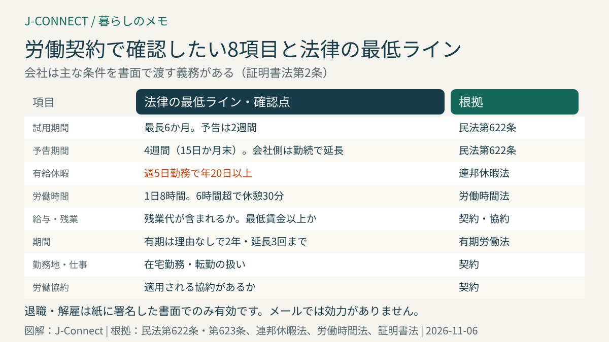
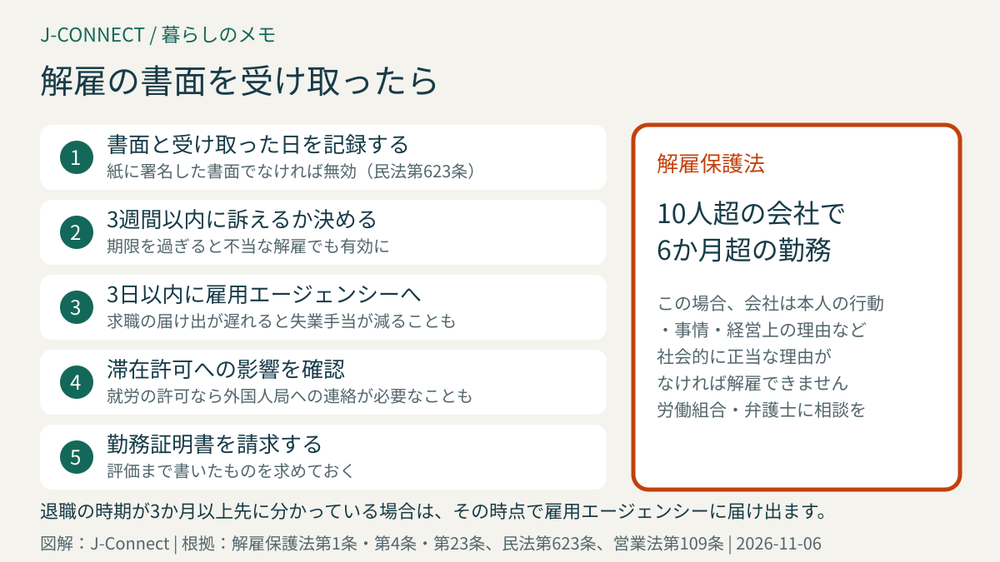

# ドイツの労働契約で確認したいこと｜試用期間、解約の予告期間、有給休暇、労働時間と休憩、有期契約、解雇されたときの3週間

ドイツの会社で働き始めるとき、ドイツ語や英語で書かれた労働契約に署名を求められます。ドイツの労働契約には、日本の雇用契約とは違う考え方や、法律で決まった最低限のルールがあり、知らずに署名すると後で困ることがあります。この記事は、ドイツで就職・転職する日本人や、アルバイトを始める人に向けて、契約で確認したい項目と、法律で守られている権利を整理します。読み終えると、契約書のどこを見ればよいか、退職や解雇のときに何に気をつければよいかが分かります。

## まず結論：契約前に確認したい8項目

1. **試用期間**：最長6か月。この間の予告期間は2週間
2. **解約の予告期間**：法律の最低は4週間。会社側は勤続年数で長くなる
3. **有給休暇**：法律の最低は週5日勤務で年20日。多くの会社は25〜30日
4. **労働時間と休憩**：1日8時間が原則。6時間を超えると30分の休憩
5. **給与と残業の扱い**：総支給額、支払日、残業代が給与に含まれるか
6. **期間**：期間の定めがあるか（有期契約）
7. **勤務地と仕事の内容**：在宅勤務や転勤の扱い
8. **労働協約**：業界の労働協約が適用されるか

会社は、これらの主な条件を**書面で渡す義務**があります（証明書法第2条）。署名前に分からない点があれば、遠慮なく質問しましょう。

## 試用期間

ドイツの正社員の契約の多くには、**最長6か月**の試用期間（Probezeit）があります。試用期間中は、会社も従業員も**2週間**前に予告すれば、いつでも契約を終わらせられます（民法第622条第3項）。

日本の試用期間と比べると、ドイツでは試用期間中の解約が比較的よく起こります。転職のために日本から引っ越す場合や、滞在許可が仕事に結びついている場合は、試用期間中に契約が終わったときのことも考えておきましょう。就労の滞在許可で働いていて契約が終わった場合は、外国人局への連絡などが必要になります。

## 解約の予告期間

試用期間の後、法律で決まった予告期間は次のとおりです（民法第622条）。

- **従業員から辞めるとき**：4週間前に予告し、**毎月15日か月末**に終わる。契約でこれより長い期間を決めていることも多くあります。ただし、会社側より長い期間を従業員だけに課すことはできません。
- **会社が解約するとき**：勤続年数に応じて長くなります。

| 勤続年数 | 会社からの予告期間 |
| --- | --- |
| 2年未満 | 4週間（15日か月末に） |
| 2年 | 1か月（月末に） |
| 5年 | 2か月 |
| 8年 | 3か月 |
| 10年 | 4か月 |
| 12年 | 5か月 |
| 15年 | 6か月 |
| 20年 | 7か月 |

労働協約で、これと異なる期間を決めている場合もあります。「3か月前に月末で」など、契約に書かれた期間が法律より長いことはよくあるので、転職の計画を立てるときは必ず契約を確認してください。

### 解約は紙に署名した書面でのみ有効

退職の申し出も、会社からの解雇も、**紙に手書きで署名した書面**でなければ無効です。メール、ショートメッセージ、スキャンしたPDFでは効力がありません（民法第623条）。退職するときは、署名した書面を会社に手渡しし、受領の署名をもらうか、届いたことが証明できる方法で送りましょう。退職の意思を伝える表現は、[仕事のメールで使うドイツ語](/germany/ja/learn-german/work-email-phrases/)を参考にしてください。

## 有給休暇

連邦休暇法では、年間の休暇の最低日数は「24日」と書かれています（同法第3条）。これは月曜から土曜までの週6日を働く日として数えた日数で、**週5日勤務なら年20日**が法律の最低です。多くの会社では、年25〜30日の休暇が契約で決まっています。

- 入社後**6か月**たつと、1年分の休暇の権利が生まれます（同法第4条）。それまでは1か月ごとに12分の1ずつです。
- 休暇は原則としてその年のうちに取ります。会社の事情などで取れなかった場合は、翌年の**3月末**までに取ります（同法第7条第3項）。会社には、休暇が消える前に従業員に知らせる義務があるとされています。
- 退職時に取りきれなかった休暇は、お金で精算されます（同法第7条第4項）。
- 休暇中に病気になり、医師の証明がある日は、休暇として数えません。詳しくは[ドイツで病気になって仕事を休むとき](/germany/ja/living/sick-leave-germany/)で説明しています。

祝日は休暇とは別で、州によって日数が違います。NRW州の祝日は[NRWの祝日2027](/germany/ja/living/nrw-public-holidays-2027/)にまとめています。

## 労働時間と休憩、残業

- **1日の労働時間**：原則**8時間**まで。6か月（または24週）の平均が8時間以内なら、1日10時間まで延ばせます（労働時間法第3条）。
- **休憩**：6時間を超えて働く日は**30分**、9時間を超える日は**45分**の休憩が必要です（同法第4条）。15分ずつに分けることもできます。
- **勤務間の休息**：仕事の終わりから次の仕事の始まりまで、**11時間**以上空ける必要があります（同法第5条）。
- **日曜・祝日**：原則として働かせることはできません（業種による例外あり）。

残業代の扱いは、法律ではなく契約や労働協約で決まります。「残業は給与に含まれる」と書かれた契約もありますが、無制限に含めることはできず、最低賃金を下回ることもできません。管理職でない人は、残業が代休で精算されるのか、残業代が払われるのかを契約で確認しましょう。

## 給与

- 給与は、多くの場合**年収（総支給額）**で提示され、月払いです。ここから所得税、連帯付加税、教会税（教会員の場合）、年金・失業・健康・介護の社会保険料が差し引かれます。
- 13か月目の給与（クリスマス手当）、休暇手当、賞与があるかも契約で確認します。
- 最低賃金は2026年が時給13.90ユーロ、2027年が14.60ユーロです。
- 給与明細の税区分が正しいかは、[税番号と税区分](/germany/ja/living/tax-id-steuernummer-steuerklasse/)で確認できます。教会税がかかっている場合は、[ドイツの教会税](/germany/ja/living/church-tax-germany/)も参考にしてください。

## 有期契約

期間の定めがある契約（有期契約）は、理由がなくても**最長2年**まで結べ、その間に**3回まで**延長できます（パートタイム・有期労働法第14条第2項）。プロジェクトや代替要員などの理由があれば、2年を超える有期契約も認められます。同じ会社と以前に有期契約を結んでいた場合は、理由のない有期契約は原則として結べません。

有期契約は、期間が終われば自動的に終わります。滞在許可が契約期間に合わせて出ている場合は、更新の時期にも注意してください。

## 解雇されたとき：3週間以内に行動する

従業員が10人を超える会社で、**6か月**を超えて働いている人は、解雇保護法で守られます（同法第1条・第23条）。この場合、会社は、本人の行動、病気などの本人の事情、会社の経営上の理由のいずれかで、社会的に正当な理由がなければ解雇できません。

解雇が不当だと考える場合は、解雇の書面を受け取ってから**3週間以内**に労働裁判所に訴える必要があります（解雇保護法第4条）。この期限を過ぎると、不当な解雇でも有効になってしまいます。解雇の書面を受け取ったら、すぐに労働組合や労働法の弁護士に相談してください。

解雇や契約の終了が決まったら、すぐに雇用エージェンシーに求職の届け出をする必要があります。遅れると失業手当が減ることがあります。手続きは[ドイツの失業手当](/germany/ja/living/unemployment-benefit-germany/)で説明しています。

## 退職するときにもらう勤務証明書

退職するとき、従業員は**勤務証明書（Arbeitszeugnis）**を求める権利があります（営業法第109条）。仕事の内容と期間だけを書いたものと、仕事ぶりや態度の評価まで書いたものがあり、次の就職でよく提出を求められます。評価まで書いた証明書を求めておくと安心です。

## よくある質問

### 英語の契約書でも有効ですか？

ドイツ語でなくても、内容に合意して署名すれば有効です。ただし、日本語で十分に理解できない部分があれば、署名前に確認してください。

### 契約書に「競業禁止」と書かれています。

退職後に同業の会社で働くことを禁じる条項は、会社が禁止期間中に一定の補償を払うなどの条件を満たさないと、効力がない場合があります。気になる場合は専門家に相談してください。

### ミニジョブやアルバイトにも同じルールが当てはまりますか？

当てはまります。短時間の仕事でも、有給休暇、病気のときの給与、最低賃金、解約の予告期間の権利があります。働く日数に応じて休暇の日数を計算します。

## 関連記事

- [ドイツで病気になって仕事を休むとき](/germany/ja/living/sick-leave-germany/)
- [税番号と税区分](/germany/ja/living/tax-id-steuernummer-steuerklasse/)
- [ドイツの失業手当](/germany/ja/living/unemployment-benefit-germany/)
- [ミニジョブの上限額](/germany/ja/living/minijob-grenze-2027/)
- [学生の働き方（ワークスチューデント）](/germany/ja/living/werkstudent-student-jobs-germany/)

## 公式情報・参考ソース

- [証明書法第2条：労働条件を書面で渡す義務](https://www.gesetze-im-internet.de/nachwg/__2.html)
- [民法第622条：解約の予告期間と試用期間](https://www.gesetze-im-internet.de/bgb/__622.html)
- [民法第623条：解約は書面でのみ有効](https://www.gesetze-im-internet.de/bgb/__623.html)
- [連邦休暇法第3条：休暇の最低日数](https://www.gesetze-im-internet.de/burlg/__3.html)
- [連邦休暇法第7条：休暇の取得と繰り越し](https://www.gesetze-im-internet.de/burlg/__7.html)
- [労働時間法第3条：1日の労働時間](https://www.gesetze-im-internet.de/arbzg/__3.html)
- [労働時間法第4条：休憩](https://www.gesetze-im-internet.de/arbzg/__4.html)
- [労働時間法第5条：勤務間の休息](https://www.gesetze-im-internet.de/arbzg/__5.html)
- [解雇保護法第1条：社会的に正当でない解雇](https://www.gesetze-im-internet.de/kschg/__1.html)
- [解雇保護法第4条：3週間以内の訴え](https://www.gesetze-im-internet.de/kschg/__4.html)
- [解雇保護法第23条：適用される事業所の規模](https://www.gesetze-im-internet.de/kschg/__23.html)
- [パートタイム・有期労働法第14条：有期契約](https://www.gesetze-im-internet.de/tzbfg/__14.html)
- [営業法第109条：勤務証明書](https://www.gesetze-im-internet.de/gewo/__109.html)

**参照日：2026年11月6日。** 労働時間法などは改正が議論されています。この記事は一般的な情報で、個別の法的助言ではありません。具体的なトラブルは、労働組合、従業員代表、労働法の弁護士に相談してください。
