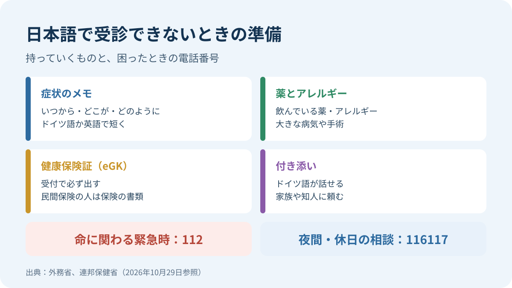

# 出産前に家族が受ける予防接種（ドイツ）｜父親はかかりつけ医で、百日咳は出産4週間前までに【2026年 編集部の記録】

ドイツでは、赤ちゃんを百日咳から守るため、妊婦本人だけでなく、一緒に暮らす家族や世話をする人も接種することが、公的保険の予防接種指針に書かれています。ところが「父親はどこで打つのか」は意外と知られておらず、妊婦健診の婦人科では受けられないことが多いです。この記事は、2026年にJ-Connect編集部の父親がかかりつけ医（Hausarzt）で百日咳とインフルエンザの接種を受けた記録をもとに、家族が出産前に確認したい接種と、予約のしかたをまとめます。

## まず結論

- 何を：同居する家族や世話をする人は、最後の百日咳の接種から**10年以上**たっていれば接種する。1970年以降に生まれた大人で、はしかの接種が0回・1回・分からない人はMMRワクチンを1回。
- いつまでに：家族の百日咳は、出産の**4週間前**までが目安。妊婦本人は妊娠**28週**からの百日咳（妊娠のたびに）、妊娠中期からのインフルエンザ（秋冬）。
- どこで：父親や家族は、自分のかかりつけ医（Hausarzt）。妊婦本人は婦人科またはかかりつけ医。
- 費用：指針に書かれた接種は公的保険の対象（社会法典第5編第20i条とG-BAの予防接種指針）。民間保険は契約による。

## あなたはどのケース？

| あなた | 指針での扱い | 確認すること |
| --- | --- | --- |
| 父親・同居の家族（最後の百日咳の接種から10年以上） | 百日咳の接種が書かれている。出産の4週間前までに | 日本の母子手帳や接種記録で、最後の接種の年 |
| 祖父母・ベビーシッターなど世話をする人 | 同じく百日咳の対象 | ドイツに来る前に日本で受けるか、ドイツで受けるか |
| 1970年以降生まれで、はしかの接種が0回・1回・不明 | MMRワクチンを1回 | 接種記録。妊婦本人は妊娠中に受けられない |
| 家族のインフルエンザ | 新生児の家族としては明記されていない。持病のある人などは別の項目で対象 | 保険の対象になるかを医師・保険者に確認 |
| 民間保険の加入者 | 契約によって違う | 保険会社に事前に確認 |

## 手順

1. 接種記録を探す：日本の母子手帳、予防接種の記録、ドイツの予防接種手帳（Impfpass）で、百日咳（日本では三種混合・四種混合など）とはしかの接種歴を確認する。記録がなければ、医師にその旨を伝える。
2. かかりつけ医を予約する：電話、オンライン予約、診療所の受付で「妻（パートナー）が妊娠していて、百日咳の接種を受けたい」と伝える。かかりつけ医がいない場合は、新規の患者を受け付ける一般医を探す。
3. 受診する：健康保険証と接種記録を持って行く。百日咳だけのワクチンはなく、破傷風・ジフテリアとの三種混合（Tdap）で接種するのが一般的。
4. 記録してもらう：接種後、予防接種手帳（Impfpass）に記入してもらう。手帳がなければ、その場で作ってもらえるか聞く。
5. 出産の4週間前までに終える：免疫がつくまでに時間がかかるため、出産予定日から逆算して予約する。

## 落とし穴

- 婦人科で打てると思う：婦人科は妊婦の診療所で、父親の接種は基本的に自分のかかりつけ医になる。
- 予約が遅れる：かかりつけ医の予約が数週間先になることがある。出産4週間前に間に合うよう、妊娠中期に動く。
- 記録がない：日本で受けた接種の記録がないと、医師が判断しにくい。母子手帳を日本の家族に送ってもらう、写真を撮っておくなどする。
- インフルエンザの費用：家族のインフルエンザが保険の対象になるかは、指針では明記されていない。自費になる可能性もあるので、受付で確認する。
- 祖父母の来独：出産前後に日本から祖父母が来る場合、日本で接種してから来るか、ドイツでの接種の費用をどうするかを事前に決める。

## そのまま使えるドイツ語

| 場面 | ドイツ語 | 日本語 |
| --- | --- | --- |
| 予約の電話 | Guten Tag, meine Frau ist schwanger, der Geburtstermin ist im [Monat]. Ich möchte mich gegen Keuchhusten impfen lassen. | こんにちは、妻が妊娠していて、〇月が予定日です。百日咳の予防接種を受けたいです。 |
| インフルエンザも頼む | Ist auch eine Grippeimpfung möglich, und übernimmt die Krankenkasse die Kosten? | インフルエンザの接種もできますか。費用は保険でカバーされますか。 |
| 記録がないとき | Ich habe meinen Impfpass nicht dabei. Meine Impfungen wurden in Japan gemacht. | 予防接種手帳を持っていません。接種は日本で受けました。 |
| 手帳への記入 | Könnten Sie die Impfung bitte in meinen Impfpass eintragen? | 接種を予防接種手帳に記入していただけますか。 |

オンラインや受付へのメッセージ：

> 件名：Terminanfrage Impfung Keuchhusten (Tdap)
> Guten Tag,
> meine Frau erwartet im [Monat Jahr] unser Kind. Ich möchte mich vor der Geburt gegen Keuchhusten und, falls möglich, gegen Grippe impfen lassen. Meine letzte Keuchhustenimpfung liegt mehr als zehn Jahre zurück.
> Könnten Sie mir bitte einen Termin anbieten?
> Mit freundlichen Grüßen
> [Name], geb. [Datum], versichert bei [Krankenkasse]

和訳：件名「百日咳（三種混合）の接種の予約」。妻が〇年〇月に出産予定です。出産前に百日咳と、できればインフルエンザの予防接種を受けたいです。最後の百日咳の接種から10年以上たっています。予約をいただけますか。〔氏名、生年月日、加入している保険〕

## 在住者の実例

J-Connect編集部メンバーの実例（2026年、デュッセルドルフ近郊）。

| したこと | 結果 |
| --- | --- |
| 父親の予防接種 | 出産前に、父親が百日咳とインフルエンザの予防接種を、自分のかかりつけ医（Hausarzt）で受けた |

接種の費用がどうなったか、予約から接種まで何日かかったかは記録していません。分かり次第追記します。

## 関連記事

- [ドイツで妊娠・出産する日本人へ](/germany/ja/living/pregnancy-birth-germany/)
- [ドイツで医師の予約を取る方法](/germany/ja/living/doctor-appointment-germany/)

## 公式情報・参考ソース

- [G-BA 予防接種指針（2026年10月29日施行）](https://www.g-ba.de/richtlinien/60/)：百日咳（妊婦、同居の家族・世話をする人）、インフルエンザ（妊婦、持病のある人の同居家族）、はしか（1970年以降生まれの大人）（2026年11月14日確認）
- [社会法典第5編第20i条：予防接種の給付](https://www.gesetze-im-internet.de/sgb_5/__20i.html)（2026年11月14日確認）
- [ロベルト・コッホ研究所：予防接種委員会（STIKO）](https://www.rki.de/DE/Themen/Infektionskrankheiten/Impfen/STIKO/stiko_node.html)：推奨の原典は2026年11月14日にこの環境から開けず未確認
