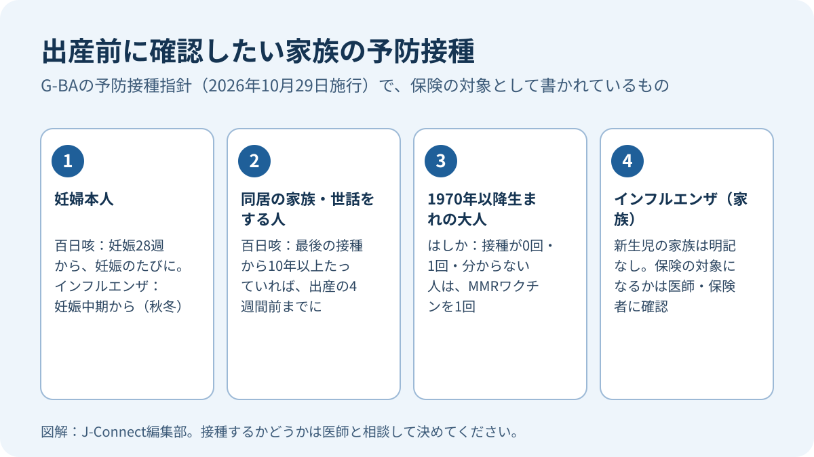
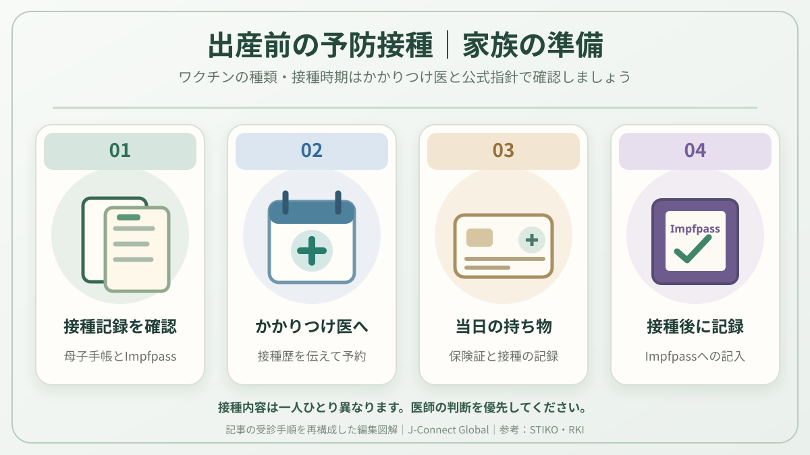

# 出産前に家族が受ける予防接種（ドイツ）｜百日咳・インフルエンザの対象と接種時期【2026年版】

ドイツでは、赤ちゃんを百日咳から守るため、妊婦本人への接種に加え、同居家族や世話をする人の接種歴を確認することが推奨されています。STIKOは、過去10年に百日咳の接種を受けていない近い接触者に、できれば出産予定日の4週間前までの接種を勧めています。この記事では、妊婦本人と家族の推奨を分け、接種歴の確認、かかりつけ医への相談、予約のしかたを整理します。

## まず結論

- 何を：同居する家族や世話をする人は、最後の百日咳の接種から**10年以上**たっていれば接種する。1970年以降に生まれた大人で、はしかの接種が0回・1回・分からない人はMMRワクチンを1回。
- いつまでに：過去10年に百日咳の接種を受けていない近い接触者は、できれば出産予定日の**4週間前まで**に接種。妊婦本人は妊娠後期の早い時期に百日咳（妊娠のたびに）。インフルエンザは季節・妊娠週数・リスクに応じて医師へ確認。
- どこで：同居家族・世話をする人は、自分のかかりつけ医（Hausarzt）など。妊婦本人は婦人科またはかかりつけ医。
- 費用：指針に書かれた接種は公的保険の対象（社会法典第5編第20i条とG-BAの予防接種指針）。民間保険は契約による。

## あなたはどのケース？

| あなた | 指針での扱い | 確認すること |
| --- | --- | --- |
| 同居家族・世話をする人（最後の百日咳接種から10年以上） | 百日咳の接種が推奨される。できれば出産予定日の4週間前までに | 母子手帳や接種記録で、最後の接種の年を確認 |
| 祖父母・ベビーシッターなど世話をする人 | 同じく百日咳の対象 | ドイツに来る前に日本で受けるか、ドイツで受けるか |
| 1970年以降生まれで、はしかの接種が0回・1回・不明 | MMRワクチンを1回 | 接種記録。妊婦本人は妊娠中に受けられない |
| 家族のインフルエンザ | 新生児の家族としては明記されていない。持病のある人などは別の項目で対象 | 保険の対象になるかを医師・保険者に確認 |
| 民間保険の加入者 | 契約によって違う | 保険会社に事前に確認 |

## 手順

1. 接種記録を探す：日本の母子手帳、予防接種の記録、ドイツの予防接種手帳（Impfpass）で、百日咳（日本では三種混合・四種混合など）とはしかの接種歴を確認する。記録がなければ、医師にその旨を伝える。
2. かかりつけ医を予約する：電話、オンライン予約、診療所の受付で「妻（パートナー）が妊娠していて、百日咳の接種を受けたい」と伝える。かかりつけ医がいない場合は、新規の患者を受け付ける一般医を探す。
3. 受診する：健康保険証と接種記録を持って行く。百日咳だけのワクチンはなく、破傷風・ジフテリアとの三種混合（Tdap）で接種するのが一般的。
4. 記録してもらう：接種後、予防接種手帳（Impfpass）に記入してもらう。手帳がなければ、その場で作ってもらえるか聞く。
5. 出産の4週間前までに終える：免疫がつくまでに時間がかかるため、出産予定日から逆算して予約する。

## 落とし穴

- 婦人科で打てると思う：婦人科は妊婦本人の診療所です。同居家族・世話をする人は、基本的に本人のかかりつけ医などで接種歴と必要なワクチンを相談します。
- 予約が遅れる：かかりつけ医の予約が数週間先になることがある。出産4週間前に間に合うよう、妊娠中期に動く。
- 記録がない：日本で受けた接種の記録がないと、医師が判断しにくい。母子手帳を日本の家族に送ってもらう、写真を撮っておくなどする。
- インフルエンザの費用：家族のインフルエンザが保険の対象になるかは、指針では明記されていない。自費になる可能性もあるので、受付で確認する。
- 祖父母の来独：出産前後に日本から祖父母が来る場合、日本で接種してから来るか、ドイツでの接種の費用をどうするかを事前に決める。

## そのまま使えるドイツ語

| 場面 | ドイツ語 | 日本語 |
| --- | --- | --- |
| 予約の電話 | Guten Tag, meine Partnerin ist schwanger; der Geburtstermin ist im [Monat]. Ich möchte mich gegen Keuchhusten impfen lassen. | パートナーが妊娠していて、予定日は〇月です。百日咳の予防接種を受けたいです。 |
| インフルエンザも頼む | Ist auch eine Grippeimpfung möglich, und übernimmt die Krankenkasse die Kosten? | インフルエンザの接種もできますか。費用は保険でカバーされますか。 |
| 記録がないとき | Ich habe meinen Impfpass nicht dabei. Meine Impfungen wurden in Japan gemacht. | 予防接種手帳を持っていません。接種は日本で受けました。 |
| 手帳への記入 | Könnten Sie die Impfung bitte in meinen Impfpass eintragen? | 接種を予防接種手帳に記入していただけますか。 |

オンラインや受付へのメッセージ：

> 件名：Terminanfrage Impfung Keuchhusten (Tdap)
> Guten Tag,
> meine Frau erwartet im [Monat Jahr] unser Kind. Ich möchte mich vor der Geburt gegen Keuchhusten und, falls möglich, gegen Grippe impfen lassen. Meine letzte Keuchhustenimpfung liegt mehr als zehn Jahre zurück.
> Könnten Sie mir bitte einen Termin anbieten?
> Mit freundlichen Grüßen
> [Name], geb. [Datum], versichert bei [Krankenkasse]

和訳：件名「百日咳（三種混合）の接種の予約」。出産予定日は〇年〇月です。出産前に百日咳と、必要に応じてインフルエンザの予防接種を受けたいです。最後の百日咳の接種から10年以上たっています。予約をいただけますか。〔氏名、生年月日、加入している保険〕

## 家族の接種歴を確認するチェックリスト

- 妊婦本人：妊娠のたびに百日咳ワクチンを接種する。STIKOは妊娠後期の早い時期を推奨し、早産の可能性が高い場合は妊娠中期への前倒しを勧めています。
- 同居家族・世話をする人：過去10年に百日咳の接種を受けていない場合、できれば出産予定日の4週間前までに接種することが推奨されています。
- 成人一般：次回の破傷風・ジフテリアの追加接種時に、百日咳を含むワクチンを使うか医師に確認します。
- インフルエンザなど他の予防接種は、妊娠週数、季節、年齢、持病、接種歴によって推奨が異なります。
- 接種歴が分からない場合は、母子手帳や予防接種記録を持参し、医師または保険者へ確認します。

## 関連記事

- [ドイツで妊娠・出産する日本人へ](/germany/ja/living/pregnancy-birth-germany/)
- [ドイツで医師の予約を取る方法](/germany/ja/living/doctor-appointment-germany/)

## 公式情報・参考ソース

- [G-BA 予防接種指針（2026年10月29日施行）](https://www.g-ba.de/richtlinien/60/)：百日咳（妊婦、同居の家族・世話をする人）、インフルエンザ（妊婦、持病のある人の同居家族）、はしか（1970年以降生まれの大人）（2026年11月14日確認）
- [社会法典第5編第20i条：予防接種の給付](https://www.gesetze-im-internet.de/sgb_5/__20i.html)（2026年11月14日確認）
- [ロベルト・コッホ研究所：百日咳の予防接種のQ&A](https://www.rki.de/SharedDocs/FAQs/DE/Impfen/Pertussis/FAQ-Liste_Pertussis_Impfen.html)：同居の家族と世話をする人は、過去10年に接種していなければ、できれば出産の4週間前までに接種。妊婦は妊娠後期（第3三半期）のできるだけ早い時期に（2026年11月15日確認）
