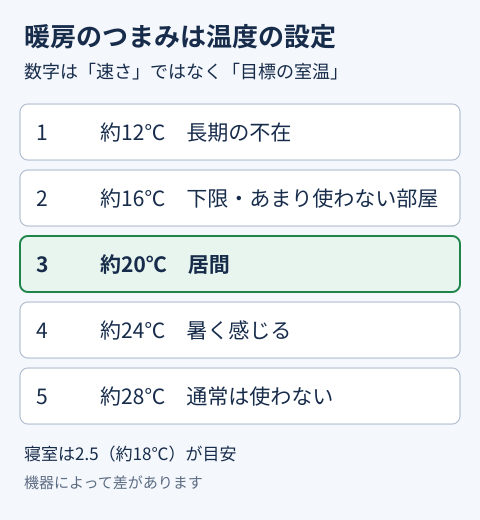
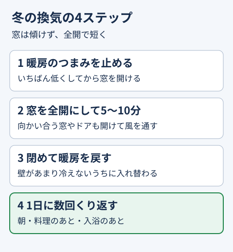

# ドイツの冬の暖房と換気｜サーモスタットの目盛り・窓の開け方・カビと光熱費を防ぐ基本【2026年】

ドイツの冬は、暖房を我慢しすぎても、窓を傾けたままにしても、カビや高い光熱費のもとになります。この記事では、暖房の目盛りと室温の関係、窓を全開にして短時間で入れ替える換気のやり方、湿度の目安を、連邦環境庁と消費者センターの案内をもとに整理します。賃貸に住み始めたばかりの人が、最初の冬に迷わないための基本です。

## まず結論：覚えるのは数字5つ

| 項目 | 目安 | 出どころ |
| --- | --- | --- |
| 居間の室温 | 20℃程度（目盛り3が約20℃） | 連邦環境庁・消費者センター |
| 寝室の室温 | 17〜18℃程度 | 連邦環境庁は17℃、消費者センターは18℃ |
| 下げすぎの下限 | 16℃を下回らない | 消費者センター（下回るとカビの危険） |
| 窓を開ける時間（冬） | 全開で5〜10分、1日に数回 | 連邦環境庁 |
| 湿度の目安 | 断熱が悪い住まいは50%未満（冬の通常時） | 連邦環境庁（経験則） |

室温を1℃下げると、暖房の消費は約6%減ると消費者センターは説明しています。ただし、下げすぎるとかえって湿気が壁に出てカビの原因になります。「下げるのは16℃まで、湿気は窓の全開で出す」と覚えておくと迷いません。

## 暖房の目盛りは「温度」で「速さ」ではない

ラジエーター（壁際の暖房）のつまみにある1〜5の数字は、温まる速さではなく、目標の室温を表します。消費者センターは、1目盛りがおよそ4℃違うと説明しています。

| つまみの数字 | 室温の目安 | 使いどころ |
| --- | --- | --- |
| 1 | 約12℃ | 長期の不在時など |
| 2 | 約16℃ | あまり使わない部屋・下限 |
| 2.5 | 約18℃ | 寝室 |
| 3 | 約20℃ | 居間 |
| 4 | 約24℃ | 暑く感じる設定 |
| 5 | 約28℃ | 通常は使わない |

連邦環境庁は、サーモスタット（温度調節弁）は室温が目標に達するとお湯の流れを絞り、一定に保つと説明しています。急いで温めたいときに5まで回しても、温まる速さが上がるわけではなく、そのまま忘れると暑くなりすぎて無駄になります。

- **夜や短い外出：** 連邦環境庁は、夜間や数時間の不在には18℃程度まで下げることを勧めています。数日の不在なら15℃程度が目安です。
- **プログラム式サーモスタット：** 時間帯ごとに室温を設定できるタイプで、消費者センターも節約に役立つとしています。賃貸では、設置前に大家や管理会社へ確認してください。

## 換気は「全開で短く」が基本

連邦環境庁は、暖房の時期は窓を傾けたままにするより、1日に数回、窓を全開にして短時間で空気を入れ替えるほうが効果的だと説明しています。

1. 暖房のつまみを止める（またはいちばん低くする）。
2. 窓を全開にして、冬は5〜10分待つ。向かい合う窓やドアを同時に開けると、空気がよく入れ替わります。
3. 窓を閉めて、暖房のつまみを元に戻す。
4. これを1日に数回、特に朝と、料理や入浴のあとに行う。

窓を傾けたままにすると、窓まわりが冷えて結露が起きやすく、カビの原因になります。暖房を絞らないまま傾けて開けておくと、熱が逃げて光熱費もかさみます（連邦環境庁）。

## 湿気が増える場面を知っておく

連邦環境庁によると、4人家族の家では呼吸、入浴、料理、洗濯などで、1日に約12リットルの水分が空気中に出ます。次の場面では、そのたびに換気します。

- 料理、入浴やシャワーのあと
- 洗濯物を室内で干したとき
- 人が集まって、窓が曇ったとき

室温が低いほど空気が含める水分は減るため、涼しい部屋ほど換気を多くする必要があります（連邦環境庁）。断熱が不十分な外壁側は表面が冷たく、湿気が付きやすくなります。

### 湿度計を置く

連邦環境庁は、湿度計で室内の湿度を見える化し、換気のタイミングを決めることを勧めています。断熱の悪い住まいでは、冬の湿度が通常50%を超えないようにするのが目安とされています。特に浴室に置くと効果的だと説明されています。

## 家具とラジエーターの置き方

- **外壁から10cm以上離す：** 外壁に家具をぴったり付けると、後ろの空気が動かず、冷たい壁に湿気が付きます（連邦環境庁）。
- **ラジエーターを隠さない：** カーテンや家具でふさぐと、熱が部屋に出にくくなり、無駄が増えます（消費者センター）。
- **暖かい部屋の熱で、暖房していない隣の部屋を温めない：** 熱と一緒に湿気も冷たい部屋へ流れ、冷たい壁に付いてしまいます（連邦環境庁）。
- **電気ヒーターは非常用に：** 連邦環境庁は、電気ヒーターは緊急時だけ短時間使うもので、常用は高くつくと説明しています。

## よくある失敗：場面の例

ここでの「場面の例」は、在住者の間でよく聞く典型例を編集部が組み立て直したもので、特定の個人の体験ではありません。

**例1：留守中は暖房を完全に切る。** 数日の旅行から戻ると、部屋の隅に黒い点が出ていた。消費者センターは16℃を下回らないよう勧めています。数日の不在でも15℃程度に保つのが目安です。

**例2：窓を一日中傾けて空気を入れ替える。** 窓の下の枠に水がたまり、カーテンの端が湿っていた。窓を傾けると壁が冷えて結露しやすくなります。全開で短時間、が基本です。

**例3：洗濯物を寝室に干して寝る。** 朝、窓が曇って壁が冷たく湿っていた。寝室は人の呼吸だけでも湿気が増えます。洗濯物は換気できる部屋で干し、干したあとに窓を全開にします。

## カビを見つけたら

連邦環境庁によると、カビの胞子は室内にもともとありますが、湿った面に付くと育ち、黒や茶色の斑点になります。家具の裏や天井の上で見えないまま育つこともあり、カビくさいにおいが手がかりになります。大量に吸い込むと、アレルギー反応や呼吸器の不調につながるおそれがあります。

1. **写真と記録を残す：** 場所、広さ、日付、そのときの湿度と室温をメモします。
2. **原因を考える：** 換気や暖房の問題か、壁の冷たさや水漏れなど建物の問題かを見分けます。
3. **大家か管理会社に連絡する：** 口頭ではなく、メールや書面で写真を添えて伝えると記録が残ります。文面は[ドイツ語学習の大家・住宅へのメール表現](/germany/ja/learn-german/landlord-housing-email-phrases/)を参考にできます。
4. **自分で判断しきれないとき：** 誰が費用を負担するかは、原因や契約内容で変わり、この記事では断定できません。借家人の相談窓口や消費者センターへの相談を検討してください。

## 光熱費の請求が気になるときは

暖房の使い方は、年に一度の光熱費の精算にも関係します。精算書の見方と期限は[光熱費・共益費の精算書の見方と期限](/germany/ja/living/nebenkostenabrechnung-2025-deadline/)、電気やインターネットの契約は[電気・ネット契約の流れ](/germany/ja/living/electricity-internet-contracts-germany/)にまとめています。賃貸の探し方と契約の確認は[ドイツの賃貸・家探し](/germany/ja/living/rent-apartment-germany/)を参照してください。

## 公式情報・参考ソース

- [連邦環境庁：正しい暖房と換気](https://www.umweltbundesamt.de/umwelttipps-fuer-den-alltag/heizen-bauen/heizen-raumtemperatur)（2026年11月16日確認。ページの更新日は2026年11月4日）
- [連邦環境庁：カビ](https://www.umweltbundesamt.de/themen/gesundheit/umwelteinfluesse-auf-den-menschen/schimmel)（2026年11月16日確認）
- [消費者センター：暖房費を節約する10のヒント](https://www.verbraucherzentrale.de/node/13892)（2026年11月16日確認）

目盛りと室温の対応は機器や設置場所で差があります。カビの責任の所在や賃料の減額は個別の事情で変わるため、確認できていません。必要に応じて専門窓口に相談してください。
