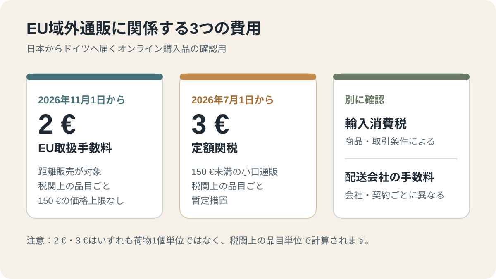
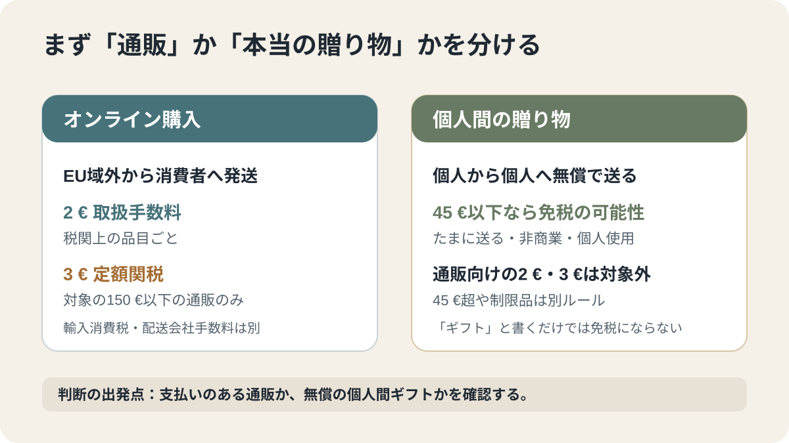

# 日本からドイツに届く荷物の関税は？2026年11月の2ユーロ手数料と3ユーロ定額関税

日本の通販サイトで買った商品をドイツに送る場合、2026年11月1日からEUの取扱手数料2ユーロが適用されるようになりました。150ユーロ以下のオンライン購入には、2026年7月1日から別の定額関税3ユーロも導入されています。日本からの通販、家族からの贈り物、EU内の倉庫から届く商品を分けて、追加費用がどこで発生するのかを整理します。

## この記事でわかること

- 2ユーロのEU取扱手数料と3ユーロの定額関税の違い
- 「1品目ごと」の計算が、荷物1個・商品1個と同じではない理由
- 日本の通販で買った商品と、家族からの私的な贈り物の違い
- 配達時に請求があった場合の確認順序

## まず結論

| 費用 | 適用開始 | 対象 | 計算単位 |
| --- | --- | --- | --- |
| EU取扱手数料 2ユーロ | 2026年11月1日 | EU域外からの消費者向け通販（距離販売）。150ユーロの上限は規定されていない | 税関上の品目ごと |
| 定額関税 3ユーロ | 2026年7月1日 | 物品価値が150ユーロ以下の対象通販 | 税関上の品目ごと |
| 輸入消費税 | 従来から | 対象となる輸入品 | 商品・取引条件による |
| 配送会社の通関取扱料 | 配送会社・契約による | 配送会社が通関手続きを代行する場合など | 配送会社の料金規則による |

2ユーロと3ユーロは別の制度です。2ユーロはEUの取扱手数料、3ユーロは150ユーロ以下の対象通販に対する一時的な定額関税で、輸入消費税や配送会社独自の手数料とも別に考えます。

## 2ユーロの取扱手数料は11月1日から適用

EU規則2026/2108第20条は、EU域内で自由流通に移すための手続きについて、距離販売で売られた商品に品目ごとの取扱手数料を設けています。金額は委任規則2026/2152で2ユーロと定められ、2026年11月1日から適用されています。

この手数料は、3ユーロの定額関税と違い、同条の規定に150ユーロ以下という価格上限がありません。つまり、150ユーロを超える通販品でも、距離販売に該当すれば取扱手数料の対象になり得ます。

## 3ユーロの定額関税は150ユーロ以下の対象通販に別途かかる

EU理事会は、150ユーロ以下の小口通販について、2026年7月1日から3ユーロの定額関税を導入しました。これは通常の関税制度に移行するまでの暫定措置です。EU理事会の説明では、荷物1個につき一律3ユーロではなく、税関上の品目ごとに計算します。

したがって、対象となる通販であれば、2026年11月1日以降は、条件に応じて3ユーロの定額関税と2ユーロの取扱手数料が重なる場合があります。輸入消費税や配送会社の取扱料は、さらに別の項目です。

## 「品目ごと」は商品1個ごとでも、荷物1個ごとでもない

EU規則2026/2108第5条は、同じ関税分類、品名、必要な場合は原産地を共有する1個以上の商品を、税関上の「品目」と定義しています。そのため、購入した商品数と税関申告上の品目数は必ずしも一致しません。

例えば、同じ分類・品名・原産地として申告される複数の商品は、まとめて1品目になることがあります。一方、異なる種類の商品は別の品目に分かれる場合があります。実際の分類は税関申告の内容で決まるため、購入点数だけから請求額を断定することはできません。

仮に、150ユーロ以下の対象通販が税関申告上2品目に分類された場合、定額関税は3ユーロ×2、取扱手数料は2ユーロ×2となります。合計10ユーロですが、これは輸入消費税や配送会社独自の取扱料を含まない例です。

## 日本の通販で買った商品はどうなる？

確認するのは、通販サイトの会社所在地だけではなく、実際に商品がどこから発送されるかです。

1. **日本などEU域外からドイツへ直接発送される場合**：対象となる距離販売なら、EUの取扱手数料や、価格条件に応じた定額関税の対象になり得ます。
2. **EU内の倉庫から発送される場合**：商品がすでにEU内で輸入通関されているなら、通常は受取人が配達時に新たな輸入通関を行う形にはなりません。販売価格や配送条件に費用が反映されている可能性はあります。
3. **通販時に税金を支払った場合**：注文確認画面と領収書を保存し、配達時に別の請求があれば、輸入消費税、関税、配送会社の取扱料のどれに当たるのかを確認します。

EUの新しい税関制度では、距離販売に関する税関手続きや費用について、販売者・プラットフォーム側の責任を強める方向が示されています。ただし、実際の販売価格への反映方法や請求表示は取引・配送の仕組みによって異なります。2ユーロが必ず受取時に現金で請求される、と決めつけないでください。

## 家族から日本の荷物が「贈り物」として届く場合

家族や友人が個人として送る本当の贈り物は、通販の距離販売とは別の扱いです。ドイツ税関の案内では、次の条件を満たす個人間の贈り物は、物品価値45ユーロ以下で輸入時の税金が免除されます。

- 差出人も受取人も個人である
- 商業目的ではなく、たまに送られる贈り物である
- 受取人本人や家庭で使うためのものである
- 代金や交換の対価を支払っていない

この条件を満たす私的な贈り物は、通販の距離販売を対象とする2ユーロの取扱手数料の対象ではありません。150ユーロ以下の通販に対する3ユーロの定額関税も、個人間の贈り物にそのまま当てはめる制度ではありません。

通販で購入した商品を、販売店に「贈り物」と記載してもらうだけでは、個人間の贈り物にはなりません。45ユーロを超える贈り物、酒類・たばこ・医薬品・食品・植物などは別の輸入税や禁止・制限が関係するため、発送前にドイツ税関の最新案内を確認してください。

## 配達時に追加料金を請求されたら

請求の名称だけで判断せず、内訳を確認します。

1. メールやSMSのリンクを直接押さず、配送会社の公式アプリまたは公式サイトで追跡番号を入力する。
2. 請求が輸入消費税、関税、EU取扱手数料、配送会社独自の通関取扱料のどれなのか確認する。
3. 注文時に税金を支払っている場合は、注文確認書・領収書を用意して販売店と配送会社に照会する。
4. 請求明細、追跡履歴、支払い記録を保存する。

税関上の手数料を納付する義務者は、EU規則上、輸入時の関税債務者です。購入者がどの費用を負担するかは販売条件や輸入手続きによって変わるため、請求書の内訳と購入時の表示を照合してください。

## よくある質問

### 2ユーロは荷物1個につきかかりますか？

いいえ。税関上の品目ごとです。1つの荷物に複数の品目が含まれれば、品目数に応じて金額が変わる場合があります。

### 2ユーロの手数料は150ユーロを超える荷物にも適用されますか？

EU規則第20条の取扱手数料は、150ユーロ以下という上限を定めていません。150ユーロ以下の対象通販に対する3ユーロの定額関税とは、適用条件が異なります。

### 2ユーロは輸入消費税に含まれますか？

別の費用です。輸入消費税、関税、EU取扱手数料、配送会社独自の取扱料は分けて確認してください。

### 家族からの45ユーロ以下の贈り物にも2ユーロかかりますか？

本当の個人間ギフトは距離販売ではないため、EUの通販向け取扱手数料の対象ではありません。ただし、45ユーロ以下の免税には個人間・非商業・無償などの条件があります。

## 関連記事

- [ドイツから日本へクリスマス・年末の荷物を送る2026](/germany/ja/living/christmas-post-germany-to-japan-2026/)
- [ドイツのDHLが配達済みなのに届かない場合](/germany/ja/living/dhl-delivered-but-not-received/)

## 公式情報・参考ソース

- [EU理事会：小口荷物へのEU措置](https://www.consilium.europa.eu/de/policies/eu-action-influx-of-small-parcels/)
- [欧州委員会：EU税関改革](https://taxation-customs.ec.europa.eu/customs/eu-customs-reform_en)
- [EU規則2026/2108](https://eur-lex.europa.eu/legal-content/EN/TXT/?uri=CELEX:32026R2108)
- [EU委任規則2026/2152](https://eur-lex.europa.eu/legal-content/EN/TXT/?uri=CELEX:32026R2152)
- [ドイツ税関：郵便・通販荷物と贈り物の案内（PDF）](https://www.zoll.de/SharedDocs/Downloads/DE/Publikation/Broschuere/Reise-Post/faltblatt_zoll_post_internethandel.pdf?__blob=publicationFile&v=4)
