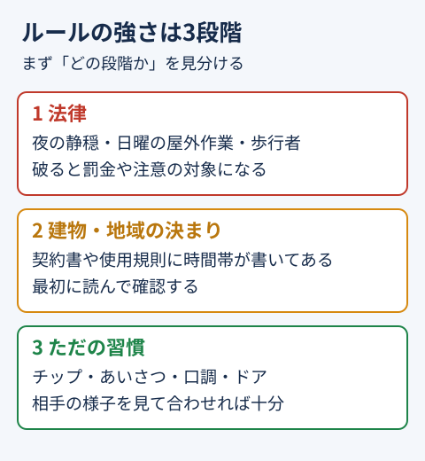
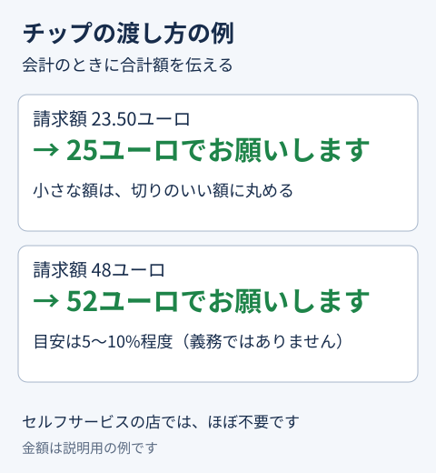

# ドイツで日本人がやりがちな「知らずに失礼」8選｜チップ・あいさつ・日曜の音・自転車レーン【2026年】

ドイツに来たばかりの頃は、悪気がないのに相手をびっくりさせてしまう場面がいくつかあります。この記事では、日本の感覚のままだと誤解されやすい8つの場面を、「何が起きるか」と「どうすればよいか」に分けて整理します。法律で決まっていること、建物や自治体で違うこと、ただの習慣を見分けられるようになるのがねらいです。

## この記事の読み方：場面の例は「再構成」です

各項目の「場面の例」は、在住者の間でよく聞く典型的な出来事を編集部が組み立て直したもので、特定の個人の体験記ではありません。また、習慣の部分は地域や人によって違い、公的な基準がないものが多くあります。法令が根拠になる点だけ、末尾の公式情報へのリンクを付けました。

## 1. 会計でチップを渡さず、そのまま帰る

**場面の例：** 友人と入ったレストランで、請求書の金額をそのまま払って店を出た。店員の表情が少しこわばったように見えた。

メニューの値段は、税などを含む総額で表示するのが原則です（価格表示規則2条）。そのため「チップを払わないと失礼」という法律はありません。ただ、席に着いて給仕を受けるお店では、満足したら金額を少し切り上げて払う習慣があります。目安は請求額の5〜10%程度と紹介されることが多く、小さな金額なら切りのいい額に丸める人もよくいます。

- **どうする：** 現金やカードで払うとき、店員に「この金額でお願いします」と、チップ込みの合計額を口頭で伝える。テーブルにコインを残して席を立つ人は少数派です。
- **使わなくてよい場面：** セルフサービスのカフェやパン屋、ファストフードは、ほとんど不要です。
- **覚えておくこと：** 気に入らなければ渡さなくても問題ありません。あくまで感謝の気持ちを表す習慣です。

## 2. お店や待合室に無言で入る

**場面の例：** 小さなパン屋に入って、店員と目を合わせないままショーケースを眺めていた。店員が一瞬こちらを待っているように見えた。

小さな店や診療所の待合室では、入るときに「こんにちは」、出るときに「さようなら（よい一日を）」と声に出すのが普通です。大型スーパーでは不要ですが、人数の少ない場所ほど、あいさつがないと冷たい印象になりやすいようです。ここは法律ではなく習慣です。

- **どうする：** 入るときは軽くうなずきながら短く一言。出るときも一言そえるだけで、その後のやりとりがやわらかくなります。
- **ドイツ語に自信がないとき：** 場面別の言い回しは、ドイツ語学習の[買い物の表現](/germany/ja/learn-german/shopping-phrases/)にまとめています。

## 3. 日曜・祝日に、音の出る作業をする

**場面の例：** 日曜の午後、ベランダの掃除や棚の組み立てを始めたら、後日、管理会社から注意の手紙が来た。

ここは、法律と建物のルールが重なる場面です。

- **法律：** 住宅地では、芝刈り機、刈払機、落ち葉ブロワーなど、屋外で使う機械は日曜・祝日は一日中使えません。平日も夜20時から朝7時までは使えません（32. BImSchV 7条）。さらにNRW州では、22時から6時は夜間の静穏を乱す行為が禁じられています（NRW州公害防止法9条）。
- **建物のルール：** 洗濯機、掃除機、工具、楽器など建物の中で出る音は、賃貸契約や住宅の使用規則（Hausordnung）に細かい時間帯が書かれていることが多いです。昼休みの時間帯に静かにするよう定めている建物もあります。
- **どうする：** 入居したら、契約書に付いている使用規則を最初に読みます。迷ったら、日曜・祝日は大きな音の出る作業を避け、平日の昼間にまとめるのが安全です。

詳しい契約の見方は[ドイツの賃貸・家探し](/germany/ja/living/rent-apartment-germany/)も参考になります。

## 4. 自転車レーンの上を歩く、立ち止まる

**場面の例：** 友人と並んで歩いていたら、赤く舗装された細い道に入っていた。後ろから自転車のベルを鳴らされた。

歩行者は歩道を通るのが原則です（道路交通規則25条）。歩道と自転車道が並んでいる道では、自転車道に足を踏み入れると衝突の危険があります。ベビーカーを押しているときや、写真を撮るときにうっかり立ち止まりやすい場所です。

- **どうする：** 色の違う舗装や、路面の自転車マークを見たら自転車道だと考えて、歩道側に寄ります。
- **自転車に乗る側のルール：** [ドイツの自転車ルール](/germany/ja/living/bicycle-rules-germany/)にまとめています。

## 5. 予約や約束に遅れるのに、連絡しない

**場面の例：** 診療所の予約に10分ほど遅れそうだったが、「待ってもらえるだろう」と思って連絡しなかった。着いたら予約が取り消されていた。

予約時間や待ち合わせ時間は、数分でも守る人が多い一方、日本ほど「待たせたこと自体を謝り続ける」文化ではありません。むしろ、遅れる連絡を早めに入れるかどうかで印象が決まります。診療所や役所の予約では、連絡なしの遅刻や無断欠席がキャンセル扱いになる場合があるため、予約票の条件を確認しましょう。

- **どうする：** 遅れそうだと分かった時点で、電話か予約サイトのメッセージで一言伝えます。
- **言い回し：** 電話の最初の一言は、ドイツ語学習の[電話の表現](/germany/ja/learn-german/telephone-phrases/)で確認できます。

## 6. 初対面の大人に、いきなり友達口調で話しかける

**場面の例：** 隣人が親しげに話しかけてきたので、こちらも同じ調子で返したら、少し間があいた。

ドイツ語には、丁寧な「あなた」と、親しい人向けの「きみ」の2種類があります。初対面の大人、店員、職場の上司には丁寧な形が基本です。一方、スポーツクラブ、学生の集まり、一部の職場や子どもの関係では、最初から親しい形で話す場面もあります。

- **どうする：** 迷ったら丁寧な形で話し、相手が親しい形に切り替えたら合わせます。相手が決めるのを待つのが無難です。
- **覚えておくこと：** どちらを使うかには地域差や世代差があり、公的な決まりはありません。

## 7. レジで、袋詰めに時間をかける

**場面の例：** スーパーのレジで会計が終わったあと、その場でゆっくり袋に入れていたら、後ろの人が待っていた。

日本のスーパーでは、会計後に袋詰め用の台が用意されていることが多く、ここで落ち着いて詰めます。ドイツのスーパーでは、レジの流れが速く、会計を終えたら荷物をいったん別の台や横の場所へ動かして詰めるのが一般的です。店によっては袋詰めの専用スペースがありますが、ない店のほうが多いです。

- **どうする：** 商品をレジに出す順番を、重い物・硬い物から、冷たい物・やわらかい物の順に並べておくと、そのまま詰めやすくなります。
- **エコバッグ：** 買い物袋は店で買うことが多いので、自分の袋を持っていくと会計がスムーズです。

## 8. ドアを押さえない、お礼を言わない

**場面の例：** 建物の出入口で、前を歩いていた人が後ろの人のためにドアを押さえてくれた。軽く会釈だけして通り過ぎた。

ドアを後ろの人のために押さえるのは自然な習慣です。押さえてもらったら、短く声に出して「ありがとう」と言う人が多く、会釈だけだと伝わりにくいことがあります。エレベーターで乗り合わせたときに、軽くあいさつを交わす地域もあります。

- **どうする：** 押さえてもらったら声に出す。後ろに人がいたら、少し待ってドアを持つ。小さな習慣ですが、近所づきあいの印象が変わります。

## まとめ：迷ったときの3つの確認

1. **法律か？** 夜の静穏、日曜・祝日の屋外作業、自転車道の通行など、法令がある点は守ります。
2. **建物のルールか？** 賃貸契約書と使用規則に、時間帯や共用部の使い方が書かれていないか確認します。
3. **習慣か？** チップ、あいさつ、口調などは、相手の様子を見て合わせ、うまくいかなくても過度に気にしすぎないことです。

最初の1か月の過ごし方は[ドイツ生活 最初の30日](/germany/ja/living/germany-first-30-days/)に、ごみの出し方は[ドイツのゴミ分別](/germany/ja/living/germany-waste-sorting-guide/)にまとめています。

## 公式情報・参考ソース

- [価格表示規則2条（総額の定義）](https://www.gesetze-im-internet.de/pangv_2022/__2.html)（2026年11月16日確認）
- [NRW州公害防止法9条（夜間の静穏）](https://recht.nrw.de/lrgv/gesetz/16032024-gesetz-zum-schutz-vor-luftverunreinigungen-geraeuschen-und-aehnlichen/)（2026年11月16日確認）
- [32. BImSchV 7条（住宅地での屋外使用の時間制限）](https://www.gesetze-im-internet.de/bimschv_32/__7.html)（2026年11月16日確認）
- [32. BImSchV 付属書（対象機械の一覧）](https://www.gesetze-im-internet.de/bimschv_32/anhang.html)（2026年11月16日確認）
- [道路交通規則25条（歩行者）](https://www.gesetze-im-internet.de/stvo_2013/__25.html)（2026年11月16日確認）

チップの目安、あいさつ、口調、袋詰めなどの習慣は、公的な基準がなく編集部の整理です。地域や店によって違うため、現地の様子を優先してください。
