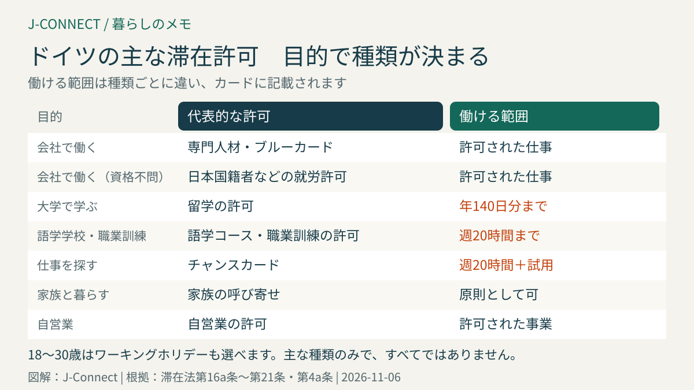
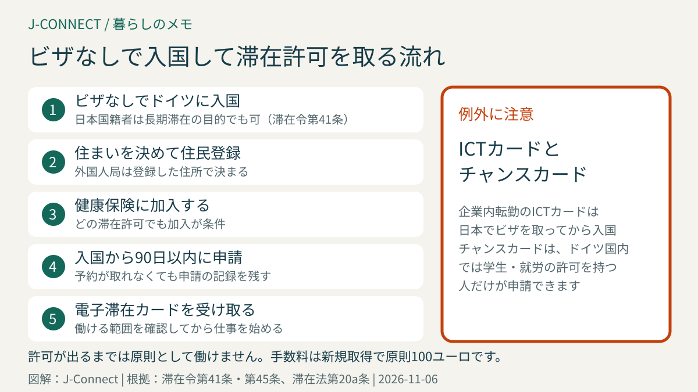

# ドイツのビザ・滞在許可の種類｜日本人がビザなしで入国して申請できるしくみと、目的別の選び方

ドイツに3か月を超えて住むには、目的に合った「滞在許可（Aufenthaltserlaubnis）」が必要です。日本国籍の人は、ほかの多くの国の人と違い、ビザを取らずに入国してから、ドイツ国内の外国人局で滞在許可を申請できます。この記事は、ドイツで働く、学ぶ、仕事を探す、家族と暮らすことを考えている日本人に向けて、主な滞在許可の種類と条件、働ける範囲、申請の流れを滞在法の条文に沿って整理します。読み終えると、自分の目的にはどの許可が合いそうか、日本で何を準備すべきかが分かります。

## まず結論：目的で滞在許可が決まる

ドイツの滞在許可は「何のためにドイツにいるか」で種類が分かれ、種類ごとに働ける範囲が違います。代表的なものは次のとおりです。

| 目的 | 主な滞在許可 | 働ける範囲 | 根拠 |
| --- | --- | --- | --- |
| 会社で働く（大学卒・職業資格あり） | 専門人材の滞在許可 | 許可された仕事 | 滞在法第18a条・第18b条 |
| 年収の高い仕事に就く（大学卒） | EUブルーカード | 許可された仕事 | 滞在法第18g条 |
| 会社で働く（資格を問わない） | 日本国籍者などの就労許可 | 許可された仕事 | 滞在法第19c条・就労令第26条 |
| 大学で学ぶ | 留学の滞在許可 | 年140日分まで | 滞在法第16b条 |
| 語学学校に通う | 語学コースの滞在許可 | 週20時間まで | 滞在法第16f条 |
| 職業訓練を受ける | 職業訓練の滞在許可 | 訓練＋週20時間まで | 滞在法第16a条 |
| 仕事を探す | チャンスカード | 週20時間まで＋試用 | 滞在法第20a条 |
| 旅をしながら働く（18〜30歳） | ワーキングホリデー | 協定の範囲で可 | 日独のワーキングホリデー制度 |
| 家族と暮らす | 家族の呼び寄せ | 原則として可 | 滞在法第27条以下 |
| 自営業・フリーランス | 自営業の滞在許可 | 許可された事業 | 滞在法第21条 |

働ける範囲は、滞在許可のカードや補足の紙に書かれます（滞在法第4a条）。「就労可（Erwerbstätigkeit erlaubt）」などの記載がない仕事はできないので、受け取ったら必ず確認してください。

## 日本人はビザなしで入国して、ドイツで申請できる

滞在令第41条により、日本国籍の人は、3か月を超える滞在の目的でも、ビザなしでドイツに入国して滞在できます。必要な滞在許可は、ドイツ国内で取得できます。ただし、**入国から90日以内に**住所地の外国人局へ申請しなければなりません（同条第3項）。

このしくみには、次の注意点があります。

- **90日以内に「申請」することが条件**です。外国人局の予約が取れないときは、オンラインフォームやメールで申請の意思を送り、記録を残しておきます。
- ビザなしで入国した期間は、短期滞在と同じ扱いではありません。ただし、**申請して許可が出るまでは、原則として働けません**。働き始める日は、許可の内容を確認してから決めます。
- 日本の会社から派遣される人が使う企業内転勤の許可（ICTカード）は、この特例の対象外です（同条第4項）。日本のドイツ大使館・総領事館でビザを取ってから入国します。
- **チャンスカード**は、ドイツ国内では、すでに学生や就労などの滞在許可を持っている人しか申請できません（滞在法第20a条第4項）。ビザなしで入国した人は、日本で申請するのが基本です。

日本で先にビザを取ることもできます。入国後すぐに働き始めたい人、ドイツでの予約が取りにくい大都市に住む予定の人、家族と一緒に入国する人は、日本のドイツ大使館・総領事館で取っておくと入国後の手続きが落ち着いて進められます。

## 就労の滞在許可：3つのルートの違い

### 専門人材（滞在法第18a条・第18b条）

ドイツで認められた職業資格（第18a条）や大学の学位（第18b条）を持ち、それを生かす仕事に就く人の許可です。日本の大学の学位がドイツの大学と同等と認められるかは、各州の文部大臣会議が運営する外国の学位のデータベース（anabin）などで確認します。永住許可まで最短3年のルートにつながります。

### EUブルーカード（滞在法第18g条）

大学を卒業し、一定以上の年収で働く人の許可です。年収の条件や家族の扱いは[ドイツのEUブルーカードとは](/germany/ja/living/eu-blue-card-germany/)で説明しています。永住許可まで最短21か月のルートがあります。

### 日本国籍者などの就労許可（滞在法第19c条・就労令第26条）

日本、アメリカ、カナダ、韓国など特定の国の国籍者は、学位や資格の有無にかかわらず、**どんな仕事でも**就労の許可を受けられる可能性があります。日本食レストランの調理や接客、日系企業の現地採用などでよく使われます。ただし、連邦雇用エージェンシーが、同じ仕事に就ける国内の求職者がいないか、労働条件がドイツ人と同等かを確認します（「優先順位の審査」）。

この許可は便利な一方、**永住許可までの期間が原則5年**になるなど、専門人材やブルーカードより不利な点があります。学位があり年収の条件も満たせる人は、どの条文で申請するかを、雇用主や外国人局と相談してください。詳しくは[ドイツの永住許可](/germany/ja/living/permanent-residence-germany/)の「日本人が最初に確認したいカードの条文」を参考にしてください。

## 学ぶための滞在許可

| 種類 | 条件の要点 | 働ける範囲 |
| --- | --- | --- |
| 大学での留学（第16b条） | 大学の入学許可、生活費の証明 | 年140日分（4時間以内の日は半日として数える） |
| 大学の出願準備（第17条第2項） | 入学の条件を満たす見込み、生活費 | 週20時間まで、最長9か月 |
| 語学学校（第16f条） | 語学学校の入学許可、生活費 | 週20時間まで |
| 職業訓練（第16a条） | 訓練先の契約、多くはドイツ語B1 | 訓練とは別に週20時間まで |

大学での留学の働き方は[ドイツの大学に留学する](/germany/ja/living/study-in-germany-student-visa/)、職業訓練は[ドイツの職業訓練（Ausbildung）](/germany/ja/living/ausbildung-germany-japanese/)で詳しく説明しています。

語学学校の滞在許可は、学ぶことが目的なので、一般的に週に18時間程度以上の授業がある集中コースを求められます。夜間や週1回のコースでは認められないことが多いので、申し込む前に語学学校に「滞在許可に使える入学証明を出せるか」を確認してください。

## 仕事を探すための滞在許可

- **チャンスカード（第20a条）**：大学の学位や2年以上の職業資格を持つ人が、最長1年、ドイツで仕事を探せます。点数制の条件や働ける範囲は[ドイツのチャンスカード](/germany/ja/living/chancenkarte-germany-japanese/)で説明しています。
- **大学・職業訓練を終えた後の求職（第20条）**：ドイツの大学を卒業した人や、職業訓練を修了した人は、最長18か月、仕事を探すための滞在許可を受けられます。この間は働く制限がありません。

## ワーキングホリデー

18歳から30歳までの日本人は、日独のワーキングホリデー制度で、最長1年、旅をしながら働けます。資金の目安や保険、申請先は[ドイツのワーキングホリデー](/germany/ja/living/working-holiday-germany/)にまとめています。

## 家族と暮らすための滞在許可

ドイツで働く人や学ぶ人の配偶者・子ども、ドイツ人と結婚した人は、家族の呼び寄せの滞在許可を受けられます。日本国籍の配偶者は、入国前にドイツ語の証明を出す必要がありません。条件は[家族をドイツに呼び寄せるとき](/germany/ja/living/family-reunification-spouse-work-germany/)で説明しています。

## 自営業・フリーランスの滞在許可

会社を作る、フリーランスとして働く人は、滞在法第21条の許可を申請します。事業の見通し、経験、資金などが審査され、事業計画書や見込み客からの書類を求められるのが一般的です。ドイツの大学を卒業した人や、研究者などには条件を緩める規定があります（同条第2a項）。45歳を超えて申請する人は、老後の備えも求められます（同条第3項）。

芸術家や語学講師などの「自由業（Freiberufler）」と、商売をする「営業（Gewerbe）」では、税務署や営業登録の手続きが異なります。申請前に、住んでいる市の外国人局や商工会議所の案内を確認してください。

## 申請の流れと手数料

1. **住民登録をする**：住む場所が決まったら、住民登録を済ませます。外国人局は登録した住所で決まります。手順は[ドイツの住民登録（Anmeldung）](/germany/ja/living/anmeldung-guide/)で説明しています。
2. **健康保険に入る**：どの滞在許可でも、健康保険の加入が条件です。[ドイツの健康保険](/germany/ja/living/health-insurance-guide/)を参考にしてください。
3. **外国人局に申請する**：多くの自治体でオンラインの申請や予約が使えます。パスポート、生体認証用の写真、申請書、目的に応じた書類（雇用契約書、入学許可、生活費の証明など）を用意します。
4. **指紋の採取と、電子滞在カードの受け取り**：審査が終わると、カードが作られ、数週間後に受け取ります。

滞在許可の手数料は、新しく取得するときが原則**100ユーロ**、延長は**93ユーロ**（3か月を超える場合）です（滞在令第45条）。目的を変える場合や、カードの再発行には別の手数料がかかります。奨学金の受給者などは減免される場合があります。

更新の時期や、審査中の扱いについては[ドイツの滞在許可を申請・更新する方法](/germany/ja/living/residence-permit-renewal-germany/)を参考にしてください。

## よくある質問

### 観光で入国してから、ドイツで仕事を探してもよいですか？

日本国籍の人は、ビザなしで入国してから、ドイツで仕事を探し、見つかった時点で就労の滞在許可を申請できます。ただし、入国から90日以内に申請する必要があり、許可が出るまでは働けません。90日を超えそうな場合は、早めに外国人局に相談してください。

### 滞在許可の目的を途中で変えられますか？

多くの場合は変えられます。例えば、語学学校の許可から大学の留学へ、留学から就労へ、という変更は一般的です。ただし、大学の出願準備や職業訓練先探しの許可の間は、原則として留学・職業訓練などへの変更に限られる（滞在法第17条第3項）など、制限がある組み合わせもあります。変更を考えたら、今の許可が切れる前に外国人局に相談します。

### 日本で取ったビザと、ドイツで取る滞在許可は何が違いますか？

日本で取るビザは、入国のための許可で、多くは3〜6か月程度の期間です。入国後、そのビザの期限が切れる前に、外国人局で電子滞在カードの滞在許可を申請します。ビザなしで入国した場合は、最初から外国人局で申請します。

## 外国人局で使うドイツ語

予約の取り方や窓口での伝え方は、[外国人局で使うドイツ語](/germany/ja/learn-german/auslaenderbehoerde-residence-phrases/)にまとめています。

## 関連記事

- [ドイツの滞在許可を申請・更新する方法](/germany/ja/living/residence-permit-renewal-germany/)
- [ドイツのEUブルーカードとは](/germany/ja/living/eu-blue-card-germany/)
- [ドイツのチャンスカード](/germany/ja/living/chancenkarte-germany-japanese/)
- [ドイツのワーキングホリデー](/germany/ja/living/working-holiday-germany/)
- [ドイツの永住許可](/germany/ja/living/permanent-residence-germany/)
- [家族をドイツに呼び寄せるとき](/germany/ja/living/family-reunification-spouse-work-germany/)

## 公式情報・参考ソース

- [滞在令第41条：日本国籍者などのビザなし入国と国内での申請](https://www.gesetze-im-internet.de/aufenthv/__41.html)
- [滞在法第4条：滞在許可が必要であること](https://www.gesetze-im-internet.de/aufenthg_2004/__4.html)
- [滞在法第4a条：就労できる範囲](https://www.gesetze-im-internet.de/aufenthg_2004/__4a.html)
- [滞在法第16a条：職業訓練](https://www.gesetze-im-internet.de/aufenthg_2004/__16a.html)
- [滞在法第16b条：大学での留学](https://www.gesetze-im-internet.de/aufenthg_2004/__16b.html)
- [滞在法第16f条：語学学校](https://www.gesetze-im-internet.de/aufenthg_2004/__16f.html)
- [滞在法第18b条：専門人材](https://www.gesetze-im-internet.de/aufenthg_2004/__18b.html)
- [滞在法第19c条：そのほかの就労](https://www.gesetze-im-internet.de/aufenthg_2004/__19c.html)
- [就労令第26条：日本国籍者などの就労](https://www.gesetze-im-internet.de/beschv_2013/__26.html)
- [滞在法第20a条：チャンスカード](https://www.gesetze-im-internet.de/aufenthg_2004/__20a.html)
- [滞在法第21条：自営業](https://www.gesetze-im-internet.de/aufenthg_2004/__21.html)
- [滞在令第45条：滞在許可の手数料](https://www.gesetze-im-internet.de/aufenthv/__45.html)

**参照日：2026年11月6日。** 滞在に関する法律は改正が続いており、運用や必要書類は外国人局ごとに異なります。この記事は一般的な情報で、個別の法的助言ではありません。申請前に必ず管轄の外国人局やドイツ大使館・総領事館の最新の案内を確認し、複雑な事情がある場合は専門の弁護士などに相談してください。
