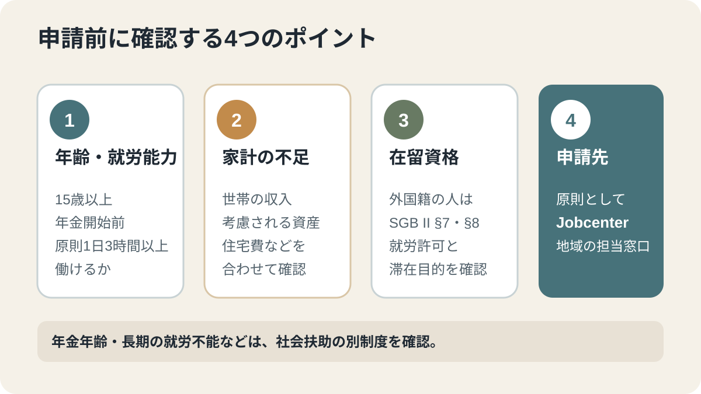
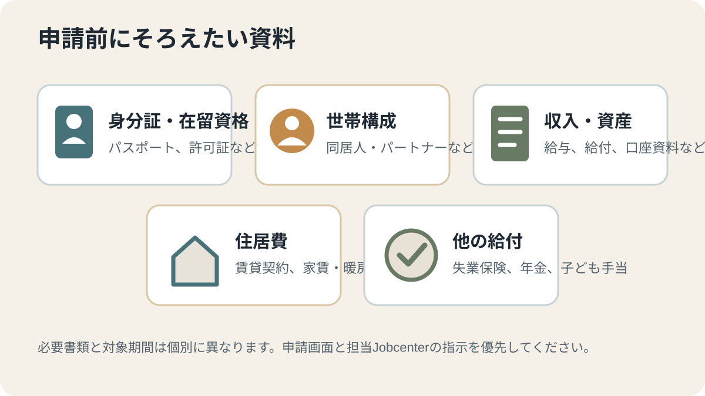

# ドイツの求職者向け基礎保障とは？旧Bürgergeldからの変更と申請方法【2026年】

ドイツでは2026年7月1日から、求職者向けの基礎保障制度が旧Bürgergeld（市民手当）から新しい制度へ移行しました。仕事を探している人だけでなく、働いていても世帯収入だけでは生活費をまかなえない人が対象になる場合があります。この記事では、失業保険との違い、対象条件、申請先と必要書類、外国籍の人が先に確認すべき点を整理します。

## 先に結論

- 新しい制度の給付名は「Grundsicherungsgeld（求職者向け基礎保障の給付）」です。旧Bürgergeldを単に改称しただけではなく、就労への仲介、協力義務、資産や住居費の扱いも見直されています。
- 申請・相談先は原則として居住地を担当するジョブセンターです。
- 失業中でなくても、働いている世帯の収入が不足していれば対象になる可能性があります。
- 外国籍の人は、就労許可と在留資格、給付除外の規定を個別に確認してください。

## 2026年7月1日から何が変わった？

連邦政府は、旧Bürgergeldを新しい求職者向け基礎保障へ移行する法律が2026年7月1日から段階的に施行されたと説明しています。連邦雇用エージェンシーも、同日からジョブセンターが新しい法令に基づいて申請を処理すると案内しています。

主な変更点は次のとおりです。

1. **給付名と制度の整理：** 現金給付はGrundsicherungsgeldと呼ばれます。ただし、移行期の書類や案内には旧Bürgergeldの名称が残る場合があります。
2. **仕事への仲介を優先：** 原則として、就労や職業訓練への仲介をより優先します。長期的な就労につながる可能性が高い場合は、研修や資格取得も引き続き選択肢です。
3. **協力義務を明確化：** ジョブセンターとの面談、就労に向けた活動、必要書類の提出など、本人が行うべきことがより明確になりました。正当な理由なく応じない場合の給付への影響も見直されています。
4. **資産と住居費の扱いを変更：** 資産の保護や住居費の認定方法にも変更があります。金額や適用条件は年齢、世帯、地域、経過措置によって異なるため、古いBürgergeldの説明をそのまま当てはめないでください。

すでに旧Bürgergeldを受給していた人は、制度変更だけを理由に新しい申請を出す必要はありません。連邦雇用エージェンシーは、既に発行された決定通知は引き続き有効で、本人が特別な手続きを取る必要はないと説明しています。書類に旧名称が残っていても、それだけで無効になるわけではありません。

## どのような人が対象になる？

基本的には、次の条件を満たす人が対象です。

- 原則として15歳以上で、通常の年金受給開始年齢に達していない。
- 健康上の理由などで長期にわたり働けない状態ではなく、一般的な労働市場の条件で1日少なくとも3時間働ける。
- ドイツに通常居住している。
- 本人や考慮対象となる世帯の収入・資産では、認定された生活上の必要をまかなえない。
- 社会法典第2編の給付除外規定に該当しない。

このため、対象は「失業している人」だけではありません。パートタイムや自営業で働いていても収入が不足している人、失業保険を受け取っていても金額が足りない人が、追加の支援を受けられる場合があります。パートナーなど同じ給付単位として扱われる人の収入・資産が計算に含まれることもあるため、自分の給与だけで判断しないでください。

一方、年金受給開始年齢に達した人や、長期的に1日3時間働くことが難しい人は、通常この制度ではなく、社会扶助や高齢・就労不能者向けの基礎保障を担当する社会福祉窓口で確認します。亡命申請者向けの給付制度や、一定の学生など、別の制度が優先される人もいます。

## 失業保険・住宅手当との違い

| 制度 | 主な窓口 | 判断の中心 | どんな場合に確認する？ |
| --- | --- | --- | --- |
| 失業保険（Arbeitslosengeld） | 連邦雇用エージェンシー | 過去の失業保険加入・保険料納付 | 仕事を失い、保険加入期間などの条件を満たす場合 |
| 求職者向け基礎保障（Grundsicherungsgeld） | ジョブセンター | 就労能力、世帯の収入・資産、必要な生活費 | 失業中、または働いていても生活費が不足する場合 |
| 住宅手当（Wohngeld）・子ども加算（Kinderzuschlag） | 市・郡の住宅手当窓口／家族給付窓口 | 住宅費や子どものいる世帯の収入 | 働く収入があり、住宅費や子育て費用の負担が重い場合 |
| 社会扶助・高齢／就労不能者向け基礎保障 | 社会福祉事務所 | 年齢や就労能力、生活上の必要 | 年金受給開始年齢に達した場合、または長期に働けない場合 |

失業保険は、過去の保険加入に基づく給付です。新しい基礎保障は、現在の世帯の必要と収入・資産を審査する制度です。失業保険の金額が不足する場合でも、条件を満たせば基礎保障による補足を検討できます。

また、働いている世帯では住宅手当や子ども加算などの優先給付が先に検討されます。それらを受けても生活上の困窮を解消できない場合に、求職者向け基礎保障が関係することがあります。住宅手当の制度改正案の進捗は、[2027年の住宅手当見直しに関するニュース解説](/germany/ja/events/news/wohngeld-reform-2027/)で整理しています。

## 外国籍の人が先に確認したいこと

日本人を含む外国籍の人は、国籍だけで受給できる・できないと判断できません。社会法典第2編第7条には、外国人の滞在権や一定の滞在目的に関する給付除外があり、第8条では就労許可などが関係します。

申請前に、少なくとも次の点を確認してください。

1. 現在の滞在許可で就労が認められているか。
2. 滞在許可の目的や滞在期間が、給付除外に該当しないか。
3. 世帯内のパートナーや子どもの在留資格・収入が審査にどう関係するか。
4. 生活費が確保されていることを更新条件とする滞在許可の場合、給付申請が今後の更新審査にどう関係し得るか。

社会保障の受給資格と、滞在許可の更新条件は別の法律問題です。受給できる可能性があっても、在留資格への影響を一律に判断することはできません。特に就労目的の滞在許可や家族の滞在許可を持つ人は、ジョブセンターだけでなく、担当の外国人局または移民法に詳しい専門家にも確認してください。

## 申請の流れ

### 1. 担当のジョブセンターを確認する

ジョブセンターは、住んでいる市または郡を担当する窓口です。連邦雇用エージェンシーのオンライン案内から、初回申請、継続申請、必要書類の提出方法を確認できます。

### 2. 初回申請を提出する

オンラインサービスを使う方法があります。申請画面や通知には旧Bürgergeldという名称が残っている場合がありますが、2026年7月1日以降の審査は新しい法令に基づいて行われます。

生活費の給付は、原則として申請した月の初日から扱われますが、申請前の過去の月まで自由にさかのぼれる制度ではありません。収入が足りないと分かったら、必要書類が全部そろうのを待って申請を遅らせず、担当窓口に早めに相談してください。具体的な給付開始日は申請内容と法律上の条件で決まります。

### 3. よく求められる資料を準備する

個別の状況で異なりますが、次の資料を求められることがあります。

- パスポートまたは身分証明書、在留カード・滞在許可
- 銀行口座情報
- 賃貸契約書、現在の家賃・暖房費の資料
- 給与明細、雇用契約、退職・解雇通知、自営業収入の資料
- 失業保険、年金、子ども手当など他の給付の決定通知
- 世帯構成やパートナーの収入・資産を確認できる資料
- ジョブセンターから個別に求められた追加資料

銀行明細の対象期間や提出書類の範囲は、申請内容や担当窓口によって異なります。インターネット上の一般的なチェックリストだけで判断せず、実際の申請画面とジョブセンターからの指示を優先してください。

### 4. 申請後の連絡に対応する

ジョブセンターから追加資料や面談を求められたら、期限を確認して対応します。面談に出られない場合は、無断欠席にせず、事前に連絡して理由を説明し、必要な証明を提出してください。新制度では協力義務がより明確になっているため、通知を放置しないことが重要です。

## いくら受け取れる？

給付額は、単純に「失業者なら月いくら」と決まるものではありません。世帯の標準的な生活費、認定される住居費・暖房費、特別な事情による追加需要などを計算し、考慮対象となる収入・資産を差し引いて決まります。

住居費は、地域ごとの基準や世帯人数などによって認定範囲が異なります。パートナーと同居している場合は、パートナーの収入や資産が計算に含まれることもあります。古いBürgergeldの金額表だけで、現在の受給額を見積もらないでください。

## よくある質問

### 仕事をしていても申請できますか？

できます。仕事をしていることだけで対象外になるわけではありません。世帯の収入などで必要な生活費をまかなえない場合、他の条件を満たせば補足給付を受けられる可能性があります。

### 旧Bürgergeldを受け取っていた人は再申請が必要ですか？

制度変更だけを理由に新しい申請を出す必要はありません。連邦雇用エージェンシーは、既存の決定通知が引き続き有効で、本人が特別な手続きを取る必要はないと説明しています。

### 高齢者向けの「基礎保障」と同じですか？

違います。この記事の制度は、主に働くことができる人を対象とする求職者向けの基礎保障です。年金受給開始年齢に達した人や長期に就労できない人向けの制度は、社会法典第12編の別制度です。

### 日本人でも申請できますか？

国籍だけでは判断できません。就労許可、滞在資格、滞在目的、他の給付制度の対象かどうかなどを確認する必要があります。個別の滞在許可への影響は、外国人局や移民法の専門家に確認してください。

## 関連記事

- [ドイツの失業手当：受給条件・金額・期間と届け出](/germany/ja/living/unemployment-benefit-germany/)
- [ドイツの住宅手当が2027年に見直しへ](/germany/ja/events/news/wohngeld-reform-2027/)
- [ドイツの滞在許可を申請・更新する方法](/germany/ja/living/residence-permit-renewal-germany/)

## 公式情報・参考ソース

- [連邦政府：新しい求職者向け基礎保障の概要](https://www.bundesregierung.de/breg-de/aktuelles/neue-grundsicherung-2399562)
- [連邦政府：社会扶助と新しい基礎保障のFAQ](https://www.bundesregierung.de/breg-de/aktuelles/sozialhilfe-und-grundsicherung-2253064)
- [連邦労働・社会省：新しい求職者向け基礎保障のFAQ](https://www.bmas.de/DE/Service/Gesetze-und-Gesetzesvorhaben/FAQ-Gesetz-zur-Umgestaltung-der-Grundsicherung-fuer-Arbeitsuchende/faq-gesetz-zur-umgestaltung-der-grundsicherung-fuer-arbeitsuchende-art.html)
- [連邦雇用エージェンシー：オンライン申請・継続申請](https://www.arbeitsagentur.de/grundsicherung/online-services-im-ueberblick)
- [連邦雇用エージェンシー：2026年7月1日の制度変更と既存受給者の扱い](https://www.arbeitsagentur.de/presse/2026-20-reform-der-grundsicherung-fuer-arbeitsuchende-tritt-am-1-juli-2026-in-kraft)
- [社会法典第2編 §7：対象者と給付除外](https://www.gesetze-im-internet.de/sgb_2/__7.html)
- [社会法典第2編 §8：就労能力](https://www.gesetze-im-internet.de/sgb_2/__8.html)
- [社会法典第2編 §9：困窮状態の判定](https://www.gesetze-im-internet.de/sgb_2/__9.html)
- [社会法典第2編 §22：住居費と暖房費](https://www.gesetze-im-internet.de/sgb_2/__22.html)
- [社会法典第2編 §31a：義務違反時の給付減額](https://www.gesetze-im-internet.de/sgb_2/__31a.html)
- [社会法典第2編 §37：申請と給付開始](https://www.gesetze-im-internet.de/sgb_2/__37.html)

**確認日：2026年11月4日。** この記事は制度の概要を説明するもので、個別の受給資格・給付額・滞在許可への影響を確定するものではありません。制度運用や法令の変更、個別事情によって結論は異なります。専門家レビューが完了するまで公開しません。
