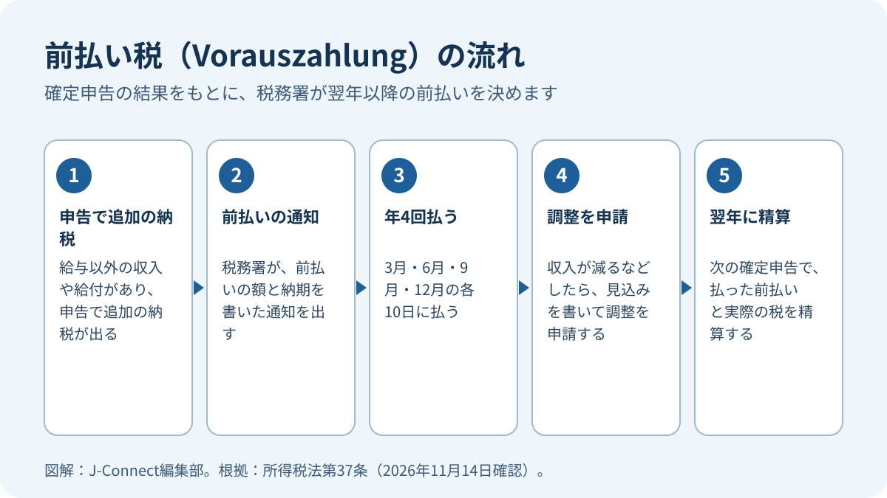
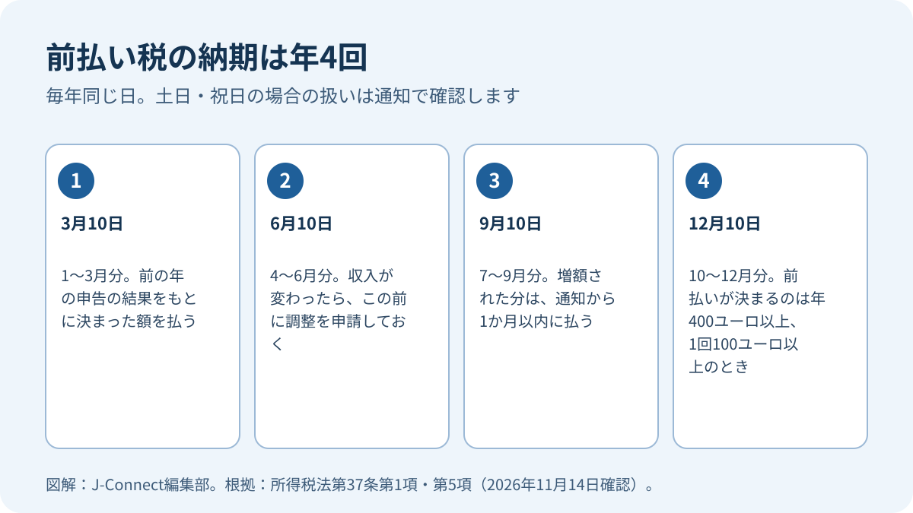

# 会社員に前払い税（Vorauszahlung）の通知が来たら｜年4回の納期とELSTERで調整を申請する手順【2026年】

ドイツの会社員は毎月の給与から所得税が引かれているため、税務署から別に「前払い」を求められると驚きます。給与以外の収入がある人や、確定申告で追加の納税が出た人には、翌年以降の税金を年4回に分けて前払いするよう通知が来ることがあります。この記事は、2026年にJ-Connect編集部のメンバーがELSTERで前払いの調整を申請した記録をもとに、通知の読み方、納期、収入が変わったときの調整の申請方法をまとめます。

## まず結論

- 何を：前払いの通知（Vorauszahlungsbescheid）に書かれた額を、決められた日に払う。収入の見込みが下がったら、調整を申請する。
- いつまでに：前払いの納期は毎年**3月10日・6月10日・9月10日・12月10日**（所得税法第37条第1項）。前払いが決まるのは、年**400ユーロ以上**かつ1回**100ユーロ以上**の場合だけ（同第5項）。
- どこで：住所地の税務署。申請はオンラインの税務システムELSTERからできる。
- 費用と期間：申請に手数料はかからない（ELSTERの利用は無料）。税務署は、その年の終わりから15か月後まで前払いを見直せる（同第3項）。

## あなたはどのケース？

| あなたの状況 | 前払いが来やすい理由 | 確認すること |
| --- | --- | --- |
| 給与だけの会社員（単身） | 通常は来ない | 給与以外の収入が年410ユーロを超えていないか |
| 夫婦で税区分3と5、または係数付きの4を使っている | 申告が必要になり（所得税法第46条第2項第3a号）、追加の納税が出ることがある | 申告の結果と、翌年の前払いの通知 |
| 出産手当・育児給付・失業手当を受けた | 給付そのものは非課税でも、ほかの所得の税率を上げる（累進の留保、第32b条）。給付が410ユーロを超えると申告が必要 | 給付のあった年の申告と、その後の前払い |
| 副業・賃貸・自営の収入がある | 給与から引かれない所得に税がかかる | 収入の見込みを税務署に正しく伝える |
| 収入が下がった（育休、退職、時短） | 前の年の申告をもとに前払いが決まるので、払いすぎになりやすい | 調整（引き下げ）の申請 |

## 手順

1. 通知を読む：前払いの通知に、各納期の額、対象の年、根拠になった申告の年が書いてある。自動引き落とし（SEPA）を登録していなければ、期日までに振り込む。
2. 収入の見込みを整理する：その年の給与、給付、給与以外の収入、控除を見込みで書き出す。育休や時短で収入が減るなら、その期間と額。
3. ELSTERにログインする：ELSTERのアカウント（証明書ファイルなど）でログインする。アカウントがない場合、登録の手続きに郵送の手順があり数日かかる（未確認：2026年11月14日にELSTERのページをこの環境から開けなかった）。
4. 調整を申請する：ELSTERの申請フォームの一覧から、前払いの調整（Anpassung der Vorauszahlungen）の申請を選び、対象の年、見込みの所得、理由を書いて送る。
5. 結果を待つ：税務署が認めると、新しい前払いの通知が届く。届くまでは、すでに決まった前払いは払う。
6. 翌年の申告で精算する：実際の税と払った前払いの差は、次の確定申告で精算される。

## 落とし穴

- 給与から引かれているから関係ないと思う：夫婦の税区分の組み合わせや給付があると、申告で追加の納税が出て、前払いにつながる。
- 収入が減ったのに放っておく：前払いは前の年の申告をもとに決まる。育休で収入が下がった年は、調整を申請しないと払いすぎになり、戻るのは翌年の申告の後になる。
- 見込みを低く書きすぎる：調整で前払いを下げすぎると、翌年の申告でまとめて払うことになる。根拠のある見込みを書く。
- 申請中に払わない：申請しても、決まった前払いの義務はすぐには消えない。新しい通知が来るまでは払う。
- 増額の通知の期限：前払いが後から増やされた場合、増えた分は通知から1か月以内に払う（第37条第4項）。

## そのまま使えるドイツ語

| 場面 | ドイツ語 | 日本語 |
| --- | --- | --- |
| 申請の理由（育休） | Wegen meiner Elternzeit verringert sich mein Einkommen im Jahr [Jahr] voraussichtlich deutlich. | 育児休業のため、〇年の私の収入は大きく減る見込みです。 |
| 申請の理由（退職） | Mein Arbeitsverhältnis endet am [Datum]. Danach erwarte ich kein weiteres Einkommen aus nichtselbständiger Arbeit. | 私の雇用は〇日に終わります。その後、給与所得はない見込みです。 |
| 電話で聞く | Guten Tag, ich habe eine Frage zu meinem Vorauszahlungsbescheid. Meine Steuernummer ist [Nummer]. | こんにちは、前払いの通知について質問があります。税番号は〇〇です。 |

税務署への申請（ELSTERの自由記入欄や手紙）：

> 件名：Antrag auf Herabsetzung der Einkommensteuer-Vorauszahlungen [Jahr], Steuernummer [Nummer]
> Sehr geehrte Damen und Herren,
> hiermit beantrage ich, die Vorauszahlungen zur Einkommensteuer für das Jahr [Jahr] herabzusetzen.
> Begründung: [Grund, z. B. Elternzeit vom ... bis ...]. Mein voraussichtliches zu versteuerndes Einkommen für [Jahr] beträgt etwa [Betrag] Euro. Eine Aufstellung füge ich bei.
> Mit freundlichen Grüßen
> [Name]

和訳：件名「〇年の所得税の前払いの引き下げの申請（税番号〇〇）」。〇年の所得税の前払いを引き下げるよう申請します。理由：〔例：〇日から〇日までの育児休業〕。〇年の課税所得の見込みはおよそ〇ユーロです。内訳を添付します。

## 在住者の実例

J-Connect編集部メンバーの実例（2026年、デュッセルドルフ近郊）。

| したこと | 結果 |
| --- | --- |
| 前払いの調整の申請 | ELSTERから、所得税の前払いの調整を申請した |

この記事の手順と条文は、一般的な説明です。自分のケースでいくら申告すべきかは、税理士や税の相談団体に相談してください。

## 関連記事

- [ドイツの確定申告入門](/germany/ja/living/income-tax-return-germany/)
- [税務ID・税務署番号・給与税区分の違い](/germany/ja/living/tax-id-steuernummer-steuerklasse/)
- [育児給付（Elterngeld）の計算と受け取り方](/germany/ja/living/elterngeld-guide-germany/)

## 公式情報・参考ソース

- [所得税法第37条：前払いの納期、見直しの期間、最低額](https://www.gesetze-im-internet.de/estg/__37.html)（2026年11月14日確認）
- [所得税法第46条：会社員の申告が必要な場合（410ユーロ、税区分の組み合わせ）](https://www.gesetze-im-internet.de/estg/__46.html)（2026年11月14日確認）
- [所得税法第32b条：累進の留保](https://www.gesetze-im-internet.de/estg/__32b.html)（2026年11月14日確認）
- [ELSTER](https://www.elster.de/)：申請フォームの名前と登録手順は、2026年11月14日にこの環境から開けず未確認
