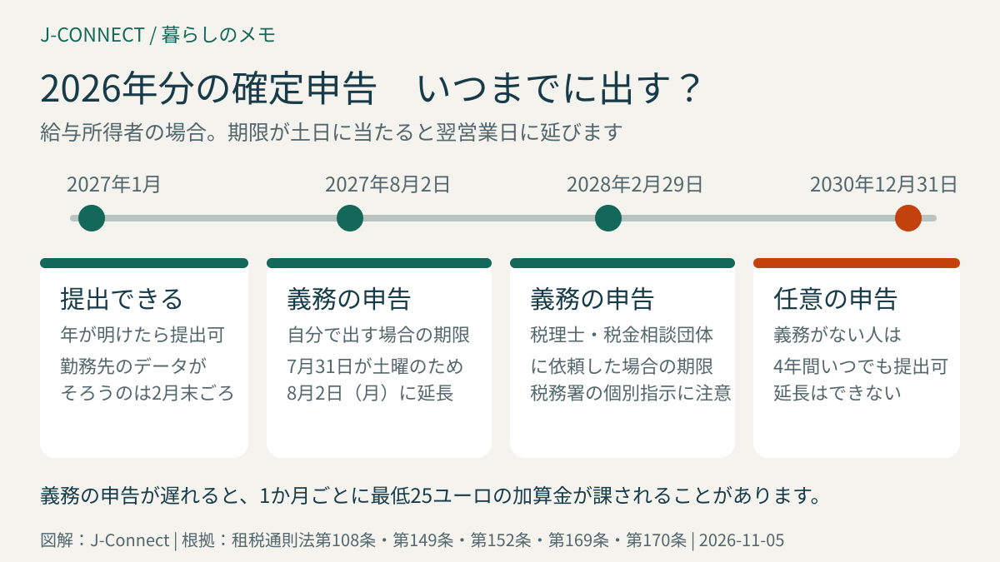
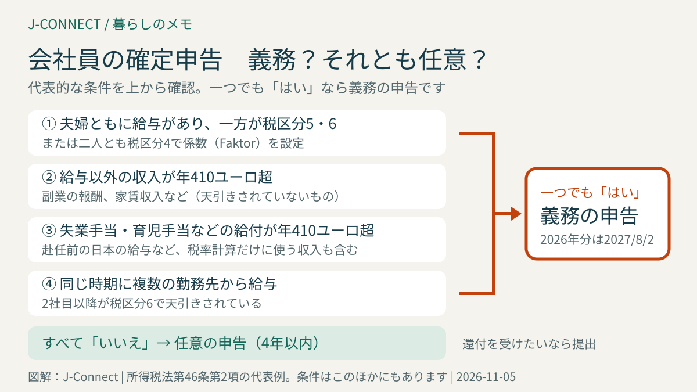

# ドイツの確定申告（Steuererklärung）入門｜会社員の義務・任意の見分け方、期限、ELSTERの流れ

ドイツで会社員として働くと、所得税は毎月の給与から天引きされますが、年に一度の確定申告を出す義務がある人と、出さなくてよい人がいます。この記事は、ドイツで働く日本人の会社員とその家族に向けて、申告義務があるかどうかの見分け方、提出期限、税金が戻りやすいケース、オンラインで出す流れを、法律の条文に沿って整理します。読み終えると、今年の申告を自分で出すか、相談先に頼むか、そもそも出す必要があるかを判断できます。

## まず結論：会社員の申告は「義務」と「任意」に分かれる

ドイツの給与所得者の確定申告は、大きく二つに分かれます。

| 種類 | どんな人 | 2026年分の期限 | 出さないと |
| --- | --- | --- | --- |
| **義務の申告** | 夫婦の税区分が3と5の組み合わせ、給与以外の収入が410ユーロ超など、法律の条件に当たる人 | **2027年8月2日（月）**。税理士などに依頼した場合は2028年2月29日 | 督促や加算金の対象。税額を推計される場合もある |
| **任意の申告** | 給与だけで、義務の条件に当たらない人 | **2030年12月31日**（対象年の翌年から4年間） | 何も起きない。ただし払いすぎた税金も戻らない |

給与だけの会社員の多くは「任意」です。それでも出す人が多いのは、毎月の天引きは「1年間同じ給与で働く」前提の概算なので、実際の事情を申告すると払いすぎた分が戻ることが多いからです。一方、申告の結果、追加で納税することになる場合もあります。

## 申告の義務があるのはどんな人？

所得税法第46条第2項は、給与から税金が天引きされている人について、申告が必要になる条件を列挙しています。日本人の会社員や家族に関係しやすいのは、次の条件です。

1. **夫婦がともに給与を受け取り、一方が税区分5または6だった年**、または二人とも税区分4で「係数（Faktor）」を設定していた年。年の一部だけでも該当します。税区分3と5の組み合わせを選んでいる共働き夫婦は、毎年この条件に当たります。
2. **給与以外の収入が年410ユーロを超えた人**。天引きされていない副業の報酬、家賃収入などが該当します。
3. **失業手当、育児手当（Elterngeld）、疾病手当、短時間労働手当などの給付が年410ユーロを超えた人**。これらは非課税ですが、税率を決める計算に加えられます。
4. **同じ時期に複数の勤務先から給与を受け取った人**（2社目以降は税区分6で天引きされます）。
5. **税務署に申請して、毎月の天引きに特別な控除額を設定してもらった人**（年収が一定額を超える場合）。

この一覧は代表的な条件で、すべてではありません。結婚・離婚・再婚の年や、ドイツ以外のEU・EEA諸国に住む配偶者を税区分に反映した場合なども条件に入っています。自分の状況が当てはまるか迷う場合は、[所得税法第46条](https://www.gesetze-im-internet.de/estg/__46.html)の原文を確認するか、税理士などに相談してください。税区分のしくみ自体は「[ドイツの税務識別番号・税務署番号・給与税区分の違い](/germany/ja/living/tax-id-steuernummer-steuerklasse/)」で説明しています。

### ドイツに来た年・日本に帰る年は特に確認する

年の途中でドイツに来た、またはドイツを離れた年は、ドイツに住んでいなかった期間の収入（たとえば赴任前の日本の給与）が、ドイツの税率を決めるときだけ加算されます。これを「累進の留保」と呼び、所得税法第32b条に定めがあります。

この「税率を決めるときだけ加える収入」が410ユーロを超えると、上の条件3と同じ扱いになり、申告が義務になります。日本で数か月働いてから赴任した人は、多くがこれに当たると考えてよいでしょう。日本の収入そのものにドイツの税金がかかるわけではありませんが、ドイツの給与にかかる税率が上がるため、還付が減ったり、追加納税になったりすることがあります。

日独の租税条約や、日本の不動産・株式の収入が関わる年は、判断が複雑になります。この部分は自己判断せず、日本の税制にも詳しい税理士などに相談するのが安全です。本帰国の年の手続き全体は「[ドイツから本帰国するときの手続き](/germany/ja/living/returning-to-japan-checklist/)」にまとめています。

## 期限：2026年分は2027年8月2日、任意なら4年間

### 義務の申告

租税通則法第149条により、申告書は対象年の翌年7月31日までに出す必要があります。2026年分の場合、2027年7月31日が土曜日に当たるため、第108条の規定で翌営業日の**2027年8月2日（月）**が期限になります。

税理士や、会社員向けの税金相談団体に作成を依頼した場合は、期限が**翌々年2月末**まで延びます。2026年分は2028年2月29日です。ただし、税務署が個別に早い提出を求めることもあります。

期限を過ぎると、税務署は加算金（遅延加算金）を課すことができます。金額は、追加で納める税額の0.25％で、**遅れた1か月ごとに最低25ユーロ**です（租税通則法第152条）。対象年の翌々年2月末（2026年分なら2028年2月末）までに出さないと原則として必ず課されますが、税額がゼロ以下、つまり還付になる場合などは例外です。病気や長期の出張など、やむを得ない事情があるときは、期限前に税務署へ延長を申し出ることができます。

### 任意の申告

義務がない人は、対象年の翌年1月1日から**4年間**、いつでも申告を出せます。2026年分は2030年12月31日まで、2023年分は2027年12月31日までです。この4年間は延長できません。2022年分の期限が迫っている人は、[2022年分の還付申告は2026年12月31日まで](/germany/ja/events/news/tax-refund-2022-deadline-december-2026/)も確認してください。

任意の申告でも、税務署が計算し直した結果、追加納税になることがあります。日本の収入がある年など、追加納税の可能性がある年は、ELSTERや市販ソフトで試算してから送信します。

## 税金が戻りやすい人と、2026年の主な控除額

### 戻りやすい年の例

- 年の途中で働き始めた、仕事を辞めた、転職した、働いていない期間があった
- 通勤距離が長い、または在宅勤務の日が多い
- 仕事のための引っ越しや研修・語学講座の費用を自分で払った
- 結婚した、子どもが生まれた
- 教会税を払っている、寄付をした
- 家の掃除・庭の手入れ・修理などを業者に頼み、銀行振込で払った

### 会社員がよく使う控除（2026年分）

| 項目 | 2026年の内容 | 条文 |
| --- | --- | --- |
| 給与所得者の概算控除 | 何も申告しなくても1,230ユーロを差し引く。仕事の費用がこれを超えた分だけ効果がある | 所得税法第9a条 |
| 通勤費 | 自宅から職場までの片道距離1kmにつき**0.38ユーロ**×出勤日数。2026年から1km目から同じ単価 | 所得税法第9条 |
| 在宅勤務 | 在宅で働いた日1日につき6ユーロ、年最大1,260ユーロ（210日分） | 所得税法第4条第5項第6c号 |
| 家事サービス | 清掃・庭の手入れなどの費用の20％を税額から差し引く（差し引ける額は年最大4,000ユーロ） | 所得税法第35a条 |
| 職人工事 | 修理・改修の人件費などの20％を税額から差し引く（差し引ける額は年最大1,200ユーロ） | 所得税法第35a条 |
| 保育費 | 14歳未満の子の保育費の80％、子ども1人につき年最大4,800ユーロ | 所得税法第10条 |

通勤費は、片道15kmを年220日通うと、15×220×0.38＝1,254ユーロで、これだけで概算控除の1,230ユーロを超えます。2025年分までは最初の20kmが0.30ユーロだったため、2026年分は以前より短い通勤距離でも効果が出やすくなりました。

控除は「税金そのもの」ではなく「税金を計算する前の収入」から差し引くものが多いため、戻る金額は控除額×自分の税率になります。家事サービスと職人工事は例外で、税額から直接差し引かれます。どちらも請求書と銀行振込の記録が必要で、現金払いは対象外です。

## ELSTERで出す流れ

ドイツの税務当局は、無料のオンライン申告ポータル「ELSTER（エルスター）」を用意しています。紙の申告書も使えますが、給与以外の事業収入などがある人は、原則としてオンライン提出が義務です。

1. **アカウントを登録する**：ELSTERのサイトで税務識別番号と生年月日などを入力します。一般的な方法では、登録用のIDがメールで、確認用のコードが税務当局に登録された住所へ郵送で届き、両方を入力すると、ログイン用の証明書ファイルを保存できます。郵送には1〜2週間ほどかかることがあるため、期限の直前に始めないでください。証明書ファイルのパスワードは、税務署でも再発行できません。
2. **書類をそろえる**：勤務先が年明けに渡す「給与と税の証明書（Lohnsteuerbescheinigung）」、通勤日数と在宅勤務日数のメモ、仕事の費用の領収書、保険料・寄付・家事サービスの請求書と振込記録などです。
3. **入力する**：ELSTERには、勤務先や保険会社が税務当局へ送ったデータを読み込む機能があります。読み込んだ数字は必ず手元の証明書と照らし合わせます。
4. **送信して控えを保存する**：送信後に表示される控えを保存します。領収書は原則として提出不要ですが、税務署から求められたときに出せるよう保管します。

画面はドイツ語で、英語の案内も一部あります。市販の申告ソフトやアプリを使う方法もありますが、どれを使う場合も、提出した内容への責任は本人にあります。

## 税額決定通知が届いたら

税務署の審査が終わると、「税額決定通知（Steuerbescheid）」が郵送またはELSTERで届きます。還付の場合は、申告書に書いた口座へ振り込まれます。

届いたら、自分の申告と通知の数字が一致しているかを確認してください。通知には、税務署が認めなかった項目の説明が書かれていることがあります。内容に納得できない場合は、**通知を受け取ってから1か月以内**に異議を申し立てることができます（租税通則法第355条）。郵送の通知は、原則として発送の4日後に受け取ったものとみなされます。異議はELSTERからも出せます。

追加納税になった場合は、通知に書かれた期限までに振り込みます。翌年以降の前払い（予定納税）を求められることもあるので、通知の後半まで読んでください。

## 自分で出すか、相談先に頼むか

給与だけで、控除も通勤費や在宅勤務程度なら、ELSTERで自分で出す人も多くいます。次のような年は、税理士（Steuerberater）や、会員制で会社員の申告を手伝う税金相談団体に相談すると安心です。

- ドイツに来た年、日本に帰る年
- 日本に給与・家賃・年金などの収入がある
- 夫婦の一方が日本や他国に住んでいる
- 副業や個人事業を始めた
- 株式や仮想通貨の売買をした

税金相談団体は、法律で相談できる範囲が会社員・年金生活者の申告などに限られています。事業収入がある場合は税理士を選びます。費用は、申告の内容や収入によって大きく異なるため、依頼前に見積もりを確認してください。

## よくある質問

### 申告は日本語で書けますか？

申告書はドイツ語で作成します。日本語の領収書や証明書を添付する場合、税務署から翻訳を求められることがあります。

### 初めての年に申告しなかったら、さかのぼって出せますか？

義務がない年なら、4年間はさかのぼって出せます。義務があったのに出していない年は、期限が過ぎていても、できるだけ早く提出してください。税務署から督促が来る前に出す方が、加算金が少なくて済みます。

### 2026年分は、いつから出せますか？

2027年1月から提出できますが、勤務先の給与データや保険会社のデータが税務当局に届くのは、多くが2月末ごろです。データを読み込む場合は、3月以降に入力を始めると手間が減ります。

## 関連記事

- [ドイツの税務識別番号・税務署番号・給与税区分の違い](/germany/ja/living/tax-id-steuernummer-steuerklasse/)
- [2022年分の税金の還付申告は2026年12月31日まで](/germany/ja/events/news/tax-refund-2022-deadline-december-2026/)
- [ドイツのMinijob（ミニジョブ）2027｜月633ユーロの上限・勤務時間・税金と保険](/germany/ja/living/minijob-grenze-2027/)
- [ドイツから本帰国するときの手続き](/germany/ja/living/returning-to-japan-checklist/)

## 公式情報・参考ソース

- [所得税法第46条：給与所得者に申告義務が生じる条件](https://www.gesetze-im-internet.de/estg/__46.html)
- [租税通則法第149条：申告書の提出期限](https://www.gesetze-im-internet.de/ao_1977/__149.html)
- [租税通則法第108条：期限が土日・祝日に当たる場合](https://www.gesetze-im-internet.de/ao_1977/__108.html)
- [租税通則法第152条：期限後の提出に対する加算金](https://www.gesetze-im-internet.de/ao_1977/__152.html)
- [租税通則法第169条：課税を確定できる期間](https://www.gesetze-im-internet.de/ao_1977/__169.html)
- [租税通則法第355条：異議申立ての期間](https://www.gesetze-im-internet.de/ao_1977/__355.html)
- [所得税法第9条：通勤費の控除](https://www.gesetze-im-internet.de/estg/__9.html)
- [所得税法第9a条：給与所得者の概算控除](https://www.gesetze-im-internet.de/estg/__9a.html)
- [所得税法第4条：在宅勤務の控除（第5項第6c号）](https://www.gesetze-im-internet.de/estg/__4.html)
- [所得税法第32b条：累進の留保](https://www.gesetze-im-internet.de/estg/__32b.html)
- [所得税法第35a条：家事サービス・職人工事の税額控除](https://www.gesetze-im-internet.de/estg/__35a.html)
- [ELSTER：オンライン申告ポータル](https://www.elster.de/eportal/start)
- [消費者センター：確定申告は誰がいつ出すのか](https://www.verbraucherzentrale.de/wissen/geld-versicherungen/sparen-und-anlegen/steuererklaerung-wer-sie-wann-beim-finanzamt-abgeben-muss-24899)

**参照日：2026年11月5日。** 金額・期限は2026年分の法律に基づきます。税制は毎年のように改正されるため、申告前に最新の情報を確認してください。この記事は一般的な情報で、個別の税務相談ではありません。
