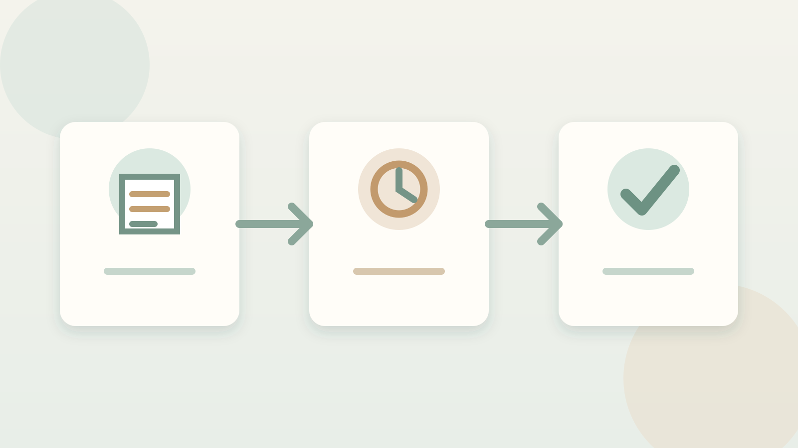

# ドイツでInkasso（債権回収）の手紙が来たら｜払う前の確認と対応手順

ドイツで債権回収会社（Inkasso）から手紙が届いても、記載された金額をそのまま払う前に、元の請求が実在するか、金額と追加費用が正しいかを確認してください。請求に心当たりがない場合でも、放置するのではなく、請求元や契約内容を文書で確認することが重要です。裁判所から届く督促状（Mahnbescheid）は別の手続きで、送達から2週間の期限があるため、最初に書類の種類を見分けましょう。

## まず結論

- **請求の存在を確認する：** 元の会社、契約・注文の内容、契約日、未払いの理由を確認します。
- **追加費用を分けて見る：** 元の請求額、利息、債権回収費用を一つの金額として扱わず、項目ごとに確認します。
- **登録と差出人を確認する：** 債権回収サービスを名乗る事業者は、連邦法務庁の登録簿で確認できます。弁護士事務所は別の登録制度で確認します。
- **期限を混同しない：** 通常の債権回収レターに、裁判所の督促状と同じ一律の2週間期限があるわけではありません。ただし、元の支払期日や遅延がすでに成立している可能性はあります。裁判所の督促状が届いたら、別記事の手順に切り替えてください。

登録簿の検索は無料です。消費者センターのオンライン確認ツールも無料ですが、個別相談の費用は窓口により異なります。通常の債権回収レターに一律の回答期限はないため、書面を確認し、必要な情報を早めに集めてください。

## あなたはどのケース？

| 状況 | 最初にすること |
| --- | --- |
| 契約や請求に心当たりがあり、未払いも確認できる | 元の請求額と追加費用を分けて確認し、正当な金額を支払う |
| 契約を覚えていない、利用した記憶がない | 元の債権者、契約内容、契約日を文書で請求する |
| すでに支払った、または金額が違う | 振込記録・請求書を保管し、誤りを具体的に書いて異議を伝える |
| 裁判所の書類に「Mahnbescheid」とある | 通常のInkasso対応ではありません。送達から2週間の異議期限を確認する |

## 手順

### 1. 差出人と元の請求元を確認する

手紙に書かれた会社名だけで判断せず、次を確認します。債権回収会社は、元の会社の代理人として回収する場合と、債権そのものを買い取って現在の債権者になる場合があります。元の債権者と、現在誰が請求権を持っているのかを分けて確認してください。

- 債権回収会社の正式名称と住所
- 誰の依頼で回収しているのか（元の債権者）
- 何の契約・注文・サービスに関する請求か
- 契約日または注文日
- 元の請求額、利息、債権回収費用の内訳
- 事業者が示す監督機関と連絡先

個人向けの債権回収サービスでは、最初の請求時に、依頼主、請求の理由、契約の対象と契約日、利息の計算、回収費用の種類・金額・発生理由などを分かりやすく示す義務があります（法務サービス法第13a条）。

### 2. 登録と連絡先を確認する

「Inkasso」を含む名称を使う債権回収サービスは、原則として連邦法務庁の登録制度の対象です。会社名と登録範囲を[債権回収サービス登録簿](https://www.rechtsdienstleistungsregister.de/)で確認してください。

連邦法務庁は2025年1月1日から登録簿の管理、登録の変更・削除、債権回収サービスに対する監督と苦情対応を担当しています。登録されていない事業者が債権回収サービスを名乗る場合は、連邦法務庁の案内に従って確認・相談できます。ただし、弁護士も債権回収を扱うことがあり、弁護士は通常の債権回収会社とは別に弁護士会の制度で確認します。登録簿に見当たらないという理由だけで、差出人が弁護士事務所である場合まで直ちに詐欺と断定しないでください。

手紙に記載された銀行口座や電話番号だけを使うのも避けます。元の債権者の公式サイトや、以前から使っている連絡先から独立して確認してください。

### 3. 元の契約・支払い記録と照合する

次の資料を確認します。

- 契約書、注文確認、会員登録、利用明細
- 元の請求書と支払期日
- 銀行口座の入出金、カード明細、口座振替の失敗
- 解約通知や返品・返金の記録
- 元の会社とのメールや問い合わせ履歴

請求が正しい場合でも、追加費用まで全て正しいとは限りません。元の債権者に独立した連絡先から問い合わせ、未払い額と回収委託の有無を確認すると安全です。

### 4. 利息と債権回収費用を確認する

利息や債権回収費用を確認する際は、まず支払遅延（Verzug）が法律上成立しているかを確認します。[民法第286条](https://www.gesetze-im-internet.de/bgb/__286.html)では、原則として支払期日後の督促によって遅延が成立します。ただし、暦上の支払期日が定められている場合などには督促が不要なこともあります。代金請求の30日ルールは、消費者の場合、請求書などにその効果が特に明示されているときに限って適用されます。本人に責任のない事情で支払えない間は遅延に陥りません。個別の請求で追加費用を負担する義務があるかは、これらの条件と費用の根拠を確認してください。

利息が請求されている場合は、元金、利率、計算期間が示されているかを確認します。債権回収費用も、何の作業に対する費用か、金額と発生理由が説明されているかを見ます。

法務サービス法第13e条は、債権回収業者に支払った費用を債務者へ損害として請求できる範囲を、同じ業務を弁護士が行った場合の報酬相当額までに制限しています。これは、請求書に記載された全ての費用が自動的に支払義務になるという意味ではありません。項目ごとの根拠を確認してください。

消費者センターの[無料Inkasso-Check](https://www.verbraucherzentrale.de/wissen/geld-versicherungen/kredit-schulden-insolvenz)では、支払義務の有無や費用の妥当性を確認できます。

### 5. 心当たりがない場合は書面で確認・異議を伝える

契約が分からない、すでに支払った、請求額が違う場合は、電話だけで済ませず、メールまたは書面で内容を残します。法務サービス法第13a条第2項に基づき、元の債権が誰に発生したのか、契約の場合は成立の主要な事情を追加で尋ねることができます。

必要に応じて、委任・債権譲渡などの権限を示す資料を求めることもできます。消費者センターも原本の委任状または債権譲渡書類を求める方法を紹介しています。ただし、全ての初回通知に必ず原本の委任状が添付されていなければ無効、という単純なルールではありません。まずは法定の情報提供が足りているかを確認します。

### 6. 分割払い・債務承認に署名する前に確認する

一括で払えない場合、分割払いを提案されることがあります。署名する前に、分割手数料、総支払額、利息、債務を認める条項、給与や保険金などの債権譲渡、将来の異議申立てへの影響を確認してください。

法務サービス法第13a条第4項は、債務承認によって、契約が存在しない、すでに支払った、時効になっているといった既存の反論を主張しにくくなる可能性について、事業者に事前説明を求めています。同条第3項では、支払猶予や分割払いの合意前に、そのために発生する費用を文書で知らせる義務も定めています。内容を理解できない書類には署名しないでください。

## 落とし穴

- **「48時間以内」と書かれているだけで裁判所の期限だと思う：** それは通常、相手方が設定した支払期限です。裁判所の2週間の異議期限とは別ですが、元の支払期日や遅延の有無は確認が必要です。
- **元の請求額と回収費用をまとめて払う：** 回収費用の内訳や利息計算を確認せず、合計額だけで判断しないでください。
- **分割払いの書類にすぐ署名する：** 債務承認、追加費用、給与などの債権譲渡を含むことがあります。署名後に争うのが難しくなる場合があります。
- **元の請求額と追加費用のどちらを争うか混同する：** 元の請求額を認め、追加費用だけを争う場合は、争っていない元の請求額を放置しないでください。請求全体に心当たりがない場合は、安易な一部支払いをせず、先に相談します。
- **SMSやメールの口座にすぐ振り込む：** 実在する会社名を悪用するケースもあります。登録・住所・口座情報を独立した連絡先で照合してください。
- **弁護士と債権回収会社の登録制度を混同する：** 弁護士は通常の債権回収会社とは別の制度で確認します。
- **裁判所の書類も普通の督促状だと思う：** 「Mahnbescheid」や「Vollstreckungsbescheid」と書かれた裁判所の書類は別手続きです。通常のInkassoレターと同じ対応をしないでください。

## そのまま使えるドイツ語

契約や請求が分からず、追加情報を求める場合の文例です。実際に請求を争う場合だけ使い、請求が正しいと確認できている場合は、支払予定を相談する文面に変えてください。

| ドイツ語 | 日本語の意味 |
| --- | --- |
| Sehr geehrte Damen und Herren, | ご担当者様 |
| Ich kann die geltend gemachte Forderung derzeit nicht zuordnen. | 現時点では、請求の内容を特定できません。 |
| Bitte teilen Sie mir gemäß § 13a Abs. 2 RDG den ursprünglichen Gläubiger und die wesentlichen Umstände des behaupteten Vertragsschlusses mit. | 法務サービス法第13a条第2項に基づき、元の債権者と、主張されている契約成立の主な事情を知らせてください。 |
| Bitte senden Sie mir außerdem eine nachvollziehbare Aufstellung von Hauptforderung, Zinsen und Inkassokosten. | 元の請求額、利息、債権回収費用の分かる内訳も送ってください。 |
| Mit freundlichen Grüßen | 敬具 |

送信前に、氏名・住所などの個人情報を、相手の正当性を確認できるまで不用意に追加しないでください。送信内容と送信日時は保存します。

## 関連記事

- [裁判所から督促状（Mahnbescheid）が届いたら｜2週間の異議申立てとその後](/germany/ja/living/mahnbescheid-germany/)
- [SCHUFAの取り方｜賃貸に出す証明と無料データの違い・履歴がないとき](/germany/ja/living/schufa-guide/)

## 公式情報・参考ソース

- [法務サービス法第10条：債権回収サービスの登録](https://www.gesetze-im-internet.de/rdg/__10.html)（2026年11月21日確認）
- [法務サービス法第13a条：個人向けの情報提供義務](https://www.gesetze-im-internet.de/rdg/__13a.html)（2026年11月21日確認）
- [法務サービス法第13e条：債権回収費用の上限](https://www.gesetze-im-internet.de/rdg/__13e.html)（2026年11月21日確認）
- [消費者センター：不当な債権回収請求の見分け方（2025年3月19日）](https://www.verbraucherzentrale.de/wissen/geld-versicherungen/kredit-schulden-insolvenz/inkasso-so-erkennen-sie-unserioese-forderungen-10871)（2026年11月21日確認）
- [消費者センター：不当な請求に対する文例（2025年4月14日）](https://www.verbraucherzentrale.de/musterbriefe-und-tools/geld-versicherungen/musterbrief-zur-abwehr-unberechtigter-forderungen-gegenueber-inkassobueros-2502)（2026年11月21日確認）
- [消費者センター：SMSによる債権回収請求への注意（2026年1月27日）](https://www.verbraucherzentrale.de/wissen/geld-versicherungen/kredit-schulden-insolvenz/inkassoforderungen-per-sms-oft-unserioes-13286)（2026年11月21日確認）
- [連邦法務庁：債権回収サービス登録簿・監督・苦情窓口](https://bundesjustizamt.de/DE/Themen/ZentraleRegister/Rechtsdienstleistungsregister/Rechtsdienstleistungsregister_node.html)（2026年11月21日確認）
- [債権回収サービス登録簿の検索](https://www.rechtsdienstleistungsregister.de/)（2026年11月21日確認）
- [民法第286条：債務者の支払遅延](https://www.gesetze-im-internet.de/bgb/__286.html)（2026年11月21日確認）
- [消費者センター：無料Inkasso-Check（2026年2月13日）](https://www.verbraucherzentrale.de/inkasso-check-start)（2026年11月21日確認）

本記事は一般的な情報であり、個別の法的助言ではありません。請求額が大きい、時効や債務承認が問題になる、支払不能が続く場合は、消費者センターや弁護士に個別相談してください。
