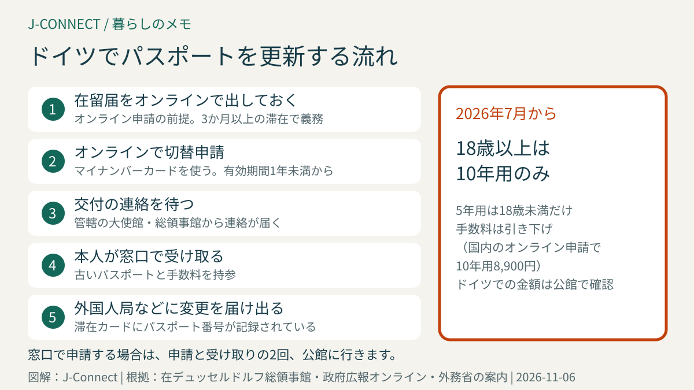
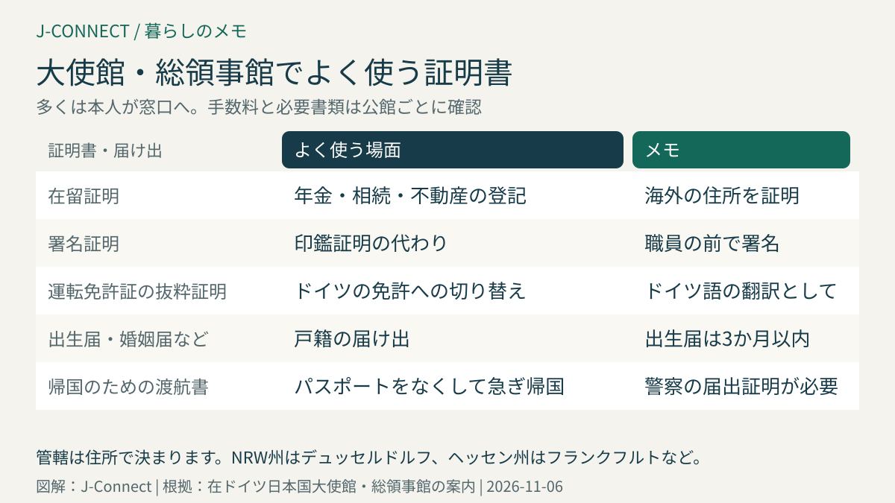

# ドイツで日本のパスポートを更新する｜オンライン申請、2026年7月からの手数料引き下げと5年旅券の廃止、大使館・総領事館の管轄と証明書

ドイツに長く住んでいると、日本のパスポートの更新や、日本での手続きに使う証明書が必要になることがあります。こうした手続きは、住所を管轄する日本の大使館・総領事館（在外公館）で行い、最近はオンラインで申請できるものも増えました。この記事は、ドイツに住む日本人に向けて、パスポートの更新の流れ、2026年7月からの制度の変更、ドイツ国内の管轄、よく使う証明書を整理します。読み終えると、どこに、何を持って、いつ行けばよいかが分かります。

## まず結論：パスポートの更新の要点

- **申請先**：住所を管轄する日本の大使館・総領事館
- **オンライン申請**：在留届をオンラインで出している人は、更新（切替申請）をオンラインででき、**受け取りだけ窓口**に行きます
- **2026年7月から**：手数料が引き下げられ、**18歳以上の人は10年用のパスポートだけ**になりました（5年用は18歳未満のみ）
- **時期**：有効期間が1年未満になったら更新できます。ドイツの滞在許可はパスポートの期限に合わせて出ることがあるので、早めの更新がおすすめです
- **受け取り**：本人が窓口に行き、古いパスポートと手数料を持参します

## ドイツ国内の大使館・総領事館の管轄

| 在外公館 | 管轄する州 |
| --- | --- |
| 在ドイツ日本国大使館（ベルリン） | ベルリン、ブランデンブルク、メクレンブルク＝フォアポンメルン、ザクセン、ザクセン＝アンハルト、テューリンゲン |
| 在ハンブルク総領事館 | ハンブルク、ブレーメン、ニーダーザクセン、シュレスヴィヒ＝ホルシュタイン |
| 在デュッセルドルフ総領事館 | ノルトライン＝ヴェストファーレン |
| 在フランクフルト総領事館 | ヘッセン、ラインラント＝プファルツ、ザールラント |
| 在ミュンヘン総領事館 | バイエルン、バーデン＝ヴュルテンベルク |

管轄は住所で決まり、原則として管轄外の公館では申請できません。バーデン＝ヴュルテンベルク州にはシュトゥットガルトの名誉総領事館もありますが、取り扱う手続きは限られます。

## 2026年7月からの変更

2026年7月1日から、改正された旅券法が施行されました。主な変更は次のとおりです。

- **手数料の引き下げ**：日本国内での手数料は、10年用のパスポートがオンライン申請で8,900円、窓口申請で9,300円になりました。
- **18歳以上の5年用のパスポートの廃止**：18歳以上の人は、10年用だけを申請できます。18歳未満の人は、これまでどおり5年用です。
- **残りの期間が同じパスポートの制度の廃止**：今のパスポートと同じ有効期限で作り直す制度はなくなりました。

在外公館での手数料は、現地の通貨で決められ、為替の変動などで見直されます。ドイツでの金額は、管轄の公館の案内で確認してください。窓口での支払い方法（現金かカードか）も公館ごとに違います。

## パスポートの更新の流れ

### オンラインで申請する場合

1. **在留届をオンラインで出しておく**：外務省の在留届のオンラインシステムで届け出ている人が、オンライン申請の対象です。
2. **オンラインで申請する**：マイナンバーカードを使って、スマートフォンなどから切替申請をします。顔写真や署名もオンラインで登録します。
3. **交付の連絡を待つ**：パスポートができたら連絡が届きます。
4. **窓口で受け取る**：本人が公館の窓口に行き、古いパスポートと手数料を持っていきます。古いパスポートは、穴を開けて返してもらえます。

### 窓口で申請する場合

申請書、写真、古いパスポートなどを持って、窓口で申請します。受け取りにもう一度行く必要があります。子どもの申請など、窓口での申請が必要な場合もあります。必要書類は、管轄の公館の案内で確認してください。

### 新しいパスポートを受け取ったら

ドイツの滞在許可（電子滞在カード）には、パスポートの番号が記録されています。新しいパスポートを受け取ったら、住民登録の役所や外国人局に、パスポートの変更を届け出る必要がある場合があります。ドイツでは、外国人は有効なパスポートを持つ義務があります（滞在法第48条）。外国人局の手続きは[ドイツの滞在許可を申請・更新する方法](/germany/ja/living/residence-permit-renewal-germany/)も参考にしてください。

## パスポートをなくしたら

1. **警察に届け出る**：ドイツの警察で紛失・盗難の届け出をし、届出の証明を受け取ります。
2. **公館に届け出る**：紛失の届け出をし、新しいパスポートを申請します。急いで日本に帰る必要がある場合は、帰国のための渡航書を発行してもらえることがあります。
3. **外国人局に連絡する**：滞在許可のカードも一緒になくした場合は、外国人局で再発行の手続きをします。

## よく使う証明書

日本での手続きのために、公館で次のような証明書を発行してもらえます。

| 証明書 | よく使う場面 |
| --- | --- |
| 在留証明 | 日本の年金の手続き、相続、不動産の登記など、海外の住所を証明するとき |
| 署名証明 | 日本の印鑑証明の代わり。相続や不動産、銀行の手続き |
| 運転免許証の抜粋証明 | 日本の運転免許をドイツの免許に切り替えるときのドイツ語の翻訳として |
| 戸籍の届け出 | 出生届、婚姻届、死亡届などを公館に提出できる |

多くの証明書は、本人が窓口に行く必要があります。署名証明は、公館の職員の前で署名します。手数料や必要書類は公館ごとに案内されているので、事前に確認してください。

運転免許の切り替えの流れは[日本の運転免許とドイツ](/germany/ja/living/drivers-license-japan-germany/)、ドイツで子どもが生まれたときの出生届と国籍の留保は[ドイツ出産の手続き完全ガイド](/germany/ja/living/birth-procedures-germany/)で説明しています。

## 在留届と在外選挙

海外に3か月以上住む日本人は、在留届を出すことが旅券法で義務づけられています。在留届は、パスポートのオンライン申請の前提になるだけでなく、災害や事件のときの安否確認にも使われます。引っ越しや帰国のときは、変更や帰国の届けも出しましょう。

海外から日本の国政選挙に投票するには、在外選挙人名簿への登録が必要です。登録の方法は[海外から日本の選挙に投票する](/germany/ja/living/overseas-voting-japan/)で説明しています。

## よくある質問

### パスポートの期限が切れそうですが、ドイツから日本に一時帰国したときに更新できますか？

日本国内でも更新できますが、住民票がない人は、一時帰国中の居所での申請になり、受け取りまでに日数がかかります。ドイツの滞在許可の更新のことも考えると、ドイツの公館で更新するほうが確実です。

### 子どものパスポートも同じ流れですか？

18歳未満の子どもは5年用のパスポートです。申請には両親のどちらかの署名が必要で、ドイツで生まれた子どもは、まず出生届を出して戸籍に記載されてから申請します。窓口での申請が必要な場合もあるので、公館の案内を確認してください。

### 公館の窓口は予約が必要ですか？

多くの公館で、手続きによって予約が必要か、受付時間が決まっています。行く前に、管轄の公館のウェブサイトで確認してください。

## 関連記事

- [海外から日本の選挙に投票する](/germany/ja/living/overseas-voting-japan/)
- [ドイツ出産の手続き完全ガイド](/germany/ja/living/birth-procedures-germany/)
- [日本の運転免許とドイツ](/germany/ja/living/drivers-license-japan-germany/)
- [ドイツへ引っ越す前に日本でする手続き](/germany/ja/living/leaving-japan-before-moving-germany/)
- [ドイツから本帰国するときの手続き](/germany/ja/living/returning-to-japan-checklist/)

## 公式情報・参考ソース

- [在ドイツ日本国大使館：大使館・総領事館の管轄](https://www.de.emb-japan.go.jp/itpr_ja/konsular_kankatsu.html)
- [在デュッセルドルフ日本国総領事館：パスポート（旅券）](https://www.dus.emb-japan.go.jp/itpr_ja/k_passport.html)
- [政府広報オンライン：パスポートのオンライン申請と2026年7月からの手数料引き下げ](https://www.gov-online.go.jp/article/202301/entry-7458.html)
- [外務省：旅券法の改正（報道発表）](https://www.mofa.go.jp/mofaj/press/release/pressit_000001_00797.html)
- [滞在法第48条：パスポートを持つ義務](https://www.gesetze-im-internet.de/aufenthg_2004/__48.html)

**参照日：2026年11月6日。** パスポートの手数料や証明書の手続きは、公館ごとに案内が異なり、変わることがあります。この記事は一般的な情報です。手続きの前に、管轄の大使館・総領事館の最新の案内を確認してください。
