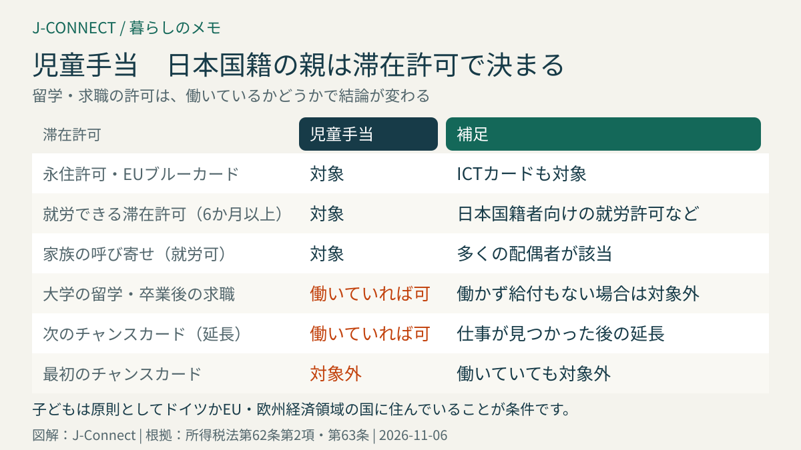
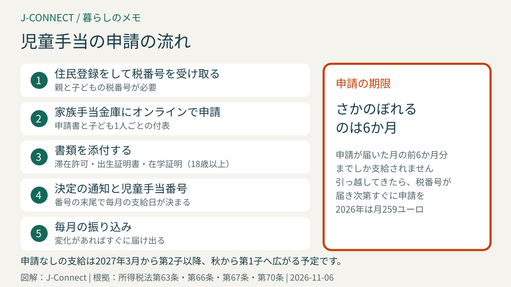

# ドイツの児童手当（Kindergeld）の申請｜日本人がもらえる滞在許可、月259ユーロ、必要書類、6か月の遡及、日本に住む子どもの扱い

ドイツに住む子育て家庭は、子どもが原則18歳になるまで、毎月の児童手当（Kindergeld）を受け取れます。日本国籍の家族も受け取れますが、持っている滞在許可の種類によっては対象外になることがあり、申請が遅れると受け取れない月が出てしまいます。この記事は、ドイツで子育てをする日本人の家庭に向けて、受け取れる条件、金額、申請の方法と必要書類、よくある注意点を所得税法の条文に沿って整理します。読み終えると、自分の家族が対象かどうか、何をいつまでに出せばよいかが分かります。

## まず結論：児童手当の要点

- **金額**：子ども1人につき**月259ユーロ**（2026年、所得税法第66条）。2027年に月267ユーロへ上げる法案が審議中です
- **対象の子ども**：原則18歳未満。職業訓練や大学で学んでいる場合などは**25歳まで**
- **日本国籍の親の条件**：ドイツに住み、**就労できる滞在許可**、永住許可、EUブルーカードなどを持っていること
- **申請先**：住所を担当する**家族手当金庫（Familienkasse）**。オンラインで申請できます
- **申請期限**：さかのぼって受け取れるのは、**申請した月の前6か月分まで**（所得税法第70条）

支給日の一覧は[児童手当の2027年の支給日](/germany/ja/living/kindergeld-auszahlungstermine-2027/)にまとめています。

## 日本国籍の親が受け取れる条件

EU以外の国籍の人が児童手当を受け取るには、ドイツに住所があることに加えて、次のような滞在許可を持っている必要があります（所得税法第62条第2項）。

### 対象になる主な滞在許可

- **永住許可**、EU長期滞在許可
- **EUブルーカード**、企業内転勤のICTカード
- **就労できる滞在許可**で、6か月以上就労が認められているもの。日本国籍者向けの就労許可（滞在法第19c条）や、専門人材の許可（第18a条・第18b条）などです。
- **家族の呼び寄せの滞在許可**で、就労が認められているもの。ドイツで働く人の配偶者の多くは、自分の滞在許可でも就労が認められているため対象になります。

### 対象にならない主な滞在許可

- 大学での**留学**の滞在許可（第16b条）
- 仕事を探すための**チャンスカード**（第20a条）や、卒業後の**求職**の滞在許可（第20条）
- 一部の短期の就労（オペア、季節労働など）の許可

夫婦のどちらか一方が条件を満たせば、その人が申請できます。例えば、夫が学生の滞在許可、妻が就労の滞在許可を持っている場合は、妻が申請者になります。滞在許可の種類は[ドイツのビザ・滞在許可の種類](/germany/ja/living/germany-visa-types-japanese/)で確認できます。

### 子どもが日本に住んでいる場合

児童手当の対象になる子どもは、原則としてドイツ、またはEU・欧州経済領域の国に住んでいる子どもです（所得税法第63条）。日本で祖父母と暮らしている子どもや、日本の学校の寮に入っている子どもは、原則として対象になりません。一時的な日本への帰省や短期の留学で、ドイツの住所が残っている場合は、対象のままになることがあります。長期で日本に滞在する予定があるときは、家族手当金庫に相談してください。

## 18歳以降も受け取れる場合

子どもが18歳を過ぎても、次の場合は**25歳になるまで**受け取れます（所得税法第32条第4項）。

- 職業訓練や大学などで学んでいる
- 職業訓練や大学に入るのを待っている（4か月までの空白期間を含む）
- 国が認めたボランティア活動をしている

最初の職業訓練や大学を終えた後に、さらに学ぶ場合は、週20時間を超えて働いていないことが条件です。21歳になるまでは、仕事を探していて雇用エージェンシーに求職の届け出をしている場合も対象です。

## 申請の方法

申請は、住所を担当する**家族手当金庫**に出します（所得税法第67条）。多くの人は連邦雇用エージェンシーの家族手当金庫の担当ですが、親が公務員の場合などは勤め先の担当になります。

1. **オンラインで申請する**：家族手当金庫のウェブサイトから、申請書と子どもの情報の書類（子ども1人ごとの付表）を入力します。紙の申請書に署名して郵送することもできます。
2. **必要書類を添付する**：申請内容によって、追加の書類を求められます。
3. **決定の通知を受け取る**：認められると、家族手当金庫の番号（児童手当番号）と金額が書かれた通知が届きます。この番号の末尾で、毎月の支給日が決まります。

### 主な必要書類

- **親と子どもの税番号（Steuer-ID）**：子どもの税番号がないと支給されません（所得税法第63条第1項）。ドイツで生まれた子どもには、出生の届け出の後、税番号が郵送で届きます。
- **滞在許可の写し**：親の電子滞在カードの表と裏、補足の紙
- **子どもの出生証明書**：ドイツの役所が発行したもの。日本で生まれた子どもは、日本の戸籍謄本と翻訳などを求められることがあります。
- **住民登録の証明**
- **18歳以上の子ども**：在学証明書や訓練契約書

ドイツで子どもが生まれたときの出生届や税番号の流れは、[ドイツで子どもが生まれたときの手続き](/germany/ja/living/birth-procedures-germany/)で説明しています。

## 申請が遅れたら：さかのぼれるのは6か月

児童手当を受け取る権利そのものは残っていても、実際にさかのぼって支給されるのは、**申請が届いた月の前6か月分まで**です（所得税法第70条第1項）。例えば、2026年1月にドイツに引っ越してきた家族が、2026年11月に申請すると、2026年5月以降の分しか支給されません。

ドイツに引っ越してきたら、住民登録と税番号が届き次第、できるだけ早く申請しましょう。滞在許可がまだ出ていない場合でも、申請だけ先に出しておくと、後から条件を満たしたときにさかのぼって審査されることがあります。

## 2027年からの変更

- **申請なしの支給**：ドイツで生まれた子どもについて、出生の届け出などの情報をもとに、申請しなくても児童手当が支払われるしくみが、2027年から段階的に始まる予定です。ただし、外国籍の親の場合は滞在許可の確認が必要なため、引き続き申請が必要になる場合があります。
- **金額**：2027年1月から月267ユーロ、2028年1月から月272ユーロに上げる法案が、2026年秋の時点で連邦議会で審議されています。成立したかどうかは、家族手当金庫の案内で確認してください。

## 届け出が必要な変化

次のような変化があったら、すぐに家族手当金庫に知らせます。知らせなかった場合、受け取りすぎた分を返すことになります。

- 引っ越し、ドイツからの出国、本帰国
- 滞在許可の種類が変わった（就労の許可から学生の許可へ、など）
- 18歳以上の子どもが学業や訓練を終えた、やめた
- 子どもが日本など、EU以外の国へ長期で移った

本帰国するときの手続きは[ドイツから本帰国するときの手続き](/germany/ja/living/returning-to-japan-checklist/)を参考にしてください。

## 児童手当と税金の控除

ドイツでは、児童手当の代わりに、所得税の「子どもの控除」が適用される場合があります。税務署が確定申告の際に、児童手当と控除のどちらが家族にとって有利かを自動で比べるので、自分で選ぶ必要はありません。収入の高い家庭では、控除のほうが有利になることがあります。[ドイツの確定申告](/germany/ja/living/income-tax-return-germany/)も参考にしてください。

## よくある質問

### 日本の児童手当と両方もらえますか？

日本の児童手当は、日本に住所がある子どもが対象です。ドイツに住民登録をして、日本の住民票を移している場合は、日本の児童手当は受け取れません。日本を出国するときに、市区町村で手続きをします。

### 親育て手当（Elterngeld）とは別ですか？

別の制度です。親育て手当は、子どもが生まれた後、仕事を減らした親の収入を補う制度で、児童手当と両方受け取れます。[ドイツの親育て手当](/germany/ja/living/elterngeld-guide-germany/)で説明しています。

### 家族手当金庫に連絡するとき、日本語は使えますか？

連絡は原則としてドイツ語です。書類の書き方が分からないときは、市の外国人向けの相談窓口や、日本人会の相談などを利用する方法もあります。

## 関連記事

- [児童手当の2027年の支給日](/germany/ja/living/kindergeld-auszahlungstermine-2027/)
- [ドイツで子どもが生まれたときの手続き](/germany/ja/living/birth-procedures-germany/)
- [ドイツの親育て手当](/germany/ja/living/elterngeld-guide-germany/)
- [税番号と税区分](/germany/ja/living/tax-id-steuernummer-steuerklasse/)
- [家族をドイツに呼び寄せるとき](/germany/ja/living/family-reunification-spouse-work-germany/)

## 公式情報・参考ソース

- [所得税法第62条：児童手当を受け取れる人](https://www.gesetze-im-internet.de/estg/__62.html)
- [所得税法第63条：対象となる子ども](https://www.gesetze-im-internet.de/estg/__63.html)
- [所得税法第32条：18歳以降の子どもの扱い](https://www.gesetze-im-internet.de/estg/__32.html)
- [所得税法第66条：児童手当の額](https://www.gesetze-im-internet.de/estg/__66.html)
- [所得税法第67条：申請](https://www.gesetze-im-internet.de/estg/__67.html)
- [所得税法第70条：支給と6か月の遡及](https://www.gesetze-im-internet.de/estg/__70.html)

**参照日：2026年11月6日。** 児童手当の金額や申請の方法は、法律の改正で変わることがあります。この記事は一般的な情報で、個別の助言ではありません。具体的な扱いは、担当の家族手当金庫に確認してください。
