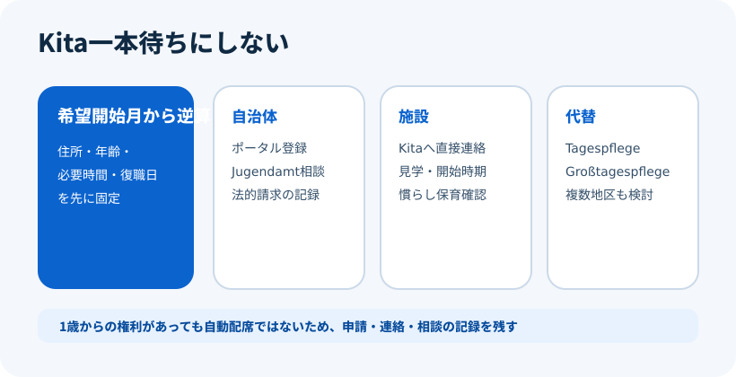

# NRWでKitaと保育ママを探す｜8月入園が基本・1歳台の枠は少ない【2026年 編集部の照会記録】

ドイツでは子どもが1歳になると保育を利用する権利がありますが、「希望の時期に、希望の園に入れる」こととは別です。この記事は、2026年10月にJ-Connect編集部のメンバーがデュッセルドルフ近郊の自治体と複数の保育施設にメールで照会した回答をもとに、NRW州で保育先を探す順番を整理します。年度途中から預けたい家庭、1歳台で預けたい家庭が、出生前後から何をすればよいかを判断できます。

## まず結論

- 何を：子どもの出生後に、住む自治体のオンラインシステムで複数の園を登録し、同時に保育ママ（家庭的保育）も探す。
- いつまでに：NRWでは保育を始める**6か月前まで**に自治体の青少年福祉局へ需要を伝えるのが原則（州保育法第5条）。新年度は**8月1日**に始まる。
- どこで：住む自治体の保育ポータルと青少年福祉局。園には見学・説明会で直接会う。
- 費用と期間：デュッセルドルフ市では3歳から就学までの保育料は無料（給食費は別、2026年11月14日確認）。1歳台の枠は少なく、年度途中の入園は空きが出た場合だけ。

## あなたはどのケース？

| あなたの状況 | 違うところ | 先にすること |
| --- | --- | --- |
| 8月から預けたい（1歳以上） | 新年度の配分に乗れる。秋の見学と年明けの配分が勝負 | 前年の秋までに登録と見学。6か月前の需要申告 |
| 年度途中（9月〜翌7月）から預けたい | 園の空きが出た場合だけ。編集部の照会では保育ママを並行して探すよう勧められた | 園の登録と同時に、保育ママの相談窓口へ |
| 開始時に1歳未満 | 利用権は、親の就労・求職・就学などの条件を満たす場合（連邦社会法第8編第24条第1項） | 就労証明など、自治体が求める証明を確認 |
| 2歳前後から預けたい | 「11月1日時点で2歳」のように、基準日の年齢で受け入れを決める園がある | 園ごとの年齢条件を、登録前に確認 |
| 引っ越し予定がある | 申込みは保育開始時に住む自治体へ | 転居先の自治体の受付方法を確認 |

## 手順

1. 妊娠中：住む予定の自治体の保育ポータルを開き、登録の受付開始（出生後か、妊娠中から可能か）と、園の説明会の時期を調べる。編集部の照会先の自治体では、登録は出生後だった。
2. 出生後すぐ：自治体のオンラインシステムで家族のアカウントを作り、複数の園を選んで登録する。デュッセルドルフ市の Kita-Navigator では、家族ごとに登録し、最大15園の待機リストに入れる（2026年11月14日確認）。
3. 同じ時期に：保育ママ（Kindertagespflege）の相談窓口に連絡する。デュッセルドルフ市の案内では、保育ママ1人が同時に預かれるのは原則5人まで、3人まで集まる大型の保育ママ（Großtagespflege）は9人まで。保育ママには自治体の許可（Pflegeerlaubnis）が必要。
4. 開始6か月前まで：青少年福祉局に、開始希望日、週の時間、保育の種類を書面で伝える（需要申告）。ポータルへの登録が需要申告を兼ねるかは自治体ごとに違うので、受付の確認メールを保存する。
5. 秋：見学会・説明会に行く。デュッセルドルフ市は、前年の秋までに登録し、見学会で園と保育者に会うことを勧めている。
6. 1月〜2月：デュッセルドルフ市の場合、1月に新年度の配分が始まり、2月から園が枠を提示する。提示から14日以内に承諾し、2週間以内に契約書に署名しないと、枠は次の家庭に回る。
7. 枠が決まらないとき：デュッセルドルフ市では、5月初めに市から今後の流れの連絡が来る。翌年度の待機を続けるなら7月30日までに再登録しないと登録が消える。並行して青少年福祉局に、開始日と必要な時間を書面で相談する。
8. 枠が決まったら：契約、保育料の申告、慣らし保育の日程を確定する。慣らし保育は数日〜数週間かかるため、復職日と入園日を同じ日にしない。

## 落とし穴

- 「1歳から権利がある＝希望の時期に入れる」ではない：権利は保育の提供を求めるもので、第一希望の園や時期までは保証されない。年度途中に預けたいなら、園の待機だけに頼らず保育ママを並行して探す。
- 年齢の基準日を見落とす：「11月1日時点で2歳」など、基準日での年齢で受け入れを決める園がある。誕生月によっては、希望の年度に対象外になる。
- 1歳台の枠の少なさ：編集部の照会では、1歳台を受け入れる枠は非常に少ないと回答された。U3（3歳未満）の枠がある園でも、2歳からしか受け入れないことがある。
- 登録しただけで安心する：「お気に入り」と正式な登録は違う。デュッセルドルフ市のように、毎年の再登録をしないと待機登録が消える自治体もある。
- 承諾期限を逃す：枠の提示から承諾・契約までの期限は短い（デュッセルドルフ市は14日・2週間）。メールと郵便を毎日確認する。

## そのまま使えるドイツ語

| 場面 | ドイツ語 | 日本語 |
| --- | --- | --- |
| 電話の最初の一言 | Guten Tag, ich rufe wegen eines Betreuungsplatzes für mein Kind an. | こんにちは、子どもの保育の枠のことでお電話しました。 |
| 年度途中の空きを聞く | Gibt es bei Ihnen auch unterjährig freie Plätze für Kinder unter drei Jahren? | 3歳未満の子の、年度途中の空きはありますか。 |
| 年齢条件を聞く | Ab welchem Alter nehmen Sie Kinder auf, und gibt es einen Stichtag? | 何歳から受け入れていますか。基準日はありますか。 |
| 保育ママを聞く | Können Sie mir eine Kindertagespflegeperson in der Nähe empfehlen? | 近くの保育ママを紹介してもらえますか。 |

園への問い合わせメール：

> 件名：Anfrage Betreuungsplatz U3 ab [Monat Jahr]
> Sehr geehrte Damen und Herren,
> unser Kind wurde am [Datum] geboren. Wir suchen ab [Monat Jahr] einen Betreuungsplatz für [Stunden] Stunden pro Woche.
> Könnten Sie mir bitte mitteilen, ob Sie Kinder in diesem Alter aufnehmen, ob es einen Stichtag für das Alter gibt und ob eine Aufnahme auch während des Kitajahres möglich ist?
> Über das Online-Portal der Stadt haben wir uns bereits vorgemerkt.
> Mit freundlichen Grüßen
> [Name]

和訳：件名「3歳未満の保育枠の問い合わせ（〇年〇月から）」。私たちの子どもは〇月〇日に生まれました。〇年〇月から週〇時間の保育先を探しています。この年齢の子を受け入れているか、年齢の基準日があるか、年度の途中でも入園できるかを教えていただけますか。市のオンラインシステムには登録済みです。

青少年福祉局への需要申告（書面）の書き出し：

> 件名：Bedarfsanzeige Kindertagesbetreuung für [Name des Kindes], geb. [Datum]
> Sehr geehrte Damen und Herren,
> hiermit melde ich den Betreuungsbedarf für unser Kind ab dem [Datum] im Umfang von [Stunden] Stunden pro Woche an, in einer Kindertageseinrichtung oder in der Kindertagespflege.
> Bitte bestätigen Sie mir den Eingang dieser Bedarfsanzeige.
> Mit freundlichen Grüßen

和訳：件名「〇〇（〇年〇月〇日生まれ）の保育需要の申告」。〇月〇日から週〇時間、保育施設または家庭的保育での保育が必要であることを申告します。この申告を受け付けたことを確認してください。

もっと短い言い回しは「[保育・学校への連絡で使う言葉](/germany/ja/learn-german/kita-school-inquiry-phrases/)」にまとめています。

## 在住者の実例

J-Connect編集部メンバーの実例（2026年10月、デュッセルドルフ近郊の自治体と保育施設にメールで照会）。1つの地域・時期の回答で、ほかの自治体や園では違うことがあります。

| 聞いたこと | 回答 |
| --- | --- |
| 入園の時期 | 多くの園で入園は8月1日が基本。年度の途中は、空きがある場合だけ |
| 年齢の条件 | 「11月1日時点で2歳」のように、基準日の年齢を条件にしている園もあった |
| 1歳台の枠 | 非常に少ない。年度の途中に預けたいなら、保育ママを並行して探すよう勧められた |
| 申込みの方法 | 出生後に自治体のオンラインシステムで、複数の園を選んで登録する |

編集部の判断（推測を含む）：4月など年度途中の復職を考えている場合、園の待機だけでは間に合わない可能性が高いため、出生後すぐに園の登録と保育ママ探しを同時に始めることにしました。

## 費用

保育料は州・自治体、子どもの年齢、時間、世帯収入で変わります。デュッセルドルフ市では、3歳未満の保育は有料、3歳から就学までは収入にかかわらず無料で、給食費は別です。2027年8月からは、週35時間までの保育は無料にする新しい規則が案内されています（どちらも2026年11月14日確認）。ほかの自治体は、その自治体の料金表を確認してください。

## 関連記事

- [ドイツで妊娠・出産する日本人へ](/germany/ja/living/pregnancy-birth-germany/)
- [ドイツ出産の手続き完全ガイド](/germany/ja/living/birth-procedures-germany/)
- [NRWの学校休暇2026/27年度](/germany/ja/living/nrw-school-holidays-2026-2027/)（Kitaの休園日は学校休暇と別に決まります）

## 公式情報・参考ソース

- [連邦社会法第8編第24条：保育を利用する権利](https://www.gesetze-im-internet.de/sgb_8/__24.html)（2026年11月14日確認）
- [NRW州保育法（KiBiz）](https://recht.nrw.de/lrgv/gesetz/01082026-gesetz-zur-fruehen-bildung-und-foerderung-von-kindern-kinderbildungsgesetz/)：保育年度は8月1日〜7月31日、6か月前の需要申告（第5条）。2019年公布の条文で2026年11月14日確認。2026年8月施行版の原典はこの日に開けず未確認
- [デュッセルドルフ市：Kita-Navigator](https://www.duesseldorf.de/familie/kinderbetreuung/kita-navigator)（最大15園、1月配分開始、14日以内の承諾、7月30日の再登録。2026年11月14日確認）
- [デュッセルドルフ市：家庭的保育](https://www.duesseldorf.de/familie/kinderbetreuung/kindertagespflege)（2026年11月14日確認）
- [デュッセルドルフ市：保育料（2027年7月まで）](https://www.duesseldorf.de/familie/kinderbetreuung/elternbeitrag)（2026年11月14日確認）
- [デュッセルドルフ市：保育料（2027年8月から）](https://www.duesseldorf.de/familie/kinderbetreuung/elternbeitrag-2027)（2026年11月14日確認）
