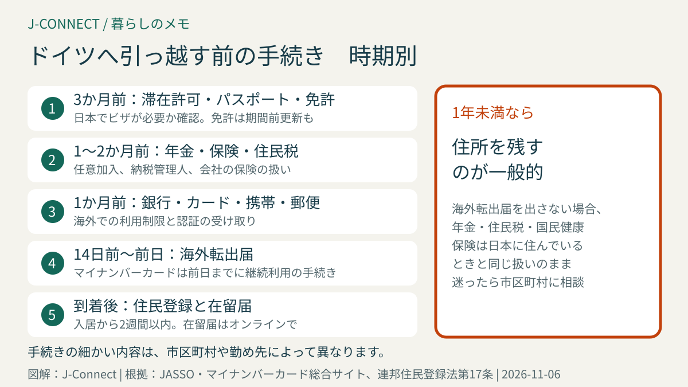
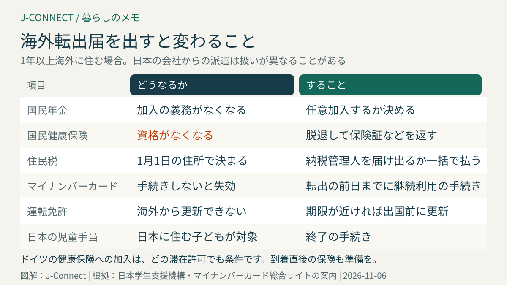

# ドイツへ引っ越す前に日本でする手続き｜海外転出届、マイナンバーカードの継続利用、年金・健康保険・住民税、運転免許、在留届のチェックリスト

ドイツへの赴任、留学、移住が決まると、ドイツ側の準備と同時に、日本で済ませておくべき手続きがたくさんあります。住民票を抜くかどうかで、年金、健康保険、住民税、マイナンバーカードの扱いが変わり、出国後には手続きしにくいものもあります。この記事は、日本から1年以上ドイツへ引っ越す人とその家族に向けて、出発の3か月前から到着後までにする手続きを時期別に整理します。読み終えると、出国までに何をいつ、どこで済ませればよいかが分かります。

## まず結論：出発前の主な手続き

| 時期 | 手続き |
| --- | --- |
| 3か月前 | ドイツの滞在許可の条件を確認、パスポートの有効期限、運転免許の更新、健康診断・歯科 |
| 1〜2か月前 | 年金・健康保険・住民税の扱いを確認、銀行・クレジットカード・携帯電話、郵便物の転送 |
| 14日前〜前日 | 市区町村で海外転出届、マイナンバーカードの継続利用の手続き、国民健康保険の脱退 |
| 出国後 | ドイツで住民登録と滞在許可、在外公館への在留届 |

1年未満の滞在で日本に住所を残す場合は、海外転出届を出さないのが一般的です。その場合、年金や住民税などは日本に住んでいるときと同じ扱いになります。

## 3か月前：ドイツ側の条件とパスポート、運転免許

### ドイツの滞在許可を確認する

日本国籍の人は、ビザなしでドイツに入国し、入国から90日以内にドイツ国内で滞在許可を申請できます（滞在令第41条）。ただし、企業内転勤のICTカードやチャンスカードのように、日本でビザを取る必要があるものもあります。自分の目的に合った滞在許可と、日本で用意する書類（卒業証明書や在職証明書の英訳など）を確認しましょう。[ドイツのビザ・滞在許可の種類](/germany/ja/living/germany-visa-types-japanese/)で比べられます。

### パスポートの有効期限

ドイツの滞在許可のカードは、パスポートの有効期限を超えて出ないことがあります。残りの期間が短い場合は、出発前に日本で新しいパスポートを取っておくと安心です。

### 運転免許の更新と国外運転免許証

- **更新**：日本の運転免許は、海外からは更新できません。期限が滞在中に来る場合は、出国前の**期間前更新**を検討します。
- **ドイツでの切り替え**：ドイツに住民登録してから一定期間は日本の免許で運転でき、その後はドイツの免許への切り替えが必要です。切り替えには有効な日本の免許が必要です。詳しくは[日本の運転免許とドイツ](/germany/ja/living/drivers-license-japan-germany/)で説明しています。
- **国外運転免許証**：到着直後の運転に備えて、運転免許センターなどで取得しておく人もいます。

### 健康診断・歯科・薬

ドイツでは、かかりつけ医や歯科の予約に時間がかかることがあります。出発前に健康診断や歯の治療を済ませ、持病の薬は英文の処方の説明や診断書を用意しておきましょう。子どもの予防接種の記録（母子手帳）は、英訳したものがあると、ドイツの小児科や保育園で役立ちます。

## 1〜2か月前：お金・保険・通信

### 国民年金

海外に住所を移すと、国民年金に加入する義務がなくなります。ただし、日本国籍の人は、**任意で加入を続ける**ことができます。将来の年金額を減らさないため、または受給資格の期間を満たすために任意加入する人もいます。

ドイツの会社で働く場合は、ドイツの公的年金に加入します。日本とドイツの間には社会保障協定があり、両国の加入期間を合わせて年金の受給資格を判断できます。日本の会社からの派遣（5年以内の見込み）なら、日本の年金に加入したままドイツの年金が免除される場合もあります。[日独社会保障協定と年金](/germany/ja/living/japan-germany-social-security-pension/)を参考にしてください。

### 健康保険

- **国民健康保険**：海外転出届を出すと、国民健康保険の資格がなくなります。海外に住む人が国民健康保険に任意で入る制度はありません。保険証（資格確認書など）は返します。
- **会社の健康保険**：日本の会社から派遣され、日本の給与が続く場合は、会社の健康保険に入ったままのことがあります。
- **ドイツの保険**：ドイツでは、どの滞在許可でも健康保険の加入が条件です。入国から働き始めるまでの間の保険も忘れずに準備しましょう。[ドイツの健康保険](/germany/ja/living/health-insurance-guide/)で説明しています。

### 住民税

住民税は、**1月1日に住所があった市区町村**で、その年度分（前の年の所得に対する税金）がかかります。年の途中で出国しても、その年度の住民税はなくなりません。

- 出国前に残りを一括で払うか、出国後の支払いを代わりにしてくれる**納税管理人**（家族など）を市区町村に届け出ます。
- 翌年の1月1日に日本に住所がなければ、翌年度の住民税はかかりません。

会社員は、出国時に会社が年末調整をしてくれることがあります。そのほかの人は、出国前に確定申告（準確定申告）が必要な場合があるので、税務署で確認してください。

### 銀行・クレジットカード・証券口座

日本の銀行や証券会社の中には、海外に住む人の口座の利用を制限するところがあります。海外転出を伝えたときに口座がどうなるか、オンラインバンキングや認証用のショートメッセージが海外で使えるかを確認しておきます。クレジットカードは、引き落とし口座と住所の扱いを確認します。

ドイツでの口座開設は、住民登録の後になることが多いので、到着後しばらくは日本のカードで支払えるようにしておくと安心です。[ドイツの銀行口座開設](/germany/ja/living/bank-account-germany/)を参考にしてください。

### 携帯電話

日本の電話番号を残したい場合は、番号を保管するサービスや、料金の安いプランへの変更を検討します。銀行などの認証にショートメッセージが必要な場合は、海外で受け取れるかも確認します。ドイツでの契約は[ドイツの携帯電話・SIMの選び方](/germany/ja/living/mobile-phone-sim-germany/)で説明しています。

### 郵便物と住所

日本の郵便局の転送サービスは、国内の住所への転送だけです。実家などを連絡先にして、保険会社や銀行の登録住所を変更しておきます。

## 14日前〜前日：市区町村の手続き

### 海外転出届

1年以上海外に住む予定の人は、住んでいる市区町村に**海外転出届**を出します。届け出は、一般的に**出国予定日の14日前から**できます。家族全員で引っ越す場合は、まとめて届け出られます。

### マイナンバーカードを国外で使い続ける

2024年5月27日から、海外に引っ越した後もマイナンバーカードを使い続けられるようになりました。使い続けるには、**転出予定日の前日までに**、市区町村の窓口で継続利用の手続きをします。カードと暗証番号を忘れずに持っていきましょう。手続きをしないで転出すると、カードは使えなくなります。

使い続けると、海外からマイナポータルや電子申告などのサービスを使えたり、一時帰国のときの本人確認に使えたりします。

### そのほかの窓口の手続き

- 国民健康保険の脱退、国民年金の任意加入の申し込み
- 児童手当の終了（日本の児童手当は日本に住む子どもが対象です）
- 印鑑登録は、転出で自動的になくなります
- 子どもの学校の転出の手続きと、在学証明書・成績証明書（英訳があると便利）

## 出国後：ドイツでの手続きと在留届

### ドイツでの住民登録と滞在許可

ドイツでは、住まいに入居してから**2週間以内**に住民登録をします（連邦住民登録法第17条）。その後、入国から90日以内に外国人局で滞在許可を申請します。最初の1か月の流れは[ドイツ生活の最初の30日](/germany/ja/living/germany-first-30-days/)と[ドイツの住民登録](/germany/ja/living/anmeldung-guide/)にまとめています。

### 在留届

海外に3か月以上住む日本人は、住所を管轄する日本の大使館・総領事館に**在留届**を出すことが旅券法で義務づけられています。外務省のオンラインの届け出のシステムから出せます。在留届を出すと、災害や事件のときの安否確認や、領事館からのお知らせを受け取れます。引っ越しや帰国のときは、変更や帰国の届けも出します。

## よくある質問

### 住民票を残したままドイツに住めますか？

1年以上海外に住む予定なら、海外転出届を出すのが原則です。住民票を残すと、国民健康保険料や住民税がかかり続けることがあります。赴任の期間がはっきりしない場合は、市区町村の窓口に相談してください。

### ふるさと納税やiDeCo、NISAはどうなりますか？

海外に住む人は、NISAやiDeCoの扱いが変わることがあります。金融機関によって手続きが違うので、出国前に確認してください。

### 一時帰国のときに病院にかかれますか？

国民健康保険を脱退していると、日本での治療費は全額自己負担になります。一時帰国の予定がある人は、海外旅行保険などで備えましょう。

## 関連記事

- [ドイツ生活の最初の30日](/germany/ja/living/germany-first-30-days/)
- [ドイツのビザ・滞在許可の種類](/germany/ja/living/germany-visa-types-japanese/)
- [日本の運転免許とドイツ](/germany/ja/living/drivers-license-japan-germany/)
- [日独社会保障協定と年金](/germany/ja/living/japan-germany-social-security-pension/)
- [ドイツの住民登録](/germany/ja/living/anmeldung-guide/)

## 公式情報・参考ソース

- [日本学生支援機構：海外留学の前にする役所の手続き](https://ryugaku.jasso.go.jp/oversea_info/basic/simulation/yakusyo.html)
- [マイナンバーカード総合サイト：国外転出をする場合の手続き](https://www.kojinbango-card.go.jp/faq_other9/)
- [滞在令第41条：日本国籍者のビザなし入国と国内での申請](https://www.gesetze-im-internet.de/aufenthv/__41.html)
- [連邦住民登録法第17条：入居後2週間以内の住民登録](https://www.gesetze-im-internet.de/bmg/__17.html)

**参照日：2026年11月6日。** 日本の手続きは、市区町村や勤め先によって異なります。この記事は一般的な情報で、個別の助言ではありません。具体的な扱いは、市区町村の窓口、年金事務所、税務署、勤め先の人事担当に確認してください。
