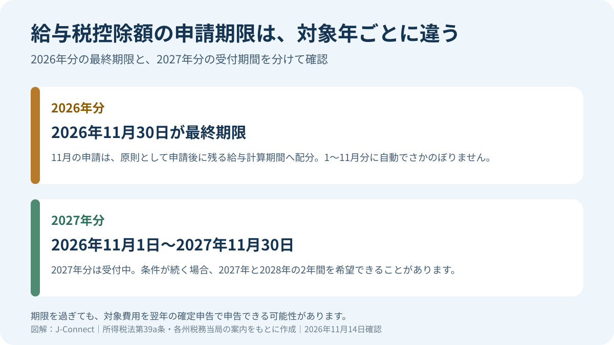
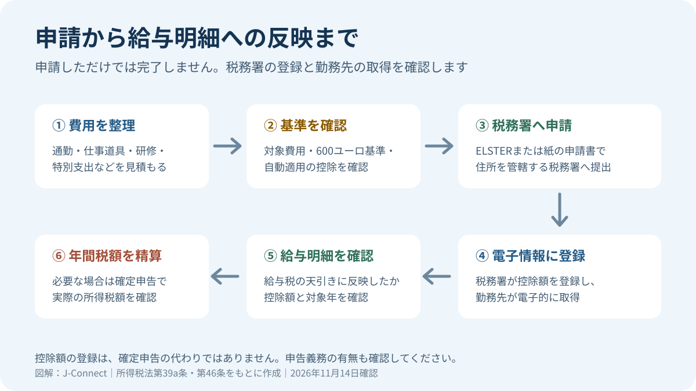

# ドイツの給与税控除額（Freibetrag）申請｜2026年分は11月30日まで

ドイツで給与を受け取る人は、通勤費や仕事の経費などが一定額を超える場合、給与税の控除額（Freibetrag）を申請して、毎月の給与から差し引かれる税金を減らせます。2026年分の申請は11月30日が最終日で、2027年分は2026年11月1日から受付が始まっています。この記事では、対象になる費用、申請期限、電子申請の手順、確定申告との関係を整理します。

## 先に確認したいこと

- **2026年分：** 申請は2026年11月30日まで。11月に申請しても、1月から11月までの給与税が自動的に返金されるわけではありません。
- **2027年分：** 2026年11月1日から申請できます。申請期限は2027年11月30日で、条件が続く場合は2027年と2028年の2年間を指定できます。
- **対象費用：** 通勤費や仕事の経費、一定の特別支出、特別な負担など。多くの項目では対象額が600ユーロを超える必要があります。
- **注意：** 控除額の登録によって、条件次第では確定申告が義務になることがあります。

## 給与税の控除額とは

給与税の控除額は、税務署が認めた年間の費用・控除を、給与から差し引く税金の計算に反映させる仕組みです。税務署が電子給与税情報（ELStAM）に登録すると、勤務先はその情報を電子的に取得し、毎月の給与税を計算します。

これは税金そのものを免除する制度ではありません。年間の所得税額を確定する前に、給与から差し引く税額を調整する仕組みです。最終的な税額は、必要な場合に提出する確定申告や税務署の決定で精算されます。給与税の控除額を登録しても、通常、年金・健康保険などの社会保険料の計算基礎は変わりません。

## どのような費用が対象になる？

申請できるのは、所得税法で認められた費用や控除です。代表例は次のとおりです。

| 費用・控除の種類 | 具体例 | 確認する点 |
| --- | --- | --- |
| 仕事に関係する費用 | 通勤費、仕事道具、専門書、職業訓練、仕事のための二重世帯 | 会社から非課税で補填された金額を二重に計上しない |
| 特別支出 | 法律で認められる保険料、寄付、一定の扶養関連支出 | 対象となる支出の種類と上限を確認 |
| 特別な負担 | 一定の医療費、障害に関連する費用など | 自己負担額や個別の法定条件を確認 |
| 家事関連サービス | 一定の家事サービス、職人による工事 | 請求書・銀行振込など法定要件を確認 |

### 600ユーロ基準と自動適用される控除

多くの申請では、対象となる仕事関連費用、特別支出、特別な負担などの合計が600ユーロを超える必要があります。ただし、すべての控除に同じ基準が適用されるわけではありません。

通勤費などの仕事関連費用は、給与所得者に自動適用される概算控除額を超える部分が対象になります。2026年の給与所得者向け概算控除額は年1,230ユーロです。たとえば通勤費などの対象経費が1,230ユーロ以下で、ほかに申請できる費用がない場合、給与税の控除額を登録しても追加の効果は通常ありません。

2027年については、給与所得者向け概算控除額を1,430ユーロに引き上げる所得税改革案が審議されています。2026年11月14日時点では成立した法律ではないため、2027年分の計算に1,430ユーロを確定額として使わず、法改正の成立状況を確認してください。

## 2026年分と2027年分の申請期限

| 対象年 | 申請できる期間 | 申請期限 | 反映の考え方 |
| --- | --- | --- | --- |
| 2026年分 | 2025年11月1日から | **2026年11月30日** | 申請後に残る給与計算期間へ配分。年初からの給与に自動でさかのぼらない |
| 2027年分 | **2026年11月1日から** | 2027年11月30日 | 2027年の給与税に反映。条件が続く場合は2028年分も指定できる |

### 2026年11月30日までに申請しても、年初にさかのぼらない

所得税法第39a条では、控除額を申請後の残りの月に分けて給与税へ反映するのが原則です。1月に申請した場合は1月1日から反映できますが、11月に申請した場合、通常はその後の給与計算期間に配分されます。

そのため、2026年11月に申請しても、1月から11月までにすでに差し引かれた給与税が自動的に返金されるわけではありません。2026年分の費用を年間で精算したい場合は、翌年の確定申告で対象費用を申告する方法を確認してください。11月30日を過ぎた場合も、確定申告で控除できる可能性まで失われるわけではありません。

## 申請の手順

1. **対象費用を整理する。** 通勤日数、通勤距離、仕事道具、研修費、二重世帯の費用などを年間見込みでまとめます。領収書、請求書、勤務先からの補填額も確認します。
2. **申請する年を選ぶ。** 2026年分の残りの給与に反映させたいのか、2027年分を申請するのかを分けて考えます。
3. **申請フォームを開く。** オンライン申請は、公式ポータルの「給与税控除額と給与税情報の申請」フォームから行います。必要な費用に応じて、仕事関連費用、特別支出、特別な負担、家事関連費用などの添付項目を選びます。
4. **住所を管轄する税務署へ提出する。** オンラインのほか、所定の紙の申請書を提出する方法もあります。2026年分を希望する場合は、11月30日までに税務署へ届くようにします。
5. **給与明細で反映を確認する。** 税務署が電子給与税情報に登録した後、勤務先が情報を取得します。反映時期は申請・処理のタイミングによって異なるため、給与明細を確認してください。
6. **条件が変わったら税務署へ知らせる。** 申請時より費用が減るなど、控除額が実情に合わなくなった場合は、税務署へ変更を届け出る必要があります。

公式申請フォーム：[ELSTERの給与税控除額申請](https://www.portal.elster.de/eportal/formulare-leistungen/alleformulare/elevermaessigungelstam)

## 控除額を登録したら確定申告は不要？

いいえ。給与税の控除額と確定申告は別の手続きです。一定の控除額が登録され、年間給与が法律上の基準を超える場合などには、確定申告が義務になることがあります。所得税法第46条は、特定の種類の控除額を登録した人について、申告義務が生じる条件を定めています。

申請したから確定申告が不要になる、または必ず税金が戻る、と考えないでください。自分の控除の種類、年間給与、ほかの所得の有無を確認してください。確定申告の義務・任意の見分け方は[ドイツの確定申告入門](/germany/ja/living/income-tax-return-germany/)で説明しています。

## 2027年の税制改正案に注意

連邦政府は2026年9月2日、2027年所得税改革案を閣議決定しました。案には、給与所得者向け概算控除額を年1,230ユーロから1,430ユーロへ引き上げる内容が含まれています。連邦議会では2026年10月8日に第1読会が行われ、委員会に付託されました。

2026年11月14日時点では、引き上げは成立済みの制度ではありません。2027年分の申請を行う人は、最終的な法律と税務当局の案内を確認してから、対象経費を計算してください。

## よくある質問

### 2026年分の申請期限を過ぎたら、控除を受けられませんか？

給与税の控除額として2026年中に反映させる申請期限は11月30日です。ただし、対象となる費用を確定申告で申告できる可能性は残ります。申請期限と確定申告の期限は別です。

### 2027年分は今すぐ申請できますか？

はい。2027年分の申請は2026年11月1日から始まっています。申請期限は2027年11月30日です。条件が続く場合は、2年間の有効期間を希望できることがあります。

### 申請すると毎月の手取りが必ず増えますか？

登録された控除額によって給与税の天引きが減る場合がありますが、実際の差額は所得、税率、控除の種類、給与計算の時期によって異なります。社会保険料が同じ仕組みで減るわけではありません。

### 障害者控除なども毎年申請が必要ですか？

障害者や遺族に関する一定の定額控除は、有効期間中、毎年申請し直さなくても給与税に反映される場合があります。個別の有効期間と登録状況を確認してください。

---

**確認日：2026年11月14日。** 2026年分の申請期限、2027年分の受付開始、所得税法第39a条・第46条、2027年所得税改革案の審議状況を確認しています。税務上の個別判断は、管轄税務署または税理士に確認してください。
