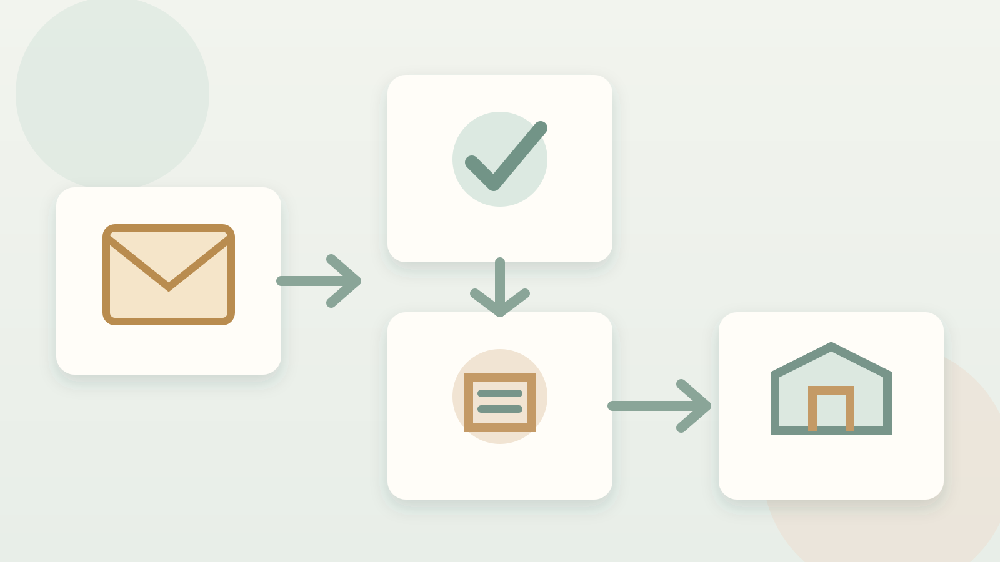

# ドイツで裁判所から督促状（Mahnbescheid）が届いたら｜2週間の異議申立てとその後

ドイツの裁判所から届く督促状（Mahnbescheid）は、請求が正しいと裁判所が認めた判決ではありません。ただし、放置すると執行命令（Vollstreckungsbescheid）に進む可能性があるため、送達日から2週間以内に支払うか、請求の全部または一部に異議を出すかを判断する必要があります。この記事では、届いた直後に確認する項目、異議の出し方、期限を過ぎた場合の対応を整理します。

## まず結論

- **期限：** 督促状が送達された日から2週間以内に、請求を支払うか、全部または一部に異議を出します。期限の最終日が土曜・日曜・祝日なら、次の平日まで延びます。
- **裁判所の審査：** この段階で裁判所は、請求が本当に正しいかを審査していません。心当たりがない請求でも、放置せず対応します。
- **提出先：** 異議は、督促状を発行した裁判所に書面で提出します。債権回収会社や元の請求会社へ送るだけでは足りません。
- **費用とその後：** 異議の後に相手が通常訴訟へ進める場合、裁判費用などが発生する可能性があります。金額は請求額や手続きによって異なります。

## あなたはどのケース？

| 状況 | 対応 |
| --- | --- |
| 請求も金額も正しい | 期限内に支払い、支払記録を保存する |
| 契約に心当たりがない、請求が誤っている | 全額について異議を出す |
| 元の請求額は正しいが、利息や費用の一部が違う | 争う範囲を確認し、必要なら一部だけ異議を出す |
| すでに支払った | 振込記録を確認し、請求者と裁判所に速やかに連絡する |
| 執行命令が届いた | 通常の異議ではなく、送達から2週間の異議申立てを直ちに検討する |

## 手順

### 1. 書類の種類・送達日・事件番号を確認する

書類の表題に「Mahnbescheid」とあるか確認します。普通の債権回収会社の手紙とは異なり、裁判所の督促手続きです。

封筒や送達記録を保管し、裁判所名、事件番号（Aktenzeichen）、請求者、請求額、利息、費用、送達日を確認してください。期限は手紙を読んだ日や請求書の日付ではなく、裁判所からの送達を基準に計算します。

### 2. 請求の根拠を照合する

請求書、契約、注文履歴、解約通知、返金記録、銀行明細を確認します。裁判所は督促状を出す段階で、請求者に本当に請求権があるかを審査していません（民事訴訟法第692条）。したがって、裁判所から届いたというだけで請求が正しいと判断しないでください。

### 3. 全額または一部の異議を決める

請求が誤っている場合は、同封の異議申立て用紙を使い、全額または争う部分を明確にします。法律上、異議は請求の全部だけでなく一部にも出せます。異議の理由を用紙に詳しく書くことは、この段階では必須ではありません（民事訴訟法第694条）。

一部だけ争う場合は、元の請求額、すでに支払った額、利息、費用を分け、どの部分を争うのかを正確に確認してください。

### 4. 発行した裁判所へ期限内に提出する

異議は、督促状を発行した裁判所に書面で提出します。原則として同封の用紙に記入し、案内に従って送ります。期限ぎりぎりに投函せず、裁判所に届くまでの時間を見込んでください。提出した用紙のコピー、送付記録、配達記録を保管します。

民事訴訟法第702条では、督促手続きに関する説明を裁判所の書記官の前で行う方法も定めています。郵送以外の方法を使う場合は、担当裁判所に確認してください。単なるメールを送るだけで期限を守ったと考えないでください。

### 5. 支払う場合は記録を残し、手続きの状況を確認する

請求が正しいと判断して支払う場合は、書類の請求者と振込先を確認してから支払います。支払日、金額、振込先、参照番号が分かる記録を保存し、請求者にも支払いを伝えます。督促状を受け取った後に支払った場合は、裁判所にも支払状況を知らせ、手続きがどう扱われるか確認してください。

## 期限を過ぎた場合・執行命令が届いた場合

2週間を過ぎても、何もせずに諦めてはいけません。民事訴訟法第694条第2項は、遅れて出された異議を「執行命令への異議」として扱うと定めています。ただし、これは期限が自動的に延長される、あるいは必ず救済されるという意味ではありません。すぐに裁判所または法律専門家へ相談してください。

執行命令（Vollstreckungsbescheid）がすでに送達された場合は、通常の異議ではなく、執行命令に対する異議申立て（Einspruch）を検討します。執行命令は仮執行可能な欠席判決と同等に扱われ、異議期間は原則として送達から2週間です（民事訴訟法第700条・第339条）。この書類を受け取ったら、当日中に日付と期限を確認し、弁護士や消費者センターに相談してください。

## 落とし穴

- **裁判所から来たので請求は正しいと思う：** 裁判所は督促状を出す段階で請求の正当性を審査していません。元の契約や支払い記録を確認します。
- **Inkasso会社に異議を送ればよいと思う：** 裁判所の督促状への異議は、発行した裁判所に出します。債権回収会社への連絡だけでは代わりになりません。
- **手紙の日付から2週間と数える：** 基準は送達日です。封筒や送達記録を保管してください。
- **メールだけで異議を出す：** 同封の用紙と裁判所の案内を使います。提出方法に不安があれば裁判所へ確認します。
- **一部だけ争うのに、金額を確認せず全部に印を付ける：** 争う部分を整理し、残りの請求をどう扱うか確認します。
- **期限後ならもう何もできないと決めつける：** 遅れた異議の扱いと、執行命令への異議は別の問題です。すぐに個別相談してください。

## そのまま使えるドイツ語

裁判所に電話で提出方法を確認するときの短い表現です。これは正式な異議申立ての代わりではありません。実際の異議には、同封の用紙と裁判所の指示を使ってください。

| ドイツ語 | 日本語の意味 |
| --- | --- |
| Ich habe einen Mahnbescheid erhalten. | 裁判所の督促状を受け取りました。 |
| Ich möchte wissen, wie ich den Widerspruch fristgerecht einreichen kann. | 期限内に異議を提出する方法を確認したいです。 |
| Können Sie mir bitte bestätigen, dass mein Widerspruch unter dem Aktenzeichen [Aktenzeichen] eingegangen ist? | 事件番号［番号］の異議が届いているか、確認していただけますか。 |
| Vielen Dank für Ihre Hilfe. | ご案内ありがとうございます。 |

## 関連記事

- [ドイツでInkasso（債権回収）の手紙が来たら｜払う前の確認と対応手順](/germany/ja/living/inkasso-letter-germany/)
- [SCHUFAの取り方｜賃貸に出す証明と無料データの違い・履歴がないとき](/germany/ja/living/schufa-guide/)

## 公式情報・参考ソース

- [民事訴訟法第692条：督促状の内容と2週間の案内](https://www.gesetze-im-internet.de/zpo/__692.html)（2026年11月21日確認）
- [民事訴訟法第694条：督促状への異議](https://www.gesetze-im-internet.de/zpo/__694.html)（2026年11月21日確認）
- [民事訴訟法第699条：執行命令](https://www.gesetze-im-internet.de/zpo/__699.html)（2026年11月21日確認）
- [民事訴訟法第700条：執行命令への異議](https://www.gesetze-im-internet.de/zpo/__700.html)（2026年11月21日確認）
- [民事訴訟法第339条：異議申立ての期間](https://www.gesetze-im-internet.de/zpo/__339.html)（2026年11月21日確認）
- [民事訴訟法第222条：期限の計算](https://www.gesetze-im-internet.de/zpo/__222.html)（2026年11月21日確認）
- [民事訴訟法第702条：申立て・説明の形式](https://www.gesetze-im-internet.de/zpo/__702.html)（2026年11月21日確認）
- [消費者センター：裁判所の督促手続きで何をすべきか（2026年7月31日）](https://www.verbraucherzentrale.de/wissen/geld-versicherungen/kredit-schulden-insolvenz/gerichtliches-mahnverfahren-was-tun-bei-einem-mahnbescheid-10851)（2026年11月21日確認）

本記事は一般的な情報であり、個別の法的助言ではありません。期限を過ぎた場合、執行命令が届いた場合、請求額が大きい場合、支払不能が続く場合は、消費者センターや弁護士へ速やかに相談してください。
