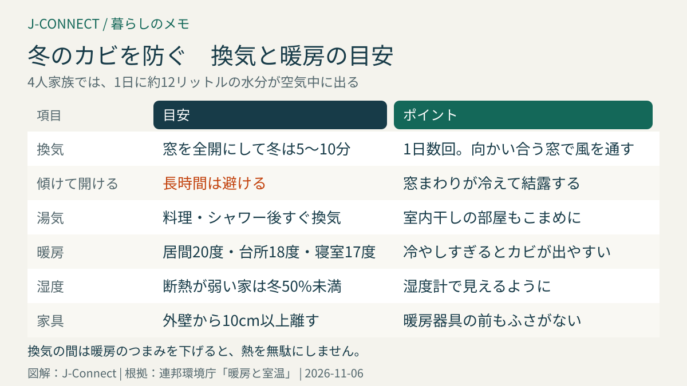
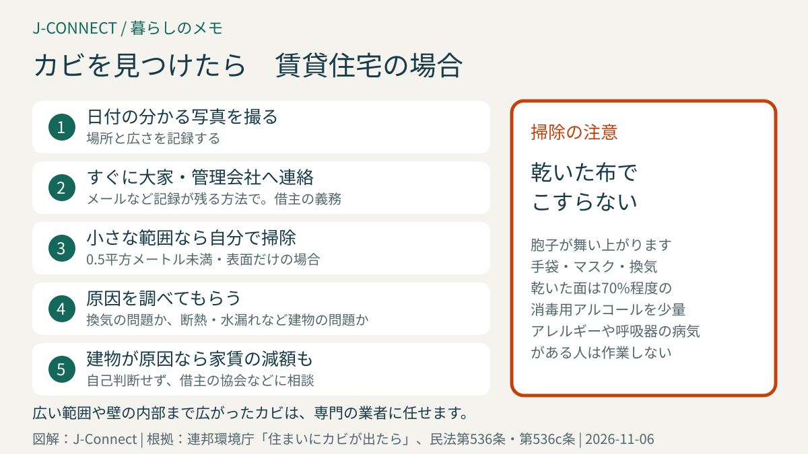

# ドイツの冬のカビ対策｜窓を全開にする換気（1日数回5〜10分）、湿度50%の目安、暖房の温度、カビが出たときの大家への連絡

ドイツの冬は寒く、窓を閉め切って暖房をつけて過ごす時間が長くなります。そのため、窓のまわりや家具の裏の壁に黒いカビが出て、驚く人が少なくありません。日本の住まいとは換気や暖房の考え方が違い、ドイツでは「窓を全開にして短時間で空気を入れ替える」のが基本です。この記事は、ドイツで賃貸住宅に住む日本人に向けて、連邦環境庁のすすめる換気と暖房の方法、カビが出たときの掃除の範囲、大家への連絡と家賃の減額までを整理します。読み終えると、今日からできる予防策と、カビを見つけたときの対応が分かります。

## まず結論：カビを防ぐ6つの習慣

1. **窓を全開にして換気**：1日に数回、冬は**5〜10分**。向かい合う窓を開けて風を通すと効果的
2. **窓を少し傾けて開けっぱなしにしない**：窓のまわりが冷えて結露し、カビの原因になります
3. **湯気が出たらすぐ換気**：料理、シャワーの後、室内で洗濯物を干すとき
4. **暖房を止めすぎない**：居間は約20度、寝室は約17度が目安。部屋を冷やしすぎるとカビが出やすくなります
5. **湿度を測る**：断熱の弱い住まいでは、冬の湿度は**50%未満**が目安
6. **家具を外壁から10cm以上離す**

この6つは、連邦環境庁の案内に基づいています。

## なぜドイツの冬はカビが出やすいのか

人が暮らすだけで、空気中には水分が出ます。連邦環境庁によると、4人家族では、呼吸、シャワー、料理、洗濯で、**1日に約12リットル**の水分が空気中に出ます。暖かい空気はたくさんの水分を含めますが、冷たい窓や外壁に触れると、含みきれない水分が水滴（結露）になります。この水分がたまった場所にカビが生えます。

特に次のような住まいでは注意が必要です。

- 古い建物で、外壁の断熱が弱い
- 窓が新しく気密性が高い（すきま風がないため、換気しないと湿気がこもる）
- 北向きの部屋や、建物の角の部屋
- 寝室を極端に寒くしている
- 室内で洗濯物を干している

## 正しい換気の方法

### 窓を全開にして短時間で入れ替える

ドイツでよく言われる換気の方法は、窓を大きく開けて短時間で空気を入れ替えるやり方です。連邦環境庁は、次のようにすすめています。

- 1日に**数回**、窓を**全開**にする
- 冬は**5〜10分**、夏は20〜30分
- できれば**向かい合う窓を開けて風を通す**
- 換気の間は**暖房のつまみを下げる**

### 窓を傾けて開けっぱなしにしない

ドイツの窓は、上を少し傾けて開けられるものが多くあります。ところが、冬にこの状態を長く続けると、窓のまわりの壁が冷えて結露し、カビが出やすくなります。しかも換気の効果は小さく、暖房の熱が逃げて暖房費もかさみます。

### 湯気が出たらすぐ換気

料理や入浴の後、浴室や台所の窓を開けるか、換気扇を回します。浴室の壁や鏡についた水滴は、タオルや水切りで取るとカビの予防になります。洗濯物を室内で干すときは、その部屋をこまめに換気してください。

## 暖房の温度の目安

連邦環境庁は、快適さと省エネを両立する目安として、次の温度をすすめています。

| 部屋 | 目安の温度 |
| --- | --- |
| 居間など | 20度まで |
| 台所 | 18度 |
| 寝室 | 17度 |
| 夜間や数時間の外出 | 18度程度に下げる |
| 数日の不在 | 15度程度 |

暖房器具のつまみの真ん中（多くは「3」）が、約20度です。寒すぎるとカビが出やすくなるので、使っていない部屋も、暖房を完全に止めすぎないようにしましょう。暖かい部屋のドアを開けて寒い部屋を温めると、湿気が寒い部屋の壁で結露するので避けます。

暖房費は、毎年の共益費の精算で清算されます。精算書の見方は[ドイツの2025年共益費精算](/germany/ja/living/nebenkostenabrechnung-2025-deadline/)で説明しています。

## 湿度計を置く

湿度は目で見えないので、数ユーロで買える**湿度計**を置くのがおすすめです。連邦環境庁は、断熱の弱い住まいでは、冬の湿度を通常**50%未満**に保つことを目安にしています。浴室や寝室にも置くと、換気のタイミングが分かりやすくなります。

## 家具の置き方

外壁に家具をぴったりつけると、裏の壁が冷えて空気が動かず、カビの温床になります。大きな家具は外壁から**10cm以上**離して置きましょう。暖房器具の前に家具やカーテンを置くと、暖かい空気が部屋に広がらないので避けます。

## カビを見つけたら

### 1. 写真を撮り、大家に連絡する

賃貸住宅でカビを見つけたら、まず日付の分かる写真を撮り、**すぐに大家や管理会社に書面（メールなど）で連絡**します。借主には、住まいの欠陥を大家に知らせる義務があり、連絡しないまま被害が広がると、借主が損害を負担することがあります（民法第536c条）。

### 2. 自分で掃除できるのは小さな範囲だけ

連邦環境庁によると、**0.5平方メートル未満で表面だけ**のカビなら、自分で取り除いても構いません。ただし、カビにアレルギーがある人、ぜんそくなど呼吸器の病気がある人、免疫が弱っている人は、自分で作業しないでください。

- 乾いた布でこすらない（胞子が舞い上がります）
- 手袋とマスクをつけ、作業中は換気する
- 洗剤を含ませた布でふき取り、乾いた面には**70%**程度の消毒用アルコールを使う方法があります。火気に注意し、少量だけ使います
- 塩素系の漂白剤を大量に使うのは避けます

それより広い範囲のカビや、壁の内部まで広がったカビは、**専門の業者**に任せるべきだとされています。

### 3. 原因を確かめる

カビを取り除いても、湿気の原因がなくならなければ、また生えてきます。換気や暖房の仕方が原因なのか、建物の断熱不足や雨漏り、配管の水漏れなど建物の問題が原因なのかで、責任の所在が変わります。大家に、原因を調べてもらうよう求めてください。

### 4. 建物の問題なら家賃の減額も

カビの原因が建物の欠陥にあり、住まいの使い勝手が損なわれている場合、借主は**家賃を減額**できます（民法第536条）。ただし、どの程度減額できるかはケースによって違い、自己判断で家賃を減らすとトラブルになることがあります。借主の協会（Mieterverein）や消費者センター、弁護士に相談してから進めましょう。

## 引っ越しのときの注意

入居時には、窓まわりや浴室にカビの跡がないかを確認し、あれば入居時の記録（引き渡しの記録）に書いてもらいます。退去時にカビが残っていると、敷金から修理費を差し引かれることがあります。手順は[ドイツの賃貸・家探し](/germany/ja/living/rent-apartment-germany/)と[ドイツの引っ越しチェックリスト](/germany/ja/living/moving-checklist-germany/)で説明しています。

## よくある質問

### 除湿機を使ったほうがよいですか？

換気だけでは湿度が下がらない部屋や、室内干しが多い家庭では、除湿機が役立つことがあります。ただし、窓を開ける換気の代わりにはならないので、両方を組み合わせます。

### 外が雨の日も換気したほうがよいですか？

冬の冷たい外気は、暖めると湿度が下がります。雨の日でも、短時間の換気で室内の湿気を減らせます。

### カビで体調が悪くなったら？

せきやくしゃみ、目のかゆみ、ぜんそくの悪化などが続く場合は、医師に相談してください。病院の探し方は[ドイツで医師を探して予約する方法](/germany/ja/living/doctor-appointment-germany/)で説明しています。

## 関連記事

- [ドイツの賃貸・家探し](/germany/ja/living/rent-apartment-germany/)
- [ドイツの2025年共益費精算](/germany/ja/living/nebenkostenabrechnung-2025-deadline/)
- [ドイツで電気・インターネットを契約する方法](/germany/ja/living/electricity-internet-contracts-germany/)
- [ドイツの個人賠償責任保険と家財保険](/germany/ja/living/liability-household-insurance-germany/)
- [ドイツの引っ越しチェックリスト](/germany/ja/living/moving-checklist-germany/)

## 公式情報・参考ソース

- [連邦環境庁：暖房と室温、正しい換気](https://www.umweltbundesamt.de/umwelttipps-fuer-den-alltag/heizen-bauen/heizen-raumtemperatur)
- [連邦環境庁：住まいにカビが出たら](https://www.umweltbundesamt.de/service/uba-fragen/was-tun-bei-schimmel-in-meiner-wohnung)
- [連邦環境庁：カビが出たときのよくある質問](https://www.umweltbundesamt.de/themen/gesundheit/umwelteinfluesse-auf-den-menschen/schimmel/haeufige-fragen-bei-schimmelbefall)
- [連邦環境庁：カビの予防と除去の手引き](https://www.umweltbundesamt.de/themen/gesundheit/umwelteinfluesse-auf-den-menschen/schimmel/aktueller-uba-schimmelleitfaden)
- [民法第536条：欠陥がある場合の家賃の減額](https://www.gesetze-im-internet.de/bgb/__536.html)
- [民法第536c条：借主の欠陥の連絡義務](https://www.gesetze-im-internet.de/bgb/__536c.html)

**参照日：2026年11月6日。** この記事は一般的な情報で、個別の法的・医療的な助言ではありません。家賃の減額など大家とのトラブルは、借主の協会や専門家に相談してください。
