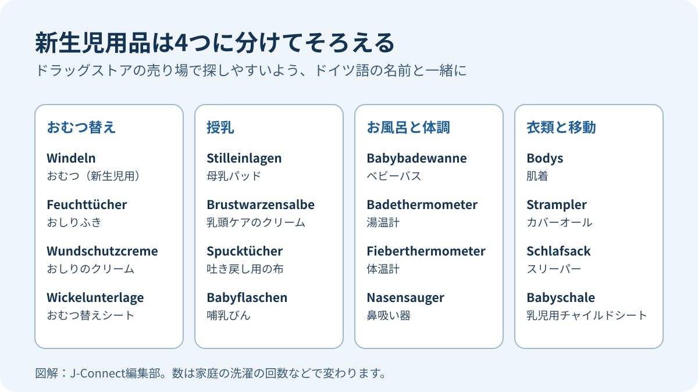
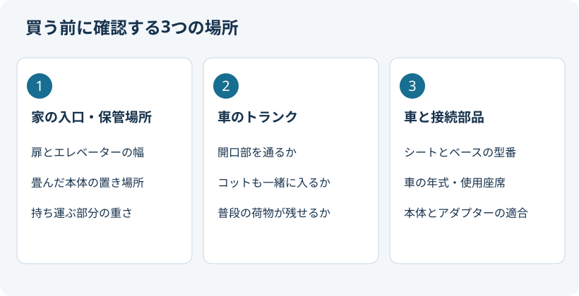

# ドイツ語の商品名つき・新生児用品チェックリスト｜dm・Rossmannで探すときの売り場の言葉【2026年】

ドイツで出産の準備をすると、ドラッグストアの棚の前で「日本で言うあれは、ドイツ語で何と書いてあるのか」と迷います。この記事は、新生児用品を4つのグループに分け、ドイツのドラッグストア（dm、Rossmann）やベビー用品店で探しやすいよう、ドイツ語の商品名と一緒に並べたチェックリストです。何を出産前にそろえ、何を生まれてから買えばよいかも判断できます。

## まず結論

- 何を：おむつ替え、授乳、お風呂と体調、衣類と移動の4つに分けて、最低限を出産前にそろえる。
- いつまでに：妊娠**36週**ごろまでに一式を用意しておくと、早めの出産でも慌てない（入院の荷物と同じ時期）。
- どこで：消耗品はdmやRossmannなどのドラッグストア、チャイルドシートやベビーカーはベビー用品店や専門店。
- 費用と注意：車で退院するなら、乳児用チャイルドシート（Babyschale）は**必須**（道路交通規則第21条第1a項：12歳未満で身長150cm未満の子は、基準に合うチャイルドシートが必要）。

## あなたはどのケース？

| あなたの状況 | 違うところ | 先にすること |
| --- | --- | --- |
| 車で退院する | 乳児用チャイルドシートがないと車に乗せられない | 出産前に購入し、車への取り付けを練習する |
| 公共交通やタクシーで退院する | タクシーにチャイルドシートがあるとは限らない | 予約時に確認するか、自分のものを持って行く |
| 母乳で育てる予定 | 哺乳びんは最小限でよいことが多い | 母乳パッドと乳頭ケアを優先 |
| 粉ミルクを使う予定 | 粉ミルク（Säuglingsmilch、新生児は「Pre」表示）と哺乳びん、消毒の道具が要る | 医師・助産師に種類を相談 |
| 狭い住まい | ベビーベッドやおむつ替え台を置けないことがある | 置く場所を測ってから買う |

## 手順

1. 妊娠中期：大きな物（チャイルドシート、ベビーカー、寝る場所）を決める。ベビーカーとチャイルドシートの選び方は「[ドイツのベビーカーの選び方](/germany/ja/living/stroller-buying-guide-germany/)」。
2. 妊娠30週ごろ：下のチェックリストで、衣類と寝具を新生児サイズ（50〜56）でそろえる。肌着は水通し（洗濯）しておく。
3. 妊娠34〜36週：消耗品（おむつ、おしりふき、母乳パッド、産後用ナプキン）をドラッグストアでそろえる。おむつは新生児用を少なめに買い、合うか見てから増やす。
4. 妊娠36週ごろ：入院の荷物と、退院時に赤ちゃんが着る服、チャイルドシートを準備する。
5. 生まれてから：足りない物を買い足す。赤ちゃんの成長は早いので、サイズの大きい服は少しずつ。

### チェックリスト

| グループ | ドイツ語 | 日本語 | 目安 |
| --- | --- | --- | --- |
| おむつ替え | Windeln (Größe 1 / Newborn) | 新生児用おむつ | 1パックから |
| おむつ替え | Feuchttücher | おしりふき | 数パック |
| おむつ替え | Wundschutzcreme | おしりのクリーム | 1本 |
| おむつ替え | Wickelunterlage | おむつ替えシート | 1〜2枚 |
| 授乳 | Stilleinlagen | 母乳パッド | 1箱 |
| 授乳 | Brustwarzensalbe | 乳頭ケアのクリーム | 1本 |
| 授乳 | Spucktücher / Mullwindeln | 吐き戻し用の布・ガーゼ | 5〜10枚 |
| 授乳 | Babyflaschen | 哺乳びん | 粉ミルクなら数本 |
| 産後のママ | Wochenbetteinlagen | 産後用ナプキン | 数パック |
| お風呂と体調 | Babybadewanne | ベビーバス | 1つ |
| お風呂と体調 | Badethermometer | 湯温計 | 1つ |
| お風呂と体調 | Fieberthermometer | 体温計 | 1つ |
| お風呂と体調 | Nasensauger | 鼻吸い器 | 1つ |
| 衣類 | Bodys (Größe 50/56) | 肌着 | 5〜7枚 |
| 衣類 | Strampler | カバーオール | 4〜6枚 |
| 衣類 | Mütze | 帽子 | 1〜2つ |
| 寝る | Schlafsack | スリーパー | 2つ |
| 移動 | Babyschale | 乳児用チャイルドシート | 車で移動するなら必須 |

数は目安で、洗濯の回数や季節で変わります。

## 落とし穴

- チャイルドシートを後回しにする：車で退院するなら、病院を出る日に必要になる。車への取り付け方も事前に確かめる。
- 新生児用おむつを買いすぎる：すぐにサイズが合わなくなる。最初は少なめにして、合うものを見つけてから増やす。
- 産後のママの物を忘れる：産後用ナプキンや授乳用の下着など、母親の回復に必要な物も準備する。
- 日本の感覚で薬を買う：赤ちゃんの薬やビタミン剤は、医師の指示に従う。ドラッグストアで自己判断で買わない。
- 店のブランドだけで選ぶ：dmやRossmannには自社ブランドのベビー用品も多いが、肌に合うかは赤ちゃんによって違う。少量から試す。

## そのまま使えるドイツ語

| 場面 | ドイツ語 | 日本語 |
| --- | --- | --- |
| 売り場を聞く | Entschuldigung, wo finde ich Windeln für Neugeborene? | すみません、新生児用のおむつはどこですか。 |
| サイズを聞く | Gibt es diese Bodys auch in Größe 50? | この肌着の50サイズはありますか。 |
| 在庫を聞く | Haben Sie das noch im Lager, oder kann ich es online bestellen und hier abholen? | 在庫はありますか。それとも、オンラインで注文してこの店で受け取れますか。 |
| チャイルドシートを相談 | Passt diese Babyschale in unser Auto? Wir haben einen [Automodell]. | この乳児用チャイルドシートは、私たちの車に合いますか。車は〇〇です。 |

## 在住者の実例

この記事のチェックリストには、まだJ-Connect編集部や読者の実例を載せていません。実際に買ってよかった物、いらなかった物の体験を集めて、追記していきます。

## 関連記事

- [ドイツのベビーカーの選び方](/germany/ja/living/stroller-buying-guide-germany/)
- [ドイツで妊娠・出産する日本人へ](/germany/ja/living/pregnancy-birth-germany/)
- [ドイツの出産当日ガイド](/germany/ja/living/birth-day-germany/)

## 公式情報・参考ソース

- [道路交通規則第21条第1a項：12歳未満・身長150cm未満の子のチャイルドシート](https://www.gesetze-im-internet.de/stvo_2013/__21.html)（2026年11月14日確認）
- [dm](https://www.dm.de/)・[Rossmann](https://www.rossmann.de/)：商品の取り扱いと売り場の表記は、2026年11月14日にこの環境から各社のサイトを開けず未確認
