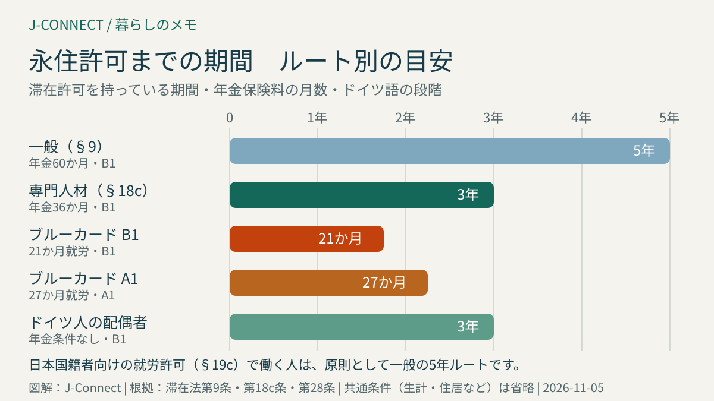
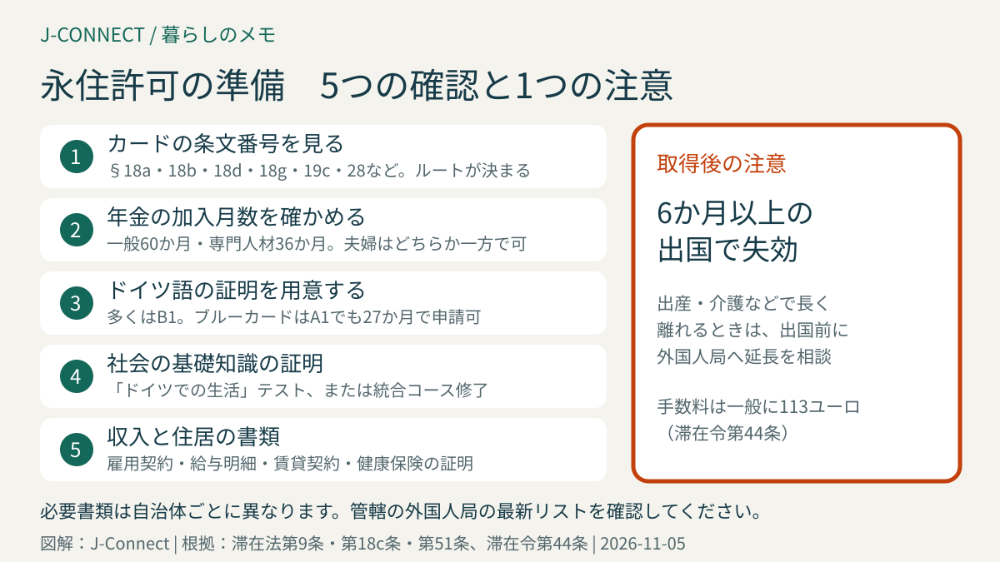

# ドイツの永住許可（Niederlassungserlaubnis）｜5年・3年・21か月の条件、日本人が確認したい点、失効の注意

ドイツに長く住むと、期限のある滞在許可を何度も更新する代わりに、期限のない「永住許可（Niederlassungserlaubnis）」を申請できるようになります。この記事は、ドイツで働く日本人とその家族に向けて、何年住めば申請できるのか、ドイツ語や年金の条件、日本国籍者が特に確認したい点、取得後に失効するケースを、滞在法の条文に沿って整理します。読み終えると、自分がいつ申請できそうか、そのために今から何を準備すればよいかが分かります。

## まず結論：基本は5年、例外で3年・21か月

永住許可の条件は、今持っている滞在許可の種類で変わります。代表的な5つのルートは次のとおりです。

| ルート | 滞在許可を持っている期間 | 年金保険料 | ドイツ語 | 根拠 |
| --- | --- | --- | --- | --- |
| 一般 | **5年** | 60か月 | B1 | 滞在法第9条 |
| 専門人材（大学卒・職業資格） | **3年**（ドイツの大学・職業教育を修了した人は2年） | 36か月（同24か月） | B1 | 滞在法第18c条第1項 |
| EUブルーカード | ブルーカードでの就労**27か月** | 同じ期間 | A1 | 滞在法第18c条第2項 |
| EUブルーカード（B1あり） | ブルーカードでの就労**21か月** | 同じ期間 | B1 | 滞在法第18c条第2項 |
| ドイツ人の配偶者 | **3年** | 条件なし | B1 | 滞在法第28条第2項 |

どのルートでも、生計が自分の収入で成り立っていること、住居が十分であること、重大な違反歴がないことなどの共通条件があります。表の期間を満たしても自動的に切り替わるわけではなく、外国人局への申請が必要です。

## 日本人が最初に確認したい「カードの条文」

専門人材の3年ルートは、滞在法第18a条・第18b条・第18d条・第18g条のいずれかに基づく滞在許可を持っている人が対象です。ところが、日本国籍者は、就労令第26条の「日本など特定の国の国籍者はどんな仕事にも就労許可を出せる」という規定を使い、**滞在法第19c条**の滞在許可で働いていることがよくあります。

この場合、仕事の内容が専門的でも、専門人材の3年ルートやブルーカードのルートは使えず、原則として**一般の5年ルート**になります。日本の会社からの派遣で、企業内転勤用の許可（ICTカード）を持っている人も、条件が異なります。

まず、電子滞在カード（eAT）の裏面や補足の紙に書かれた「§」で始まる条文番号を確認してください。

- **§ 18a・18b・18d**：専門人材のルート（3年）を検討できます
- **§ 18g**：EUブルーカードのルート（21か月または27か月）を検討できます
- **§ 19c**：一般のルート（5年）が基本です
- **§ 28**：ドイツ人の家族のルート（3年）を検討できます
- **§ 30**などの家族の呼び寄せ：一般のルートが基本です。専門人材の配偶者には別の特例があります（下記）

途中で許可の種類が変わった人は、どの期間が数えられるかの判断が複雑になります。申請前に外国人局へ確認してください。ブルーカードへの切り替えを考えている人は、[ドイツのEUブルーカードとは](/germany/ja/living/eu-blue-card-germany/)も参考になります。

## 共通の条件を一つずつ確認する

滞在法第9条第2項は、一般ルートの条件を9つ挙げています。専門人材やブルーカードのルートも、その多くを準用します。

### 生計が成り立っている

家族を含めて、生活保護や求職者向けの給付に頼らずに暮らせることが必要です。雇用契約書と直近の給与明細で示すのが一般的です。試用期間中や、契約の終わりが近い場合は、審査で詳しく確認されることがあります。

### 年金保険料を払った期間

一般ルートでは、ドイツの公的年金に**60か月分**の保険料を払っていることが必要です。専門人材ルートは36か月、ブルーカードはその就労期間分です。年金の加入記録は、ドイツ年金保険から届く年金の加入記録の通知で確認できます。

条文には、公的年金の代わりに「比べられる保障」への支払いでもよいという規定があります。日独社会保障協定によって日本の年金に加入したまま派遣されている人は、この扱いになるかを外国人局へ確認してください。協定のしくみは[日独社会保障協定と年金](/germany/ja/living/japan-germany-social-security-pension/)で説明しています。

夫婦で暮らしている場合、年金と就労許可の条件は、どちらか一方が満たせばよいとされています（滞在法第9条第3項）。

### ドイツ語の力

滞在法第2条で、ドイツ語の段階は欧州共通の基準に合わせて決められています。

| 法律上の表現 | 段階 |
| --- | --- |
| 簡単なドイツ語の知識 | A1 |
| ある程度のドイツ語の知識 | A2 |
| 十分なドイツ語の知識 | B1 |
| よいドイツ語の知識 | B2 |

一般ルートと専門人材ルートは**B1**が必要です。証明には、公認の語学試験の合格証や、移民向けの統合コースの修了証を使います。ブルーカードは、A1なら27か月、B1なら21か月で申請できます。

統合コースを修了すると、ドイツ語と次の「社会の基礎知識」の両方を満たしたものとして扱われます。ドイツ語の学び方は[A1から生活で困らないレベルを目指すドイツ語ルート](/germany/ja/learn-german/a1-daily-life-german-route/)や[VHSのドイツ語コース](/germany/ja/learn-german/vhs-german-course-guide/)を参考にしてください。

### 社会・法律の基礎知識

ドイツの法律や社会のしくみ、暮らしの基本を知っていることが条件です。一般的には、移民向けの「ドイツでの生活」テスト（Leben in Deutschland）の合格証で示します。ブルーカードのルートでも必要です。

### 住居が十分であること

家族の人数に対して十分な広さの住居に住んでいることが条件です。賃貸契約書と、大家が出す入居証明を求められることがあります。広さの具体的な基準は州や自治体によって扱いが異なります。

### そのほか

重大な犯罪歴などがないこと、働く人は就労が認められていること、仕事に必要な許可（医師免許など）を持っていることも条件です。

## 期間の数え方：日本への一時帰国や留学期間

滞在法第9条第4項には、5年などの期間の数え方についての決まりがあります。

- 1回あたり**6か月までの国外滞在**で、滞在許可が失効しなかったものは、期間に含めて数えられます。
- ドイツの大学での**留学期間や職業教育の期間は半分**として数えます。
- 以前に永住許可を持っていた人が再びドイツに来た場合、前の期間を最大4年まで数えられることがあります。

ドイツに来てから一度もビザが切れていないか、つまり更新を期限内に申請していたかも確認されます。更新の手続きは[ドイツの滞在許可を申請・更新する方法](/germany/ja/living/residence-permit-renewal-germany/)にまとめています。

## 家族の永住許可

### ドイツ人の配偶者

ドイツ人と結婚してドイツで暮らしている人は、3年間滞在許可を持ち、夫婦の共同生活が続いていて、B1のドイツ語がある場合、原則として永住許可を受けられます（滞在法第28条第2項）。年金の条件はありません。

### 専門人材の配偶者

配偶者が専門人材のルート（滞在法第18c条）で永住許可を得ている場合、本人も3年間滞在許可を持ち、**週20時間以上働いている**などの条件を満たせば、永住許可を受けられます（滞在法第9条第3a項）。働いていない場合は、一般のルートを検討します。

### 子ども

子どもの永住許可には、年齢やドイツでの通学歴に応じた別の規定があります。家族全員で申請するときは、外国人局の予約時に子どもの分も申請したいと伝えてください。家族の呼び寄せ全体は[家族をドイツに呼び寄せるとき](/germany/ja/living/family-reunification-spouse-work-germany/)で説明しています。

## 「EU長期滞在許可」との違い

永住許可とよく似た制度に、EUの指令に基づく「EU長期滞在許可（Erlaubnis zum Daueraufenthalt – EU）」があります（滞在法第9a条）。こちらも期限がなく、5年の滞在、B1のドイツ語、社会の基礎知識などが条件です。

違いは、ほかのEU加盟国へ移って働く・住むときの手続きが一部簡単になる点です。一方で、一時的な目的の滞在とされる許可（短期の就労など）では対象外になる場合があります。ドイツ以外のEU諸国へ移る可能性がある人は、どちらが自分に合うかを外国人局に相談してください。

## 永住許可でも失効することがある

永住許可は期限がありませんが、**ドイツを離れて6か月以内に戻らない場合は失効**します（滞在法第51条第1項第7号）。日本への本帰国のように、戻るつもりのない出国でも失効します。

- 出産・介護・日本での長期勤務などで6か月以上離れる予定があるときは、**出国前に外国人局へ申し出て、より長い期限を認めてもらえるか**確認します。一時的な理由の場合、長い期限が認められることが一般的です。
- ドイツに15年以上合法的に住み、生計が成り立っている人などは、6か月を超えても失効しない特例があります。
- EUブルーカードそのものは、国外滞在の期限が12か月と長く決められています。

本帰国の手続き全体は[ドイツから本帰国するときの手続き](/germany/ja/living/returning-to-japan-checklist/)で確認できます。

## 申請の流れと費用

1. **管轄の外国人局を確認する**：住民登録をしている市や郡の外国人局が担当です。デュッセルドルフ市など多くの自治体では、オンラインの申請フォームや予約システムを使います。
2. **書類をそろえる**：一般的には、パスポート、現在の電子滞在カード、生体認証用の写真、雇用契約書と直近の給与明細、年金の加入記録、ドイツ語の証明、社会の基礎知識の証明、賃貸契約書、健康保険の加入証明などです。自治体ごとにリストが公開されているので、必ず最新版を使います。
3. **申請・面談**：書類を確認し、指紋を採取します。書類が足りないと追加で求められます。
4. **新しいカードを受け取る**：電子滞在カードが作られ、数週間後に受け取ります。

永住許可の手数料は、一般的な場合**113ユーロ**です（滞在令第44条）。自営業者は124ユーロ、高度専門人材の特例は147ユーロです。

今の滞在許可の期限が近い場合は、永住許可の申請中でも、期限内に申請を出しておくことが大切です。申請中の扱いについては、[滞在許可の更新記事の「審査中であることを示す証明」](/germany/ja/living/residence-permit-renewal-germany/)を確認してください。

## ドイツ国籍の取得とは別の制度

永住許可は、日本国籍のままドイツに期限なく住める許可です。ドイツ国籍の取得（帰化）は別の制度で、ドイツの国籍法では原則として5年の合法的な滞在や、期限のない滞在権を持っていることなどが条件です。

日本の国籍法では、自分の意思で外国の国籍を取得すると、日本の国籍を失います（国籍法第11条第1項）。ドイツが二重国籍を認めるようになっても、日本側のこの扱いは変わりません。国籍の取得を考える場合は、日本の在外公館や専門家に必ず確認してください。

## よくある質問

### 5年たったら、更新の代わりに永住許可を申請すればよいですか？

条件をすべて満たしていれば、更新の時期に永住許可を申請できます。ドイツ語や「ドイツでの生活」テストの証明が間に合わない場合は、通常の更新をしてから、準備ができた段階で永住許可を申請する人もいます。

### 夫婦の一方がドイツ語B1を持っていません。

ドイツ語と社会の基礎知識の条件は、夫婦それぞれに必要です。年金と就労許可の条件と違い、一方が満たせばよいというものではありません。病気や障害で証明できない場合などには例外があります。

### 日本に一時帰国していた期間は数えられますか？

1回あたり6か月までで、滞在許可が失効していなければ、原則として期間に含まれます。長期の帰国があった人は、出入国の記録を整理しておきましょう。

## 外国人局での会話が不安なら

予約の取り方や窓口での伝え方は、[外国人局で使うドイツ語](/germany/ja/learn-german/auslaenderbehoerde-residence-phrases/)にまとめています。

## 関連記事

- [ドイツの滞在許可を申請・更新する方法](/germany/ja/living/residence-permit-renewal-germany/)
- [ドイツのEUブルーカードとは](/germany/ja/living/eu-blue-card-germany/)
- [日独社会保障協定と年金](/germany/ja/living/japan-germany-social-security-pension/)
- [家族をドイツに呼び寄せるとき](/germany/ja/living/family-reunification-spouse-work-germany/)
- [ドイツから本帰国するときの手続き](/germany/ja/living/returning-to-japan-checklist/)

## 公式情報・参考ソース

- [滞在法第9条：永住許可（一般の条件）](https://www.gesetze-im-internet.de/aufenthg_2004/__9.html)
- [滞在法第18c条：専門人材・EUブルーカード保持者の永住許可](https://www.gesetze-im-internet.de/aufenthg_2004/__18c.html)
- [滞在法第28条：ドイツ人の家族](https://www.gesetze-im-internet.de/aufenthg_2004/__28.html)
- [滞在法第9a条：EU長期滞在許可](https://www.gesetze-im-internet.de/aufenthg_2004/__9a.html)
- [滞在法第51条：滞在許可の失効](https://www.gesetze-im-internet.de/aufenthg_2004/__51.html)
- [滞在法第2条：ドイツ語能力の段階](https://www.gesetze-im-internet.de/aufenthg_2004/__2.html)
- [滞在法第19c条：資格によらない就労](https://www.gesetze-im-internet.de/aufenthg_2004/__19c.html)
- [就労令第26条：日本国籍者などの就労](https://www.gesetze-im-internet.de/beschv_2013/__26.html)
- [滞在令第44条：永住許可の手数料](https://www.gesetze-im-internet.de/aufenthv/__44.html)
- [ドイツ国籍法第10条：帰化の条件](https://www.gesetze-im-internet.de/stag/__10.html)
- [連邦政府の専門人材向けポータル：ビザと滞在](https://www.make-it-in-germany.com/en/visa-residence)
- [デュッセルドルフ市：外国人局のお知らせ](https://www.duesseldorf.de/auslaenderamt/aktuelles)
- [日本の国籍法（e-Gov法令検索）](https://laws.e-gov.go.jp/law/325AC0000000147)

**参照日：2026年11月5日。** 滞在に関する法律は改正が続いており、運用も外国人局ごとに異なります。この記事は一般的な情報で、個別の法的助言ではありません。申請前に必ず管轄の外国人局の最新の案内を確認し、複雑な事情がある場合は専門の弁護士などに相談してください。
