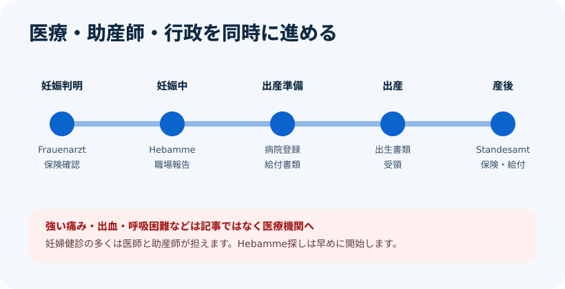
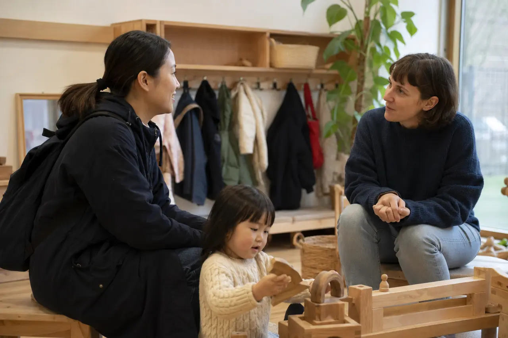

# ドイツで妊娠・出産する日本人へ｜病院選び・産休・出生届を時期順に

この記事は、ドイツで妊娠・出産を迎える日本人家庭が、妊娠判明から産後までの全体像を理解するためのガイドです。婦人科、助産師、出産施設、健康保険、職場、ドイツと日本の出生届がそれぞれ何を担うかを説明します。母体と赤ちゃんの安全を中心に、家族が必要な時期に必要な相手へつながるために使ってください。2026年にデュッセルドルフ近郊で出産準備をしたJ-Connect編集部メンバーの記録（出産予定日の証明の提出、家族の予防接種、日本語の両親学級）も、実例として載せています。

## まず結論

- 何を：妊娠が分かったら婦人科を予約し、助産師、出産する病院を順に決める。出産予定日の証明（Muster 3）が出たら、健康保険者と勤務先に出す。
- いつまでに：産前の保護期間は出産予定日の**6週間前**から、産後は**8週間**（母性保護法第3条）。育児休業は始める**7週間前**までに勤務先へ通知する。手紙のほか、メールなどのテキスト形式でもよい。赤ちゃんと同居する家族の百日咳の予防接種は、出産の**4週間前**までが目安。
- どこで：婦人科（妊婦健診）、助産師（妊娠中と産後）、出産施設、健康保険者、勤務先。家族の予防接種はかかりつけ医（Hausarzt）。
- 費用：公的保険に本人として加入している会社員は、保護期間中に保険者から1日最大13ユーロの出産手当を受け、手取りとの差を勤務先が補う（社会法典第5編第24i条）。

## 今の時期から、次にすることを選ぶ

| 時期 | 先に決めること | 詳しく確認する記事 |
| --- | --- | --- |
| 妊娠が分かったら | 婦人科の予約、保険の範囲、産後の助産師探し | このページの医療・助産師の項目と[健康保険ガイド](/germany/ja/living/health-insurance-guide/) |
| 出産前 | 出産施設、職場への通知、親の出生・婚姻書類、退院時の移動手段 | [出生登録などの書類準備](/germany/ja/living/birth-procedures-germany/)と[ベビーカー・車用シートの選び方](/germany/ja/living/stroller-buying-guide-germany/) |
| 陣痛・破水から出産当日 | 連絡先、医療者の指示、付き添いの役割 | [出産当日ガイド](/germany/ja/living/birth-day-germany/) |
| 出生直後から | 退院後の健診、出生証明書、子の保険、給付、日本の出生届 | [出産後の手続きガイド](/germany/ja/living/birth-procedures-germany/) |
| 保育と復職を考えたら | 開始希望日、必要時間、自治体への申込み | [保育園・U3申込みガイド](/germany/ja/living/kita-u3-tagesmutter-guide/) |

## あなたはどのケース？

| あなたの状況 | 違うところ | 確認すること |
| --- | --- | --- |
| 公的保険に本人として加入する会社員 | 出産手当は保険者から、差額は勤務先から | 出産予定日の証明を保険者と勤務先の両方に出す |
| 家族加入・民間保険・自営業・ミニジョブ | 出産手当の仕組みが違う。自営業は所得保障が自動で付かないことがある | 加入先に、産前産後の所得保障を妊娠初期に確認 |
| 駐在（日本の社会保険を継続） | ドイツの出産手当ではなく、日本側の制度の対象になる場合がある | 勤務先の人事と日本の健康保険組合に確認 |
| 配偶者が外国籍 | 出生届で、配偶者の国の書類の原本・翻訳・認証が要る | [ドイツ出産の手続き完全ガイド](/germany/ja/living/birth-procedures-germany/)の国際結婚の項目 |
| 日本語で出産準備をしたい | 日本語の両親学級は数が少なく、中止になることもある | ドイツ語の講座やオンラインの日本語講座も候補にしておく |

## 手順

1. 妊娠が分かったら：婦人科を予約し、妊婦健診の記録（Mutterpass）を受け取る。健康保険の範囲を確認する。
2. 妊娠初期〜中期：産後に来てもらう助産師を探す。都市部では早く埋まるため、妊娠が分かったら探し始める。
3. 妊娠中期：出産する病院を選び、必要なら事前登録する。勤務先に妊娠と予定日を伝える。
4. 出産予定日の証明が出たら：婦人科や助産師が出す出産予定日の証明（Muster 3）を、健康保険者へ出産手当の申請として出し、勤務先にも写しを出す。
5. 出産の4週間前まで：赤ちゃんと暮らす家族で、最後の百日咳の予防接種から10年以上たっている人は、かかりつけ医で接種する（G-BAの予防接種指針）。詳しくは「[出産前に家族が受ける予防接種](/germany/ja/living/family-vaccination-before-birth-germany/)」。
6. 出産前：両親学級、出産時の持ち物、退院時のチャイルドシート、親の書類（出生届用）を準備する。新生児用品は「[ドイツ語の商品名つき・新生児用品チェックリスト](/germany/ja/living/newborn-items-checklist-germany/)」を使うと売り場で探しやすい。
7. 出産後：出生届、子の健康保険、育児給付、児童手当、日本の出生届（3か月以内）を家族で分担して進める。

医療と書類の担当を分け、各記事は必要な段階で開いてください。[家族・子育ての案内ページ](/germany/ja/living/routes/family/)からも時期別に選べます。

## 日本と違うのは、役割が分かれていること

ドイツでは、妊婦健診を行う婦人科、妊娠中と産後を支える助産師、実際に出産する病院や助産院が、別々であることが一般的です。一つの施設が妊娠から産後まで自動的に担当するとは限りません。

この分業は複雑に見えますが、それぞれに役割があります。婦人科は医学的な経過を確認し、助産師は生活や授乳、産後の回復を支え、出産施設は分娩を担います。三者の連絡先を早めに持つことが、安心の土台になります。

## 妊娠が分かったら最初にすること

### 婦人科を予約する

自宅の検査で妊娠が分かったら、婦人科へ連絡します。初診の時期は、最終月経、症状、既往歴によって判断されます。強い腹痛、大量の出血、失神などがある場合は、通常予約を待たず医療機関へ相談してください。

都市部では新規患者を受け付けていない診療所もあります。見つからないときは、健康保険者の検索、診療予約サービスの116117、近隣の病院を利用します。受診の基本は[病院予約ガイド](/germany/ja/living/doctor-appointment-germany/)で説明しています。

### 妊婦健診の記録を受け取る

妊娠が確認されると、診察結果、血液検査、出産予定日などを記録する**妊婦健診記録（Mutterpass）**が渡されます。これは母子手帳と似た役割を持ちますが、日本の母子健康手帳そのものではありません。

救急受診や旅行中にも経過を伝えられるよう、妊娠中は携帯します。紛失に備えて、個人情報の扱いに注意しながら主要ページの写しを安全に保存しておきましょう。

### 健康保険の範囲を確認する

公的保険では、標準的な妊婦健診、助産師支援、出産などが給付の対象です。一方、追加の超音波検査、出生前検査、個室などは、医学的必要性や契約によって自費になる場合があります。

民間保険や短期保険では、契約ごとに待機期間、上限、妊娠・出産の扱いが違います。「病院で使える」と聞くだけでなく、どの検査と施設が対象かを書面で確認します。

## 助産師は、妊娠と産後の生活をつなぐ人

助産師（Hebamme）は、妊娠中の相談、出産準備、産後の家庭訪問、授乳、赤ちゃんの体重、母体の回復などを支えます。公的保険では一定の助産師サービスが給付されますが、利用枠は地域によって早く埋まります。

特に産後の家庭訪問を希望する場合は、出産施設が決まる前でも探し始めて構いません。候補には、対応地域、出産予定時期、希望する支援、健康保険を短く伝えます。

助産師との関係は、正解を教えてもらうだけのものではありません。授乳や睡眠、産後の過ごし方について日本と異なる助言を受けたら、理由を聞き、自分と赤ちゃんに合う方法を一緒に考えます。

## 赤ちゃんの移動用品を準備する

ベビーカーは、散歩用の寝台と車用の乳児シートの役割を分けて選びます。自宅での保管、車への積み込み、必要な接続部品を確認する手順は、[ドイツのベビーカーの選び方・5点セット図解](/germany/ja/living/stroller-buying-guide-germany/)にまとめています。

## 出産する場所を選ぶ

出産場所には、病院、助産師が運営する出産施設、自宅出産などがあります。持病、妊娠経過、過去の出産、緊急時の対応を踏まえ、婦人科や助産師と相談します。

病院を選ぶときは、単に家から近いかだけでなく、次を見ます。

- 周産期医療や新生児医療の体制
- 無痛分娩など希望する鎮痛方法
- パートナーの立会い
- 産後の部屋と母子同室の考え方
- 多言語対応や、必要時の通訳相談
- 出産前登録の時期と説明会

「希望どおりの出産」を計画することは大切ですが、出産時の安全に応じて方法が変わる余地も残します。希望は優先順位を付け、譲れない点と状況に応じて変えられる点を医療者と共有します。

## 妊娠中の仕事と産前産後の保護

妊娠を職場へ伝える時期に一律の正解はありません。ただし、夜勤、重量物、感染、高温、化学物質など仕事上の危険がある場合は、早めに伝えることで職場が安全対策を取れます。雇用主が妊娠証明を求めた場合、その証明費用は原則として雇用主が負担します。

産前産後保護（Mutterschutz）の期間は、通常、出産予定日の六週間前から出産後八週間までです。産前は本人が明確に希望すれば働けますが、その意思は撤回できます。産後は原則として就業できません。早産、多胎、障害のある子どもの出生などでは、産後期間が十二週間になる場合があります。

2025年6月からは、妊娠十三週以降の流産にも段階的な保護期間が設けられています。該当する場合は、心身の回復を優先し、医師、職場、健康保険へ確認してください。

## 産前産後の所得をどう支えるか

公的保険に本人として加入して働く人は、通常、産前産後の保護期間に保険者から一日最大13ユーロの出産手当を受け、従前の手取りとの差を雇用主が補います。家族加入、民間保険、自営業、少額雇用などでは仕組みが異なります。

出産予定日の証明が発行されたら、健康保険へ申請方法を聞きます。出産後は出生証明を追加提出します。自営業者は、休業時の所得保障が自動で付かないことがあるため、妊娠前または早い時期に契約を確認することが重要です。

## 育児休業と育児給付は別の制度

育児休業（Elternzeit）は、雇用関係を保ちながら仕事を休む権利です。各親が子ども一人につき最長三年取得でき、一部を八歳になる前までに取れます。現在これから生まれる子どもの育休を準備する場合、三歳の誕生日前の休業は開始の七週間前まで、三歳から八歳の誕生日前の休業は十三週間前までに雇用主へ通知します。メールなどのテキスト形式で通知でき、開始日・終了日と受領確認を残します。過去に生まれた子どもや急な早産などの扱いは、[連邦家族ポータルの通知案内](https://familienportal.de/familienportal/familienleistungen/elternzeit/faq/wann-und-wie-muss-ich-elternzeit-beantragen--124810)で確認してください。

育児給付（Elterngeld）は、子どもの出生後、収入の減少を補う給付です。休業を取らなくても条件を満たせば受けられますが、受給中の就労は原則週32時間までです。課税所得が17万5,000ユーロを超える親・世帯は対象外です。金額の計算例や分け方は「[ドイツの育児給付（Elterngeld）の計算と受け取り方](/germany/ja/living/elterngeld-guide-germany/)」で説明しています。

二つは期間の数え方も違います。育児給付は誕生日を起点とする「生活月」で計算され、申請前に遡って支払われるのは最大三生活月です。夫婦で取得を分ける場合は、雇用主への通知と給付の月を一緒に設計します。

## 出産後、ドイツで行うこと

### 出生の登録

出生は、出生地を管轄する戸籍登録所へ一週間以内に届け出ます。病院や出産施設で生まれた場合は、施設が出生の通知を行うのが一般的ですが、親が必要書類を提出しなければ出生証明書は発行されません。

外国籍の親には、パスポート、出生証明、婚姻証明などの原本と認証・翻訳を求められる場合があります。未婚の親では、父親の認知や共同親権の書類が関係します。必要書類は家族構成と出生地で違うため、出産前に管轄窓口の一覧を確認します。

出生証明書は、健康保険、出産手当、育児給付、児童手当などに使います。用途別の無料証明が発行されることもあるので、窓口で目的を伝えます。

### 子どもの健康保険と小児科

出生後は、親の健康保険者へ子どもの加入を申請します。公的保険の家族加入が可能でも、自動登録ではありません。両親の保険の種類と収入により、子どもの加入先が変わる場合があります。

退院後の健診と予防接種を担う小児科も早めに探します。都市部では新規患者枠が限られるため、出産前に「出生後に受け入れ可能か」を確認して構いません。

退院時には、赤ちゃんの[U2健診（通常、生後3～10日）](https://www.kindergesundheit-info.de/themen/frueherkennung-u1-u9-und-j1/untersuchungen-u1-bis-u9/u2-untersuchung/)が済んでいるか、未実施の検査をいつ・どこで受けるかを医療者に確認します。自宅出産や早い退院では、家族が速やかに予約する必要があります。[U3健診は通常、生後4～5週](https://www.kindergesundheit-info.de/themen/frueherkennung-u1-u9-und-j1/untersuchungen-u1-bis-u9/u3-untersuchung/)で、出生後早めに小児科へ連絡します。書類がそろうのを待たず、受診の手配と保険手続きを並行してください。

### 育児給付と児童手当

育児給付は、出生証明、収入資料、雇用主の証明などをそろえて、子どもの居住地を管轄する窓口へ申請します。児童手当は別制度で、原則として連邦雇用庁の家族給付窓口へ申請します。

外国籍の親は、在留資格によって対象条件が変わります。家族の一人に任せきりにせず、どの給付を誰の名義で、いつまでに申請するかを共有します。

出生証明書、子どもの保険、育児給付・児童手当、日本の出生届、国籍・旅券・滞在許可を実際に進めるときは、[ドイツ出産の手続き完全ガイド](/germany/ja/living/birth-procedures-germany/)の時系列図とチェックリストを利用してください。

## 日本側の出生届は三か月以内

日本国籍の親は、ドイツでの手続きとは別に、日本の大使館・総領事館または本籍地の市区町村へ出生届を提出します。期限は出生の日を含めて三か月以内です。

子どもが出生により外国籍も取得した場合は、出生届で日本国籍を留保する意思を期限内に表示しなければ、出生時に遡って日本国籍を失う可能性があります。これは後回しにできない重要な期限です。管轄公館の最新案内で、国籍、氏名、必要書類を必ず確認してください。

## 産後は「手続きを分担する」

産後は、母体の回復と赤ちゃんの世話だけで一日が終わります。出生証明、健康保険、給付、日本側の届出を一人で抱えないよう、出産前に担当を決めます。

- 出産した人は回復、授乳、医療相談を優先する
- パートナーや家族は、書類、郵便、保険、給付を担当する
- 原本を持ち出す人と、提出状況を記録する人を決める
- 困ったときは助産師、産院、自治体の家族相談へつながる

産後の気分の落ち込み、不安、不眠が強い場合は、「よくあること」と我慢せず、助産師、婦人科、家庭医へ相談します。家族も、本人の食事と睡眠が取れているかを見守ります。

## 保育は妊娠中から情報だけ集める

保育先をすぐ決める必要はありませんが、復職予定がある家庭は、居住自治体の申込時期だけ妊娠中に確認しておきましょう。施設保育と家庭的保育の違い、子どもの慣らし方は[ドイツの保育先探し](/germany/ja/living/kita-u3-tagesmutter-guide/)で説明しています。

このあとの「そのまま使えるドイツ語」に、助産師探しと予防接種の予約で使う文を載せています。ほかの場面の言い回しは[子育てで使うドイツ語](/germany/ja/learn-german/parenting-phrases/)にまとめています。

## 落とし穴

- 助産師を探し始めるのが遅い：産後の訪問をしてくれる助産師は、地域によって早く埋まる。妊娠が分かったら探し始める。
- 出産予定日の証明を片方にしか出さない：出産手当は保険者、差額の補てんは勤務先が払う。証明は両方に必要になる。
- 家族の予防接種をどこで受けるか分からない：父親など家族の接種は婦人科ではなく、自分のかかりつけ医で受ける。百日咳は出産の4週間前までが目安なので、予約が遅れると間に合わない。
- 日本語の講座だけに頼る：日本語の両親学級は参加者が集まらず中止になることがある。早めに申し込み、代わりの講座も決めておく。
- 日本国籍の留保を忘れる：子が出生で外国籍も得る場合、日本の出生届で3か月以内に留保しないと日本国籍を失う。

## そのまま使えるドイツ語

| 場面 | ドイツ語 | 日本語 |
| --- | --- | --- |
| かかりつけ医で接種を予約する | Guten Tag, meine Frau ist schwanger. Ich möchte mich gegen Keuchhusten und Grippe impfen lassen. Kann ich einen Termin bekommen? | こんにちは、妻が妊娠しています。百日咳とインフルエンザの予防接種を受けたいです。予約できますか。 |
| 保険者に証明を送る | Anbei sende ich Ihnen das Zeugnis über den mutmaßlichen Tag der Entbindung für den Antrag auf Mutterschaftsgeld. | 出産手当の申請のため、出産予定日の証明を添付します。 |
| 両親学級を聞く | Gibt es noch freie Plätze im Geburtsvorbereitungskurs für Paare? | カップル向けの出産準備クラスに、まだ空きはありますか。 |

助産師への問い合わせメール：

> 件名：Anfrage Wochenbettbetreuung – ET [Datum]
> Sehr geehrte Frau [Name],
> ich bin in der [Zahl]. Schwangerschaftswoche, der errechnete Geburtstermin ist der [Datum]. Wir wohnen in [Stadtteil/PLZ].
> Hätten Sie Kapazität für die Wochenbettbetreuung nach der Geburt? Ich spreche Japanisch und etwas Deutsch/Englisch.
> Mit freundlichen Grüßen
> [Name]

和訳：件名「産後ケアの問い合わせ（出産予定日〇月〇日）」。妊娠〇週で、出産予定日は〇月〇日です。〇〇（地区・郵便番号）に住んでいます。出産後の産褥期のケアをお願いできる余裕はありますか。日本語と、少しドイツ語・英語を話します。

## 在住者の実例

J-Connect編集部メンバーの実例（2026年、デュッセルドルフ近郊）。

| したこと | 結果・回答 |
| --- | --- |
| 出産予定日の証明（Muster 3） | 婦人科で受け取り、保険者に出産手当の申請として提出した |
| 家族の予防接種 | 出産前に、父親が百日咳とインフルエンザの予防接種をかかりつけ医（Hausarzt）で受けた |
| 日本語の両親学級 | 申し込んだ日本語の出産準備コースが中止になった |

G-BAの予防接種指針（2026年10月29日施行版）では、新生児と同居する家族の百日咳の接種が明記されています。インフルエンザは妊婦本人への接種が明記されている一方、新生児の家族は明記されていないため、保険でカバーされるかは保険者や医師に確認してください。

## まとめ

ドイツの妊娠・出産では、婦人科、助産師、出産施設が異なる役割を持ち、医療、仕事、行政の手続きが並行します。妊娠初期に三者への入口を作り、出産前に職場と所得保障を整理し、産後はドイツと日本の出生届を家族で分担するのが全体の流れです。制度を完璧に覚えるより、体調の変化を相談できる相手と、期限のある届出を見失わない仕組みを持つことが大切です。

## 公式情報・参考ソース

- [母性保護法第3条：産前6週・産後8週の保護期間](https://www.gesetze-im-internet.de/muschg_2018/__3.html)（2026年11月14日確認）
- [社会法典第5編第24i条：出産手当、1日最大13ユーロ、出産予定日の証明](https://www.gesetze-im-internet.de/sgb_5/__24i.html)（2026年11月14日確認）
- [育児給付・育児休業法第16条：育休は7週間前・13週間前までに通知](https://www.gesetze-im-internet.de/beeg/__16.html)（2026年11月14日確認）
- [育児給付・育児休業法第1条第8項：課税所得17万5,000ユーロ超は対象外](https://www.gesetze-im-internet.de/beeg/__1.html)（2026年11月14日確認）
- [G-BA 予防接種指針（2026年10月29日施行）](https://www.g-ba.de/richtlinien/60/)：妊婦の百日咳・インフルエンザ、新生児の家族の百日咳（2026年11月14日確認）
- [連邦家族ポータル：産前産後の保護](https://familienportal.de/familienportal/familienleistungen/mutterschutz)：産後8週間（多胎・早産などは12週間）（2026年11月15日確認）
- [ドイツ連邦家族ポータル：出産手当](https://familienportal.de/familienportal/familienleistungen/mutterschaftsleistungen)：1日の手取りが13ユーロを超える分は勤務先が補う（2026年11月15日確認）
- [ドイツ連邦家族ポータル：育児休業の通知](https://familienportal.de/familienportal/familienleistungen/elternzeit/faq/wann-und-wie-muss-ich-elternzeit-beantragen--124810)：3歳前は7週間前、3〜8歳は13週間前まで。テキスト形式（署名のない手紙やメール）で通知できる（2026年11月15日確認）
- [ドイツ連邦家族ポータル：育児給付の申請](https://familienportal.de/familienportal/familienleistungen/elterngeld/faq/wie-kann-ich-elterngeld-beantragen--124762)：申請は出生後。さかのぼって支払われるのは最大3生活月（2026年11月15日確認）
- [ドイツ連邦家族ポータル：出生登録](https://familienportal.de/familienportal/lebenslagen/schwangerschaft-geburt/anmeldung-standesamt)：病院や出産施設で生まれた場合は、施設が戸籍登録所に通知し、出生の証明を送る（2026年11月15日確認）
- [在ドイツ日本国大使館：出生届](https://www.de.emb-japan.go.jp/itpr_ja/konsular_koseki04.html)（2026年11月14日はこの環境から開けず未確認）
- [BIÖG：U2健診](https://www.kindergesundheit-info.de/themen/frueherkennung-u1-u9-und-j1/untersuchungen-u1-bis-u9/u2-untersuchung/)：生後3〜10日（2026年11月15日確認）
- [BIÖG：U3健診](https://www.kindergesundheit-info.de/themen/frueherkennung-u1-u9-und-j1/untersuchungen-u1-bis-u9/u3-untersuchung/)：生後4〜5週。多くは小児科の診療所で受ける最初の健診（2026年11月15日確認）
