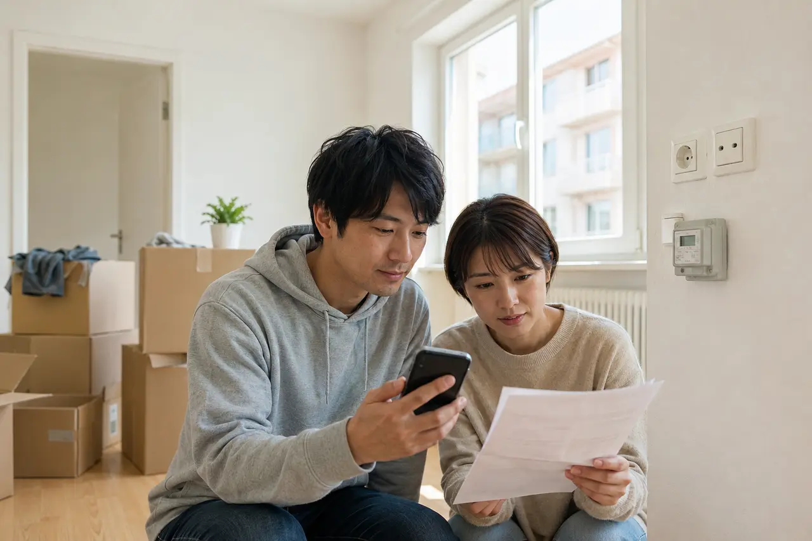

# ドイツの放送負担金（Rundfunkbeitrag・旧GEZ）とは？金額・同居・引っ越し・免除の手続き

ドイツには、テレビやラジオを持っているかにかかわらず、原則として住戸ごとに公共放送を支える負担金があります。この記事は、ドイツへ引っ越した人が「自分が新たに払うのか、同居人の登録に加わるのか」を判断し、手紙を放置せずに手続きするための案内です。読み終えると、制度の理由、金額、同居・学生寮・引っ越しでの違いが分かります。

## なぜ「テレビを持つ人」ではなく「住戸」が払うのか

この制度の正式名称は **Rundfunkbeitrag** で、日本語では放送負担金と説明できます。以前の徴収機関の名前から、今も「GEZ」と呼ぶ人がいます。公共テレビ、ラジオ、オンラインの報道・教育・文化番組を、広告や政府予算だけに依存せず支えるための仕組みです。

現在の制度は受信機の台数を数えるのではなく、「一つの住戸に一件」を基本にしています。スマートフォンしか使わない人、公共放送を見ない人も、原則として対象です。利用量への料金ではなく、公共放送を社会全体で利用可能にしておくための負担と考えると、制度の位置づけが分かりやすくなります。

## 金額と支払い単位

2026年10月31日時点の公式額は、一住戸あたり月18.36ユーロです。一人当たりではないため、夫婦や家族、共同生活で複数の大人が住んでいても、その住戸で一件を支払います。

支払いは、法律上3か月ごとです。1回の金額は55.08ユーロで、3か月の期間の真ん中の月の15日が期限になります。毎月払いは法律上の支払い方法ではありません（[放送負担金公式サイト](https://www.rundfunkbeitrag.de/presse-und-aktuelles/servicethemen/beitragsmythen-teil-1-ich-kann-den-rundfunkbeitrag-monatlich-zahlen-oder)）。

金額を算定する委員会（KEF）は、2027年1月1日から月18.64ユーロにすることを勧告しています。ただし、これは勧告で、実際に変わるには州の決定が必要です（[KEF](https://kef-online.de/presse/detail/kef-empfiehlt-deutlich-geringere-anhebung-des-rundfunkbeitrags)）。

公式サイトで口座引き落としなどの方法を選び、通知に記載された期限を確認します。家賃、電気代、インターネット料金とは別の制度であり、大家や通信会社へ払っていても自動的に含まれるわけではありません。

## 一人暮らし、家族、共同生活で何が違うか

| 住み方 | 基本的な考え方 |
| --- | --- |
| 一人暮らし | 自分の住戸として登録し、一件を負担 |
| 夫婦・家族 | 住戸内の一人が支払い、他の成人はその登録番号を伝える |
| 共同生活 | 誰か一人がその住戸で支払っているか確認し、重複を解消 |
| サブレット | 同じ住戸として扱われるか、独立した住戸かを確認 |
| 学生寮 | 部屋が独立した住戸と扱われるか、共同住戸の一室かで変わる |

同居人がすでに払っている場合、自分にも手紙が届くことがあります。住民登録の情報から自動的に連絡されるためです。そのときは、支払っている人の登録番号を使って、同じ住戸であることを回答します。

「誰かが払っているはず」と思い込むのが最も危険です。同居開始時に、登録している人の氏名、番号、いつからその住戸を担当しているかを確認してください。

## 学生寮では部屋の構造が重要

学生だから自動的に免除されるわけではありません。寮の一室が、共用廊下から直接入る独立した生活単位と見なされる場合、その部屋ごとに負担が生じることがあります。複数の個室が一つの玄関の内側にまとまる共同住戸なら、一件として扱われる場合があります。

寮の名称や契約の呼び方だけでは判断せず、部屋の構造と公式サイトの定義を照合します。管理会社が家賃と一緒に回収しているかどうかも確認してください。

## 手紙が届く理由と読む順番

住民登録をすると、登録情報が放送負担金の窓口へ提供され、住戸の支払い状況を確認する手紙が届くことがあります。これは直ちに「未払いの罰金」という意味ではありません。

まず、宛名、住所、対象期間、回答期限、問い合わせ番号を見ます。次に、自分が新たに登録するのか、同居人の既存登録へ結び付けるのかを判断します。手紙のサイトへアクセスするときは、広告や代行サイトではなく、必ず公式ドメインを使ってください。

## 2026年11月の全国住民データ照合

2026年11月8日を基準日として、自治体の住民登録情報と放送負担金事務局の登録情報を全国規模で照合します。対象はドイツに住民登録している18歳以上の人で、約7,300万件のデータが11月9日から12月8日まで段階的に送信される予定です。通知開始時期は、11月5日付のプレス発表と公式FAQが「12月14日ごろ」とする一方、同日付のサービス解説記事は「2027年1月から」としており、公式ページ間で差があります（2026年11月7日確認）。本文では発送日を断定せず、個別通知の回答期限を優先するよう案内します。

同じ住戸で家族や同居人がすでに支払っている場合、その人の支払者番号を回答します。オンラインフォームでは通知書の10桁の照会番号（Aktenzeichen）も必要です。郵送の返信用紙には照会番号があらかじめ印字されているため、支払者番号を記入します。手紙が届いたことだけで、同じ住戸に二件目の負担金が発生するわけではありません。通知書に記載された期限と送信完了の記録を保存します。

誰もその住戸の負担金を支払っていない場合は、入居日を基準に登録・請求される可能性があります。2026年の全国照合を通じた遡及登録は、公式FAQによると2024年1月1日より前にはさかのぼりません。免除・減額の要件を満たす場合は、証明書を添えて申請します。なお、照合開始日だけを理由に全員が先に申請する必要はなく、確認の手紙が届いた場合はその案内に従います。

照合は法律に基づく手続きであり、自治体からのデータ送信自体には異議を申し立てられません。未確認データは法律上、最長12か月で削除されます。すでに登録済みの住戸に結び付いた人のデータは、照合後に速やかに削除されると事務局は説明しています。

詳しい日程、手紙が届いた場合の回答方法、過去に回答済みでも再通知される可能性については、[2026年の全国住民データ照合ガイド](/germany/ja/events/news/rundfunkbeitrag-meldedatenabgleich-2026/)を参照してください。支払い状況は[公式の残高確認サービス](https://www.rundfunkbeitrag.de/kontostand)でも確認できます。

## 放置すると何が起きるか

回答しないままにすると、住戸の状況にもとづいて登録や請求が進み、未払い分、督促、執行手続きへ発展する可能性があります。内容に誤りがある場合も、放置するのではなく、同居開始日や既存の登録番号など根拠を示して訂正します。

支払いが難しい場合は、単に引き落としを止めず、免除・減額に該当するか、支払い方法を相談できるかを公式窓口へ確認します。

## 免除・減額は申請が必要

一定の公的給付を受ける人や、特定の重い障害がある人などは、免除または減額の対象になる場合があります。学生でも、学生支援給付を受けているなど所定の条件を満たし、証明書を添えて申請する必要があります。

「収入が少ない」「学生である」「テレビを見ない」だけでは、自動的に免除されません。対象条件、必要な証明、適用開始日を公式サイトで確認します。

## 引っ越し・同居開始・帰国

住民登録の住所を変えても、放送負担金の登録が自動的に最適な状態へ更新されるとは限りません。

- 一人暮らしから別の一人暮らしへ移る場合は、登録住所を変更
- 二人が同居を始める場合は、どちらの登録を残すか決める
- 支払っていた人が住戸を出る場合は、残る人が新しい担当者になる
- ドイツを完全に離れる場合は、住民登録の転出とあわせて解約を申請

退去日、新住所、同居人の登録番号などを準備し、手続き完了の確認を保存します。二重払いが起きた場合は、対象期間と二つの登録番号を明確にして問い合わせます。

## 言葉で困ったら

本文では制度を日本語で理解することを優先しています。手紙への回答や住所変更の表現は[行政手続きで使うドイツ語](/germany/ja/learn-german/behoerde-anmeldung-phrases/)を参照してください。

## よくある質問

### テレビを持っていなくても払う必要がありますか？

はい。受信機の有無ではなく、住戸ごとの負担です。スマートフォンしか使わない人や、公共放送を見ない人も原則として対象です。

### 夫婦や家族で住んでいる場合、人数分払いますか？

いいえ。一つの住戸につき一件です。住戸内の一人が支払い、ほかの大人は支払っている人の登録番号を伝えて、同じ住戸であることを回答します。

### 毎月払えますか？

法律上の支払いは3か月ごとで、1回55.08ユーロです。口座引き落としにしておくと、期限を忘れにくくなります。

### 学生は免除されますか？

学生であることだけでは免除されません。学生支援給付を受けているなど所定の条件を満たし、証明書を添えて申請した場合に免除の対象になります。

### 日本に帰国するときは？

住民登録の転出とあわせて、公式サイトから登録の解約を申請します。手続きが終わったことを示す確認は保存しておきます。

### 2026年の照合で日本人も対象になりますか？

ドイツに住民登録している18歳以上の人が対象です。公式FAQは国籍で対象を限定していないため、日本国籍の成人も対象に含まれます。

### 同居人がすでに支払っているのに手紙が届いたら？

同じ住戸の支払い担当者の支払者番号を確認し、公式フォームまたは返信用紙で回答します。手紙を無視せず、回答期限を守ってください。

### 過去の照合で回答済みでも、再び手紙が届くことはありますか？

あります。過去の照合後に一部の登録データが削除されている場合など、再び確認される可能性があると公式FAQは説明しています。今回の手紙にも回答してください。

## 公式情報

- [放送負担金公式サイト：市民向け案内](https://www.rundfunkbeitrag.de/buergerinnen-und-buerger/informationen)
- [放送負担金公式サイト：英語案内](https://www.rundfunkbeitrag.de/welcome/english)
- [放送負担金事務局：全国住民データ照合の開始（2026年11月5日）](https://www.rundfunkbeitrag.de/presse-und-aktuelles/presse/beitragsservice-startet-bundesweiten-meldedatenabgleich-2026)
- [放送負担金事務局：2026年の照合の質問と回答](https://www.rundfunkbeitrag.de/buergerinnen-und-buerger/informationen/informationen-zum-meldedatenabgleich/fragen-und-antworten-zum-bundesweiten-meldedatenabgleich)
- [放送負担金事務局：照合の手紙が届いたら（2026年11月5日）](https://www.rundfunkbeitrag.de/presse-und-aktuelles/servicethemen/ploetzlich-post-vom-beitragsservice-meldedatenabgleich-2026-das-muessen-sie-tun)
- [放送負担金州間協定第11条：住民登録データの照合](https://www.gesetze-bayern.de/Content/Document/RBeitrStV-11)

金額、免除要件、手続き画面は変わることがあります。実際の登録・変更・解約では公式サイトの最新案内を優先してください。
