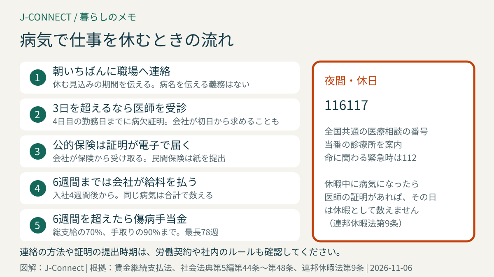
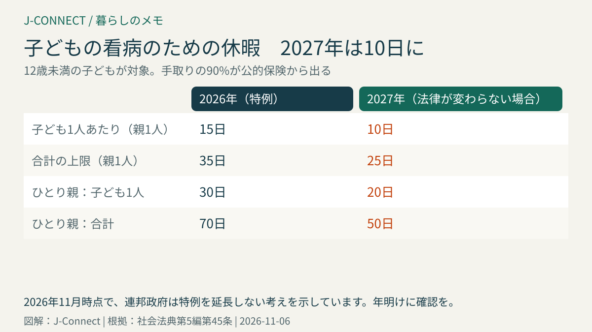

# ドイツで病気になって仕事を休むとき｜連絡と診断書、電子の病欠証明、6週間の給与、傷病手当金、子どもの看病休暇（2027年は10日に）

ドイツで働いていて体調を崩したとき、職場にいつ、どう連絡すればよいか、医師の証明は必要か、給料は減るのかと不安になる人は多いと思います。ドイツでは、病気で働けない間の連絡や証明のルールと、給料の保障が法律で決まっています。この記事は、ドイツで会社員やアルバイトとして働く日本人に向けて、休むときの手順、電子の病欠証明、6週間の給与の保障、その後の傷病手当金、子どもの看病で休むときのルールを整理します。読み終えると、病気の朝に何をすればよいかが分かります。

## まず結論：病気で休むときの要点

- **すぐに連絡**：働けないと分かったら、始業前などできるだけ早く職場に連絡し、休む見込みの期間を伝えます
- **医師の証明**：休みが3日を超えるときは、**4日目の勤務日までに**医師の病欠証明が必要です。会社が初日から求めることもあります
- **電子の証明**：公的健康保険の人は、医師が保険に送り、会社が電子で受け取ります。紙を会社に出す必要は原則ありません
- **給料**：会社が**最長6週間**、通常どおり給料を払います
- **6週間を超えたら**：公的保険から**傷病手当金**（総支給の70%、手取りの90%まで）が出ます
- **子どもの看病**：12歳未満の子どもの看病で休むと、公的保険から手当が出ます。2026年は子ども1人につき年**15日**ですが、2027年は**10日**に戻る見込みです

## 1. 職場への連絡

賃金継続支払法第5条により、働けなくなったら**すぐに**、働けないことと、休む見込みの期間を会社に伝える義務があります。病名を伝える義務はありません。

- 連絡の方法（電話、メール、チャットなど）や、連絡する相手は、労働契約や社内のルールで決まっていることが多いので、入社時に確認しておきます。
- 連絡が遅れたり、なかったりすると、注意や警告の対象になることがあります。
- 医師の証明より休みが長引くときは、もう一度連絡し、新しい証明を受けます。

## 2. 医師の病欠証明

休みが**3暦日を超える**とき（土日も数えます）は、医師の病欠証明（Arbeitsunfähigkeitsbescheinigung、略して「AU」）が必要です。証明は、遅くとも**次の勤務日**に提出できるようにします。会社は、初日から証明を求めることもできるので、労働契約や社内規定を確認してください。

### 公的保険の人は電子で届く

公的健康保険に入っている人は、医師が病欠の情報を保険に電子で送り、**会社が保険から電子で受け取る**しくみになっています。本人は、決められた日までに医師の診察を受け、会社に「受診した」と伝えれば十分です。控えとして紙の証明を受け取れるので、保管しておきましょう。

### 民間保険の人は紙で提出

民間の健康保険に入っている人や、日本の保険などに入っている人は、電子のしくみの対象外です。医師から紙の証明を受け取り、自分で会社に提出します。

### かかりつけ医がいない、言葉が不安なとき

軽い病気でも、受診の予約が取りにくいことがあります。かかりつけ医の探し方や予約の取り方は[ドイツで医師を探して予約する方法](/germany/ja/living/doctor-appointment-germany/)、日本語で相談できる医師は[日本語で受診できる医療機関の探し方](/germany/ja/living/japanese-speaking-doctors-germany/)にまとめています。夜間や休日は、全国共通の医療相談の電話番号116117で、当番の診療所を案内してもらえます。

症状の伝え方は、[病院で使うドイツ語](/germany/ja/learn-german/hospital-phrases/)を参考にしてください。

## 3. 6週間までは会社が給料を払う

病気で働けないとき、会社は**最長6週間**、通常どおり給料を払う義務があります（賃金継続支払法第3条）。

- **入社して4週間**たっていることが条件です。入社直後の4週間の病気には、会社の給料の支払いはなく、公的保険の人は傷病手当金を受け取れる場合があります。
- ミニジョブやアルバイトの人にも、同じルールが当てはまります。
- 同じ病気で何度も休んだ場合、6週間は合計で数えます。前回から6か月以上たっているときなどは、新しく6週間の権利が生まれます。

給料が減らされたり、病気を理由に不当な扱いを受けたりした場合は、職場の従業員代表や労働組合、労働法の専門家に相談できます。

## 4. 6週間を超えたら傷病手当金

6週間を超えて働けない場合、公的健康保険から**傷病手当金（Krankengeld）**が出ます（社会法典第5編第44条）。

- **金額**：総支給額の**70%**で、手取り額の**90%**を超えない額（同第47条）。ここから年金などの社会保険料が差し引かれます。
- **期間**：同じ病気で、3年間に最長**78週**（同第48条）。会社の6週間も含めて数えます。
- **手続き**：医師の病欠証明が続いていることが必要です。保険から書類が届いたら、記入して返送します。

民間の健康保険の人は、傷病手当金の代わりに、契約に「収入の補償」が含まれているかで受け取れる額が決まります。契約内容を確認してください。保険のしくみは[ドイツの健康保険](/germany/ja/living/health-insurance-guide/)で説明しています。

## 5. 子どもの看病で休むとき

12歳未満の子ども（障害があり助けが必要な場合は年齢を問わず）が病気で、家にほかに世話をできる人がいないとき、親は仕事を休み、公的保険から**子どもの看病のための傷病手当金**を受け取れます（社会法典第5編第45条）。子どもも公的保険に入っていることが条件です。

| 期間 | 子ども1人あたり（親1人） | 合計の上限（親1人） | ひとり親 |
| --- | --- | --- | --- |
| 2026年 | 15日 | 35日 | 子ども1人30日、合計70日 |
| 2027年（法律が変わらない場合） | 10日 | 25日 | 子ども1人20日、合計50日 |

2026年の15日は、その年だけの特例です。連邦政府は2026年秋の時点で延長しない考えを示していて、法律が変わらなければ、2027年は通常の10日に戻ります。年明けに最新の情報を確認してください。

- **金額**：手取りの**90%**が基本です（直近12か月に賞与などがあれば100%）。上限があります。
- **手続き**：医師（多くは小児科）に、子どもの看病が必要だという証明を出してもらい、保険に申請します。会社には休むことをすぐに連絡します。
- **会社の給料が出る場合**：労働契約や労働協約で、子どもの看病の日にも給料を払うと決めている会社もあります。その場合は、保険の手当より会社の給料が優先されます。

子どもが保育園や学校を休むときのルールは、[ドイツのKita・U3申込み](/germany/ja/living/kita-u3-tagesmutter-guide/)も参考にしてください。

## 休暇中に病気になったら

有給休暇中に病気になり、医師の証明で働けなかったことが示されれば、その日は**休暇として数えません**（連邦休暇法第9条）。旅行先で病気になった場合も、現地の医師の証明を受け取り、すぐに会社に連絡します。休暇の日数は、後で別に取れます。

## 病気で休んでいる間にしてよいこと

病気で休んでいる間は、回復を妨げることをしないのが原則です。散歩や買い物、薬局に行くことは問題ありません。ただし、病欠中にほかの仕事をする、回復に悪い遠出をするなどは、トラブルの原因になります。

## よくある質問

### 1日だけ休むときも、医師の証明は必要ですか？

法律では3日を超える場合に必要ですが、会社が初日からの証明を求めることができます。労働契約と社内のルールを確認してください。

### 試用期間中に病気で休むと、解雇されますか？

試用期間中は2週間前の予告で解約できるため（民法第622条第3項）、病気をきっかけに解約されることもあり得ます。ただし、病欠の権利そのものは試用期間中もあります。労働契約の基本は[ドイツの労働契約](/germany/ja/living/employment-contract-germany/)にまとめています。

### オンラインの診察でも病欠証明はもらえますか？

条件を満たせば、ビデオ通話などの診察や、かかりつけ医への電話で証明を受けられる場合があります。初めての医師の場合は条件が厳しくなることがあるので、医師に確認してください。

## 関連記事

- [ドイツで医師を探して予約する方法](/germany/ja/living/doctor-appointment-germany/)
- [ドイツの健康保険](/germany/ja/living/health-insurance-guide/)
- [ドイツの労働契約](/germany/ja/living/employment-contract-germany/)
- [日本語で受診できる医療機関の探し方](/germany/ja/living/japanese-speaking-doctors-germany/)
- [ドイツのKita・U3申込み](/germany/ja/living/kita-u3-tagesmutter-guide/)

## 公式情報・参考ソース

- [賃金継続支払法第3条：病気のときの給与（6週間）](https://www.gesetze-im-internet.de/entgfg/__3.html)
- [賃金継続支払法第5条：連絡と病欠証明の義務](https://www.gesetze-im-internet.de/entgfg/__5.html)
- [社会法典第5編第44条：傷病手当金](https://www.gesetze-im-internet.de/sgb_5/__44.html)
- [社会法典第5編第47条：傷病手当金の額](https://www.gesetze-im-internet.de/sgb_5/__47.html)
- [社会法典第5編第48条：傷病手当金の期間](https://www.gesetze-im-internet.de/sgb_5/__48.html)
- [社会法典第5編第45条：子どもの看病のための傷病手当金](https://www.gesetze-im-internet.de/sgb_5/__45.html)
- [連邦休暇法第9条：休暇中の病気](https://www.gesetze-im-internet.de/burlg/__9.html)

**参照日：2026年11月6日。** 子どもの看病のための日数は、法律の改正で変わることがあります。この記事は一般的な情報で、個別の法的・医療的な助言ではありません。具体的な扱いは、会社の人事担当、健康保険、専門家に確認してください。
